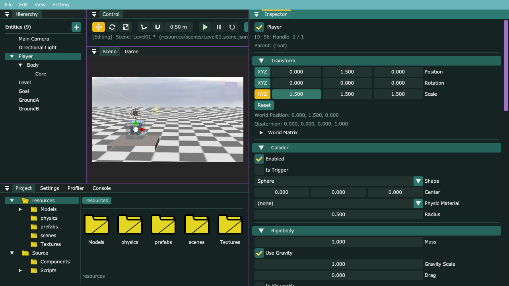
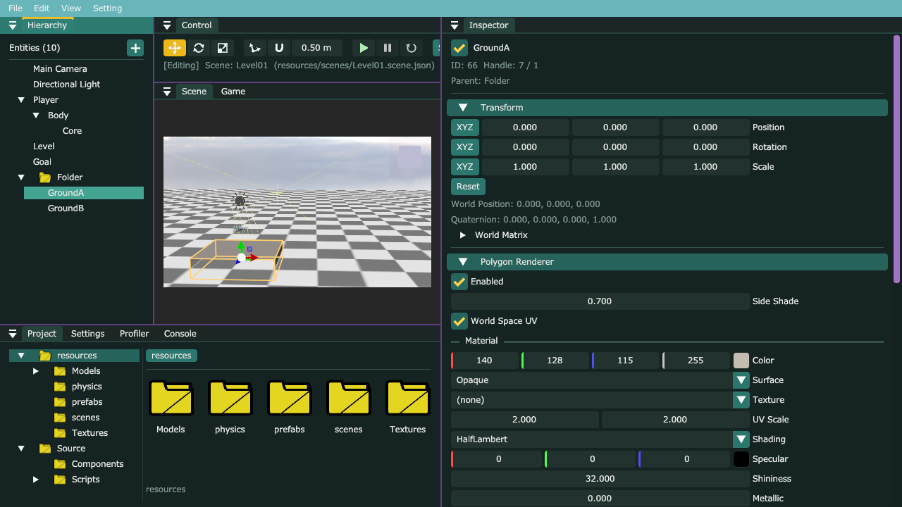

# エディタの直し：大きさ 0 で落ちる・XYZ をまとめて変える・Hierarchy のフォルダ

## このファイルについて
- エディタを触っていて出た3つ。G7（[G7Gimmick.md](G7Gimmick.md)）とは別の話なので、どちらから写してもよい（同じファイルは触らない。G7 は `TransformComponent.h` だけ）。
- やること
  1. **大きさ（Scale）を 0 にすると assert で落ちる**のを直す（`Inverse` で逆行列が無いときは、単位行列を返す）
  2. **Transform の「XYZ」ボタン**：押すと Position・Rotation・Scale の X・Y・Z を一緒に変える
  3. **Hierarchy のフォルダ**：＋ → Folder で作って、ドラッグで中へ入れる
- 確かめた環境：本体の master（e3bbbf7）＋ このファイル、AL4_01 のコピー。Release で大きさ 0 の物を置いたシーンを動かし、Debug のエディタで実際にボタン・ドラッグ・保存・読み直し・Play を試した（7章）。

| パート | ファイル（MyEngine_v1） | 何をするか |
|---|---|---|
| A | `Math/Matrix4x4.cpp`・`Matrix4x4.h` | 逆行列が無いときは単位行列 |
| B | `Editor/Inspector/TransformEditor.h/.cpp` | XYZ ボタン |
| C | `Components/FolderComponent.h`（新しく作る）・`ECS/EntityManager.cpp`・`Components/EngineComponents.cpp` | フォルダの印 |
| D | `Editor/Windows/HierarchyWindow.cpp`・`InspectorWindow.cpp`・`Editor/Gizmos/SceneGizmo.cpp` | フォルダを描く・作る・入れる。Transform とギズモを出さない |
| （C） | `MyEngine_v1.vcxproj` | 新しい 1 ファイル |

---

## 1. 何をするか（なぜこう作ったか）

### 1.1 大きさ 0 で落ちた理由
```
描くたびに（Primitive・Polygon・Sprite・モデル…全部）
  ShaderConstants.h：data.normalMatrix = Transpose(Inverse(worldMatrix));   ← 法線を回すための行列
                                                    │
  Scale が (0, 1, 1) だと、worldMatrix の1行目が全部 0 → 逆行列が無い
                                                    │
  Matrix4x4.cpp の Inverse：MY_ASSERT_MSG(…, "逆行列が存在しません。")   ← ここで止まっていた
```
- Inspector で Scale をドラッグすると、途中で 0 を通ることがある（1.0 → 0.5 → 0 → −0.5）。その1フレームで止まっていた。
- **逆行列が無いときは、単位行列を返す**ようにした。
  - 大きさ 0 の軸がある物は、その向きにつぶれて見えない（板・線になる）ので、法線の行列が単位行列でも見た目はほとんど変わらない（縦だけ 0 の足場は、上から見ると暗い薄い板になる。7章）。
  - `Inverse` はほかに、カメラ・親の付け替え（`SetParentKeepWorld`）・`TranslateWorld`・ギズモでも使っている。親の大きさが 0 のときは、子の位置の計算が正しくならない（単位行列で計算する）が、止まらずに続く。大きさを戻せば元どおり。
- assert は「来てはいけない所に来た」の印なので、**エディタの操作で普通に来る所**には置かない方がいい。

### 1.2 XYZ ボタン
- Unity の Scale の左のくさり（Constrain Proportions）と同じ考え。頼まれたとおり、Position・Rotation・Scale の3つに付けた。
- 押すたびにオン・オフ。オンの間はボタンが黄色。
- ドラッグ（や数字の入力）で1つの軸が変わったら、残りの2つも合わせる。

| 行 | 合わせ方 | 例 |
|---|---|---|
| Position・Rotation | **同じだけ足す** | (1, 2, 3) の X を +0.5 → (1.5, 2.5, 3.5) |
| Scale | **同じ倍にする**（形を保つ） | (0.75, 0.25, 0.25) の X を 1.5 へ（2 倍）→ (1.5, 0.5, 0.5) |
| Scale で、動かした軸が 0 | 倍が出せないので、同じだけ足す | (0, 0, 0) の X を +0.3 → (0.3, 0.3, 0.3) |

- **Undo は1回で3つとも戻る**。Inspector は「描く前の Component」と「描いた後の Component」を丸ごと比べて1件の履歴にするので（`InspectorWindow::DrawComponent`）、ここで3つ書き換えても、何もしなくても1件になる。
- オン・オフは、エディタの見せ方なので保存しない（全部の Entity で共通。エディタを閉じると外れる）。`DrawComponent` は `const` の関数なので、覚えておく変数は `mutable` にした（`const` の関数の中でも書き換えてよい印。「中身の値」ではなく「見せ方の状態」に使う）。

### 1.3 Hierarchy のフォルダ：どう作るか
| 作り方 | 中身 | |
|---|---|---|
| ① 普通の Entity を入れ物にする（Unity のやり方） | 空の Entity の子にする | 入れ物を動かすと中身がずれる。入れ物か普通の物か見分けにくい |
| ② エディタだけのフォルダ（Unreal のやり方） | Entity は親子にしない。「どのフォルダか」の名前だけ持つ | 保存・Undo・コピー・ドラッグを全部作り直すことになる |
| **③ 印の付いた Entity（今回）** | ① に **`FolderComponent`（中身の無い印）** を付けて、エディタで特別に扱う | 親子・ドラッグ・名前の変更・Undo・コピー・Prefab・保存・Play/Stop が**今の仕組みのまま動く** |

- ③ にして、① の困る所（入れ物を動かすと中身がずれる）は、**フォルダの Transform をいつも原点のまま使う**決まりで消した。
  - Inspector にフォルダの Transform を出さない。Scene ビューの移動のギズモも出さない。
  - フォルダを入れられるのは、**一番上か、ほかのフォルダの中だけ**。普通の Entity の子にすると、「見た目を変えずに付け替える」（`SetParentKeepWorld`）がフォルダの Transform をずらしてしまう（親が (5, 0, 0) にいれば、フォルダは (−5, 0, 0) になる）。
  - だから、フォルダの中に物を入れても、**その物の位置・回転・大きさの数字は変わらない**（親の行列が単位行列なので、親から見た値 ＝ ワールドの値）。
- 中身の無い印でも、`RegisterComponent`（置き場所）と `ComponentSerializer::Register`（保存の名前）をすれば、シーンファイルに `"Folder": {}` と書かれて、読むと付く。Undo・コピー・Play/Stop の写しは、Component の型を知らずにバイト列で写すので、何もしなくても入る。
- 当たり判定は「自分の先祖・子孫とは当たらない」（`EntityManager::IsRelated`）が、同じフォルダの中の物どうしは兄弟なので、今までどおり当たる。
- フォルダの有効・無効（Inspector の左上のチェック）は、普通の Entity と同じく中身ごと切り替わる（隠したい足場をまとめて消せる）。
- `Components` フォルダは 19 ファイルになった（目安の 15 を超えている。AL4_01Game.md の3章のとおり、分けるのは提出の後）。

---

## 2. パートA：逆行列が無いとき（エンジン）

### `MyEngine/Math/Matrix4x4.cpp`（1か所。`Inverse` の `MY_ASSERT_MSG` の2行を置き換える）

```cpp
		// --- 逆行列が存在しないとき：単位行列を返す ---
		// 大きさ（Scale）が 0 の軸がある・3つの軸が1つの面につぶれていると、逆行列は無い
		// Inspector で Scale をドラッグして 0 を通ると、描くたびに法線の行列（Transpose(Inverse(world))）でここへ来るので、止めずに続ける
		// 大きさ 0 の物は見えないので、単位行列でも見た目は変わらない
		if (std::abs(temp.m[i][i]) <= 1e-6f) {
			return MakeIdentity4x4();
		}
```

- `MY_ASSERT_MSG` はこのファイルのほかの所（`TransformPoint` の w が 0）でまだ使っているので、include はそのまま。

### `MyEngine/Math/Matrix4x4.h`（1か所。説明だけ）

```cpp
// 逆行列（無ければ単位行列。大きさが 0 の軸がある行列など）
Matrix4x4 Inverse(const Matrix4x4& m);
```

---

## 3. パートB：XYZ ボタン（エディタ）

### `MyEngine/Editor/Inspector/TransformEditor.h`（全部置き換える）

```cpp
#pragma once
#include <array>

#include "MyEngine/Editor/Inspector/ComponentEditor.h"
#include "MyEngine/Components/TransformComponent.h"


/// <summary>
/// TransformComponentのInspector（全Entityが必ず持つので、外せない）
/// <para>Position・Rotation・Scale の左の「XYZ」ボタンを押すと、X・Y・Z を一緒に変える（Scale は形を保ったまま大きさだけ変わる）</para>
/// </summary>
class TransformEditor : public TypedComponentEditor<TransformComponent> {
public:
	const char* GetName() const override { return "Transform"; }
	const char* GetCategory() const override { return "Core"; }


protected:
	void DrawComponent(TransformComponent& transform) const override;

private:
	// Position・Rotation・Scale の順に、X・Y・Z を一緒に変えるか（「XYZ」ボタンで切り替える）
	// 全部の Entity で共通。エディタの見せ方なので、シーンには保存しない（DrawComponent は const なので mutable）
	mutable std::array<bool, 3> isLinked_ = {false, false, false};
};
```

### `MyEngine/Editor/Inspector/TransformEditor.cpp`（全部置き換える）

```cpp
#include "TransformEditor.h"

#include <array>
#include <cmath>

#include <externals/imgui/imgui.h>

#include "MyEngine/ECS/EntityManager.h"

namespace {
constexpr float kMinRatioBase = 1e-4f; // Scale をまとめて変えるとき、動かした軸の元の値がこれより小さければ、倍ではなく同じ量を足す

//=============================================================================
// X・Y・Z をまとめて変える
//=============================================================================
// before から value へ、動かした軸（ドラッグ・入力で変わるのは1つだけ）を見つけて、残りの2つも合わせる
// keepRatio（Scale）：同じ「倍」にする（形を保つ。Unity の Constrain Proportions と同じ）
//   元が 0 の軸を動かしたときは倍が出せないので、同じ「量」を足す（全部 0 にした後でも、また大きくできるように）
// それ以外（Position・Rotation）：同じ「量」を足す
void ApplyLinked(const Vector3& before, Vector3& value, bool keepRatio) {
	const std::array<float, 3> old = {before.x, before.y, before.z};
	std::array<float, 3> now = {value.x, value.y, value.z};
	// --- 動かした軸を探す（無ければ何もしない）---
	int moved = -1;
	for (int axis = 0; axis < 3; ++axis) {
		if (now[axis] != old[axis]) {
			moved = axis;
			break;
		}
	}
	if (moved < 0) {
		return;
	}
	// --- 残りの2つを合わせる ---
	const bool useRatio = keepRatio && std::abs(old[moved]) >= kMinRatioBase;
	const float ratio = useRatio ? now[moved] / old[moved] : 1.0f; // 何倍になったか
	const float delta = now[moved] - old[moved];                   // どれだけ増えたか
	for (int axis = 0; axis < 3; ++axis) {
		if (axis != moved) {
			now[axis] = useRatio ? old[axis] * ratio : old[axis] + delta;
		}
	}
	value = {now[0], now[1], now[2]};
}

// 1行分：左に「XYZ」ボタン（押すたびに、X・Y・Z をまとめて変えるかを切り替える）、右に DragFloat3。値が変わったら true
// ボタンの分だけ DragFloat3 を短くして、項目名の位置をほかの Component の行とそろえる
bool DrawVector3Row(const char* label, Vector3& value, float speed, bool& isLinked, bool keepRatio) {
	ImGui::PushID(label);
	// --- まとめている間は、押した色にしておく（今どちらか見て分かるように）---
	const bool wasLinked = isLinked;
	if (wasLinked) {
		ImGui::PushStyleColor(ImGuiCol_Button, ImGui::GetStyleColorVec4(ImGuiCol_ButtonActive));
	}
	if (ImGui::Button("XYZ")) {
		isLinked = !isLinked;
	}
	if (wasLinked) {
		ImGui::PopStyleColor();
	}
	ImGui::SetItemTooltip(keepRatio ? "押すと X・Y・Z を一緒に変える（形を保ったまま、同じ倍にする）" : "押すと X・Y・Z を一緒に変える（同じだけ足す）");

	// --- 数値 ---
	const float buttonWidth = ImGui::GetItemRectSize().x + ImGui::GetStyle().ItemInnerSpacing.x;
	ImGui::SameLine(0.0f, ImGui::GetStyle().ItemInnerSpacing.x);
	ImGui::SetNextItemWidth(ImGui::CalcItemWidth() - buttonWidth);
	const Vector3 before = value;
	const bool changed = ImGui::DragFloat3(label, &value.x, speed);
	if (changed && isLinked) {
		ApplyLinked(before, value, keepRatio);
	}
	ImGui::PopID();
	return changed;
}
} // namespace

void TransformEditor::DrawComponent(TransformComponent& transform) const {
	DrawVector3Row("Position", transform.translation, 0.05f, isLinked_[0], false);

	// 回転は中ではクォータニオンで持っているので、見せるときだけオイラー角（度）に直す（GetEulerAngles：最後に決めた角度に一番近い表し方）
	// 何も触っていないフレームは、Component を書き換えない（書き換えると、Undo の対象に入ってしまう）
	// 角度は度のまま持っているので、触っていない軸の数字は1文字も変わらない（前はラジアンとの往復で、少しずれることがあった）
	Vector3 euler = GetEulerAngles(transform);
	if (DrawVector3Row("Rotation", euler, 0.5f, isLinked_[1], false)) {
		SetEulerAngles(transform, euler);
	}

	DrawVector3Row("Scale", transform.scale, 0.01f, isLinked_[2], true);

	if (ImGui::Button("Reset")) {
		transform.translation = {0.0f, 0.0f, 0.0f};
		SetEulerAngles(transform, {0.0f, 0.0f, 0.0f});
		transform.scale = {1.0f, 1.0f, 1.0f};
	}
	// --- 計算結果（読み取り専用）---
	// EntityManager::UpdateTransformsが作った、親の行列まで掛けた結果。親子が繋がっているかの確認に使う
	const Matrix4x4& world = transform.worldMatrix;
	ImGui::TextDisabled("World Position: %.3f, %.3f, %.3f", world.m[3][0], world.m[3][1], world.m[3][2]);
	const Quaternion& q = transform.rotation; // 中に入っている回転そのもの（x・y・z は 回す軸 × sin(角度/2)、w は cos(角度/2)）
	ImGui::TextDisabled("Quaternion: %.3f, %.3f, %.3f, %.3f", q.x, q.y, q.z, q.w);
	if (ImGui::TreeNode("World Matrix")) {
		for (int row = 0; row < 4; ++row) {
			ImGui::Text("%8.3f %8.3f %8.3f %8.3f", world.m[row][0], world.m[row][1], world.m[row][2], world.m[row][3]);
		}
		ImGui::TreePop();
	}
}
```

- `DrawComponent` の中は、3つの `DragFloat3` を `DrawVector3Row` に替えただけ（Reset から下は前のまま）。
- `ImGui::PushID(label)`：同じ「XYZ」という名前のボタンが3つあるので、行ごとに ID の範囲を分ける（分けないと、どれを押しても1つ目が押されたことになる）。
- ボタンの幅だけ `DragFloat3` を短くしているので、「Position」などの項目名の位置は、ほかの Component の行とそろう。
- 動かした軸を探すのは `!=` で比べている。ドラッグ・入力で変わるのは1フレームに1つの軸だけなので、最初に違った軸が動かした軸。

---

## 4. パートC：フォルダの印（エンジン）

### `MyEngine/Components/FolderComponent.h`（新しく作る）

```cpp
#pragma once
#include <type_traits>

// Hierarchy を整理するためのフォルダ。Hierarchy の ＋ → Folder で作る（Add Component には出さない）
// 中身は無い「印」。この印が付いた Entity は、Hierarchy でフォルダの絵で描き、Inspector では Transform・Add Component を出さない
// 中に入れた物（子）の位置が変わらないように、フォルダの Transform はいつも原点・回転なし・大きさ1のまま使う
//   → 動かすギズモを出さない・フォルダを入れられるのは一番上か、ほかのフォルダの中だけ
// 有効・無効（Inspector の左上のチェック）は、普通の Entity と同じく中身ごと切り替わる（Unity の空の GameObject と同じ）

/// <summary>
/// フォルダの印
/// </summary>
struct FolderComponent {};

static_assert(std::is_trivially_copyable_v<FolderComponent>);
```

- 中身の無い struct でも、大きさは 1 バイトある（C++ の決まり。別々の物は別々の場所に置くため）ので、置き場所（`ComponentStorage`）にそのまま入る。

### `MyEngine/ECS/EntityManager.cpp`（2か所）
**1. include**（`LogManager.h` の上）

```cpp
#include "MyEngine/Components/FolderComponent.h"
#include "MyEngine/Diagnostics/LogManager.h"
#include "MyEngine/Diagnostics/MyAssert.h"
```

**2. `Initialize` で置き場所を作る**

```cpp
	RegisterComponent<TransformComponent>();
	RegisterComponent<ModelRendererComponent>();
	RegisterComponent<FolderComponent>(); // Hierarchy のフォルダの印（Release でもシーンを読むと付くので、ここで登録する）
```

### `MyEngine/Components/EngineComponents.cpp`（3か所）
**1. include**

```cpp
#include "MyEngine/Components/FolderComponent.h"
#include "MyEngine/Components/ModelRendererComponent.h"
```

**2. 保存の項目**（`DescribeTransform` の下）

```cpp
//=============================================================================
// フォルダ
//=============================================================================
// 項目は無い（"Folder": {} と書かれているだけで、フォルダだと分かる）
void DescribeFolder(ComponentUI& /*ui*/, FolderComponent& /*value*/) {}
```

- 引数の名前を `/*ui*/` のようにコメントにしているのは、「使っていない引数」の警告を出さないため（名前を書かなければ、使わないことが分かる）。

**3. 登録**（`RegisterEngineComponents` の Transform の下）

```cpp
	Register<TransformComponent>("Transform", &DescribeTransform);
	Register<FolderComponent>("Folder", &DescribeFolder);
```

### `MyEngine_v1.vcxproj`（1ファイル）
ソリューションエクスプローラーで MyEngine_v1 の Components フォルダを右クリック → 追加 → 既存の項目 → `FolderComponent.h`。

```xml
    <ClInclude Include="MyEngine\Components\FolderComponent.h" />
```

---

## 5. パートD：Hierarchy・Inspector・ギズモ（エディタ）

### `MyEngine/Editor/Windows/HierarchyWindow.cpp`（7か所）
**1. include**（`EditorHistory.h` の上に2つ、`ColliderComponent.h` の下に1つ）

```cpp
#include "MyEngine/Diagnostics/LogManager.h"
#include "MyEngine/Editor/Assets/AssetIcons.h"
#include "MyEngine/Editor/History/EditorHistory.h"
#include "MyEngine/Editor/Widgets/EditorWidgets.h"
#include "MyEngine/ECS/EntityManager.h"
#include "MyEngine/Components/CameraComponent.h"
#include "MyEngine/Components/ColliderComponent.h"
#include "MyEngine/Components/FolderComponent.h"
```

**2. 名前の無い namespace：`IsFolder` を足し、`AcceptEntityDrop` を置き換え、`DrawFolderLabel` を足す**（`HasChild` の下から `} // namespace` の上まで）

```cpp
// フォルダか（フォルダの印 FolderComponent が付いているか。無効な Handle なら false）
bool IsFolder(Handle<Entity> handle) { return EntityManager::Get<FolderComponent>(handle) != nullptr; }

// ドロップされたEntityを受け取る。newParentの子にする（無効ならrootへ）
void AcceptEntityDrop(Handle<Entity> newParent) {
	if (!ImGui::BeginDragDropTarget()) {
		return;
	}
	if (const ImGuiPayload* payload = ImGui::AcceptDragDropPayload(HierarchyWindow::kDragDropType)) {
		const Handle<Entity> dropped = *static_cast<const Handle<Entity>*>(payload->Data);
		// フォルダは、一番上か、ほかのフォルダの中にだけ入れる
		// 普通の Entity の子にすると、見た目を保つために、フォルダの Transform が原点からずれる（中身が親と一緒に動くようになる）
		if (IsFolder(dropped) && newParent.IsValid() && !IsFolder(newParent)) {
			LogManager::Warning("フォルダは、一番上か、ほかのフォルダの中にだけ入れられます");
		} else {
			EditorHistory::RequestReparent(dropped, newParent);
		}
	}
	ImGui::EndDragDropTarget();
}

// フォルダの名前を、フォルダの絵の後ろに描く（Project ウィンドウの左の木と同じ描き方。ツリーの矢印の右に置く）
// 開いていて中身があれば、開いたフォルダの絵にする
void DrawFolderLabel(const std::string& name, bool isOpen) {
	ImGui::SameLine();
	const float iconSide = ImGui::GetTextLineHeight();
	const ImVec2 iconMin = ImGui::GetCursorScreenPos();
	AssetIcons::Draw(ImGui::GetWindowDrawList(), isOpen ? AssetIcon::FolderOpen : AssetIcon::Folder, iconMin, ImVec2(iconMin.x + iconSide, iconMin.y + iconSide));
	ImGui::Dummy(ImVec2(iconSide, iconSide));
	ImGui::SameLine();
	ImGui::TextUnformatted(name.c_str());
}
```

- フォルダの絵は Project ウィンドウの左の木と同じ `AssetIcons::Draw`（`Folder.png`・`FolderOpen.png`）。開いていて中身がある時だけ、開いたフォルダの絵にする。

**3. `DrawEntityNode`：フォルダか・子がいるかを先に調べる**（`isRenaming` から `ImGuiTreeNodeFlags_Leaf` まで）

```cpp
	const bool isRenaming = (handle == renaming_);
	const bool isFolder = IsFolder(handle);
	const bool hasChild = HasChild(handle);
	ImGuiTreeNodeFlags flags = ImGuiTreeNodeFlags_OpenOnArrow | ImGuiTreeNodeFlags_DefaultOpen;
	if (!isRenaming) {
		flags |= ImGuiTreeNodeFlags_SpanAvailWidth; // 名前の変更中は、矢印の横に入力欄を置くので横幅いっぱいにしない
	}
	if (!hasChild) {
		flags |= ImGuiTreeNodeFlags_Leaf;
	}
```

- `HasChild` を2回呼ばないように、`hasChild` に入れておく（全部の Entity を見て探す関数なので）。

**4. `DrawEntityNode`：フォルダはツリーに名前を出さない**（`TreeNodeEx` の行を置き換える）

```cpp
	// フォルダの名前は、フォルダの絵の後ろに自分で描く（DrawFolderLabel）ので、ツリーには名前を出さない
	const bool isOpen = ImGui::TreeNodeEx("##node", flags, "%s", (isRenaming || isFolder) ? "" : entity->name.c_str());
```

**5. `DrawEntityNode`：右クリックのメニューの下に、フォルダの絵と名前**

```cpp
		// --- フォルダの絵と名前（ツリーの行の操作を全部受けた後に描く。先に描くと、上の「今の行」が絵と文字の方になる）---
		if (isFolder) {
			DrawFolderLabel(entity->name, isOpen && hasChild);
		}
```

- **順番が大事**。ImGui の「今の行」（`IsItemDeactivated`・ドラッグ・右クリックが見る物）は、最後に描いた物になる。絵と文字を `TreeNodeEx` のすぐ後に描くと、クリック・ドラッグ・右クリックが、ツリーの行ではなく文字の方を見てしまう。

**6. `DrawEntityMenu`：フォルダの右クリックに Create Folder**（`Create Child` の下）

```cpp
	if (ImGui::MenuItem("Create Child")) {
		EditorHistory::RequestCreate("Child", handle);
	}
	// フォルダの中にだけ、フォルダを作れる（普通の Entity の子にはフォルダを置かない。AcceptEntityDrop と同じ決まり）
	if (IsFolder(handle) && ImGui::MenuItem("Create Folder")) {
		EditorHistory::RequestCreate("Folder", handle, {ComponentSnapshot::Make(FolderComponent{})});
	}
```

**7. `DrawCreateMenu`：＋のメニューに Folder**（`Create Child` の下）

```cpp
	// --- フォルダ：Hierarchy を整理する入れ物（一番上に作る。中へはドラッグで入れる）---
	if (ImGui::MenuItem("Folder")) {
		EditorHistory::RequestCreate("Folder", {}, {ComponentSnapshot::Make(FolderComponent{})});
	}
```

- ライトと同じく「Component を付けた状態で作る」ので、Undo 1回でフォルダごと消える。

### `MyEngine/Editor/Windows/InspectorWindow.cpp`（2か所）
**1. include**（`EntityManager.h` の上）

```cpp
#include "MyEngine/Components/FolderComponent.h"
```

**2. `Draw`：フォルダは説明だけ**（`DrawHeader(handle);` の下を置き換える）

```cpp
		if (EntityManager::IsAlive(handle)) {
			DrawHeader(handle);
			if (EntityManager::Get<FolderComponent>(handle) != nullptr) {
				// --- フォルダ：Transform も Component も出さない（中身の位置が変わらないように、Transform は原点のまま使う）---
				ImGui::TextWrapped("フォルダ（Hierarchy を整理する入れ物）。中へは Hierarchy でドラッグして入れる。左上のチェックを外すと、中身ごと無効になる");
			} else {
				for (const std::unique_ptr<ComponentEditor>& editor : ComponentEditorRegistry::GetAll()) {
					DrawComponent(handle, *editor);
				}
				DrawAddComponent(handle);
			}
```

- 名前・有効のチェック（`DrawHeader`）はフォルダにも出す。

### `MyEngine/Editor/Gizmos/SceneGizmo.cpp`（2か所）
**1. include**（`TransformComponent.h` の上）

```cpp
#include "MyEngine/Components/FolderComponent.h"
```

**2. `Manipulate`：フォルダには移動のギズモを出さない**（一番上の `if` を置き換える）

```cpp
	TransformComponent* transform = EntityManager::Get<TransformComponent>(selected);
	// フォルダは動かさない（Transform を原点のまま使う。動かすと、中身がまとめてずれる）
	if (transform == nullptr || EntityManager::Get<FolderComponent>(selected) != nullptr) {
		EndDrag(); // ドラッグ中に消された・選ぶのをやめた・フォルダを選んだ
		return false;
	}
```

---

## 6. 使い方
| すること | どうなる |
|---|---|
| Hierarchy の ＋ → **Folder** | 一番下に「Folder」ができる（名前はダブルクリック・F2 で変える） |
| Entity をフォルダの行へドラッグ | フォルダの中に入る。位置・回転・大きさの数字は変わらない |
| フォルダの中の物を、何も無い所へドラッグ | 一番上へ戻る |
| フォルダの右クリック → Create Folder | フォルダの中にフォルダ |
| フォルダを選ぶ | Inspector は説明だけ。Scene ビューにギズモは出ない |
| フォルダの左上のチェックを外す | 中身ごと見えなくなる・動かなくなる |
| フォルダを Delete | 中身ごと消える（Ctrl+Z で戻る）。中身を残したいときは、先に外へドラッグする |
| Transform の行の左の **XYZ** | 黄色になる。その行の X・Y・Z が一緒に変わる。もう一度押すと戻る |

---

## 7. 確かめたこと
**大きさ 0（Release）**：下の物を置いたシーンを動かした。

| 物 | 直す前 | 直した後 |
|---|---|---|
| 箱 Scale (0, 1, 1)・球 Scale (0, 0, 0) とその子・Polygon Scale (1, 0, 1) | 起動してすぐ `Matrix4x4.cpp::Inverse 77` の assert（逆行列が存在しません。） | 止まらない。箱・球は見えない。Polygon は上から見た暗い薄い板（縦がつぶれた形）に見える |

**エディタ（Debug）**：テストの間だけ、ファイルに書いた操作（マウスの位置・押す・離す・キー）を ImGui に直接入れる仕掛けを一時的に足して、実際に操作した（確かめた後に外して、ビルドし直した）。

| すること | 結果 |
|---|---|
| Player を選ぶ | Transform の3行の左に XYZ ボタン（画像1） |
| Scale の XYZ を押して、X を右へドラッグ | ボタンが黄色。1 → **1.5**（Y・Z も 1.5） |
| そのまま左へ大きくドラッグ（0 を通って −0.05 まで）→ 戻す | **止まらない**（ログに assert なし）。最後は 3つとも 0.25 |
| XYZ を外して X だけ 0.75 にする → XYZ を押して X を 1.5 へ | (0.75, 0.25, 0.25) → **(1.5, 0.5, 0.5)**（同じ 2 倍。形を保つ） |
| Ctrl+Z | (0.75, 0.25, 0.25) に戻る（3つとも1回で） |
| ＋ → Folder | フォルダの絵の付いた「Folder」ができた。Inspector は説明だけ、ギズモは出ない |
| GroundA・GroundB をフォルダへドラッグ | 中に入った。開いたフォルダの絵になる。足場の位置は変わらない |
| フォルダを Goal（普通の Entity）へドラッグ | 入らない（一番上のまま） |
| フォルダのチェックを外す | 足場が2つとも消えた |
| Save → エディタを閉じて起動し直す | フォルダの中に GroundA・GroundB のまま。GroundA の Parent は Folder、Position (0, 0, 0) のまま（画像2）。シーンファイルは `"Folder": {}` と、足場の `"parent": 68` |
| Play | Player がフォルダの中の足場の上に立つ（y 0.875 ＝ 足場の上 0.5 ＋ 球の半径 0.375）。Stop で戻る |





- 確かめていないこと：フォルダを普通の Entity へ落としたときの警告の文字（`フォルダは、一番上か、ほかのフォルダの中にだけ入れられます`）。エディタを強制終了したのでログが最後まで書かれず、ファイルでは見られなかった（入らなかったことは画面で見た）。Rotation・Position の XYZ は、Scale と同じ関数（足し方だけ違う）なので、画面では試していない。

---

## 8. Reference.md の直し
- [Reference.md](../Reference.md) の17章（エディタ）：Hierarchy の＋に Folder、「Hierarchy のフォルダ」と「Transform の XYZ ボタン」の行を足した。
