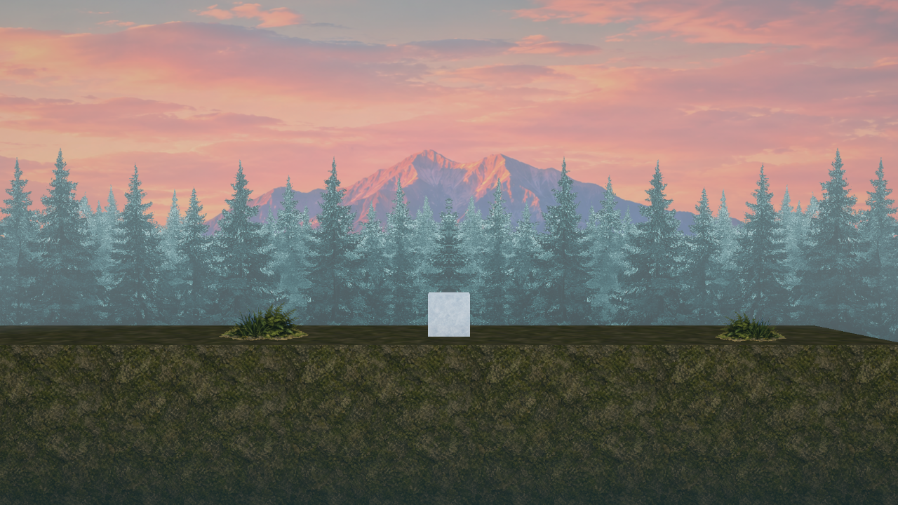
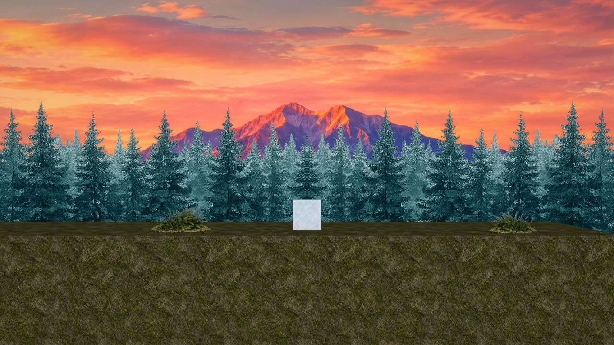
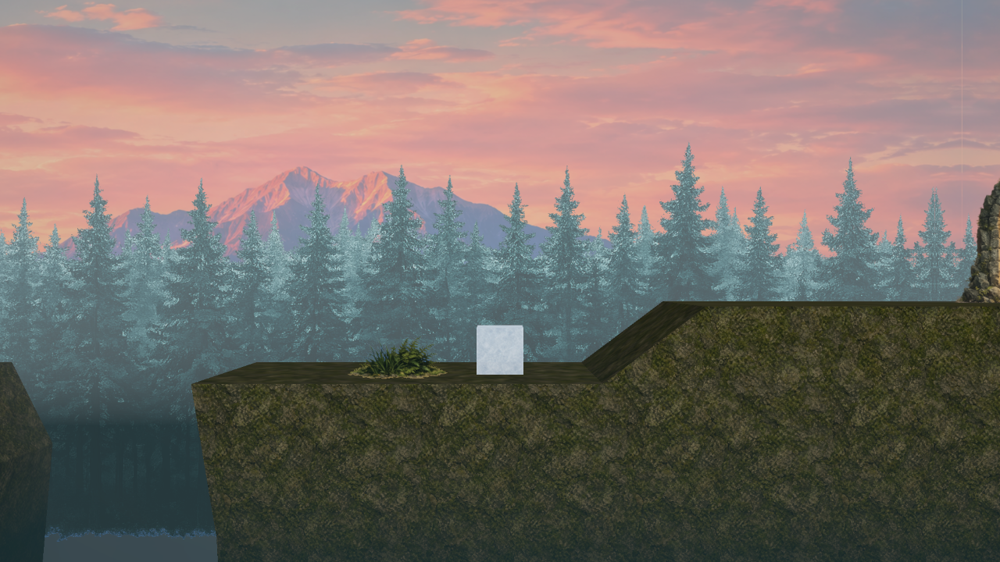

# G10：森の世界観（背景の層・素材・霧）

## このファイルについて
- [AL4_01Game.md](AL4_01Game.md) の **G10**（P2・世界観①）。順番を変えて、G9（レベル・UI）より先にやる（モチベを上げるため）。
- 2026-10-23 に決めたこと：
  - **場所は森だけ**（海辺はやめる。同じ物の方が考えるのが楽）。
  - **◆（ジェム）は作らない**。[G8Hazards.md](G8Hazards.md) の `Gem.h/.cpp`・`LevelInfo.h/.cpp`（◆ の数だけの変更）・6.3 は写さなくてよい。
  - 順番：**G8 の写経（◆ 抜き）→ G10（これ）→ G11（DOF）→ G9（レベル・UI）**。G9 が終わると提出できる形になるので、プレイ会（10/28）までに G9 の時間を残す。
- やること：
  - **エンジン**：**霧（Fog）**。距離の霧＋高さの霧を、全部の 3D のシェーダーの最後で色に混ぜる。空（Skybox）にも混ぜる。値はシーンに置く **Fog Component**。
  - **エディタで**：用意した素材（F1〜F6・I1〜3・D）を置いて、**背景の層（Sprite Renderer の板）**・苔の岩の足場・草・氷のキューブ・ゴールの扉を作る。
- 確かめた環境：本体の master（f506646）＋ G8 の答え ＋ このファイルのエンジン、AL4_01 のコピー（G8 の答え）。Release で、用意してもらった素材を置いたテスト用のシーンを撮った（7章）。Debug もビルド・エディタの起動まで。

| パート | ファイル | 何をするか |
|---|---|---|
| A | `Graphics/Pipeline/ShaderConstants.h`・`Components/FogComponent.h`（新しく作る）・`Systems/FogSystem.h/.cpp`（新しく作る）・`Graphics/Renderer/SceneRenderer.h/.cpp`・`Engine.cpp`・`WindowManager.cpp`・`MyEngine_v1.vcxproj` | 霧の値を Fog Component からカメラの定数バッファへ |
| B | `Shader/Data/Buffers/Camera.hlsli`・`Fog/Fog.hlsli`（新しく作る）・`Model/*.PS`（6つ）・`Particle/*`（3つ）・`Skybox/Skybox.PS`・`Scene/Skybox.h/.cpp` | 色に霧を混ぜる |
| C | `Editor/Viewport/EditorViewport.h/.cpp`・`Editor/ImGuiManager.cpp` | View → Scene View → Fog（Scene ビューだけ霧を切る） |
| E | `Math/Color.h`・`Graphics/Renderer/Renderer.cpp`・`Systems/LightSystem.cpp` | **色を全部 sRGB で選ぶ**（シェーダーへ送るときにリニアへ直す。色見本どおりの色が出る） |
| D | エディタで | 素材を置いて、森の背景・足場・キューブ・扉を作る |

- **パートの順番**：A → B → C → E → D。A と B は一緒に写す（A で定数バッファの大きさが変わるので、B のシェーダーも合わせないと、霧の値がずれて読まれる）。C は A の `SetViewFogEnabled` を使う。E は A の `FogSystem.cpp` が `SrgbToLinear` を使うので、A と一緒にビルドする（E を後にするなら、A の `FogSystem.cpp` の `SrgbToLinear` の2か所と `Color.h` の include は E のときに足す）。D はエディタで色を選ぶので、E の後にする。

---

## 1. 素材の置き場所と名前

### 1.1 下の茶色い帯（扉・葉）
**作り直さなくてよい。下を切り落とせば使える。**
- 透明かどうかを、画像の行ごとに調べた（アルファの値を数えた）。扉・葉・木（F2・F3）・草（F5）は、**透明な所は本当に透明**だった（見る物によって、白や黒に見えるだけ）。
- **茶色い帯は、画像の一部（透明でない四角）**。生成 AI が「地面」のつもりで足した物。本体との間に、まるごと透明な行がある。
  - → **一番上から、最初の「まるごと透明な行」までを残して、その下を捨てる**。あとは透明な余白を切り詰める（8 ピクセルだけ残す）。
  - 扉：1024×1536 → **982×977**、葉：1024×1536 → **243×312**。
- Windows のペイントで切ると、**透明が白になって消える**ので使わない。

### 1.2 置き場所と名前
ゲームの `AL4_01/project/Resources/Textures/` の下に、場所ごとのフォルダを作る。**ファイル名は英語**（日本語の名前は、アセットとして読めない）。

| # | 元のファイル（ダウンロード） | 置き場所（`Resources/Textures/` の下） | 大きさ | 透明 |
|---|---|---|---|---|
| F1 | 朝焼けに染まる中央峰と山霧.png | `Forest/sky.png` | 1774×887 | なし |
| F2 | 霧に霞む青緑の針葉樹林.png | `Forest/trees_far.png` | 1536×1024 | あり（木と霧は、上から 33〜75% の帯） |
| F3 | 濃密な深緑針葉樹の森Ⅱ.png | `Forest/trees_near.png` | 1536×1024 | あり（木は 25〜91% の帯） |
| F4 | 苔むした岩肌のシームレステクスチャ.png | `Forest/rock_moss.png` | 1254×1254 | なし |
| F5 | 草とシダの緑の茂み.png | `Forest/grass_fern.png` | 1024×1024 | あり（草は 25〜66% の帯） |
| F6 | 透明背景に浮かぶ緑の葉＾＾.png | `Effects/leaf.png`（**下を切る**） | 243×312 | あり |
| I1 | 氷の結晶模様背景.png | `IceCube/ice.png` | 1254×1254 | なし |
| I2 | ひび割れた氷の結晶模様.png | `IceCube/ice_crack_small.png` | 1254×1254 | なし |
| I3 | ひび割れた氷の透明な質感.png | `IceCube/ice_crack_large.png` | 1254×1254 | なし |
| D | 苔むした古代石門の黄金の光.png | `Gimmicks/goal_door.png`（**下を切る**） | 982×977 | あり |

- **名前を付け替えて、扉と葉を切った物は、作ってある**（Claude の作業用のフォルダ。チャットに場所を書いた）。フォルダごと `Resources/Textures/` に写せばよい。
- シーンファイルには `resources/Textures/Forest/sky.png` のように、`resources/` からのパスで保存される（Inspector の画像の欄で選ぶ）。
- 葉（F6）は、パーティクルを Component にしてから使う（8章）。今は置くだけ。

---

## 2. 何をするか（なぜこう作ったか）

### 2.1 背景は Sprite Renderer の板を奥行きに並べる
| 方法 | | 理由 |
|---|---|---|
| Skybox を変える | × | 無限に遠い所にあるので、**パララックス（遠い物ほどゆっくり動く）が出ない**。奥行きも1つなので、層ごとに霧・DOF の掛かり方を変えられない。6 面の絵も要る |
| **板を奥行きに並べる** | ○ | 透視カメラなので、パララックスが勝手に出る。層ごとに、奥ほど霧に溶ける（G11 で、奥ほどぼける） |

```
（横から見た図。カメラは z = -17、FOV 40°）
  カメラ ─┐
          │   z=-2.1 草（足場の前の面の少し手前）
          │   z=0    遊ぶ面（足場は奥行き 4m：前の面 z=-2〜後ろ z=+2）・キューブ・扉
          │   z=+15  近い木（F3）   … 霧が少し
          │   z=+40  遠い木（F2）   … 霧が中くらい
          │   z=+80  空と山（F1）   … 霧が一番濃い（Max Opacity）
          └── Skybox                … 板の隙間から見えても、霧の色・暗い色になる（2.4）
```

- **1 画面に写る大きさ**：カメラから d（m）離れた所には、高さ **0.728 × d**、横 **1.29 × d**（16:9）が写る（tan 20° ＝ 0.364 の2倍）。
- 板の大きさは「画像のピクセル数 ÷ **Pixels Per Unit**」（m）。なので **PPU ＝ 画像の横のピクセル ÷ 作りたい横の長さ（m）**。
- 板はワールドに止まっていて、カメラが動いた分だけ写る所がずれる。**どの層も「1 画面の幅 ＋ レベルの長さ」だけ横に要る**。Sprite Renderer に UV のくり返しは無いので、**同じ板を横に並べて、1 枚おきに Flip X**（左右反転）する。反転すると、つなぎ目の左右がいつも同じ絵になるので、つなぎ目が目立たない（絵が左右つながっていなくても使える）。
- 板は全部 **Alpha Clip**（奥行きを書く）。G11 の DOF は奥行きでぼかすので、半透明のまま描くと、後ろの空の奥行きでぼけてしまう。扉だけは、光のふちを柔らかく見せたいので切らない（遊ぶ面にあるので、ぼけない）。
- 光は使わない（Sprite Renderer は Unlit）。絵の色がそのまま出て、霧だけが掛かる。

### 2.2 霧の式
**距離の霧**（遠いほど、明るい霧の色に溶ける）と、**高さの霧**（低いほど、暗い色に沈む。穴の底が見えない）の2つ。

```
距離の霧の量 ＝ min( 1 − exp(−Density × max(距離 − Start Distance, 0)), Max Opacity )
高さの霧の量 ＝ saturate( exp(−(高さ − Height Base) × Height Falloff) ) × Height Max Opacity

色 ← lerp(色, 霧の色, 距離の霧の量)          … まず距離の霧
色 ← lerp(色, 高さの霧の色, 高さの霧の量)    … 次に高さの霧
```
- `1 − exp(−k × x)`：霧の中を光が進むと、1m ごとに同じ割合だけ減る、という形（ビールの法則）。近いと 0、遠いほど 1 に近づく。
- **Start Distance**（20m）：カメラから遊ぶ面まで 17m なので、遊ぶ面には距離の霧が掛からない。
- **Max Opacity**（0.4）：一番奥の空の絵（97m）にも掛かるので、大きいと夕焼けの色が抜ける（0.6 で試したら、ピンクがかった灰色になった）。
- 高さの霧は `exp` で、Height Base（−4m）で 1、上へ行くほど 0 に近づく（0.4/m なら、高さ 0 で 0.2、遊ぶ面のキューブにも少しだけ掛かる）。下は 1 を超えるので `saturate`（0〜1 に切る）。

### 2.3 値の通り道
```
Fog Component（シーンに1つ。Inspector で値を変える）
  → FogSystem::Update（毎フレーム。停止中も）……… SceneRenderer::SetFog(FogData)
  → SceneRenderer::UploadCameraCB（ビューごと）…… カメラの定数バッファ（b0）の後ろに FogData を書く
  → シェーダー：#include "Fog/Fog.hlsli" → ApplyFog(色, ワールドの位置)
```
- カメラの定数バッファ（b0）は、モデルの PS がもう鏡面反射のために読んでいる。ここに足せば、**ルートシグネチャ（シェーダーに渡す物の一覧）を変えずに**全部の 3D の物に届く（ルートシグネチャはシェーダーの中身から自動で作るので、読んでいなかった Unlit・パーティクルは include を足すだけ）。
- C++ の `FogData` と HLSL の `Camera` の `fog〜` は、**同じ並び・同じ大きさ**にする（`static_assert(sizeof(CameraData) == 160)`）。HLSL の定数バッファは 16 バイトずつに区切って並ぶので、`float3 ＋ float` で 16 バイトになるように並べた。
- エディタの Scene ビューだけ切れる（View → Scene View → Fog）。Scene を描く前に `SetViewFogEnabled(false)` にして、`UploadCameraCB` が「霧なし」（`FogData{}`。濃さの上限が 0）を書く。
- Fog Component が無いシーンは、霧なし（今までと同じ見た目）。

### 2.4 空（Skybox）にも霧
板の背景の下（穴の底など）から Skybox がのぞくと、霧が掛からない白っぽい空が見えた（7章の1枚目を撮る前）。
- 空は無限に遠いので、**距離の霧はいつも Max Opacity**（一番奥の板と同じ色になじむ）。
- 下を向いた空は、無限に下まで霧の中を見るので、**高さの霧が一番濃い**。向きの Y が −1/8 より下なら一番濃く、地平線より上には掛けない（`ApplySkyFog`）。
- Skybox は今までカメラの定数バッファを受け取っていなかったので、`Skybox::Draw` に渡すようにした。

### 2.5 色は sRGB で選んで、リニアで計算する（パートE）
- シェーダーは**リニア**（光の強さに比例する値）で計算して、最後に画面（`_SRGB` の形）へ書くときに、GPU が **sRGB**（人の目に合わせた、見た目の値）に直す。画像も `_SRGB` の形で読むので、読むときにリニアになっている。
- ところが **Inspector の色は、直さずにそのまま**シェーダーへ送っていた（ライトの色だけは LightSystem が直していた）。なので、**色見本で選んだ色より明るく・薄く出ていた**。
  - 例：灰色 0.2 → 画面では 0.48（124/255）の灰色。高さの霧の色を (0.03, 0.08, 0.09) にしたら、中くらいの青緑になった。
- **パートE で全部直す**：Inspector・コードで書く色は sRGB（見た目の値）として持って、**シェーダーへ送るとき（Renderer が Material に入れるとき）にリニアに直す**。Unity の「Linear」の色空間と同じ考え方。
  - 直した後、灰色 0.2 は画面でちょうど 51（＝0.2 × 255）になった（7章）。
  - A（透け方）は割合なので直さない。
  - 直すのは、Renderer の色の番号（`0xRRGGBBAA`）を開く所・マテリアルの Ambient・Diffuse・Specular・Emissive・パーティクル・文字の色・線（ギズモ）・霧の色。ライトは前から直していたので、同じ関数（`Color.h` へ移した）を使う。
  - モデルの mtl ファイルの値は、ファイルのまま使う（Override Material を付けて Inspector で選んだ時だけ直す）。
- 影響：前に選んだ中くらいの色（0.5 など）は、暗く・濃く見えるようになる（0 と 1 は変わらない）。レベルはまだ作り込んでいないので、全部まとめて直した。
- 混ぜる計算（霧・半透明）はリニアのままで正しい。なので「霧で暗くしたつもりでも、画面ではあまり暗く見えない」（7章で測った：地面の下の方が 79 → 55）のは直さない。もっと沈めたいときは、Height Max Opacity を 1 に・Height Base を上げる。

---

## 3. パートA：霧の値の通り道（エンジン）

### `MyEngine/Graphics/Pipeline/ShaderConstants.h`（2か所）
`// カメラ` の前に `FogData` を足す：
```cpp
/// <summary>
/// 霧（距離の霧＋高さの霧）。カメラの定数バッファ（b0）に入れて、3D のシェーダーの最後で色に混ぜる
/// <para>値は FogSystem が、シーンの Fog Component から毎フレーム SceneRenderer::SetFog で渡す。初期値は「霧なし」（濃さの上限が 0）</para>
/// <para>HLSL の Camera（Buffers/Camera.hlsli）の fog〜 と同じ並び。16 バイトずつ3つ</para>
/// </summary>
struct FogData {
	Vector3 color = {0.0f, 0.0f, 0.0f};       // 距離の霧の色
	float startDistance = 0.0f;               // カメラからこの距離（m）までは、距離の霧が無い
	float density = 0.0f;                     // 距離の霧の濃さ（1m あたり。大きいほど近くから濃くなる）
	float maxOpacity = 0.0f;                  // 距離の霧の一番濃い所（0〜1。0 なら距離の霧なし）
	float heightBase = 0.0f;                  // 高さの霧が一番濃くなる高さ（ワールドの Y。これより下はずっと一番濃い）
	float heightFalloff = 1.0f;               // 高さの霧が、上へ薄くなる速さ（1m あたり）
	Vector3 heightColor = {0.0f, 0.0f, 0.0f}; // 高さの霧の色
	float heightMaxOpacity = 0.0f;            // 高さの霧の一番濃い所（0〜1。0 なら高さの霧なし）
};
static_assert(sizeof(FogData) == 48, "HLSLのCameraの霧の所と大きさが違います");
```

`CameraData` の最後に `fog` を足して、大きさを確かめる：
```cpp
struct CameraData {
	Matrix4x4 viewProj;
	Vector3 worldPosition;
	float padA = 0.0f;
	Vector3 right; // ビルボード用
	float padB = 0.0f;
	Vector3 up; // ビルボード用
	float padC = 0.0f;
	FogData fog; // 霧（3D のシェーダーの最後で、色に混ぜる。Fog.hlsli の ApplyFog）
};
static_assert(sizeof(CameraData) == 160, "HLSLのCameraと大きさが違います");
```

### `MyEngine/Components/FogComponent.h`（新しく作る）
```cpp
#pragma once
#include <type_traits>

#include "MyEngine/Math/Vector3.h"

// 霧（距離の霧＋高さの霧）。シーンに1つ、どの Entity に付けてもよい Component（カテゴリ：Rendering3D）
// 値は FogSystem が毎フレーム SceneRenderer へ渡し、3D のシェーダー（モデル・Primitive・Polygon・Sprite の板・パーティクル）の最後で色に混ぜる
// 有効な Fog が2つ以上あれば、先に見つかった1つだけを使う。1つも無ければ霧なし。停止中のエディタでも掛かる（Scene ビューは View → Scene View → Fog で切れる）

/// <summary>
/// 霧（Unity の Lighting の Fog・Unreal の Exponential Height Fog の小さい版）
/// </summary>
struct FogComponent {
	bool enabled = true; // false の間は霧なし
	// --- 距離の霧（遠いほど、明るい霧の色に溶ける）---
	Vector3 color = {0.70f, 0.79f, 0.81f}; // 霧の色（sRGB。遠くの山・木が溶けていく色。空の地平線の色に近づける）
	float startDistance = 20.0f;           // カメラからこの距離（m）までは霧が無い（遊ぶ面より少し奥にすると、遊ぶ面ははっきり見える）
	float density = 0.02f;                 // 濃さ（1m あたり。大きいほど近くから濃くなる）
	float maxOpacity = 0.4f;               // 一番濃い所（0〜1。1 にすると、一番奥の空の絵まで霧の色だけになる）
	// --- 高さの霧（低いほど、暗い霧の色に沈む。穴の底を見えなくする）---
	Vector3 heightColor = {0.10f, 0.19f, 0.21f}; // 高さの霧の色（sRGB。暗い青緑）
	float heightBase = -4.0f;                    // 一番濃くなる高さ（ワールドの Y。これより下はずっと一番濃い）
	float heightFalloff = 0.4f;                  // 上へ薄くなる速さ（1m あたり。大きいほど、すぐ薄くなる）
	float heightMaxOpacity = 0.9f;               // 一番濃い所（0〜1。0 なら高さの霧なし）
};

static_assert(std::is_trivially_copyable_v<FogComponent>);
```

### `MyEngine/Systems/FogSystem.h`（新しく作る）
```cpp
#pragma once
#include "MyEngine/Components/FogComponent.h"

/// <summary>
/// Fog（霧）を登録し、シーンの Fog Component の値を、毎フレーム SceneRenderer へ渡す
/// <para>色に混ぜるのはシェーダー（Fog.hlsli の ApplyFog）。値はカメラの定数バッファ（b0）に入る</para>
/// </summary>
class FogSystem {
public:
	// FogComponent を登録する（置き場所・保存・Inspector）。EntityManager::Initialize の後に呼ぶ
	static void Initialize();
	static void Release();

	/// <summary>
	/// 有効な Fog Component を探して、SceneRenderer::SetFog で渡す（無ければ霧なし）。停止中も呼ぶ（エディタで値を変えて、すぐ見られるように）
	/// </summary>
	static void Update();
};
```

### `MyEngine/Systems/FogSystem.cpp`（新しく作る）
- 色は `ui.ColorField`（色見本を押すと選べる。保存の名前は `###` の後ろ）。
- `EntityManager::ForEach` は途中で止められないので、見つけたら `isFound` を立てて、後の物は飛ばす。

```cpp
#include "FogSystem.h"

#include <algorithm>
#include <memory>

#include "MyEngine/ECS/ComponentSerializer.h"
#include "MyEngine/ECS/ComponentUI.h"
#include "MyEngine/ECS/EntityManager.h"
#include "MyEngine/ECS/GameComponent.h"
#include "MyEngine/Editor/Inspector/ComponentEditor.h"
#include "MyEngine/Graphics/Pipeline/ShaderConstants.h"
#include "MyEngine/Graphics/Renderer/SceneRenderer.h"
#include "MyEngine/Math/Color.h"

namespace {
//=============================================================================
// Inspector と 保存
//=============================================================================
void DescribeFog(ComponentUI& ui, FogComponent& value) {
	ui.Field("Enabled###enabled", value.enabled, Tip("外すと霧なし"));
	ui.Label("シーンに1つ。3D の物の色に、距離と高さで霧を混ぜる（Scene ビューは View → Scene View → Fog で切れる）");
	// ===== 距離の霧 =====
	ui.Separator("Distance");
	ui.ColorField("Color###color", value.color);
	ui.Field("Start Distance###startDistance", value.startDistance, AtLeast(0.0f).Tip("カメラからこの距離（m）までは霧が無い。遊ぶ面より少し奥にすると、遊ぶ面ははっきり見える"));
	ui.Field("Density###density", value.density, AtLeast(0.0f).Tip("濃さ（1m あたり）。大きいほど近くから濃くなる。0.02 なら、始まりから 35m 奥で半分くらい"));
	ui.Field("Max Opacity###maxOpacity", value.maxOpacity, Range(0.0f, 1.0f).Tip("一番濃い所（0〜1）。1 にすると、一番奥の空の絵まで霧の色だけになる"));
	// ===== 高さの霧 =====
	ui.Separator("Height");
	ui.ColorField("Height Color###heightColor", value.heightColor);
	ui.Field("Height Base###heightBase", value.heightBase, Tip("一番濃くなる高さ（ワールドの Y）。これより下はずっと一番濃い。穴の底より少し上にする"));
	ui.Field("Height Falloff###heightFalloff", value.heightFalloff, AtLeast(0.0f).Tip("上へ薄くなる速さ（1m あたり）。大きいほど、すぐ薄くなる（0.35 なら、3m 上で約 3 分の 1）"));
	ui.Field("Height Max Opacity###heightMaxOpacity", value.heightMaxOpacity, Range(0.0f, 1.0f).Tip("一番濃い所（0〜1）。0 なら高さの霧なし"));
}

// Fog Component の値を、シェーダーへ送る形にする
FogData ToFogData(const FogComponent& fog) {
	FogData data;
	data.color = SrgbToLinear(fog.color); // 色は Inspector で選んだ sRGB → シェーダーで混ぜるリニアへ
	data.startDistance = (std::max)(fog.startDistance, 0.0f);
	data.density = (std::max)(fog.density, 0.0f);
	data.maxOpacity = std::clamp(fog.maxOpacity, 0.0f, 1.0f);
	data.heightBase = fog.heightBase;
	data.heightFalloff = (std::max)(fog.heightFalloff, 0.0f);
	data.heightColor = SrgbToLinear(fog.heightColor);
	data.heightMaxOpacity = std::clamp(fog.heightMaxOpacity, 0.0f, 1.0f);
	return data;
}
} // namespace

//=============================================================================
// 初期化 / 解放
//=============================================================================
void FogSystem::Initialize() {
	// Fog の置き場所・保存・Inspector を登録する（見せ方は DescribeFog 1つで、保存と Inspector の両方に使う）
	EntityManager::RegisterComponent<FogComponent>();
	ComponentSerializer::Register<FogComponent>("Fog", &DescribeFog);
	ComponentEditorRegistry::Register(std::make_unique<DescribedComponentEditor<FogComponent>>("Fog", "Rendering3D", &DescribeFog));
}

void FogSystem::Release() {} // 持っている物は無い（SceneRenderer は先に消えていることがあるので、ここでは触らない）

//=============================================================================
// 毎フレーム
//=============================================================================
void FogSystem::Update() {
	// 有効な Fog を1つ探す（先に見つかった物。無ければ霧なし）
	// ForEach は途中で止められないので、見つけたら印を付けて、後の物は飛ばす
	FogData data;
	bool isFound = false;
	EntityManager::ForEach<FogComponent>([&data, &isFound](Handle<Entity> entity, const FogComponent& fog) {
		if (isFound || !fog.enabled || !EntityManager::IsActiveInHierarchy(entity)) {
			return;
		}
		data = ToFogData(fog);
		isFound = true;
	});
	SceneRenderer::SetFog(data); // 見つからなければ、初期値（霧なし）のまま
}
```

### `MyEngine/Graphics/Renderer/SceneRenderer.h`（3か所）
include に：
```cpp
#include "MyEngine/Graphics/Pipeline/ShaderConstants.h"
```
`GetPost` の下に：
```cpp
	// --- 霧（カメラの定数バッファに入れて、3D のシェーダーが色に混ぜる）---
	// 霧の値（FogSystem が、シーンの Fog Component から毎フレーム書く。Fog Component が無ければ「霧なし」を書く）
	static void SetFog(const FogData& fog) { instance_->fog_ = fog; }
	// この後に描くビューに霧を掛けるか（エディタの Scene ビューで切るときに false。描いたら true に戻す）
	static void SetViewFogEnabled(bool isEnabled) { instance_->isViewFogEnabled_ = isEnabled; }
```

メンバーの最後（`cameraSlot_` の下）に：
```cpp
	FogData fog_;                  // 霧の値（初期値は霧なし）
	bool isViewFogEnabled_ = true; // この後に描くビューに霧を掛けるか
```

### `MyEngine/Graphics/Renderer/SceneRenderer.cpp`（2か所）
`UploadCameraCB` の、`dst->up = …` の下に：
```cpp
	// 霧：切ってあるビュー（エディタの Scene ビュー）には「霧なし」（濃さの上限が 0）を送る
	dst->fog = instance_->isViewFogEnabled_ ? instance_->fog_ : FogData{};
```
`RenderWorld` の Skybox を描く所（パートB で `Skybox::Draw` の引数が増える）：
```cpp
		instance_->skybox_->Draw(camera, camCB); // 空にも霧を混ぜるので、カメラの定数バッファも渡す
```

### `MyEngine/Engine.cpp`（3か所）
```cpp
#include "MyEngine/Systems/FogSystem.h"
```
```cpp
	FogSystem::Initialize();             // FogをEntityManagerに登録する（保存・Inspectorも）ので、EntityManagerの後
```
```cpp
	FogSystem::Release();             // シーン（ウィンドウ）の破棄より後にする
```

### `MyEngine/Window/WindowManager.cpp`（2か所）
```cpp
#include "MyEngine/Systems/FogSystem.h"
```
`UpdateAll` の `LightSystem::Update();` の下に：
```cpp
	FogSystem::Update();                    // 霧の値を SceneRenderer へ（停止中も。エディタで値を変えて、すぐ見られるように）
```

### `MyEngine_v1.vcxproj`
`FogComponent.h`・`FogSystem.h`・`FogSystem.cpp` を足す。

---

## 4. パートB：色に霧を混ぜる（シェーダー）

### `MyEngine/Shader/Data/Buffers/Camera.hlsli.shader`（全部置き換える）
```cpp
#META
stage: Include
path : Buffers/Camera.hlsli
#META_END

#HLSL
struct Camera
{
    float4x4 viewProj;        // ビュー×プロジェクション
    float32_t3 worldPosition; // カメラのワールド座標（鏡面反射・霧の距離用）
    float padA;
    float32_t3 right;         // カメラ右方向（ビルボード用）
    float padB;
    float32_t3 up;            // カメラ上方向（ビルボード用）
    float padC;
    // --- 霧（C++ の FogData と同じ並び。使うのは Fog.hlsli の ApplyFog）---
    float32_t3 fogColor;      // 距離の霧の色
    float fogStartDistance;   // カメラからこの距離（m）までは、距離の霧が無い
    float fogDensity;         // 距離の霧の濃さ（1m あたり）
    float fogMaxOpacity;      // 距離の霧の一番濃い所（0 なら距離の霧なし）
    float heightFogBase;      // 高さの霧が一番濃くなる高さ（ワールドの Y）
    float heightFogFalloff;   // 高さの霧が、上へ薄くなる速さ（1m あたり）
    float32_t3 heightFogColor; // 高さの霧の色
    float heightFogMaxOpacity; // 高さの霧の一番濃い所（0 なら高さの霧なし）
};
ConstantBuffer<Camera> gCamera : register(b0);
#HLSL_END
```

### `MyEngine/Shader/Data/Fog/Fog.hlsli.shader`（新しく作る。`Fog` フォルダも作る）
- **Camera.hlsli は、ここでは include しない**。使う側が先に include する（2回 include すると、`Camera` と `gCamera` が2つずつになって、コンパイルで止まる）。

```cpp
#META
stage: Include
path : Fog/Fog.hlsli
#META_END

#HLSL
// 霧を混ぜる。3D のシェーダーの最後（色が決まった後）に呼ぶ
// 値はカメラの定数バッファ（gCamera）にあるので、"Buffers/Camera.hlsli" の後に include する（こちらでは include しない。2回 include すると、同じ名前が2つになって止まる）
// 加算（Additive）の物にも同じように混ぜるので、霧の濃い所の加算は、霧の色の分だけ明るくなる（遊ぶ面の近くなら、霧はほとんど掛からない）
float32_t3 ApplyFog(float32_t3 color, float32_t3 worldPosition)
{
    // ===== 距離の霧：カメラから遠いほど、霧の色に近づく =====
    // 1 − exp(−濃さ × 距離)：近いと 0、遠いほど 1 に近づく（霧の中を光が進むと、1m ごとに同じ割合だけ減る、という形）
    // 始まりの距離（Start Distance）までは 0。遊ぶ面がはっきり見えるように、ピントの面より少し奥から効かせる
    float distance = length(worldPosition - gCamera.worldPosition);
    float distanceFog = 1.0f - exp(-gCamera.fogDensity * max(distance - gCamera.fogStartDistance, 0.0f));
    color = lerp(color, gCamera.fogColor, min(distanceFog, gCamera.fogMaxOpacity));

    // ===== 高さの霧：低いほど、霧の色（暗い色）に近づく。穴の底を見えなくする =====
    // exp(−(高さ − 基準の高さ) × 減り方)：基準の高さで 1、上へ行くほど 0 に近づく。基準より下は 1 を超えるので、saturate で 1 にする
    float heightFog = saturate(exp(-(worldPosition.y - gCamera.heightFogBase) * gCamera.heightFogFalloff));
    color = lerp(color, gCamera.heightFogColor, heightFog * gCamera.heightFogMaxOpacity);
    return color;
}

// 下を向いた空が、どれだけ急に高さの霧の色になるか（向きの Y が −1 ÷ これ より下なら、一番濃い）
static const float kSkyHeightFogSharpness = 8.0f;

// 空（Skybox）に霧を混ぜる。direction は空を見る向き（長さ1）
// 空は無限に遠いので、距離の霧はいつも一番濃い所（Max Opacity）。遠くの背景の板と同じ色になじむ
// 下を向いた空は、無限に下まで霧の中を見るので、高さの霧が一番濃い。地平線（Y が 0）より上は掛けない
// 背景の板の下から空がのぞいても（穴の底など）、白っぽい空ではなく、暗い色になる
float32_t3 ApplySkyFog(float32_t3 color, float32_t3 direction)
{
    color = lerp(color, gCamera.fogColor, gCamera.fogMaxOpacity);
    float heightFog = saturate(-direction.y * kSkyHeightFogSharpness);
    color = lerp(color, gCamera.heightFogColor, heightFog * gCamera.heightFogMaxOpacity);
    return color;
}
#HLSL_END
```

### `MyEngine/Shader/Data/Model/` の PS（6つ）
**Lambert・HalfLambert・Phong・BlinnPhong・PBR**（もう Camera.hlsli を include している5つ）：
1. `#include "Buffers/Camera.hlsli"` の下に：
```cpp
#include "Fog/Fog.hlsli"
```
2. 最後の `if (output.color.a == 0.0)` の**すぐ上**に（色が全部決まった後）：
```cpp
    output.color.rgb = ApplyFog(output.color.rgb, input.worldPosition); // 霧（色が決まった後に混ぜる）
```

**Unlit**（光を使わない。Sprite Renderer の板もここを通る）：
1. include を足す：
```cpp
#include "Object3d.hlsli"
#include "Buffers/Camera.hlsli"
#include "Fog/Fog.hlsli"
#include "Resources/Texture.hlsli"
```
2. `finalAlpha` の下に：
```cpp
    finalColor = ApplyFog(finalColor, input.worldPosition); // 霧（光を使わない物にも掛ける。背景の板も、ここを通る）
```

### `MyEngine/Shader/Data/Particle/`（3つ）
`Particle.hlsli.shader`（全部置き換える。位置を PS へ渡す）：
```cpp
#META
stage: Include
path:  Particle/Particle.hlsli
#META_END

#HLSL
struct VertexShaderOutput
{
    float4 position      : SV_POSITION;
    float2 texcoord      : TEXCOORD0;
    float4 color         : COLOR0;
    float3 worldPosition : POSITION0; // 霧の距離・高さに使う
};

struct PixelShaderOutput
{
    float4 color : SV_TARGET0;
};
#HLSL_END
```

`Particle.VS.shader`：`output.color = …` の下に：
```cpp
    output.worldPosition = worldPos;
```
`Particle.PS.shader`：include と、`finalAlpha` の下に：
```cpp
#include "Particle.hlsli"
#include "Buffers/Camera.hlsli"
#include "Fog/Fog.hlsli"
#include "Resources/Texture.hlsli"
```
```cpp
    finalColor = ApplyFog(finalColor, input.worldPosition); // 霧
```
- 加算（Add）のパーティクルも霧の色に寄るので、遠くの加算は少し明るくなる（今のゲームには遠くのパーティクルは無い）。

### `MyEngine/Shader/Data/Skybox/Skybox.PS.shader`（全部置き換える）
```cpp
#META
stage:   PS
path:    Skybox/Skybox.PS.hlsl
profile: ps_6_0
#META_END

#HLSL
#include "Buffers/Camera.hlsli"
#include "Fog/Fog.hlsli"
#include "Resources/Texture.hlsli"
#include "Resources/TextureCube.hlsli"

struct Skybox
{
    float4x4 world;
    float4x4 viewProj;
    float    intensity;
    uint     cubeIndex;
    float2   pad;
};
ConstantBuffer<Skybox> gSkybox : register(b20);

struct VSOutput
{
    float4 pos : SV_Position;
    float3 dir : TEXCOORD0;
};

float4 main(VSOutput i) : SV_TARGET
{
    float3 direction = normalize(i.dir);
    float3 c = gTexturesCube[gSkybox.cubeIndex].Sample(gSampler, direction).rgb * gSkybox.intensity;
    c = ApplySkyFog(c, direction); // 霧（板の背景の下から空がのぞいても、霧の色・穴の底の暗い色になる）
    return float4(c, 1.0f);
}
#HLSL_END
```

### `MyEngine/Scene/Skybox.h`・`Skybox.cpp`（カメラの定数バッファを受け取る）
`Skybox.h`：
```cpp
	// cameraCB：カメラの定数バッファ（SceneRenderer が作った物。霧の値が入っている。空にも霧を混ぜる）
	void Draw(const Camera* camera, D3D12_GPU_VIRTUAL_ADDRESS cameraCB);
```
`Skybox.cpp`：引数を同じにして、`RootBind::Skybox` を渡している所の下に1行（前のコメントの `b0` は間違いで、Skybox の値は `b20`）：
```cpp
void Skybox::Draw(const Camera* camera, D3D12_GPU_VIRTUAL_ADDRESS cameraCB) {
```
```cpp
	cmdList->SetGraphicsRootConstantBufferView(rsInfo_.slotOf.at(RootBind::Skybox), cb_->GetGPUVirtualAddress() + offset); // b20
	cmdList->SetGraphicsRootConstantBufferView(rsInfo_.slotOf.at(RootBind::Camera), cameraCB); // b0（霧の値）
```
- `RootBind::Camera` の場所（`slotOf`）は、シェーダーが `gCamera` を読むようになったので、ルートシグネチャに自動で入る。

---

## 5. パートC：Scene ビューだけ霧を切る（エディタ）

### `MyEngine/Editor/Viewport/EditorViewport.h`
`GetShowSceneEffects` の下に：
```cpp
	// Scene ビューにも霧（Fog Component）を掛けるか（全ウィンドウ共通。View メニューで切り替える。Game ビューにはいつも掛ける）
	static bool& GetShowSceneFog();
```

### `MyEngine/Editor/Viewport/EditorViewport.cpp`（2か所）
`Render` の、2回の `RenderToTexture` を：
```cpp
	// 霧も View メニューで Scene だけ切れる（遠くの物を霧に隠さずに置きたいとき）。Game にはいつも掛ける
	SceneRenderer::SetViewFogEnabled(GetShowSceneFog());
	SceneRenderer::RenderToTexture(debugCamera_.get(), sceneRT, windowTitle, sceneMode); // Scene：レンズ以外
	SceneRenderer::SetViewFogEnabled(true);
	SceneRenderer::RenderToTexture(gameCamera, gameRT, windowTitle);                     // Game：全部
```

一番下に：
```cpp
//=============================================================================
// Scene ビューにも霧を掛けるか
//=============================================================================
bool& EditorViewport::GetShowSceneFog() {
	static bool showSceneFog = true; // 既定は掛ける（Game と同じ見た目で並べられるように）
	return showSceneFog;
}
```

### `MyEngine/Editor/ImGuiManager.cpp`
View メニューの `Post Effects` の下に：
```cpp
			ImGui::MenuItem("Fog", nullptr, &EditorViewport::GetShowSceneFog());
```

---

## 5b. パートE：色を全部 sRGB で選ぶ（エンジン）

### `MyEngine/Math/Color.h`（2か所）
include に `Vector3` を足して、一番上の説明に「色の空間」を足す：
```cpp
#include "MyEngine/Math/Vector3.h"
#include "MyEngine/Math/Vector4.h"

// 色の書き方の変換
// Component・Inspector は 0〜1 の Vector4（RGBA。色を選びやすい）、Renderer は 0xRRGGBBAA（1色8ビットずつ）で持つ
// 色の空間：Inspector・コードで書く色は sRGB（色見本・画像と同じ、見た目の値）。シェーダーへ送るときにリニア（光の強さに比例する値）へ直す
//   シェーダーはリニアで計算して、最後に画面（_SRGB の形）へ書くときに GPU が sRGB へ戻す。画像も _SRGB の形で読むので、読むときにリニアになる
//   色だけ直さないと、色見本で選んだ色より明るく・薄く出る（0.2 の暗い灰色が、画面では 0.48 の灰色になる）
```

一番下に（`FromColorCode` の下）：
```cpp
// ===== sRGB（見た目の値）→ リニア（シェーダーで計算する値）=====
// GPU が _SRGB の形の画像を読むときと同じ式（暗い所は直線、それより上は 2.4 乗の曲線）。0 と 1 は変わらない

// 1色分
inline float SrgbToLinear(float value) {
	if (value <= 0.04045f) {
		return value / 12.92f;
	}
	return std::pow((value + 0.055f) / 1.055f, 2.4f);
}

// RGB（光の色・自己発光・霧の色など、A の無い色）
inline Vector3 SrgbToLinear(const Vector3& color) { return {SrgbToLinear(color.x), SrgbToLinear(color.y), SrgbToLinear(color.z)}; }

// RGBA（A は透け方の割合なので、直さない）
inline Vector4 SrgbToLinear(const Vector4& color) { return {SrgbToLinear(color.x), SrgbToLinear(color.y), SrgbToLinear(color.z), color.w}; }

// 0xRRGGBBAA（sRGB）→ シェーダーへ送るリニアの Vector4（Renderer が、色の番号を Material に入れるときに使う）
inline Vector4 FromColorCodeLinear(uint32_t code) { return SrgbToLinear(FromColorCode(code)); }
```

- `std::pow(x, 2.4f)`：x の 2.4 乗（`<cmath>`。Color.h はもう include している）。

### `MyEngine/Systems/LightSystem.cpp`（関数を Color.h へ移す）
include に：
```cpp
#include "MyEngine/Math/Color.h"
```
無名 namespace の `SrgbToLinear` 2つを消して、代わりに：
```cpp
/// <summary>
/// ライトの色（sRGB の見た目の色）→ シェーダーへ送るリニアの色（RGBA）。アルファはシェーダーで使わないので1固定
/// <para>sRGB → リニアの式は Color.h の SrgbToLinear（ほかの色と同じ物を使う）</para>
/// </summary>
Vector4 ToLightColor(const Vector3& color) {
	const Vector3 linear = SrgbToLinear(color);
	return {linear.x, linear.y, linear.z, 1.0f};
}
```

3か所の `SrgbToLinear(light.color)` を `ToLightColor(light.color)` にする（平行光・点光源・スポットライト）：
```cpp
			directional.color = ToLightColor(light.color);
```
```cpp
		data.color = ToLightColor(light.color);
```
- 消さないと、Color.h の `SrgbToLinear(const Vector3&)`（Vector3 を返す）と、同じ引数で戻り値だけ違う関数が2つになって、コンパイルで止まる。

### `MyEngine/Graphics/Renderer/Renderer.cpp`（7か所）
include に：
```cpp
#include "MyEngine/Math/Color.h"
```
**MakeModelMaterial**：色の番号を開く4行を消して、`material.color` を：
```cpp
	// マテリアル構築（色は 0xRRGGBBAA の sRGB → リニアの float4）
	Material3dData material;
	material.color = FromColorCodeLinear(color);
```
同じ関数の `else`（MaterialParams を使う所）の色4つ：
```cpp
		// 色の4つは Inspector で選んだ sRGB の色なので、リニアに直す（MTL の値はファイルのまま使う）
		material.ambient = SrgbToLinear(params.ambient);   // Ka: Ambient   環境光（影になっている部分の明るさ）
		material.diffuse = SrgbToLinear(params.diffuse);   // Kd: Diffuse   拡散反射（物体本来の色）
		material.specular = SrgbToLinear(params.specular); // Ks: Specular  鏡面反射（ハイライトの強さ）
		material.shininess = params.shininess;             // Ns: Shininess 光沢（値が大きいほどハイライトが小さく鋭くなる）
		material.emissive = SrgbToLinear(params.emissive); // Ke: Emissive  自己発光（光源がなくても発光する色）
```

**PushMesh**：色の番号を開く4行を：
```cpp
	// --- 色変換（0xRRGGBBAA の sRGB → リニア）---
	const Vector4 color = FromColorCodeLinear(config.color);
```
```cpp
	req.materialData = MakeDefaultModelMaterial(color.x, color.y, color.z, color.w, config.uvTransform, config.alphaCutoff);
```
**PushSprite**：色の番号を開く4行を消して：
```cpp
	// bind情報、頂点情報（色は 0xRRGGBBAA の sRGB → リニア。2D も画面へ書くときに sRGB へ戻る）
	SpriteRequest req;
	req.materialData.color = FromColorCodeLinear(config.color);
```
**DrawParticle**：
```cpp
		data.color = SrgbToLinear(p.color); // フェード済みの色（sRGB → リニア。A はそのまま）
```
```cpp
	req.materialData.color = SrgbToLinear(config.color);
```
**DrawText2d**：
```cpp
	// 色は Inspector で選んだ sRGB の色なので、リニアに直す（A はそのまま）
	req.materialData.color = SrgbToLinear(config.color);
	req.materialData.outlineColor = SrgbToLinear(config.outlineColor);
	req.materialData.outlineWidth = config.outlineWidth;
	req.materialData.glowColor = SrgbToLinear(config.glowColor);
	req.materialData.glowWidth = config.glowWidth;
	req.materialData.shineColor = SrgbToLinear(config.shineColor);
```

**DrawLines**（ギズモの線）：全体色と線ごとの色を開く所を：
```cpp
	// 全体色は先に1回だけ分解しておく（sRGB → リニア）
	const Vector4 base = FromColorCodeLinear(config.color);
	for (const LineSegment& seg : config.lines) {
		// 線ごとの色 × 全体色（どちらもリニアに直してから掛ける）
		const Vector4 segment = FromColorCodeLinear(seg.color);
		Vector4 col = {segment.x * base.x, segment.y * base.y, segment.z * base.z, segment.w * base.w};
```

### `MyEngine/Systems/FogSystem.cpp`（パートA で写した物）
`ToFogData` の色2つ（パートA のコードに、もう入っている）：
```cpp
	data.color = SrgbToLinear(fog.color); // 色は Inspector で選んだ sRGB → シェーダーで混ぜるリニアへ
```
```cpp
	data.heightColor = SrgbToLinear(fog.heightColor);
```

---

## 6. パートD：エディタで森を作る

**Release で遊ぶ・提出するときは、エンジンの `project/MyEngine/Shader` を、AL4_01 の `project/MyEngine/Shader` に丸ごと写し直す**（Release の exe はこちらを読む。G8 の0章）。

### 6.1 霧
1. 空の Entity「Fog」（または Main Camera）に Add Component → Rendering3D → **Fog**。初期値が、この森に合わせた値。

| 項目 | 初期値 | 調整の目安 |
|---|---|---|
| Color | (0.70, 0.79, 0.81) | 遠くの木（F2）の霧の色に寄せる（色は全部 sRGB。色見本どおりに出る） |
| Start Distance | 20 | 遊ぶ面（カメラから 17m）より奥 |
| Density | 0.02 | 遠い木（57m 先）で 0.52 → Max Opacity で 0.4 |
| Max Opacity | 0.4 | 上げると夕焼けが抜ける |
| Height Color | (0.10, 0.19, 0.21) | 暗い青緑 |
| Height Base | −4 | 穴の底・足場の下の方 |
| Height Falloff | 0.4 | 大きいほど、すぐ薄くなる |
| Height Max Opacity | 0.9 | 1 で真っ暗まで |

2. View → Scene View → Fog で、Scene ビューだけ切れる（遠くの板を並べるときに見やすい）。

### 6.2 背景の層
カメラは z = −17・FOV 40°（Level01 と同じ）。下の値で、霧と合わせて 7 章の絵になった。**レベルの長さに合わせて、同じ板を右へ並べる**（横の間 ＝ 1 枚の幅。1 枚おきに Flip X）。

| 層 | 画像 | Z | 1枚の幅（PPU） | Pivot | Y | 横に並べる間 |
|---|---|---|---|---|---|---|
| 空と山 | sky.png | 80 | 160m（**11.09**） | 0.5, 0.5 | 16 | 160 |
| 遠い木 | trees_far.png | 40 | 90m（**17.07**） | 0.5, 0 | −33 | 90 |
| 近い木 | trees_near.png | 15 | 40m（**38.4**） | 0.5, 0 | −12.2 | 40 |

- 全部：**Alpha Clip を付ける**・Blend は Normal・Billboard は None・Color は白。
- Y は、山の頂上が画面の真ん中より少し上・遠い木の頂上が 1/4 上・近い木の頂上が半分上、に来るように決めた（画面の上下の位置 ＝ (Y − カメラの Y) ÷ (0.364 × (Z + 17))）。近い木は画面を大きくふさぐので、空を見せたいときは Y を下げる。
- Prefab にしておく：空の Entity「ForestBackground」（Hierarchy の ＋ → Create Folder で作ったフォルダでよい）の子に並べて、Save As Prefab。レベルごとに置いて、横の枚数だけ足す。

### 6.3 足場（苔の岩）
Polygon Renderer（足場・緑の壁）：
- **Texture を rock_moss.png**・**UV Scale 4**（4m で1枚。ワールド座標の UV なので、足場どうしがつながる）・Color は白・Side Shade 0.6・Shading は HalfLambert のまま。
- 平行光（Directional Light）の色を夕方の色 (1.0, 0.86, 0.74) にすると、岩が少し暖かい色になる。
- 緑の壁（StickyWall）は、Color を (0.6, 1.0, 0.6) くらいにして、同じテクスチャを緑っぽくする。

### 6.4 草（Prefab「Grass」）
- Sprite Renderer：grass_fern.png、**PPU 465**（幅 2.2m）、**Pivot (0.5, 0.33)**（草の根元が Entity の位置。画像の下 33% は透明）、Alpha Clip。
- **Z は −2.1**（足場の前の面 z = −2 の少し手前）。Y は足場の上の面の高さ。Scale・Flip X を変えて並べると、同じに見えない。

### 6.5 氷のキューブ
Player の子の「Body」の Primitive Renderer：
- **Texture を ice.png**・Surface は Transparent のまま・Color (0.95, 0.97, 1.0, 0.85)・**Shading を Unlit**（HalfLambert だと、夕方の光で灰色の石に見えた）。
- IceCube の **Crack Small Texture に ice_crack_small.png・Crack Large Texture に ice_crack_large.png**（G8 で足した欄。トゲで HP が減ると替わる）。

### 6.6 ゴールの扉
GoalDoor の子に「Door」：
- Sprite Renderer：goal_door.png、**PPU 280**（高さ 3.5m）、**Pivot (0.5, 0.03)**（下の地面の分だけ上げる）、**Alpha Clip は外す**（光のふちを柔らかく）。
- 扉の Collider（Is Trigger）の大きさも、扉の絵に合わせる（幅 1.5・高さ 3 くらい。Center の Y を 1.5）。

### 6.7 見本のシーン
- 7章を撮ったテスト用のシーンも、作業用のフォルダに置いた（チャットに場所を書いた）。`Resources/scenes/` に置いて開くと、上の値がそのまま入っている（素材を 1.2 の場所に置いてから）。

---

## 7. 確かめたこと

Release で、1.2 の素材を置いたテスト用のシーン（地面2つと穴・草3つ・扉・背景の層・Fog）を撮った。

| 確かめたこと | 結果 |
|---|---|
| 霧あり・なし | 霧ありで、遠い木が青緑の霧に溶け、山と夕焼けも少し霞む（下の2枚）。遊ぶ面（キューブ・草・足場の上）は変わらない |
| 高さの霧 | 足場の下の方・穴の奥が暗い青緑に沈む。地面の下の方の画素：霧なし (79, 71, 43) → 霧あり (55, 58, 47) |
| 空の霧 | 穴の底から Skybox がのぞいても、暗い色になる（直す前は白っぽい空が見えた） |
| Max Opacity | 0.6 では夕焼けがピンクがかった灰色に抜けた → 0.4 |
| 高さの霧の色 | (0.03, 0.08, 0.09) では画面で中くらいの青緑に見えた → 色を sRGB で選ぶように直した（パートE）。初期値は (0.10, 0.19, 0.21)（直す前に良かった色と同じ見た目） |
| 色を sRGB で選ぶ（パートE） | Unlit の箱の色 0.2 の灰色が、画面でちょうど (51, 51, 51)（直す前の計算では 124）。霧の色を sRGB の値に置き換えたシーンは、直す前と同じ画素（空・木・地面）。氷のキューブの色 (0.95, 0.97, 1.0) は少し落ち着いた |
| 氷のキューブ | HalfLambert だと灰色の石のよう → Unlit で白っぽい氷 |
| Debug | ビルド OK・エディタが Scene・Game の2画面とも止まらずに描く |





- View → Scene View → Fog の切り替えは、ビルドだけで、押して確かめていない。

---

## 8. 後でやること
- **G11 の DOF**：奥の層ほどぼける。これで「ピントの合った遊ぶ面」と「ぼけた奥の森」になる（元のゲームの一番の特徴）。
- **葉のパーティクル**（leaf.png）・湯気：パーティクルを Component にしてから。`WindZoneSystem::Sample` を読めば、葉も風で流せる。
- 層ごとに霧の量を変えたい（空の絵だけ霧を弱く、など）ときは、Sprite Renderer に「霧の倍率」を足す（今は全部 Max Opacity まで）。
- 透明な所の色が茶色・黒のままなので、遠くで小さく写ると（ミップマップ）、ふちに少し色がにじむことがある。気になったら、透明な所の色を、となりの色で埋めておく。
- 法線マップ（岩の凹凸に光を当てる）：今の岩の絵は陰が描き込まれているので、無くても十分に見える。
