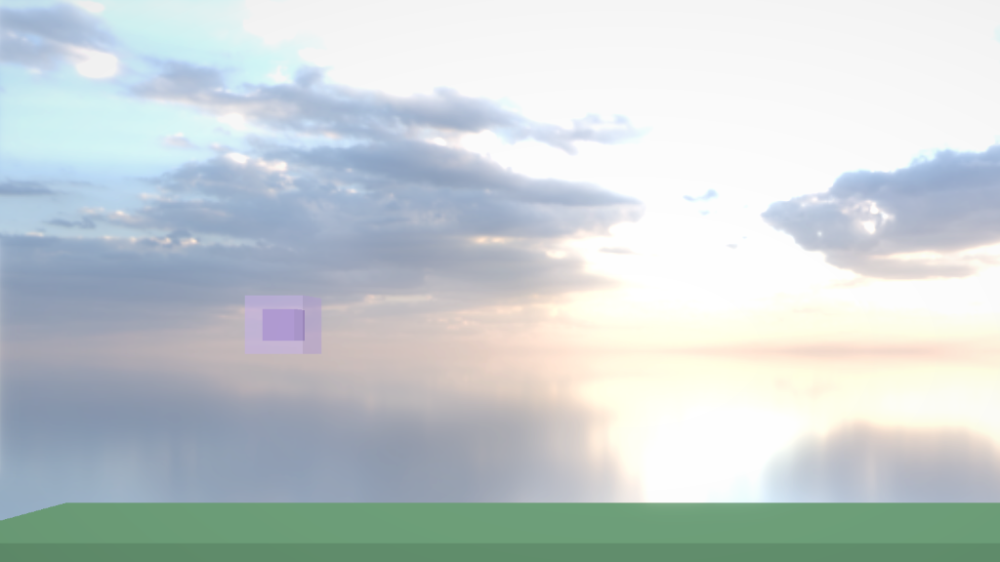

# G5：氷のキューブ（プレイヤー）とカメラの追いかけ

## このファイルについて
- [AL4_01Game.md](AL4_01Game.md) の **G5**（P1）。Jump Adventures 風の企画になってから、最初の写経。
- やること
  1. **エンジン：Camera Follow**（カメラが Entity をなめらかに追う。**追い方（Mode）を選ぶ**：Center／Look Ahead（速さ × 先読み時間）。遊び・遅れの上限・ステージの端で止まる・地面にいる間は縦を合わせる）
  2. **エンジン：Surface**（Primitive Renderer を半透明・加算にできる。氷のキューブ・光る扉に使う）
  3. **エンジン：ReloadScene・FindChild**（今のシーンを最初から・子を名前で探す）
  4. **ゲーム：氷のキューブ（IceCube）・レベルの情報（LevelInfo）・ゴールの扉（GoalDoor）**
  5. **エディタ：Level01・Level02 を作る**（足場は仮に箱。G6 で Polygon Shape に替える）
- **パートの順番**：A・B・C はどの順でもよい（それぞれ独立）。D（ゲーム）は A と C の後（`TranslateWorld`・`FindChild`・`ReloadScene` を使う）。E は D の後。
- 確かめた環境：本体の今の状態（fa6a2c4 ＋ 写経済みで未コミットの Text・G4b・TextEffects）＋ このファイル、AL4_01 のコピー ＋ パートD。Release でテスト用のシーンを動かし、入力を時間で流して、ログで数字を確かめた（7章）。

| パート | ファイル | 何をするか |
|---|---|---|
| A | `Components/CameraFollowComponent.h`（新しく作る）・`Systems/CameraSystem.h/.cpp`・`ECS/EntityManager.h/.cpp`・`Systems/PhysicsSystem.cpp`・`Window/WindowManager.cpp`・`ECS/GameComponent.h`・vcxproj | カメラの追いかけ |
| B | `Components/PrimitiveRendererComponent.h`・`Systems/PrimitiveRenderSystem.h/.cpp` | 半透明・加算（Surface） |
| C | `Scene/SceneManager.h/.cpp`・`ECS/GameObject.h/.cpp` | やり直し・子を名前で探す |
| D | `Source/Scripts/IceCube.h/.cpp`・`LevelInfo.h/.cpp`・`GoalDoor.h/.cpp`（新しく作る）・`AL4_01.vcxproj`・`main.cpp` | 氷のキューブ・レベル・ゴール |
| E | エディタで | Level01・Level02 を作る |

---

## 0. 前の写経で気づいた所（しなくてもよい）
本体のコードを写したときに、1つだけ G4b（[G4Bounce.md](G4Bounce.md)）の答えと違う所に気づいた。

| ファイル | 違い | 起きること |
|---|---|---|
| `CollisionSystem.cpp` の `DescribeCollider` | カプセルの高さのラベルが `"Height###height "`（最後に空白。答えは `"Height###height"`） | 保存の名前（キー）が `height `（空白付き）になる。今のファイル（`Player.prefab`・GameScene）はみんな `height ` で保存されているので、動きは同じ |

- このゲームではカプセルを使わないので、直すなら今がよい（直すと、前に保存したカプセルを読むときに警告が1回出て、高さが初めの値 2.0 になる。保存し直せば消える）。

---

## 1. 何をするか（なぜこう作ったか）

### 1.1 Camera Follow（カメラの追いかけ）
**横から見るゲームなら、どれも同じことをする**ので、エンジンの Component にする（Add Component → Camera → Camera Follow）。前に GameBasics.md の E-4 でゲームの Script（`CameraFollow`）として作ったが、毎回書き直さなくてよいように、遊び・先読み・ステージの端まで入れた。

```
                  画面の真ん中（カメラ）
                        │
        ┌───────────────┼───────────────┐  ← 遊び（Dead Zone）
        │               │        ● focus │     focus がこの中にいる間、カメラは動かない
        └───────────────┼───────────────┘     はみ出したら、はみ出した分だけ追う
                        │
  focus（画面の真ん中に置きたい点）＝ 追う物の位置 ＋ Offset ＋ 追い方（Mode）で決まるずれ
```

**追い方（Mode）**：Unity の Cinemachine と同じく「どう追うか」を選び、Inspector には選んだ追い方の値だけを出す（Collider の Shape で、出す大きさが変わるのと同じ）。追い方を足すときは、`CameraFollowMode` に1つ足して、見せ方と `CalcWantedLookAhead` の switch に case を足す。

| Mode | focus のずれ | 使う値 |
|---|---|---|
| Center | 無し（追う物を真ん中に） | 無し |
| **Look Ahead**（初めの値） | **追う物の速さ × Look Ahead Time**（t ＝ p ＋ α・v の α・v）。速いほど先を見せ、止まると真ん中に戻る | Look Ahead Time（α。X 0.4 秒・Y 0）・Look Ahead Max（上限 X 3m・Y 2m）・Look Ahead Smooth Time（0.3 秒） |

- **Look Ahead の Y は初めは 0**：ジャンプの縦の速さは ±13〜20m/s あるので、Y にも α を掛けると、跳ぶたびに画面が 5m 以上上下する（遊びと Ground Snap Y で揺れを止めた意味がなくなる）。落ちるときに下を見せたいレベルだけ、Y を入れる。
- **上限（Look Ahead Max）**：G7 の緑の円で吹っ飛ぶと 15m/s を超える。0.4 秒を掛けると 6m 先になり、キューブが画面の端に寄りすぎる。
- **速さは位置の変化から出す**（÷ deltaTime）。Rigidbody が無い物でも使え、壁に止められている間は 0 になる（壁を押している間に画面が流れない）。フレームごとのガタつきは、次の指数補間でならす。
- **先読みも指数補間で変える**：目標の先読みへ、1フレームに「残りの差 × t」だけ近づける（t は下の式。Look Ahead Smooth Time を使う）。振り返る・止まるで速さが急に変わっても、画面がガクッと動かない。Center に切り替えたときも、0 へなめらかに戻る。

1フレームの流れ（`UpdateFollowOne`）：

| 順 | すること | 中身 |
|---|---|---|
| 1 | 先読み | 追う物の速さ（位置の変化 ÷ deltaTime）から、追い方で目標のずれを出し（`CalcWantedLookAhead`）、指数補間で近づける |
| 2 | focus | 追う物 ＋ Offset ＋ 先読み |
| 3 | 追う | 遊びの外へ出た分だけ → なめらかに近づける → 遅れの上限（Max Lag）で縛る。**追う物が地面にいる間は、縦は遊びを使わずに合わせる（Ground Snap Y）** |
| 4 | 端で止める | Bounds：画面の端が Min〜Max の外を写さない |
| 5 | 動かす | `EntityManager::TranslateWorld`（親の下に置いたカメラでも動く） |

- **なめらかに近づける式（指数補間）**：1フレームに「残りの差 × t」だけ進む。`t = 1 − e^(−deltaTime ÷ Smooth Time)`（`CalcSmoothRate`。カメラの追いかけと先読みの両方で使う）。
  - `Lerp(今, 目標, 0.1)` のように t を決め打ちすると、60fps と 144fps で近づく速さが変わる（144fps は1秒に 144 回 10% 近づくので、ずっと速い）。
  - e を使った式なら、「Smooth Time 秒たつと、残りの差が e⁻¹ ≈ 37% になる」がフレームの速さに関係なく成り立つ（60fps・Smooth Time 0.15 なら t ≈ 0.105。144fps なら t ≈ 0.045 だが、回数が 2.4 倍なので同じだけ進む）。
- **走っている間の遅れ**：速さ v で動く物を追うと、カメラは「v × Smooth Time」くらい遅れる（7m/s × 0.15 秒 ≈ 1m）。先読み 2.8m（7m/s × 0.4 秒）− 遊び 0.5m − 遅れ 1m で、キューブの前に 1.3m くらい広く見える（7章で 1.31m）。
- **Ground Snap Y（テストで見つけて足した）**：遊びだけだと、3m 跳んだときに遊び（1.5m）の上へはみ出した分カメラが上がり、着地しても遊びの中なので戻らない。跳ぶたびに少しずつ上にずれていった（7章）。そこで、追う物の Rigidbody が地面にいる間（`isGrounded`）は、縦だけ遊びを使わずに合わせる。跳んでいる間は遊びの中なら動かないので、ジャンプで画面は揺れず、段に乗ると上がる・降りると下がる（横スクロールのゲームでよくあるカメラ）。
- **Bounds**：画面の半分の高さ ＝ 距離 × tan(縦の視野角 ÷ 2)、半分の幅 ＝ 半分の高さ × 16/9。カメラ z = -17・視野角 40° なら、z = 0 の面で半分の高さ 6.19m・半分の幅 11.0m。Min X = -5 なら、カメラの真ん中は -5 + 11.0 = 6.0 より左へ行かない（7章で 6.000）。
- **呼ぶ所**：物理で動いた後・カメラの絵を決める前（`WindowManager::UpdateAll` の `PhysicsSystem::Update` の後）。物理の前に追うと、追う物が1フレーム先へ進んでから撮るので、ガタガタする。動かしたら、カメラの子もそろうように `UpdateTransforms` をもう一度呼ぶ（物理と同じ形）。
- **`EntityManager::TranslateWorld`**：PhysicsSystem の `ApplyMove`（ワールドで動いた量を、親から見た量に直して translation に足す）と同じことがカメラにも要る。同じコードを2か所に書かないように、EntityManager の public に移して、物理とカメラの両方から呼ぶ。
- 実行中だけの値（`isFollowing`・`currentLookAhead`・`lastTargetPosition`）は Component に入れるが、見せ方（Describe）に並べないので保存されない（Rigidbody の `isGrounded` と同じ）。シーンを読むたびに初めの値に戻るので、Play・やり直しの最初のフレームは、置いた位置から流れてこずに、すぐ focus に合う。
- Look Ahead の値は、Mode が Look Ahead のときだけ Inspector に出て、保存もされる（Center にして保存すると、ファイルからは消える。また Look Ahead にすると初めの値に戻る）。

### 1.2 Surface（半透明・加算）
- Renderer はもう「奥行きを書かない物（`DepthMode::TestNoWrite`）を半透明として、不透明な物の後で、カメラから遠い順に描く」ようになっている（Sprite Renderer の板が使っている）。Primitive Renderer は、それを選べなかった（いつも `TestWrite`）。
- `PrimitiveMaterial` に `surface`（`Opaque`・`Transparent`・`Additive`）を足し、`ApplyMaterial` で `blendMode`・`depthMode` に直す（enum なので switch）。Elastic Surface も同じ `PrimitiveMaterial` なので、半透明にできるようになる（G6 の Polygon Renderer も使う）。
- 氷のキューブは「外の箱（Transparent）＋中の箱（Opaque）」。不透明な中の箱が先に描かれ、その上に外の箱が透けて重なるので、中の箱が見える（7章の画像）。
- 半透明の物は奥行きを書かないので、G10 のフォグ・G11 の DOF（奥行きを使う）では扱いが変わる（そのときに考える）。

### 1.3 ReloadScene（やり直し）
やられた・R キーで「今のレベルを最初から」にしたい。`LoadScene(今のシーンの名前)` でもできるが、エディタでは困る：

| 今のシーン | ReloadScene がすること | 理由 |
|---|---|---|
| Play を押したシーン（エディタで開いているシーン） | Stop・Restart と同じく、**Play を押した瞬間の状態**へ戻す | `LoadScene` はファイルから読むので、保存していない編集が消えた状態でやり直しになる（レベルを作りながら遊ぶと「さっき動かした足場が戻っている」になる） |
| `LoadScene` で切り替えた先（Level02 など） | そのシーンファイルから読み直す | Play を押した瞬間の状態は、開いているシーンの物しか無い |

- 製品版（Release）は Play を押さないので「Play を押した瞬間の状態」が無く、どちらもシーンファイルから読み直す（7章で確かめた）。

### 1.4 FindChild（子を名前で探す）
- 氷のキューブの Script は、子の「Body」（見た目のキューブ）を傾けたり伸ばしたりする。`GameObject::Find("Body")` はシーン全体の最初の1つなので、Body という名前の物がほかにあると、それを掴んでしまう。
- `gameObject.FindChild("Body")` は自分の子だけを見る（Unity の `transform.Find` と同じ）。Prefab を何個置いても、それぞれの子が見つかる。

### 1.5 氷のキューブ（IceCube）

```
Player（Rigidbody ＋ Collider（Sphere・半径 0.5）＋ IceCube）  ← 当たりは球。物理で動くのはこれ
 └ Body（Primitive Renderer の箱・Transparent）              ← 見た目のキューブ。IceCube が傾け・伸び縮みさせる
     └ Core（Primitive Renderer の箱・Opaque・Scale 0.55）   ← 中の濃い箱（Body と一緒に動く）
```

- **当たりを球にする理由**（AL4_01Game.md の5章）：G6 の多角形の足場と押し出しが簡単で確実。足場の角やつなぎ目で引っかからない。キューブは見た目だけなので、地面の向きに合わせて傾ける（角から落ちるときも、転がり落ちるように見える）。
- **ジャンプの高さから速さを出す**：速さ v で真上に跳ぶと、重力 g で v² ÷ 2g だけ上がる。だから高さ h にしたいときは v ＝ √(2gh)。Gravity 30・Jump Height 3 なら v ＝ √180 ≈ 13.4m/s、頂上まで v ÷ g ≈ 0.45 秒。Inspector では高さ（m）で決められる。
- **重力の強さ**：Rigidbody の Gravity Scale（Settings の重力 9.8 の何倍か）を毎フレーム書く。上がっている間は Gravity（30 ÷ 9.8 ≈ 3.06 倍）、落ちる間は Fall Gravity Multiplier 倍（45 ÷ 9.8 ≈ 4.59 倍）。落ちる方が速いと、ふわっとしない。
- **跳ぶ手触りの3つ**：

| 名前 | 中身 | 無いと |
|---|---|---|
| コヨーテタイム | 足場から歩いて落ちても、0.1 秒は地面のジャンプが残る | 端ぎりぎりで押したのに跳べない |
| 先行入力（Jump Buffer） | 着地の 0.1 秒前に押したジャンプを覚えておき、着地した瞬間に跳ぶ | 着地の少し前に押すと、何も起きない |
| 長押し（Jump Cut） | 上がっている途中で離したら、上向きの速さを半分に | いつも同じ高さ（小さく跳べない） |

- **地面にいるか**：Rigidbody の `isGrounded`（前のフレームの物理の結果。Script の Update は物理より前）。跳んだ直後 0.1 秒は数えない（まだ床に触れていて、地面にいることになるのを防ぐ）。
- **左右の入力を自分で読む理由**：`InputManager::GetMoveAxis` は W・↑ も「上」として入っていて、斜めで長さ1にそろえる。右（D）とジャンプ（W）を一緒に押すと、横が 0.71 倍になってしまう。なので横だけ（A・D・←・→・左スティック・十字）を読む。
- **状態**：`Move`（地上・空中）・`Dead`（やられ）・`Clear`（扉へ吸い込まれる）。地上と空中は加速の強さが違うだけなので、同じ状態にした。G7 で「緑の壁にくっつく」「緑の円で吹っ飛ぶ」を足す。
- **見た目**：傾き（地上は足元の向き、空中は進む向きへ Tilt Angle 度）・伸び縮み（跳ぶと縦に伸び、着地でつぶれる。つぶれても底が浮かないように、つぶれた分だけ下げる）。傾きと伸び縮みは、1.1 と同じ「e の式」で元に戻す。
- **HP**：G5 では減らす物が無い（トゲは G8）。`Damage`・`Kill` だけ用意して、下の線より下に落ちたら `Kill`。
- **足場の摩擦は 0**：Physic Material を選ばない（全部 0）。止まるのは IceCube の減速でやる。前の企画の `Player.physmat`（摩擦 0.5）は付けない。

### 1.6 LevelInfo・GoalDoor

```
ゴール：GoalDoor の OnTriggerEnter（キューブが触れた）
         → IceCube::Clear（扉へ吸い込まれて小さくなる。物理を止める）
         → Next Level Delay（1秒）
         → LevelInfo::LoadNextLevel → SceneManager::LoadScene(Next Scene)（空・無ければ ReloadScene）
やられ：IceCube::Kill（下に落ちた。G8 でトゲ・熱湯も）→ 縮んで消える → Restart Delay（1秒）→ SceneManager::ReloadScene
やり直し：LevelInfo の Update で R / パッドの Back → SceneManager::ReloadScene
```

- LevelInfo は、シーンに1つ置く「レベルの情報」（番号・場所の名前・下の線の高さ・次のシーンの名前）。ゲームの進み方なので Script にした（Script は `std::string` を持てる。`FindObjectOfType` で探せる）。G9 で左下の「レベル 1 森」に使う。
- カメラの範囲は LevelInfo ではなく、Camera Follow の Bounds に持たせた（エンジンの機能にまとめる）。

---

## 2. パートA：Camera Follow（エンジン）

### `MyEngine/Components/CameraFollowComponent.h`（新しく作る）

```cpp
#pragma once
#include <type_traits>

#include "MyEngine/ECS/Entity.h"
#include "MyEngine/Math/Vector2.h"

// カメラが Entity を追いかける。Camera Component と同じ Entity に付けるComponent（カテゴリ：Camera）
// 横から見るゲーム用：動かすのは X・Y だけ（Z と向きは、置いたときのまま）
// 動かすのは CameraSystem::UpdateFollow（再生中だけ。物理で動いた後・カメラの絵を決める前）。停止中は置いた位置のまま
// 画面の真ん中に置きたい点（focus）＝ 追う物の位置 ＋ Offset ＋ 追い方（Mode）で決まるずれ。カメラは、focus が「遊び」の外へ出た分だけ、なめらかに追う

/// <summary>
/// 追い方（focus をどこに置くか）。Inspector では、選んだ追い方の値だけが出る
/// </summary>
enum class CameraFollowMode {
	Center,    // 追う物を真ん中に（Offset の分だけずらす）
	LookAhead, // 進む向きの先を見せる（追う物の速さ × Look Ahead Time だけ先を真ん中に。止まると真ん中に戻る）
};


/// <summary>
/// カメラの追いかけ（Unity の Cinemachine の、横から見るゲーム用の小さい版）
/// </summary>
struct CameraFollowComponent {
	// --- どの追い方でも使う ---
	bool enabled = true;                                 // false の間は追わない（置いた位置のまま）
	EntityRef target;                                    // 追う Entity（Hierarchy からドラッグ。保存は EntityId で）
	CameraFollowMode mode = CameraFollowMode::LookAhead; // 追い方
	Vector2 offset = {0.0f, 1.5f};                       // 追う物から、画面の真ん中をどれだけずらすか（m。Y を上げると、足元が広く見える）
	Vector2 deadZone = {0.5f, 1.5f};                     // 遊び（m）。画面の真ん中から左右・上下にこの範囲で動いても、カメラは動かない
	bool groundSnapY = true;                             // true：追う物が地面にいる間は、上下の遊びを使わずに合わせる（跳んでも画面は揺れず、段に乗ると上がる）。追う物の Rigidbody の isGrounded を見る
	float smoothTime = 0.15f;                            // 追いつくまでの時間の目安（秒。0 ならすぐ合わせる）
	Vector2 maxLag = {6.0f, 4.0f};                       // 遅れの上限（m）。focus と画面の真ん中が、これより離れない（速く動いても画面から出ないように）
	bool useBounds = false;                              // true：画面の端が boundsMin〜boundsMax の外を写さない（ステージの端でカメラが止まる）
	Vector2 boundsMin = {-10.0f, -10.0f};                // 写してよい範囲の左下（ワールドの X・Y。追う物の奥行きで測る）
	Vector2 boundsMax = {100.0f, 30.0f};                 // 写してよい範囲の右上
	// --- Look Ahead のときだけ使う ---
	Vector2 lookAheadTime = {0.4f, 0.0f}; // 何秒先を見せるか（先読み ＝ 追う物の速さ × これ。Y を 0 にすると、跳んでも上下に先読みしない）
	Vector2 lookAheadMax = {3.0f, 2.0f};  // 先読みの上限（m）。吹っ飛びのような速い動きで、先へ行きすぎないように
	float lookAheadSmoothTime = 0.3f;     // 先読みが変わるまでの時間の目安（秒。速さが急に変わっても、画面がガクッと動かないように）

	// --- 実行中だけの値（CameraSystem が書く。保存しない）---
	bool isFollowing = false;                  // 追いかけ始めたか（false なら、次のフレームで focus へすぐ合わせる）
	Vector2 currentLookAhead = {0.0f, 0.0f};   // 今の先読み（m。右・上が＋。Center の間は 0 へ戻っていく）
	Vector2 lastTargetPosition = {0.0f, 0.0f}; // 前のフレームの、追う物の位置（速さを出すのに使う）
};

static_assert(std::is_trivially_copyable_v<CameraFollowComponent>);
```

### `MyEngine/Systems/CameraSystem.h`（2か所）
**1. include を1行足す**

```cpp
#include <memory>

#include "MyEngine/Components/CameraComponent.h"
#include "MyEngine/Components/CameraFollowComponent.h"
#include "MyEngine/Core/Handle.h"
```

**2. クラスの説明に1行足し、`Initialize` の説明を直し、`UpdateFollow` を足す**（`Release` の下）

```cpp
/// <summary>
/// CameraComponent を持つEntityから、ゲームの絵を撮るカメラを決める
/// <para>カメラ（Camera クラス）はここが1つだけ持ち、毎フレーム、有効な Camera Component の中で priority が一番大きい物の
/// 位置・向き（Transform）と写り方をそこへ写す。シーンの GetCamera() は、上書きしなければこのカメラを返す</para>
/// <para>Camera Follow（カメラの追いかけ）も持つ。追いかけて Transform を動かすのが UpdateFollow、その位置から撮るのが Update</para>
/// </summary>
class CameraSystem {
public:
	// CameraComponent・CameraFollowComponent を登録する（置き場所・保存・Inspector）。EntityManager::Initialize の後に呼ぶ
	static void Initialize();
	static void Release();

	/// <summary>
	/// Camera Follow を付けた Entity（カメラ）の Transform を、追う物へ近づける（再生中だけ。WindowManager から1フレームに1回）
	/// <para>物理で動いた後（ワールド行列を計算し直した後）、Update の前に呼ぶ。追う物の、そのフレームの位置を追うため</para>
	/// </summary>
	/// <returns>動かしたカメラがあったか（あれば、呼んだ側でワールド行列を計算し直す）</returns>
	static bool UpdateFollow(float deltaTime);

	// 毎フレーム1回、EntityManager::UpdateTransforms の後に呼ぶ（親の下に置いたカメラも、そのフレームの位置で撮るため）
	static void Update();
```

### `MyEngine/Systems/CameraSystem.cpp`（4か所）
**1. include を2行足す**（`<cmath>`・`RigidbodyComponent.h`）

```cpp
#include <algorithm>
#include <cmath>
#include <memory>

#include "MyEngine/Camera/Camera.h"
#include "MyEngine/Components/RigidbodyComponent.h"
#include "MyEngine/Components/TransformComponent.h"
#include "MyEngine/Diagnostics/LogManager.h"
#include "MyEngine/Diagnostics/MyAssert.h"
#include "MyEngine/ECS/ComponentSerializer.h"
#include "MyEngine/ECS/ComponentUI.h"
#include "MyEngine/ECS/EntityManager.h"
#include "MyEngine/ECS/GameComponent.h"
#include "MyEngine/Editor/Inspector/ComponentEditor.h"
```

**2. `DescribeCamera` の下（無名 namespace の終わり `} // namespace` の前）に足す**

```cpp
//=============================================================================
// Camera Follow（カメラの追いかけ）
//=============================================================================
// Camera Follow の見せ方（実行中だけの値は並べない＝保存しない）
void DescribeCameraFollow(ComponentUI& ui, CameraFollowComponent& value) {
	ui.Field("Enabled###enabled", value.enabled, Tip("外すと追わない（置いた位置のまま）"));
	ui.Field("Target###target", value.target, Tip("追う Entity（Hierarchy からドラッグ）。再生中だけ追う。動かすのはカメラの X・Y だけ（Z と向きは置いたまま）"));
	ui.Field("Mode###mode", value.mode, Tip("追い方。Center：追う物を真ん中に / LookAhead：進む向きの先を見せる（速さ × Time。止まると真ん中に戻る）"));
	// --- 選んだ追い方の値だけを見せる（保存も、使っている方だけが書かれる。Collider の Shape と同じ）---
	switch (value.mode) {
	case CameraFollowMode::Center:
		break; // Center だけの値は無い
	case CameraFollowMode::LookAhead:
		ui.Field("Look Ahead Time###lookAheadTime", value.lookAheadTime, AtLeast(0.0f).Tip("何秒先を見せるか（先読み ＝ 追う物の速さ × これ）。X 0.4 なら 7m/s で 2.8m 先。Y を 0 にすると、跳んでも上下に先読みしない"));
		ui.Field("Look Ahead Max###lookAheadMax", value.lookAheadMax, AtLeast(0.0f).Tip("先読みの上限（m）。吹っ飛びのような速い動きで、先へ行きすぎないように"));
		ui.Field("Look Ahead Smooth Time###lookAheadSmoothTime", value.lookAheadSmoothTime, AtLeast(0.0f).Tip("先読みが変わるまでの時間の目安（秒）。速さが急に変わっても（振り返る・止まる）、画面がガクッと動かない。0 ならすぐ変わる"));
		break;
	}
	ui.Separator("Follow");
	ui.Field("Offset###offset", value.offset, Tip("追う物から、画面の真ん中をどれだけずらすか（m）。Y を上げると、足元が広く見える"));
	ui.Field("Dead Zone###deadZone", value.deadZone, AtLeast(0.0f).Tip("遊び（m）。画面の真ん中から左右・上下にこの範囲で動いても、カメラは動かない（跳ぶたびに画面が上下しないように）"));
	ui.Field("Ground Snap Y###groundSnapY", value.groundSnapY, Tip("追う物が地面にいる間は、上下の遊びを使わずに合わせる（跳んでも画面は揺れず、段に乗ると上がる・降りると下がる）。追う物に Rigidbody が要る"));
	ui.Field("Smooth Time###smoothTime", value.smoothTime, AtLeast(0.0f).Tip("追いつくまでの時間の目安（秒）。大きいほどゆっくり。0 ならすぐ合わせる"));
	ui.Field("Max Lag###maxLag", value.maxLag, AtLeast(0.0f).Tip("遅れの上限（m）。速く動いても、追う物が画面の真ん中からこれより離れない"));
	ui.Separator("Bounds");
	ui.Field("Use Bounds###useBounds", value.useBounds, Tip("画面の端が、Min〜Max の外を写さない（ステージの端でカメラが止まる）"));
	ui.Field("Min###boundsMin", value.boundsMin, Tip("写してよい範囲の左下（ワールドの X・Y）。追う物の奥行きで測る"));
	ui.Field("Max###boundsMax", value.boundsMax, Tip("写してよい範囲の右上（ワールドの X・Y）"));
}

// ===== なめらかに近づけるときの、1フレームに進む割合（残りの差 × これ だけ進む）=====
// t ＝ 1 − e^(−経過時間 ÷ smoothTime)。フレームの速さ（60fps・144fps）が変わっても、同じ時間で同じだけ近づく（smoothTime 秒で、残りが e⁻¹ ≈ 37% になる）
// smoothTime が 0 なら 1（すぐ合わせる）
float CalcSmoothRate(float deltaTime, float smoothTime) { return (smoothTime > 0.0f) ? 1.0f - std::exp(-deltaTime / smoothTime) : 1.0f; }

// ===== 追い方で決まる、focus のずれ（先読み）の目標 =====
// velocity は追う物の速さ（位置の変化から出した物）
Vector2 CalcWantedLookAhead(const CameraFollowComponent& follow, const Vector2& velocity) {
	switch (follow.mode) {
	case CameraFollowMode::Center:
		return {0.0f, 0.0f}; // ずらさない（LookAhead から切り替えたときは、0 へなめらかに戻る）
	case CameraFollowMode::LookAhead:
		// 速さ × 何秒先か（t = p + α・v の α・v）。速いほど先を見せ、止まると 0（真ん中に戻る）。上限で縛る
		return {
		    std::clamp(velocity.x * follow.lookAheadTime.x, -follow.lookAheadMax.x, follow.lookAheadMax.x),
		    std::clamp(velocity.y * follow.lookAheadTime.y, -follow.lookAheadMax.y, follow.lookAheadMax.y),
		};
	}
	MY_ASSERT_MSG(false, "知らない CameraFollowMode です");
	return {0.0f, 0.0f};
}

// ===== 1つの軸で、遊びの外へ出た分だけ真ん中を動かす（focus が「真ん中 ± 遊び」の中なら、真ん中のまま）=====
float ApplyDeadZone(float center, float focus, float deadZone) {
	if (focus > center + deadZone) {
		return focus - deadZone; // 右（上）へはみ出した：はみ出した分だけ追う
	}
	if (focus < center - deadZone) {
		return focus + deadZone; // 左（下）へはみ出した
	}
	return center; // 遊びの中：動かない
}

// ===== 1つの軸で、画面の端が min〜max の外を写さないように、真ん中を寄せる =====
// halfView は画面の半分の幅（高さ）。範囲が画面より狭いときは、どこに置いてもはみ出すので、範囲の真ん中にする
float ApplyBounds(float center, float halfView, float min, float max) {
	const float low = min + halfView;  // 真ん中がこれより小さいと、画面の左（下）の端が min の外を写す
	const float high = max - halfView; // 真ん中がこれより大きいと、画面の右（上）の端が max の外を写す
	if (low > high) {
		return (min + max) * 0.5f;
	}
	return std::clamp(center, low, high);
}

// ===== カメラ1つ分の追いかけ。動かしたら true =====
bool UpdateFollowOne(Handle<Entity> entity, CameraFollowComponent& follow, float deltaTime) {
	// --- 早期リターン ---
	const Handle<Entity> targetEntity = EntityManager::Find(follow.target);
	const TransformComponent* transform = EntityManager::Get<TransformComponent>(entity);
	const TransformComponent* targetTransform = EntityManager::Get<TransformComponent>(targetEntity);
	if (transform == nullptr || targetTransform == nullptr) {
		return false; // 追う物が入っていない・もう居ない
	}
	const Vector3 cameraPosition = GetWorldPosition(*transform);
	const Vector3 targetPosition = GetWorldPosition(*targetTransform);
	const Vector2 target = {targetPosition.x, targetPosition.y};

	// --- 1. 先読み（追い方で決まる focus のずれ）---
	// 速さは位置の変化から出す（Rigidbody が無い物・スクリプトで動かす物でも使える。壁に止められている間は 0）
	// 目標の先読みへ、指数でなめらかに近づける（速さはフレームごとにガタつくので、そのままだと画面が震える）
	if (follow.isFollowing) {
		const Vector2 velocity = (target - follow.lastTargetPosition) / deltaTime;
		const Vector2 wanted = CalcWantedLookAhead(follow, velocity);
		follow.currentLookAhead += (wanted - follow.currentLookAhead) * CalcSmoothRate(deltaTime, follow.lookAheadSmoothTime);
	}
	follow.lastTargetPosition = target;

	// --- 2. 画面の真ん中に置きたい点（focus）---
	const Vector2 focus = target + follow.offset + follow.currentLookAhead;

	// --- 3. 新しい真ん中 ---
	Vector2 center = {cameraPosition.x, cameraPosition.y};
	if (!follow.isFollowing) {
		// 追いかけ始め（Play・シーンを読んだ直後）：置いた位置から流れてこないように、すぐ focus へ
		center = focus;
		follow.isFollowing = true;
	} else {
		// 遊びの外へ出た分だけ追う。Y は、追う物が地面にいる間は遊びを使わずに合わせる（Ground Snap Y）
		// 遊びだけだと、跳んで遊びの上へはみ出した分カメラが上がり、着地しても遊びの中なので戻らない（跳ぶたびに少しずつずれていく）
		const RigidbodyComponent* targetBody = EntityManager::Get<RigidbodyComponent>(targetEntity);
		const bool isSnapY = follow.groundSnapY && targetBody != nullptr && targetBody->isGrounded;
		const Vector2 wanted = {ApplyDeadZone(center.x, focus.x, follow.deadZone.x), isSnapY ? focus.y : ApplyDeadZone(center.y, focus.y, follow.deadZone.y)};
		// なめらかに近づける（指数補間。1フレームに「残りの差 × t」だけ進む）
		center += (wanted - center) * CalcSmoothRate(deltaTime, follow.smoothTime);
		// 遅れすぎないように縛る（吹っ飛びのような速い動きでも、追う物が画面から出ない）
		center.x = std::clamp(center.x, focus.x - follow.maxLag.x, focus.x + follow.maxLag.x);
		center.y = std::clamp(center.y, focus.y - follow.maxLag.y, focus.y + follow.maxLag.y);
	}

	// --- 4. ステージの端で止める（画面の端が、範囲の外を写さない）---
	if (follow.useBounds) {
		// 追う物の奥行きでの、画面の半分の高さ・幅（カメラは +Z を向いている前提）。半分の高さ ＝ 距離 × tan(縦の視野角の半分)
		const CameraComponent* camera = EntityManager::Get<CameraComponent>(entity);
		const float fovY = std::clamp(camera ? camera->fovY : CameraComponent{}.fovY, kMinFovY, kMaxFovY) * kDegToRad;
		const float halfHeight = std::abs(targetPosition.z - cameraPosition.z) * std::tan(fovY * 0.5f);
		const float halfWidth = halfHeight * kAspectRatio;
		center.x = ApplyBounds(center.x, halfWidth, follow.boundsMin.x, follow.boundsMax.x);
		center.y = ApplyBounds(center.y, halfHeight, follow.boundsMin.y, follow.boundsMax.y);
	}

	// --- 5. 動いた量を Transform へ（親の下に置いたカメラでも、ワールドで動いた量だけ動く）---
	const Vector3 move = {center.x - cameraPosition.x, center.y - cameraPosition.y, 0.0f};
	if (LengthSq(move) == 0.0f) {
		return false;
	}
	EntityManager::TranslateWorld(entity, move);
	return true;
}
} // namespace
```

**3. `Initialize` の最後に3行足す**

```cpp
	EntityManager::RegisterComponent<CameraComponent>();
	ComponentSerializer::Register<CameraComponent>("Camera", &DescribeCamera);
	ComponentEditorRegistry::Register(std::make_unique<DescribedComponentEditor<CameraComponent>>("Camera", "Camera", &DescribeCamera));

	EntityManager::RegisterComponent<CameraFollowComponent>();
	ComponentSerializer::Register<CameraFollowComponent>("Camera Follow", &DescribeCameraFollow);
	ComponentEditorRegistry::Register(std::make_unique<DescribedComponentEditor<CameraFollowComponent>>("Camera Follow", "Camera", &DescribeCameraFollow));
}
```

**4. `// 毎フレーム` の大見出しの下、`Update` の前に足す**

```cpp
bool CameraSystem::UpdateFollow(float deltaTime) {
	if (deltaTime <= 0.0f) {
		return false; // 一時停止・ヒットストップ中（追う物も止まっている）
	}
	bool isMoved = false;
	EntityManager::ForEach<CameraFollowComponent>([&isMoved, deltaTime](Handle<Entity> entity, CameraFollowComponent& follow) {
		if (!follow.enabled || !EntityManager::IsActiveInHierarchy(entity)) {
			return;
		}
		if (UpdateFollowOne(entity, follow, deltaTime)) {
			isMoved = true;
		}
	});
	return isMoved;
}
```

### `MyEngine/ECS/EntityManager.h`（1か所。`CalcWorldMatrix` の下）

```cpp
	// 親まで掛けたワールド行列を、今の translation / rotation / scale から計算する（UpdateTransforms を待たずに正しい値が欲しいとき）
	static Matrix4x4 CalcWorldMatrix(Handle<Entity> handle);
	// ワールド座標で worldMove だけ動かす（translation は親から見た位置なので、親の下なら、親から見た量に直して足す）
	// 親のワールド行列は UpdateTransforms の結果を使う。物理の押し戻し・カメラの追いかけが使う
	static void TranslateWorld(Handle<Entity> handle, const Vector3& worldMove);
```

### `MyEngine/ECS/EntityManager.cpp`（1か所。`CalcWorldMatrix` の下）

```cpp
void EntityManager::TranslateWorld(Handle<Entity> handle, const Vector3& worldMove) {
	TransformComponent* transform = Get<TransformComponent>(handle);
	const Entity* entity = Get(handle);
	if (!transform || !entity) {
		return;
	}
	Vector3 move = worldMove;
	if (const TransformComponent* parent = Get<TransformComponent>(entity->parent)) {
		// 親の向き・大きさを外す（ワールドの向き × 親のワールド行列の逆 ＝ 親から見た向き。位置は足さないので TransformNormal）
		const Vector3 local = TransformNormal(worldMove, Inverse(parent->worldMatrix));
		// 親の大きさが0だと逆行列が作れず、数でなくなる。そのときは、そのまま足す
		if (std::isfinite(local.x) && std::isfinite(local.y) && std::isfinite(local.z)) {
			move = local;
		}
	}
	transform->translation += move;
}
```

### `MyEngine/Systems/PhysicsSystem.cpp`（2か所。`ApplyMove` を `TranslateWorld` にする）
**1.** 大見出し `// 動いた量を Transform へ書く` から `ApplyMove` 関数の終わりまで（21行）を**消す**（中身は EntityManager の `TranslateWorld` に移した）。

**2.** `Update` の「3. 動いた量を Transform へ」を直す

```cpp
	// ===== 3. 動いた量を Transform へ（moved はワールド座標。親の下なら、TranslateWorld が親から見た量に直す）=====
	bool isMoved = false;
	for (const Body& body : state->bodies) {
		if (LengthSq(body.moved) == 0.0f) {
			continue;
		}
		EntityManager::TranslateWorld(body.entity, body.moved);
		isMoved = true;
	}
	return isMoved;
```

### `MyEngine/Window/WindowManager.cpp`（1か所。`UpdateAll` の物理の後に足す）

```cpp
	if (isGameRunning && PhysicsSystem::Update(Time::GetDeltaTime())) {
		EntityManager::UpdateTransforms();
	}
	// カメラの追いかけ（Camera Follow）。物理で動いた後の位置を追う。カメラを動かしたら、カメラ（と子）のワールド行列を計算し直す
	if (isGameRunning && CameraSystem::UpdateFollow(Time::GetDeltaTime())) {
		EntityManager::UpdateTransforms();
	}
	CameraSystem::Update();                 // Camera Component の位置・向きをゲームのカメラへ写す（ワールド行列の後、使う人たちの前）
```

### `MyEngine/ECS/GameComponent.h`（上の説明の2行を直す）

```cpp
//   カメラは Entity に付ける Camera Component。追いかけるなら、同じ Entity に Camera Follow（Add Component → Camera）を付けて Target を入れる
//   シーンを替えるときは、③の中で SceneManager::LoadScene("Result") を呼ぶ（切り替わるのは次のフレームの頭）。やり直しは SceneManager::ReloadScene()
```

### `MyEngine_v1.vcxproj`（1ファイル）
`MyEngine/Components/CameraFollowComponent.h` を足す（ソリューションエクスプローラーで MyEngine\Components を右クリック → 追加 → 既存の項目）。

---

## 3. パートB：Surface（エンジン）

### `MyEngine/Components/PrimitiveRendererComponent.h`（2か所）
**1. `PrimitiveMaterial` の前に enum を足す　2. `color` の下に `surface` を1行足す**

```cpp
/// <summary>
/// 透け方（描く順番と、奥行きを書くか）
/// </summary>
enum class SurfaceType {
	Opaque,      // 不透明（奥行きを書く。先に描く）
	Transparent, // 半透明（色の A の分だけ透ける。奥行きを書かずに、不透明な物の後で、カメラから遠い順に描く）
	Additive,    // 加算（色を足して光らせる。奥行きを書かずに、遠い順に描く）
};

/// <summary>
/// モデルのファイルを使わない形の見た目（Primitive Renderer の球・箱、Elastic Surface の板・支柱で共通）
/// <para>モデル（Model Renderer）と違って mtl が無いので、値はいつもここから使う</para>
/// <para>Inspector と保存の並びは PrimitiveRenderSystem::DescribeMaterial（持っている Component の見せ方から呼ぶ）</para>
/// </summary>
struct PrimitiveMaterial {
	Vector4 color = {1.0f, 1.0f, 1.0f, 1.0f};           // 色（RGBA。0〜1）。テクスチャがあれば掛け合わせる
	SurfaceType surface = SurfaceType::Opaque;          // 透け方（Transparent にすると、color の A の分だけ透ける）
```

### `MyEngine/Systems/PrimitiveRenderSystem.h`（1か所。`ApplyMaterial` の最後に switch を足す）

```cpp
	template<class TConfig> static void ApplyMaterial(TConfig& config, const PrimitiveMaterial& material, IBLEnvironment* environment) {
		config.color = ToColorCode(material.color);
		config.textureHandle = material.textureHandle;
		config.uvTransform.scale = {material.uvScale.x, material.uvScale.y, 1.0f}; // UV の Scale は「テクスチャ1枚の大きさ」（大きいほど絵が大きく、くり返しが減る）
		config.shadingType = material.shadingType;
		config.material = &material.params;
		config.env = environment;
		// --- 透け方：奥行きを書かない（TestNoWrite）物は、Renderer が半透明として、不透明な物の後にカメラから遠い順で描く ---
		switch (material.surface) {
		case SurfaceType::Opaque:
			config.blendMode = BlendMode::Normal;
			config.depthMode = DepthMode::TestWrite;
			break;
		case SurfaceType::Transparent:
			config.blendMode = BlendMode::Normal;
			config.depthMode = DepthMode::TestNoWrite;
			break;
		case SurfaceType::Additive:
			config.blendMode = BlendMode::Add;
			config.depthMode = DepthMode::TestNoWrite;
			break;
		}
	}
```

- `DepthMode` は `RenderStates.h` の enum（`PrimitiveRendererComponent.h` が読んでいるので、include は要らない）。

### `MyEngine/Systems/PrimitiveRenderSystem.cpp`（1か所。`DescribeMaterial` の Color の下）

```cpp
	// ===== 色とテクスチャ =====
	ui.ColorField(label("Color", "color").c_str(), material.color);
	ui.Field(label("Surface", "surface").c_str(), material.surface, Tip("Opaque：不透明 / Transparent：Color の A の分だけ透ける（氷・水）/ Additive：色を足して光る（光の玉）。Transparent・Additive は不透明な物の後に、遠い順に描く"));
```

- 保存の名前は `surface`（Elastic Surface の支柱は `postSurface`）。前に保存したファイルには無いので、読むと初めの値（Opaque）になる（警告は出ない）。

---

## 4. パートC：ReloadScene・FindChild（エンジン）

### `MyEngine/Scene/SceneManager.h`（1か所。`LoadScene` の下）

```cpp
	static bool LoadScene(const std::string& name);
	// 今のシーンを最初からやり直す（次のフレームの頭で。再生中だけ効く）。ゲームの「やり直し」用
	// Play を押したシーンなら、Play を押した瞬間の状態に戻す（エディタで保存していない編集も、そのまま残る）
	// LoadScene で切り替えた先なら、そのシーンファイルから読み直す
	static bool ReloadScene();
```

### `MyEngine/Scene/SceneManager.cpp`（1か所。`LoadScene` の下）

```cpp
bool SceneManager::ReloadScene() {
	SceneManager* target = (updating_ != nullptr) ? updating_ : main_;
	if (target == nullptr || target->currentScene_ == nullptr) {
		LogManager::Warning("ReloadScene()：シーンがまだ無いので、やり直せません");
		return false;
	}
	if (target->playState_ == PlayState::Editing) {
		LogManager::Log("ReloadScene()：停止中なのでやり直しません（Play 中だけ効きます）");
		return false;
	}
	const std::string& name = target->currentScene_->GetSceneName();
	// --- Play を押したシーン：Stop と同じく、Play を押した瞬間の状態へ（エディタで保存していない編集も残る。製品版はシーンファイルから）---
	if (name == target->openSceneName_) {
		target->isReloadRequested_ = true;
		return true;
	}
	// --- LoadScene で切り替えた先：そのシーンファイルから読み直す ---
	return LoadScene(name);
}
```

- `isReloadRequested_` は Control ウィンドウの Restart と同じ物（次のフレームの頭で `ReloadImmediate`）。

### `MyEngine/ECS/GameObject.h`（1か所。`Find` の下）

```cpp
	// 名前で探す（同じ名前が何個もあれば最初の1つ。無ければ消えた GameObject と同じ扱い）
	static GameObject Find(const std::string& name);
	// 自分の子の中から、名前で探す（孫は探さない。Unity の transform.Find と同じ）。無ければ消えた GameObject と同じ扱い
	// シーン全体から探す Find と違い、同じ名前の物がほかの所にあっても、自分の子だけを見る（Prefab を何個置いても、それぞれの子が見つかる）
	GameObject FindChild(const std::string& name) const;
```

### `MyEngine/ECS/GameObject.cpp`（2か所）
**1. `<vector>` を足す**

```cpp
#include "GameObject.h"

#include <vector>

#include "MyEngine/Diagnostics/MyAssert.h"
#include "MyEngine/Scene/PrefabManager.h"
```

**2. 「作る・探す」の `Instantiate` の下に足す**

```cpp
GameObject GameObject::Instantiate(uint32_t prefab, const Vector3& position, GameObject parent) { return {PrefabManager::Instantiate(prefab, position, parent.handle)}; }

GameObject GameObject::FindChild(const std::string& name) const {
	// 子を並べて、名前が同じ物を探す（孫までは見ない）
	std::vector<Handle<Entity>> children;
	EntityManager::GetChildren(handle, children);
	for (Handle<Entity> child : children) {
		const Entity* entity = EntityManager::Get(child);
		if (entity != nullptr && entity->name == name) {
			return {child};
		}
	}
	return {}; // 無い（if (found) が false になる）
}
```

---

## 5. パートD：ゲーム（AL4_01）

### `Source/Scripts/IceCube.h`（新しく作る）

```cpp
#pragma once
#include <MyEngine/ECS/Script.h>
#include <MyEngine/Math/Vector3.h>

/// <summary>
/// 氷のキューブ（プレイヤー）。Rigidbody ＋ Collider（Sphere）を付けた Entity に付ける
/// <para>Rigidbody は Freeze Position Z を付け、Collide With Rigidbodies を外す。Use Gravity・Gravity Scale は、ここが毎フレーム書く</para>
/// <para>見た目のキューブは子の Entity「Body」（Primitive Renderer の箱）。当たりは球で、キューブは見た目だけ（傾く・伸び縮みする）</para>
/// <para>左右移動とジャンプ（1回）。コヨーテタイム・先行入力・長押しで高さが変わる。ぶつかる・押し戻すのはエンジン（PhysicsSystem）の仕事で、
/// ここは「入力を読んで、Rigidbody の速さと重力の強さを書く」だけ</para>
/// <para>HP・やられ（下に落ちる・Kill・HP 0）・クリア（GoalDoor から）。やられたら少し待って、レベルの最初から（SceneManager::ReloadScene）</para>
/// </summary>
class IceCube : public Script {
public:
	void Start() override;
	void Update() override;
	void Fields(ComponentUI& ui) override;

	// ===== 当たり（足元の向きを集める。キューブを地面の向きに傾ける）=====
	void OnCollisionEnter(const CollisionInfo& collision) override;
	void OnCollisionStay(const CollisionInfo& collision) override;

	// ===== ほかの Script から使う =====
	// HP を amount だけ減らす（トゲ：G8）。0 になったらやられ
	void Damage(int amount);
	// 一発アウト（熱湯：G8。下に落ちたときも、ここを通る）
	void Kill();
	// ゴールに入った（GoalDoor から）。doorPosition へ吸い込まれる（次のレベルへ進むのは GoalDoor）
	void Clear(const Vector3& doorPosition);
	int GetHp() const { return hp_; }
	int GetMaxHp() const { return maxHp_; }
	// 操作できるか（やられ・クリアの最中でない）
	bool IsPlayable() const { return state_ == State::Move; }

private:
	/// <summary>
	/// 今していること（G7 で、緑の壁にくっつく・緑の円で吹っ飛ぶ を足す）
	/// </summary>
	enum class State {
		Move,  // 動ける（地上・空中）
		Dead,  // やられ（縮んで消えて、少し待ってから、レベルの最初から）
		Clear, // クリア（扉へ吸い込まれる）
	};

	// ===== 毎フレーム =====
	void UpdateMove(RigidbodyComponent& rigidbody, float deltaTime);         // State::Move
	void UpdateDead(float deltaTime);                                        // State::Dead
	void UpdateClear(float deltaTime);                                       // State::Clear
	void UpdateGround(const RigidbodyComponent& rigidbody, float deltaTime); // 地面にいるか・着地
	void UpdateRun(RigidbodyComponent& rigidbody, float deltaTime);          // 左右移動
	void UpdateJump(RigidbodyComponent& rigidbody, float deltaTime);         // ジャンプ（先行入力・コヨーテタイム・長押し）
	void UpdateGravity(RigidbodyComponent& rigidbody) const;                 // 重力の強さ（上がる・落ちる）と、落ちる速さの上限
	void UpdateBody(const RigidbodyComponent& rigidbody, float deltaTime);   // 見た目（子の Body の傾き・伸び縮み・大きさ）
	void Jump(RigidbodyComponent& rigidbody);                                // 跳ぶ
	void BeginEnding(State next);                                            // やられ・クリアを始める（物理で動かすのを止める）
	void CollectGround(const CollisionInfo& collision);                      // 足元の向きを集める
	// 地面のジャンプが使えるか（地面にいる・足場から落ちてコヨーテタイムの間）
	bool CanGroundJump() const { return isOnGround_ || groundJumpTimer_ > 0.0f; }

	// ===== 入力 =====
	static float ReadMoveInput();  // 左右（-1〜1。左が−）
	static bool IsJumpTriggered(); // ジャンプを押した瞬間
	static bool IsJumpPressed();   // ジャンプを押している

	// ===== Inspector に出す・保存する値 =====
	// --- 移動 ---
	float runSpeed_ = 7.0f;     // 左右の一番速い速さ（m/s）
	float groundAccel_ = 60.0f; // 地上で、入力の向きへ速さを変える強さ（1秒に何 m/s 変えるか）
	float groundDecel_ = 70.0f; // 地上で入力が無いとき、止まる強さ
	float airAccel_ = 35.0f;    // 空中で、入力の向きへ速さを変える強さ
	float airDecel_ = 10.0f;    // 空中で入力が無いとき、横の速さを落とす強さ（小さいと、跳んだ勢いが残る）
	// --- ジャンプ ---
	float jumpHeight_ = 3.0f;            // 長押ししたときのジャンプの高さ（m）
	float gravity_ = 30.0f;              // 重力の強さ（m/s²。上がっている間）
	float fallGravityMultiplier_ = 1.5f; // 落ちる間の重力の倍率
	float maxFallSpeed_ = 20.0f;         // 落ちる速さの上限（m/s）
	float jumpCutRatio_ = 0.5f;          // 上がっている途中でジャンプを離したとき、上向きの速さに掛ける
	float coyoteTime_ = 0.1f;            // 足場から落ちても、この秒数はまだジャンプできる
	float jumpBufferTime_ = 0.1f;        // 着地のこの秒数前に押したジャンプは、着地した瞬間に跳ぶ
	// --- HP・やられ・クリア ---
	int maxHp_ = 3;             // HP
	float restartDelay_ = 1.0f; // やられてから、レベルの最初に戻るまでの秒数
	float clearTime_ = 0.6f;    // ゴールの扉へ吸い込まれる秒数
	// --- 見た目（子の Body）---
	float cubeSize_ = 1.0f;     // 見た目のキューブの大きさ（m）
	float tiltAngle_ = 12.0f;   // 空中で、進む向きに傾く角度（度。走る速さのとき）
	float tiltSpeed_ = 12.0f;   // 傾きが変わる速さ（大きいほどすぐ）
	float jumpStretch_ = 0.2f;  // 跳んだとき、縦に伸びる割合
	float landSquash_ = 0.25f;  // 着地したとき、縦につぶれる割合（落ちる速さの上限で着地したとき）
	float stretchTime_ = 0.08f; // 伸び縮みが戻る時間の目安（秒）

	// ===== 実行中だけの値（保存しない）=====
	State state_ = State::Move;                 // 今していること
	int hp_ = 0;                                // 今の HP（Start で Max HP にする）
	float killHeight_ = -10.0f;                 // これより下に落ちたら一発アウト（Start で LevelInfo から読む）
	bool isOnGround_ = false;                   // 地面にいる
	float groundJumpTimer_ = 0.0f;              // 足場から落ちた後、地面のジャンプがあと何秒使えるか（コヨーテタイムの残り）
	float jumpBufferTimer_ = 0.0f;              // 押したジャンプを、あと何秒覚えているか（先行入力の残り）
	float sinceJump_ = 1.0f;                    // 最後に跳んでからの秒数
	bool isJumpRising_ = false;                 // ジャンプで上がっている途中（長押しを見る）
	float previousVelocityY_ = 0.0f;            // 前のフレームの上下の速さ（着地の強さに使う）
	Vector3 groundNormal_ = {0.0f, 0.0f, 0.0f}; // このフレームの足元の向き（当たりで集める。乗っていなければ 0）
	float stateTimer_ = 0.0f;                   // やられ・クリアになってからの秒数
	bool isRestartRequested_ = false;           // やり直しを頼んだ（何回も頼まないように）
	Vector3 clearStart_ = {0.0f, 0.0f, 0.0f};   // 吸い込まれ始めた位置
	Vector3 clearTarget_ = {0.0f, 0.0f, 0.0f};  // 扉の位置
	GameObject body_;                           // 子の「Body」（見た目のキューブ。Start で探す）
	float bodyAngle_ = 0.0f;                    // 今の傾き（度。Z 軸のまわりで、左回りが＋）
	float stretch_ = 0.0f;                      // 今の伸び縮み（＋で縦に伸びる、−でつぶれる）
	float bodyScale_ = 1.0f;                    // 全体の大きさの倍率（やられ・クリアで小さくなる）

	static constexpr float kGroundIgnoreAfterJump = 0.1f; // 跳んだ直後のこの秒数は、足場に触れていても地面にいることにしない
	static constexpr float kStandCos = 0.7f;              // 当たりの向き（normal）の上の成分がこれ以上なら足元（約45度。エンジンの地面の判定と同じ）
	static constexpr float kVanishTime = 0.25f;           // やられたとき、縮んで消えるまでの秒数（G8 で、砕ける・溶けるに替える）
};
```

### `Source/Scripts/IceCube.cpp`（新しく作る）

```cpp
#include "IceCube.h"

#include <algorithm>
#include <cmath>

#include <MyEngine/Input/InputManager.h>
#include <MyEngine/Math/Easing.h>
#include <MyEngine/Math/MathUtility.h>

#include "LevelInfo.h"

SCRIPT(IceCube, "Game");

//=============================================================================
// Inspector に出す・保存する値
//=============================================================================
void IceCube::Fields(ComponentUI& ui) {
	ui.Label("A・D / ←→ / 左スティック・十字：移動　Space・W・↑ / A ボタン：ジャンプ（長押しで高く）");
	// ===== 移動 =====
	ui.Separator("Run");
	ui.Field("Run Speed", runSpeed_, AtLeast(0.0f).Tip("左右の一番速い速さ（m/s）"));
	ui.Field("Ground Accel", groundAccel_, AtLeast(0.0f).Tip("地上で、入力の向きへ速さを変える強さ（1秒に何 m/s 変えるか）"));
	ui.Field("Ground Decel", groundDecel_, AtLeast(0.0f).Tip("地上で入力が無いとき、止まる強さ"));
	ui.Field("Air Accel", airAccel_, AtLeast(0.0f).Tip("空中で、入力の向きへ速さを変える強さ"));
	ui.Field("Air Decel", airDecel_, AtLeast(0.0f).Tip("空中で入力が無いとき、横の速さを落とす強さ（小さいと、跳んだ勢いが残る）"));
	// ===== ジャンプ =====
	ui.Separator("Jump");
	ui.Field("Jump Height", jumpHeight_, AtLeast(0.0f).Tip("長押ししたときの高さ（m）。跳ぶ速さは、この高さと Gravity から計算する"));
	ui.Field("Gravity", gravity_, AtLeast(0.1f).Tip("重力の強さ（m/s²。上がっている間）。大きいほどキビキビ動く（Rigidbody の Gravity Scale は、これに合わせて毎フレーム書く）"));
	ui.Field("Fall Gravity Multiplier", fallGravityMultiplier_, AtLeast(0.0f).Tip("落ちる間の重力の倍率（1 より大きいと、ふわっとしない）"));
	ui.Field("Max Fall Speed", maxFallSpeed_, AtLeast(0.0f).Tip("落ちる速さの上限（m/s）"));
	ui.Field("Jump Cut", jumpCutRatio_, Range(0.0f, 1.0f).Tip("上がっている途中でジャンプを離したとき、上向きの速さに掛ける（0.5 なら、すぐ離すと低いジャンプ。1 なら長押しの差が無い）"));
	ui.Field("Coyote Time", coyoteTime_, AtLeast(0.0f).Tip("足場から落ちても、この秒数はまだジャンプできる（端ぎりぎりで押しても跳べるように）"));
	ui.Field("Jump Buffer", jumpBufferTime_, AtLeast(0.0f).Tip("着地のこの秒数前に押したジャンプは、着地した瞬間に跳ぶ（先行入力）"));
	// ===== HP・やられ・クリア =====
	ui.Separator("Life");
	ui.Field("Max HP", maxHp_, Range(1.0f, 10.0f).Tip("HP（G8 のトゲで 1 減る。0 でやられ）"));
	ui.Field("Restart Delay", restartDelay_, AtLeast(0.0f).Tip("やられてから、レベルの最初に戻るまでの秒数"));
	ui.Field("Clear Time", clearTime_, AtLeast(0.01f).Tip("ゴールの扉へ吸い込まれる秒数"));
	// ===== 見た目（子の Body）=====
	ui.Separator("Look");
	ui.Field("Cube Size", cubeSize_, AtLeast(0.0f).Tip("見た目のキューブの大きさ（m）。子の「Body」の Scale に毎フレーム書く。当たりの球の大きさは Collider で決める"));
	ui.Field("Tilt Angle", tiltAngle_, AtLeast(0.0f).Tip("空中で、進む向きに傾く角度（度。走る速さのとき）"));
	ui.Field("Tilt Speed", tiltSpeed_, AtLeast(0.0f).Tip("傾きが変わる速さ（大きいほどすぐ変わる）"));
	ui.Field("Jump Stretch", jumpStretch_, Range(0.0f, 0.9f).Tip("跳んだとき、縦に伸びる割合（0 なら伸びない）"));
	ui.Field("Land Squash", landSquash_, Range(0.0f, 0.9f).Tip("着地したとき、縦につぶれる割合（落ちる速さの上限で着地したとき。ゆっくり着地すると小さい）"));
	ui.Field("Stretch Time", stretchTime_, AtLeast(0.01f).Tip("伸び縮みが戻る時間の目安（秒）"));
}


//=============================================================================
// 毎フレーム
//=============================================================================
void IceCube::Start() {
	hp_ = maxHp_;
	body_ = gameObject.FindChild("Body"); // 見た目のキューブ（無ければ、見た目は動かさない）
	// 下の線の高さは、シーンの LevelInfo から（LevelInfo が無ければ -10 のまま）
	if (const LevelInfo* level = LevelInfo::Find()) {
		killHeight_ = level->GetKillHeight();
	}
}

void IceCube::Update() {
	RigidbodyComponent* rigidbody = GetComponent<RigidbodyComponent>();
	if (rigidbody == nullptr) {
		return; // Rigidbody が無いと動かせない（Inspector で外した）
	}
	const float deltaTime = Time::GetDeltaTime();
	if (deltaTime <= 0.0f) {
		return; // ヒットストップ中（入力で速さを変えない）
	}

	// --- 今していることで、することが変わる ---
	switch (state_) {
	case State::Move:
		UpdateMove(*rigidbody, deltaTime);
		break;
	case State::Dead:
		UpdateDead(deltaTime);
		break;
	case State::Clear:
		UpdateClear(deltaTime);
		break;
	}
	UpdateBody(*rigidbody, deltaTime);

	// --- 次のフレームのために覚える・空にする ---
	previousVelocityY_ = rigidbody->velocity.y;
	groundNormal_ = {0.0f, 0.0f, 0.0f}; // 足元の向きは、次のフレームの当たりで集め直す
}

void IceCube::UpdateMove(RigidbodyComponent& rigidbody, float deltaTime) {
	// --- 下の線より下に落ちたら、一発アウト ---
	if (GetWorldPosition(transform).y < killHeight_) {
		Kill();
		return;
	}
	UpdateGround(rigidbody, deltaTime);
	UpdateRun(rigidbody, deltaTime);
	UpdateJump(rigidbody, deltaTime);
	UpdateGravity(rigidbody);
}


//=============================================================================
// 地面
//=============================================================================
void IceCube::UpdateGround(const RigidbodyComponent& rigidbody, float deltaTime) {
	sinceJump_ += deltaTime;
	// isGrounded は前のフレームの物理の結果（Script の Update は物理より前に呼ばれる）
	// 跳んだ直後は、まだ足場に触れていて isGrounded になることがあるので、少しの間は数えない
	const bool isGrounded = rigidbody.isGrounded && sinceJump_ >= kGroundIgnoreAfterJump;
	if (isGrounded) {
		// --- 着地した瞬間：落ちてきた速さの分だけ、つぶれる ---
		if (!isOnGround_) {
			const float impact = (maxFallSpeed_ > 0.0f) ? std::clamp(-previousVelocityY_ / maxFallSpeed_, 0.0f, 1.0f) : 1.0f;
			stretch_ = -landSquash_ * impact;
		}
		isOnGround_ = true;
		groundJumpTimer_ = coyoteTime_; // 地面にいる間は、いつでも満タン
	} else {
		isOnGround_ = false;
		groundJumpTimer_ -= deltaTime; // 足場から落ちても、コヨーテタイムの間は地面のジャンプが残る
	}
}

void IceCube::OnCollisionEnter(const CollisionInfo& collision) { CollectGround(collision); }

void IceCube::OnCollisionStay(const CollisionInfo& collision) { CollectGround(collision); }

void IceCube::CollectGround(const CollisionInfo& collision) {
	// 足元の当たり（normal が上向き）のうち、一番上を向いている物を、このフレームの足元の向きにする
	if (collision.normal.y >= kStandCos && collision.normal.y > groundNormal_.y) {
		groundNormal_ = collision.normal;
	}
}


//=============================================================================
// 左右移動
//=============================================================================
void IceCube::UpdateRun(RigidbodyComponent& rigidbody, float deltaTime) {
	const float input = ReadMoveInput();
	// 入力があれば加速、無ければ減速（地上と空中で強さが違う）
	// 速さを直接書かずに「近づける」ので、急に向きが変わらない
	float rate = 0.0f;
	if (isOnGround_) {
		rate = (input != 0.0f) ? groundAccel_ : groundDecel_;
	} else {
		rate = (input != 0.0f) ? airAccel_ : airDecel_;
	}
	rigidbody.velocity.x = MathUtility::MoveTowards(rigidbody.velocity.x, input * runSpeed_, rate * deltaTime);
}


//=============================================================================
// ジャンプ
//=============================================================================
void IceCube::UpdateJump(RigidbodyComponent& rigidbody, float deltaTime) {
	// --- 先行入力：押した瞬間を Jump Buffer 秒だけ覚えておく（着地の少し前に押しても、着地した瞬間に跳ぶ）---
	const bool isTriggered = IsJumpTriggered();
	if (isTriggered) {
		jumpBufferTimer_ = jumpBufferTime_;
	}
	// --- 跳ぶ：押した（覚えている）ジャンプがあって、地面のジャンプが使えるとき ---
	// 押したフレームは isTriggered で見る（Jump Buffer が 0 でも跳べるように）
	if ((isTriggered || jumpBufferTimer_ > 0.0f) && CanGroundJump()) {
		Jump(rigidbody);
	}
	jumpBufferTimer_ -= deltaTime;

	// --- 長押し：上がっている途中でジャンプを離したら、上向きの速さを減らす（すぐ離すと低いジャンプ）---
	if (isJumpRising_) {
		if (rigidbody.velocity.y <= 0.0f) {
			isJumpRising_ = false; // もう落ち始めた（最後まで押していた）
		} else if (!IsJumpPressed()) {
			rigidbody.velocity.y *= jumpCutRatio_;
			isJumpRising_ = false; // 1回のジャンプで1回だけ
		}
	}
}

void IceCube::Jump(RigidbodyComponent& rigidbody) {
	// 長押ししたときに、ちょうど Jump Height まで上がる速さ
	// 速さ v で真上に投げると、重力 g で v² ÷ 2g だけ上がる（v² = 2gh）→ v ＝ √(2gh)。上がっている間の重力（Gravity）で計算する
	rigidbody.velocity.y = std::sqrt(2.0f * gravity_ * jumpHeight_);
	isOnGround_ = false;
	groundJumpTimer_ = 0.0f; // 地面のジャンプを使った（コヨーテタイムの残りも消す）
	jumpBufferTimer_ = 0.0f; // 覚えていたジャンプも使った
	sinceJump_ = 0.0f;
	isJumpRising_ = true;
	stretch_ = jumpStretch_; // 見た目：縦に伸びる
}


//=============================================================================
// 重力
//=============================================================================
void IceCube::UpdateGravity(RigidbodyComponent& rigidbody) const {
	// 重力の強さは、Rigidbody の Gravity Scale（Settings の重力の何倍か）で変える。上がっている間は Gravity、落ちる間は Fall Gravity Multiplier 倍
	const float worldGravity = Length(PhysicsSystem::GetGravity());
	if (worldGravity > 0.0f) {
		const float wanted = (rigidbody.velocity.y > 0.0f) ? gravity_ : gravity_ * fallGravityMultiplier_;
		rigidbody.gravityScale = wanted / worldGravity;
	}
	rigidbody.useGravity = true;
	// --- 落ちる速さの上限（このフレームの重力は物理が後で足すので、ほんの少し超えることはある）---
	rigidbody.velocity.y = (std::max)(rigidbody.velocity.y, -maxFallSpeed_);
}


//=============================================================================
// HP・やられ・クリア
//=============================================================================
void IceCube::Damage(int amount) {
	if (state_ != State::Move || amount <= 0) {
		return; // もうやられ・クリアの最中
	}
	hp_ = (std::max)(hp_ - amount, 0);
	if (hp_ == 0) {
		Kill();
	}
}

void IceCube::Kill() {
	if (state_ != State::Move) {
		return; // もうやられ・クリアの最中
	}
	hp_ = 0;
	BeginEnding(State::Dead);
}

void IceCube::Clear(const Vector3& doorPosition) {
	if (state_ != State::Move) {
		return;
	}
	clearStart_ = GetWorldPosition(transform);
	clearTarget_ = {doorPosition.x, doorPosition.y, clearStart_.z}; // 奥行きは変えない
	BeginEnding(State::Clear);
}

void IceCube::BeginEnding(State next) {
	state_ = next;
	stateTimer_ = 0.0f;
	isJumpRising_ = false;
	// --- その場で止める（重力で落ちない。やられ・クリアの動きは、このスクリプトが位置と大きさで作る）---
	if (RigidbodyComponent* rigidbody = GetComponent<RigidbodyComponent>()) {
		rigidbody->velocity = {0.0f, 0.0f, 0.0f};
		rigidbody->useGravity = false;
	}
}

void IceCube::UpdateDead(float deltaTime) {
	stateTimer_ += deltaTime;
	// --- 見た目：その場で縮んで消える（G8 で、砕ける・溶けるに替える）---
	bodyScale_ = (std::max)(1.0f - stateTimer_ / kVanishTime, 0.0f);
	// --- 少し待ってから、レベルの最初から（1回だけ頼む）---
	if (stateTimer_ >= restartDelay_ && !isRestartRequested_) {
		isRestartRequested_ = true;
		SceneManager::ReloadScene();
	}
}

void IceCube::UpdateClear(float deltaTime) {
	stateTimer_ += deltaTime;
	// --- 扉へ吸い込まれる：最初は速く、だんだんゆっくり近づいて、小さくなる ---
	const float t = std::clamp(stateTimer_ / clearTime_, 0.0f, 1.0f);
	const Vector3 next = MathUtility::Lerp(clearStart_, clearTarget_, Ease::OutQuad(t, 0.0f, 1.0f));
	EntityManager::TranslateWorld(gameObject.handle, next - GetWorldPosition(transform));
	bodyScale_ = 1.0f - t;
}


//=============================================================================
// 見た目（子の Body）
//=============================================================================
void IceCube::UpdateBody(const RigidbodyComponent& rigidbody, float deltaTime) {
	if (!body_) {
		return; // 子の Body が無い（見た目は動かさない）
	}
	// --- 傾き：地上は足元の向きに合わせる。空中は進む向きへ倒れる ---
	float targetAngle = 0.0f; // 度（Z 軸のまわり。画面で左回りが＋）
	if (state_ == State::Move) {
		if (isOnGround_ && groundNormal_.y > 0.0f) {
			// キューブの上 (0, 1) を、足元の向き (nx, ny) へ回す角度
			// Z 軸で θ 回すと (0, 1) は (−sinθ, cosθ) になるので、θ ＝ atan2(−nx, ny)
			targetAngle = std::atan2(-groundNormal_.x, groundNormal_.y) * kRadToDeg;
		} else if (!isOnGround_ && runSpeed_ > 0.0f) {
			// 右へ進むと右へ倒れる（右回り＝マイナス）。走る速さのときに Tilt Angle
			targetAngle = -std::clamp(rigidbody.velocity.x / runSpeed_, -1.0f, 1.0f) * tiltAngle_;
		}
	}
	// 目標へ指数で近づける（Tilt Speed が大きいほどすぐ。フレームの速さが変わっても同じ動き）
	bodyAngle_ += (targetAngle - bodyAngle_) * (1.0f - std::exp(-tiltSpeed_ * deltaTime));
	// --- 伸び縮みは、だんだん元に戻る（Stretch Time で、残りが約 37% になる）---
	stretch_ *= std::exp(-deltaTime / stretchTime_);

	// --- 子の Transform へ書く ---
	TransformComponent& body = body_.GetTransform();
	const float size = cubeSize_ * bodyScale_;
	const float height = size * (1.0f + stretch_);       // 縦（伸びると高く、つぶれると低く）
	const float width = size * (1.0f - stretch_ * 0.5f); // 横・奥行き（縦と反対に、半分だけ）
	body.scale = {width, height, width};
	// つぶれても底が浮かないように、高さが変わった分の半分だけ下げる（伸びたときは上げる）
	body.translation = {0.0f, (height - size) * 0.5f, 0.0f};
	SetEulerAngles(body, {0.0f, 0.0f, bodyAngle_});
}


//=============================================================================
// 入力
//=============================================================================
float IceCube::ReadMoveInput() {
	// InputManager::GetMoveAxis は使わない（W・↑ も「上」として入っていて、斜めで長さ1にそろえるので、右とジャンプ（W）を一緒に押すと横が 0.71 倍になる）
	float input = 0.0f;
	if (InputManager::IsKeyPressed(DIK_D) || InputManager::IsKeyPressed(DIK_RIGHT) || InputManager::IsButtonPressed(GamepadButton::DpadRight)) {
		input += 1.0f;
	}
	if (InputManager::IsKeyPressed(DIK_A) || InputManager::IsKeyPressed(DIK_LEFT) || InputManager::IsButtonPressed(GamepadButton::DpadLeft)) {
		input -= 1.0f;
	}
	input += InputManager::GetLeftStickX(); // デッドゾーンの処理は済んでいる
	return std::clamp(input, -1.0f, 1.0f);
}

bool IceCube::IsJumpTriggered() {
	return InputManager::IsKeyTriggered(DIK_SPACE) || InputManager::IsKeyTriggered(DIK_W) || InputManager::IsKeyTriggered(DIK_UP) || InputManager::IsButtonTriggered(GamepadButton::A);
}

bool IceCube::IsJumpPressed() {
	return InputManager::IsKeyPressed(DIK_SPACE) || InputManager::IsKeyPressed(DIK_W) || InputManager::IsKeyPressed(DIK_UP) || InputManager::IsButtonPressed(GamepadButton::A);
}
```

### `Source/Scripts/LevelInfo.h`（新しく作る）

```cpp
#pragma once
#include <string>

#include <MyEngine/ECS/Script.h>

/// <summary>
/// レベル（1つのシーン）の情報と進み方。シーンに1つ、空の Entity（名前は Level）に付ける
/// <para>番号・場所の名前（G9 で左下に出す）・下の線の高さ（これより下に落ちたら一発アウト）・次のシーンの名前を持つ</para>
/// <para>R キー / パッドの Back で、いつでもレベルの最初からやり直せる</para>
/// </summary>
class LevelInfo : public Script {
public:
	void Update() override;
	void Fields(ComponentUI& ui) override;

	// ===== ほかの Script から使う =====
	int GetNumber() const { return number_; }
	const std::string& GetAreaName() const { return areaName_; }
	float GetKillHeight() const { return killHeight_; }
	// 次のレベルへ（Next Scene が空・見つからなければ、このレベルを最初から）
	void LoadNextLevel() const;
	// 今のシーンの LevelInfo（無ければ nullptr）。ポインタは使い捨て（フレームをまたいで持たない）
	static LevelInfo* Find() { return FindObjectOfType<LevelInfo>(); }

private:
	// ===== Inspector に出す・保存する値 =====
	int number_ = 1;              // レベルの番号
	std::string areaName_ = "森"; // 場所の名前
	float killHeight_ = -10.0f;   // これより下に落ちたら一発アウト（ワールドの Y）
	std::string nextScene_;       // ゴールの後に読むシーンの名前（resources/scenes/<名前>.scene.json。空なら、このレベルをもう一度）
};
```

### `Source/Scripts/LevelInfo.cpp`（新しく作る）

```cpp
#include "LevelInfo.h"

#include <MyEngine/Input/InputManager.h>

SCRIPT(LevelInfo, "Game");

//=============================================================================
// Inspector に出す・保存する値
//=============================================================================
void LevelInfo::Fields(ComponentUI& ui) {
	ui.Label("R / パッドの Back：レベルの最初からやり直す");
	ui.Field("Number", number_, AtLeast(1.0f).Tip("レベルの番号（G9 で左下に出す）"));
	ui.Field("Area Name", areaName_, Tip("場所の名前（森・海辺。G9 で左下に出す）"));
	ui.Field("Kill Height", killHeight_, Tip("これより下に落ちたら一発アウト（ワールドの Y）。足場の一番下より、少し下にする"));
	ui.Field("Next Scene", nextScene_, Tip("ゴールの後に読むシーンの名前（Level02 など。resources/scenes の .scene.json の名前）。空なら、このレベルをもう一度"));
}


//=============================================================================
// 毎フレーム
//=============================================================================
void LevelInfo::Update() {
	// --- やり直し：いつでもレベルの最初から ---
	if (InputManager::IsKeyTriggered(DIK_R) || InputManager::IsButtonTriggered(GamepadButton::Back)) {
		SceneManager::ReloadScene();
	}
}


//=============================================================================
// 次のレベル
//=============================================================================
void LevelInfo::LoadNextLevel() const {
	// 次のシーンが空・見つからない（名前の打ち間違い）なら、このレベルをもう一度（見つからないときは LoadScene が警告を出す）
	if (nextScene_.empty() || !SceneManager::LoadScene(nextScene_)) {
		SceneManager::ReloadScene();
	}
}
```

### `Source/Scripts/GoalDoor.h`（新しく作る）

```cpp
#pragma once
#include <MyEngine/ECS/Script.h>

/// <summary>
/// ゴールの扉。Collider（Is Trigger）を付けた Entity に付ける
/// <para>氷のキューブ（IceCube）が触れたらクリア。キューブが扉へ吸い込まれている間（Next Level Delay 秒）待ってから、次のレベルへ（LevelInfo）</para>
/// </summary>
class GoalDoor : public Script {
public:
	void Update() override;
	void Fields(ComponentUI& ui) override;
	void OnTriggerEnter(GameObject other) override; // キューブが触れた

private:
	// ===== Inspector に出す・保存する値 =====
	float nextLevelDelay_ = 1.0f; // 触れてから、次のレベルへ進むまでの秒数

	// ===== 実行中だけの値（保存しない）=====
	bool isCleared_ = false;       // キューブが触れた
	float timer_ = 0.0f;           // 触れてからの秒数
	bool isNextRequested_ = false; // 次のレベルを頼んだ（何回も頼まないように）
};
```

### `Source/Scripts/GoalDoor.cpp`（新しく作る）

```cpp
#include "GoalDoor.h"

#include "IceCube.h"
#include "LevelInfo.h"

SCRIPT(GoalDoor, "Game");

//=============================================================================
// Inspector に出す・保存する値
//=============================================================================
void GoalDoor::Fields(ComponentUI& ui) {
	ui.Field("Next Level Delay", nextLevelDelay_, AtLeast(0.0f).Tip("キューブが触れてから、次のレベルへ進むまでの秒数（キューブが扉へ吸い込まれる間）"));
}


//=============================================================================
// 当たり
//=============================================================================
void GoalDoor::OnTriggerEnter(GameObject other) {
	// --- 早期リターン：キューブでない・もうやられた・もうクリアした ---
	IceCube* cube = other.GetComponent<IceCube>();
	if (cube == nullptr || !cube->IsPlayable() || isCleared_) {
		return;
	}
	// --- クリア：キューブを扉へ吸い込ませて、時間を数え始める ---
	cube->Clear(GetWorldPosition(transform));
	isCleared_ = true;
}


//=============================================================================
// 毎フレーム
//=============================================================================
void GoalDoor::Update() {
	if (!isCleared_ || isNextRequested_) {
		return;
	}
	timer_ += Time::GetDeltaTime();
	if (timer_ < nextLevelDelay_) {
		return;
	}
	// --- 次のレベルへ（LevelInfo が無ければ、このレベルを最初から）---
	isNextRequested_ = true;
	if (const LevelInfo* level = LevelInfo::Find()) {
		level->LoadNextLevel();
	} else {
		SceneManager::ReloadScene();
	}
}
```

### `AL4_01.vcxproj`（6ファイル）
上の6ファイルを足す（ソリューションエクスプローラーで AL4_01 を右クリック → 追加 → 既存の項目）。

### `main.cpp`（1か所。最初のシーン）

```cpp
	Engine::Initialize(config, "Level01");
```

- 前の企画の `PlayerController`・`BallDropper`・`ShapeSpawner` は、このゲームでは使わない（消すかどうかは AL4_01Game.md の「まだ決めていないこと」）。残しておいてもビルドは通る。

---

## 6. パートE：レベルを作る（エディタで）
足場は仮に箱（G6 で Polygon Shape に替える）。数字は 7章で確かめたテストのシーンと同じ。

**E-1. シーンを作る**：Project ウィンドウの `resources/scenes` で右クリック → Create → Scene → 名前を `Level01` → 開く（カメラと平行光源から始まる）。

**E-2. プレイヤー**（Hierarchy の ＋ → Create Entity。名前は `Player`）

| Entity | Transform | 付ける物 |
|---|---|---|
| `Player` | Position (0, 0.5, 0) | **Rigidbody**：Mass 1・Collide With Rigidbodies を外す・Freeze Position Z を付ける／**Collider**：Shape Sphere・Radius 0.5・Physic Material は (none)／**IceCube**（Add Component → Gameplay → Game） |
| `Body`（Player の子。右クリック → Create Child） | そのまま（IceCube が毎フレーム書く） | **Primitive Renderer**：Shape Box・Color (0.78, 0.66, 1.0, A 0.55)・**Surface Transparent**・Shading HalfLambert・Emissive (0.1, 0.05, 0.2) |
| `Core`（Body の子） | Scale (0.55, 0.55, 0.55) | **Primitive Renderer**：Shape Box・Color (0.45, 0.3, 0.75, 1)・Surface Opaque |

- 子の名前は **`Body`**（IceCube が `FindChild("Body")` で探す）。
- できたら Player を右クリック → **Save As Prefab**（`IceCube.prefab`。前の `Player.prefab` とは別の名前に）。Level02 でも使う。

**E-3. 足場・ゴール・レベルの情報**

| Entity | Transform | 付ける物 |
|---|---|---|
| `GroundA` | Position (5, -1, 0)・Scale (20, 2, 4) | Collider（Box・Size 1,1,1）・Primitive Renderer（Box・緑） |
| `GroundB` | Position (28, -1, 0)・Scale (20, 2, 4) | 同じ（GroundA を Ctrl+D で複製） |
| `Step` | Position (24, 1, 0)・Scale (2, 2, 4) | 同じ（高さ 2m の段） |
| `Goal` | Position (34, 1.5, 0)・Scale (1.5, 3, 1) | Collider（Box・**Is Trigger**）・**GoalDoor**・Primitive Renderer（Box・Color (1, 0.9, 0.4, 0.8)・**Surface Additive**・Shading Unlit） |
| `Level` | そのまま | **LevelInfo**：Number 1・Area Name 森・Kill Height -10・Next Scene `Level02` |

- GroundA と GroundB の間（x = 15〜18）が 3m の穴。

**E-4. カメラ**（`Main Camera`）

| 項目 | 値 |
|---|---|
| Transform | Position (0, 2, -17)・Rotation (0, 0, 0) |
| Camera | Field Of View 40 |
| **Camera Follow**（Add Component → Camera） | Target：Hierarchy の `Player` をドラッグ／Offset (0, 1.5)／Dead Zone (0.5, 1.5)／Ground Snap Y 付ける／Smooth Time 0.15／Max Lag (6, 4)／**Mode：LookAhead**（Look Ahead Time (0.4, 0)・Look Ahead Max (3, 2)・Look Ahead Smooth Time 0.3）／Use Bounds 付ける・Min (-5, -6)・Max (60, 20) |

**E-5. 保存して Level02 を作る**：Ctrl+S → File → Save As → `Level02` → LevelInfo を Number 2・Area Name 海辺・Next Scene（空）に変え、足場を少し動かして Ctrl+S → `Level01` を開き直す。

**E-6. Play で確かめる**

| すること | こうなればよい |
|---|---|
| 何も押さない | 床に乗って止まる（滑らない）。Rigidbody の Info が Is Grounded |
| Space を長押し | 3m くらい跳ぶ。跳ぶと縦に伸び、着地でつぶれる |
| Space をすぐ離す | 低いジャンプ |
| 右へ走って穴の手前で跳ぶ | 越えられる。ぎりぎり落ちてから押しても跳べる（コヨーテタイム） |
| 穴に落ちる | 下で消えて、1 秒後にレベルの最初から |
| R キー | いつでも最初から（エディタで保存していない編集も残る） |
| 扉に触れる | 吸い込まれて、1 秒後に Level02 |
| カメラ | 走ると前が広く見え、止まると真ん中に戻る。跳んでも上下に揺れない。左端では止まる。Mode を Center にすると、先読みがなめらかに 0 に戻る |

---

## 7. 確かめたこと
Release（エディタ無し）で、テスト用の Level01（上の E-2〜E-4 と同じ）と Level02（足場の無い所にプレイヤーを置いた物）を動かした。入力はテスト用の Script から時間で流し（IceCube の入力の3つの関数を一時的に差し替えた）、0.05 秒ごとの位置・速さ・カメラをログに出した。確かめた後、差し替えとテスト用の Script は外してビルドし直した（エラー・警告は前と同じ。読み込みの警告 0）。

| 場面 | 計算 | 結果 |
|---|---|---|
| 長押しのジャンプ（y = 0.5 から） | 0.5 ＋ 3.0 ＝ 3.5 | 頂上 **3.454**（1フレームずつ進めるので 1.5% 低い） |
| すぐ離すジャンプ（0.05 秒だけ押す） | 0.5 ＋ 1.22 ＝ 1.72 | **1.701・1.845**（2回。離したと分かるフレームがずれると変わる） |
| 先行入力（落ちている途中、着地の約 0.03 秒前に1フレームだけ押す） | 着地した次のフレームに跳ぶ | 2.517 秒に着地 → **2.533 秒に跳んだ**（もう離していたので、すぐ低いジャンプ） |
| コヨーテタイム（足場から落ちて3フレーム後に押す） | 跳べる | 跳んで 3m の穴を越えた |
| 重力の倍率 | 30 ÷ 9.8 ＝ 3.061／45 ÷ 9.8 ＝ 4.592 | 上がる間 **3.061**・落ちる間 **4.592** |
| 走り出し | 0 → 7m/s に 7 ÷ 60 ≈ 0.12 秒 | 約 0.12 秒で 7m/s |
| カメラ：最初（Bounds Min X -5） | 真ん中は 6.0 より右 | **6.000** |
| Look Ahead：走っている（7m/s） | 先読み 7 × 0.4 ＝ 2.8m | 先読み **2.800**（指数補間で近づいた） |
| カメラ：走っている（7m/s） | 先読み 2.8 − 遊び 0.5 − 遅れ 1.05 ≈ 1.25m 前 | キューブの **1.31m 前** |
| Look Ahead：1.2 秒止まる | 2.8 × e^(−1.2 ÷ 0.3) ≈ 0.05 | 先読み **0.059**（カメラは遊びの端まで戻った：キューブの 0.61m 前） |
| （初めの作り：向きだけ見て、いつも 3m 先） | — | 止まっても先読みが残った → 速さ × 先読み時間（Look Ahead）に替え、Mode で選べる形にした |
| カメラ：3m 跳んだ後（Ground Snap Y を足す前） | — | 着地しても 3.20 のまま（最初は 2.0）。跳ぶたびに上がった → 1.1 の Ground Snap Y を足した |
| カメラ：3m 跳んだ後（Ground Snap Y） | 着地すると 2.0 に戻る | 着地の約 0.9 秒後に **2.000** |
| ゴール | 触れて 1 秒で Level02 | 吸い込まれて（大きさ 1 → 0）、約 1 秒で Level02 |
| 下に落ちる（Level02） | -10 より下で止まり、1 秒で同じシーンを読み直す | -10.23 で止まり、1 秒後に読み直し（3回くり返した。LoadScene で切り替えた先なので、シーンファイルから） |
| ReloadScene（Play を押したシーン） | 製品版はシーンファイルから | 読み直した（Script の Start がもう一度呼ばれた） |
| 半透明（Surface） | 外の箱が透けて、中の箱が見える | 下の画像（ジャンプ中） |



- Debug（エディタ付き）のビルド・Inspector の見た目（Camera Follow の欄・Surface の選択肢）・エディタでの Play は、まだ確かめていない（ビルド検証は Release のみ）。

---

## 8. AL4_01Game.md の直し
この作りに合わせて、[AL4_01Game.md](AL4_01Game.md) を直した（md なので差し替えてよい）。
- 5章「状態」：地上・空中は同じ状態（Move）。
- 8章：LevelInfo からカメラの範囲を外した（Camera Follow の Bounds）。
- 10章「カメラ」：Ground Snap Y と、先読みの数字。
- 13章「Step」の G5：ReloadScene・FindChild・TranslateWorld を足した。
- [Reference.md](../Reference.md)：Camera Follow・Surface・ReloadScene・FindChild・TranslateWorld、1フレームの順番の 6.4 を足した（G4b・Text まで入った版に足したので、本体の Docs/Reference.md はこのファイルで置き換える）。
