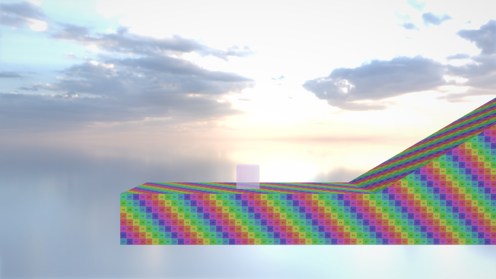
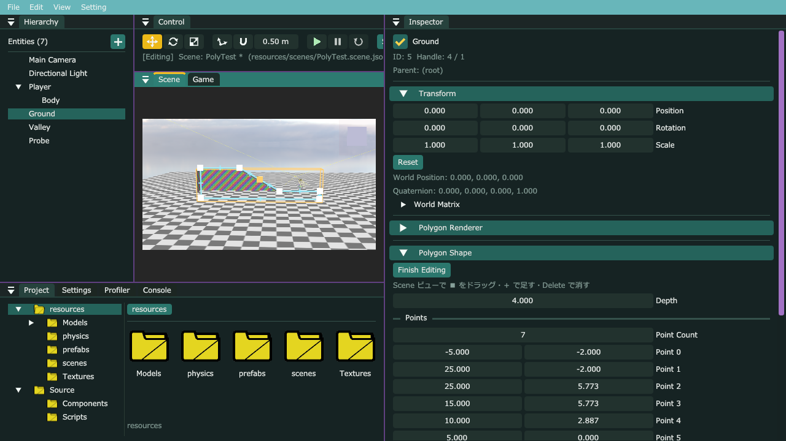

# G6：Polygon Shape（多角形の足場）と形のエディタ

## このファイルについて
- [AL4_01Game.md](AL4_01Game.md) の **G6**（P1・一番重い Step）。G5（[G5Player.md](G5Player.md)）の続き。
- やること
  1. **エンジン：多角形の計算**（面積・中か外か・一番近い辺・形がおかしくないか・**耳切り法**で三角形に分ける）
  2. **エンジン：Polygon Shape・Polygon Renderer**（横から見た形を奥へ押し出した足場。テクスチャはワールド座標で貼る。形が変わった時だけメッシュを作り直す）
  3. **エンジン：Collider の Polygon**（球 × 多角形の押し出し・レイ・線。三角形に分けずに、辺と「中か外か」で調べる）
  4. **エディタ：形のエディタ**（Inspector の Edit Shape → Scene ビューで点をドラッグ・＋で足す・Delete で消す・Undo）と、Hierarchy の ＋ → 3D Object → Polygon
  5. **ゲーム：坂の上で止まる**（IceCube。坂に沿った速さにして、立っている間は重力を切る。坂に着地してもずり落ちない）
  6. **エディタ：Level01 の足場を Polygon にする**
- **パートの順番**：A → B → C → D（B は A の計算、C は B の `CalcWorldPolygon`、D は B・C を使う）。E（ゲーム）は C の後ならいつでも。F は全部の後。
- 確かめた環境：本体の master（742ce28 ＝ G5 まで）＋ このファイル、AL4_01 のコピー ＋ パートE。Release でテスト用のシーンを動かし、入力を時間で流してログで数字を確かめた。Debug ではエディタを起動して、メッセージでマウスを動かして Edit Shape を確かめた（8章）。

| パート | ファイル | 何をするか |
|---|---|---|
| A | `Math/Geometry/Polygon.h/.cpp`（新しく作る） | 多角形の計算（`ExtrudedPolygon`・`Polygon2D`） |
| B | `Components/PolygonShapeComponent.h`・`PolygonRendererComponent.h`・`Systems/PolygonShapeSystem.h/.cpp`（新しく作る）・`Engine.cpp`・`Window/WindowManager.cpp`・`Components/PrimitiveRendererComponent.h`・`Systems/PrimitiveRenderSystem.cpp` | 形と見た目 |
| C | `Collision/Collision.h/.cpp`・`Components/ColliderComponent.h`・`Systems/CollisionSystem.h/.cpp`・`Systems/PhysicsSystem.cpp`・`Systems/ElasticSurfaceSystem.cpp` | 当たり |
| D | `Camera/Camera.h/.cpp`・`Editor/Inspector/ComponentEditor.h`・`Editor/Gizmos/PolygonShapeGizmo.h/.cpp`（新しく作る）・`Editor/Gizmos/SceneGizmo.cpp`・`Editor/Viewport/ScenePicking.h/.cpp`・`Editor/Windows/HierarchyWindow.cpp` | 形のエディタ・クリックで選ぶ・作るメニュー |
| （B〜D） | `MyEngine_v1.vcxproj` | 新しい 8 ファイル |
| E | `Source/Scripts/IceCube.h/.cpp`（AL4_01） | 坂の上で止まる |
| F | エディタで | Level01 の足場を Polygon に |

---

## 0. 前の写経で気づいた所（しなくてもよい）
G5 をコミットする前に、写経したコードと答えを見比べた。**動きが変わる違いは無かった**。

| ファイル | 違い | 起きること |
|---|---|---|
| `CameraSystem.cpp` | `CalcSmoothRate` の上の説明（`t ＝ 1 − e^(−経過時間 ÷ smoothTime)…`）と、`CalcWantedLookAhead` の上の説明（`velocity は追う物の速さ…`）の2行が無い。`<algorithm>` の include の順番 | 無し（コメント・並びだけ） |
| `PhysicsSystem.cpp` | `// ===== 3. 動いた量を Transform へ =====` の後ろの説明が短い | 無し |
| `MyEngine_v1.vcxproj.filters` | `CameraFollowComponent.h` に `<Filter>MyEngine\Components</Filter>` が無い | ソリューションエクスプローラーで、Components フォルダではなく一番上に出る（VS で Components フォルダへドラッグすれば直る） |

- G5 で書いた `CollisionSystem.cpp` の `"Height###height "`（最後に空白）もそのまま（直すなら G5Player.md の 0章）。

---

## 1. 何をするか（なぜこう作ったか）

### 1.1 3つの Component に分ける
```
Ground（Entity）
 ├ Polygon Shape     … 形だけ（外周の点・奥行き）。下の2つが同じ形を読む
 ├ Polygon Renderer  … 見た目（Primitive Renderer と同じ Material）
 └ Collider（Shape：Polygon） … 当たり
```
- Unity の MeshFilter（形）・MeshRenderer（見た目）・MeshCollider（当たり）と同じ考え。**形は1か所にだけ持つ**ので、点を動かすと、見た目と当たりが一緒に変わる。
- 当たりの無い飾り（手前の岩のシルエット）は、Collider を付けなければいい。見えない壁は、Renderer を付けなければいい。
- 形と見た目の登録・描画は、1つの System（`PolygonShapeSystem`）にまとめた（形だけの System は、登録しかすることが無いので）。

### 1.2 点の持ち方（`std::array` ＋ 点の数）
- Component は `memcpy` で写す（Undo・Prefab・Play/Stop の写し）ので、`std::vector` を入れられない（中身がほかの場所にあるので、写しても中身は写らない）。
- なので **決まった大きさの配列（`std::array<Vector2, 32>`）＋ 使っている数（`pointCount`）** で持つ。32 点あれば足場の形には十分。
- 保存は `point0`・`point1`… の名前で、使っている数だけ（`Describe` で、先に `pointCount` を読んでから、その数だけ点を読む）。

### 1.3 三角形に分ける（耳切り法・Ear Clipping）
GPU が描けるのは三角形だけなので、前の面（多角形）を三角形に分ける。

```
  点 0〜5 の多角形（へこんだ所がある）       「耳」＝ 隣の2点と結んだ三角形が
                                              ・とがっている（左回り）
      3───2                                   ・中にほかの点が入っていない
     /     │                                  角。切り取っても、残りは多角形のまま
    4      │
    │\     │      1. 耳を探す（4 はへこんでいるので耳ではない。2 は耳）
    5 ╲    │      2. 耳の三角形（1-2-3）を描く三角形にして、点 2 を外す
    │  ╲   │      3. 残りが 3 点になるまで、1・2 をくり返す
    0────╲─1      点が n 個なら、三角形は n−2 個
```

- **へこんだ形も分けられる**（凸な形だけなら、点 0 から扇形に結ぶだけでいいが、それだと元のゲームのような岩は作れない）。
- 1回の耳探しで全部の点を見るので、点の数の 3 乗くらいかかる（32 点で 3 万回くらい）。速い方法もあるが、32 点ならこれで十分。そのかわり、**形が変わった時だけ作り直す**（1.6）。
- 点が時計回りに並んでいたら、反時計回りに並べ直してから分ける（「とがっている＝左回り」で判定するので）。回り方は**符号付きの面積（靴ひもの公式）**の＋−で分かる。
- 一直線に並んだ点（辺の途中の点）は、どの三角形にもとがっていないので、耳が見つからなくなることがある。そのときは、その点を三角形を作らずに外す。
- **辺が交差している形**（8 の字）は三角形に分けられないので描かない（エディタで線が赤くなる）。

### 1.4 当たり：球 × 多角形（三角形に分けない）
```
         ↑ 押す向き（辺の点 → 中心）
         ●  球の中心が外：一番近い辺の点から、中心への向きに「半径 − 距離」
  ───────┷─────────

  ───────┯─────────
         ●  球の中心が中：中心から、一番近い辺の点への向きに「距離 ＋ 半径」
         ↓ 辺の点（ここを越えて、外で触れる所まで出す）
```
- 「中か外か」は、**中心から右へ線を伸ばして、辺と交わる回数が奇数なら中**（Crossing Number）。へこんだ形でも同じ。
- **三角形に分けて判定しない理由**：分けると、分けた所の線（本当は辺ではない）でも押し出されて、平らな床の上で引っかかる・跳ねる。外周の辺だけを見れば、床はずっと平ら。
- **Z も押す**：中心が外なら「形の表面で一番近い点（X・Y は中なら中心のまま／外なら一番近い辺の点、Z は奥行きの範囲に収めた所）」から離れる向きへ。中心が中なら「横の辺・前の面・後ろの面」のうち一番近い所から（箱の押し出しと同じ考え）。Freeze Position Z の物は Z の向きを使わないので、横から見るゲームの動きは X・Y だけで押すのと同じ（8章の数字は変わらなかった）。
- 囲む箱（`box`）に触れていなければ、辺を1本ずつ調べる前に「当たらない」と分かる（足場が多くても軽い）。
- **当たる相手は球だけ**（カプセルは、今までどおり「線分の上の一番近い点の球」に置き換えるので当たる）。箱 × 多角形・多角形 × 多角形は作っていない（`false`）。プレイヤーは球、ギミックの Trigger は足場と当たる必要が無いので、要らない。
- 「触れているか」は、両方を少し太らせて調べる（`Inflate`）。多角形は辺を外へずらすと形が変わるので、「太らせた量（`radius`）」を覚えて、球の半径に足して調べる（同じ意味）。

### 1.5 レイ（Raycast・Scene ビューでクリックして選ぶ）
1. 奥行き（Z）の間にいる t の範囲（tEnter〜tExit）を出す（箱のスラブ法の Z だけ版）。
2. 入った所（tEnter）が、横から見て多角形の中なら、そこで当たる（前の面・後ろの面）。
3. そうでなければ、横から見て**レイが辺を横切る所**のうち、範囲の中で一番手前（横の面）。
   - 「レイの点 ＝ 辺の点」の式 `o + d·t = a + e·s` の両辺に「辺 e との外積」を取ると s の項が消えて t が出る。「向き d との外積」を取ると t が消えて s が出る（s が 0〜1 なら辺の上）。

### 1.6 メッシュを覚えておく
- 耳切り法は軽くないので、毎フレームはやらない。Entity ごとに「作ったときの形・ワールド行列・UV の作り方」と、作ったメッシュを覚えておき、**どれかが変わった時だけ作り直す**。
- 比べ方は `std::memcmp`（バイトの並びをそのまま比べる）。Component・行列は `memcpy` で写せる型なので、中身をそのまま比べられる。
- 描くときは、覚えているメッシュを写して `Renderer::DrawMesh` に渡す（Renderer がフレームの終わりまで持つので、写しを渡す）。

### 1.7 見た目：ワールド座標の UV
- 前の面の UV は「ワールドの X・Y」（m）。**足場を動かしても伸ばしても、テクスチャは伸びず、隣の足場と絵がつながる**（元のゲームの「同じ岩のテクスチャで、形だけ違う」）。UV Scale が 2 なら 2m に1枚。
- 横の面の UV は「外周に沿った長さ, 前からの奥行き」。横の面は Side Shade の分だけ暗くする（頂点に色が無いので、前の面と横の面を別々に描いて、横は色を暗くする）。
- 後ろの面はカメラから見えないので作らない（Scene ビューで後ろから見ると、前の面の裏が見える）。

### 1.8 形のエディタ
```
Inspector の Edit Shape ─→ PolygonShapeSystem::SetEditing(true)（編集中かどうかは、ここに1つ）
                                     │
Scene ビュー（SceneGizmo::Draw）─→ PolygonShapeGizmo::Draw
                                     ├ 選んでいる Entity に Polygon Shape が無い → 編集を終わる
                                     ├ 点・辺・＋ を描く（画面の位置は Camera::WorldToScreenPoint）
                                     ├ 押す・ドラッグ・離す（マウスのレイと、前の面の平面の交わる所 → Entity から見た位置）
                                     ├ Delete・Esc
                                     └ true を返す → SceneGizmo は移動のギズモ・クリックで選び直すのをしない
```
- **Undo**：ドラッグ（足す・消す）の前に `ComponentEditor::Save` で中身を写しておき、終わったら `EditorHistory::RecordComponentChange` に「前」と「後」を渡す（Transform のギズモと同じ入口）。1回のドラッグで1件の履歴。
- どの Component の変更かを渡すのに、その型の `ComponentEditor` が要る。SceneGizmo にあった Transform 用の探し方（`FindTransformEditor`）を、どの型でも使える `ComponentEditorRegistry::Find<T>()` にして、ComponentEditor.h に移した（同じコードを2か所に書かないように）。
- **少し動かすまで点を動かさない**（`ImGui::IsMouseDragging`）。押しただけで、グリッドに吸い付いて位置が変わらないように（テストで、＋で足した点が辺の真ん中から 0.14m ずれたので直した）。
- 画面の位置 → ピクセルは SceneGizmo と同じ式。ワールド → 画面の位置は、`Camera::ScreenPointToRay` の逆の `Camera::WorldToScreenPoint` を足した。

### 1.9 坂の上で止まる（IceCube）
足場の摩擦は 0（G5）。重力のままだと、**重力の「坂に沿った分」で、止まっていても坂をずり落ちる**（30 度なら 1 秒に 22m/s ずつ速くなる）。

| すること | 中身 |
|---|---|
| 坂に沿った速さだけにする | 足元の向き（当たりの normal）(nx, ny) を右に 90 度回した (ny, −nx) が「坂に沿った右向き」。速さはこの向きの量だけを、入力へ近づける（今までの横の速さと同じ） |
| 立っている間は重力を切る | 重力が無ければ、ずり落ちない |
| 足元へ少し押し付ける（2m/s） | 重力を切ると、床にちょうど触れた所で浮いて、Is Grounded が切れたり付いたりする。足元へ押し付けた分は、物理が押し戻すときに消える（動きには出ない） |
| 着地した瞬間は、空中の横の速さから始める | 坂に落ちると、物理が「落ちてきた勢い」を坂に沿った向きへ曲げる（13m/s で落ちると、坂を 6.5m/s で下る速さになる）。そのまま使うと、着地のたびに 0.4m ずり落ちた（8章） |

- 「立っている」＝ 地面にいて（`isOnGround_`）、足元の向きが分かっている（`groundNormal_.y ≥ 0.7`。45 度より急な坂は立てずに滑る）。跳んだフレームは `isOnGround_` が false になるので、跳ぶ速さに押し付けが混ざらない。
- 坂の上の角（下り坂の始まり）を 7m/s で越えると、一瞬だけ浮く（Is Grounded が 1 回切れる。コヨーテタイムがあるので、ジャンプは効く）。

### 1.10 使った STL（あまり使っていない物）
| STL | 中身 | 使った所 |
|---|---|---|
| `std::iota(first, last, 値)` | 範囲に 値, 値+1, 値+2 … と順に入れる（`<numeric>`） | 耳切り法で、点の番号 0, 1, 2 … を並べる |
| `std::ranges::reverse(範囲)` | 範囲を逆の順に並べ替える | 時計回りの点を反時計回りに |
| `std::copy_backward(first, last, d_last)` | [first, last) を、**後ろから**写して d_last で終わる所に置く。右へずらすとき、前から写すと、まだ写していない所を上書きしてしまうので後ろから | 点を足すとき、後ろの点を1つずつ後ろへずらす |
| `std::memcmp(a, b, 大きさ)` | 2つのメモリをバイトで比べる（同じなら 0。`<cstring>`） | 形・行列が前と同じか |
| `std::span<const T>` | 配列の一部を「先頭の場所 ＋ 数」で指す（写さない）。今までも使っている | 使っている点だけを渡す |

---

## 2. パートA：多角形の計算（エンジン）

### `MyEngine/Math/Geometry/Polygon.h`（新しく作る）

```cpp
#pragma once
#include <array>
#include <cstdint>
#include <span>
#include <vector>

#include "MyEngine/Math/Vector2.h"
#include "MyEngine/Math/Vector3.h"

// 多角形の点の数の上限（Polygon Shape の Component は memcpy で写すので、決まった大きさの配列で持つ）
constexpr uint32_t kMaxPolygonPoints = 32;

/// <summary>
/// 多角形を奥（Z）へ押し出した形（当たり判定に使う。ワールド座標）
/// <para>横から見るゲームの足場用。X・Y の形は自由（へこんでいてもよい）で、Z は奥行きの幅だけ</para>
/// </summary>
struct ExtrudedPolygon {
	std::array<Vector2, kMaxPolygonPoints> points{}; // 外周の点（origin から見た X・Y。反時計回りに並べ直してある）
	uint32_t count = 0;                              // 使っている点の数（3 より少なければ、何にも当たらない）
	Vector3 origin = {0.0f, 0.0f, 0.0f};             // 基準の位置（物理で動かすときは、ここだけずらせばよい）
	float halfDepth = 0.0f;                          // 奥行きの半分（Z が origin.z ± halfDepth の間だけ当たる）
	float radius = 0.0f;                             // 外へ太らせた量（角は丸くなる。「触れているか」を調べるときに少し太らせる）

	// 使っている点だけ
	std::span<const Vector2> GetPoints() const { return {points.data(), count}; }
};


/// <summary>
/// 平面の多角形（点を順につなぎ、最後の点から最初の点へ戻る形）の計算
/// <para>点 i → 点 i+1 を「辺 i」と呼ぶ（最後の辺は、最後の点 → 点 0）</para>
/// <para>Polygon Shape の見た目（三角形に分ける）・当たり（中か・一番近い辺）・形のエディタ（形がおかしくないか）で使う</para>
/// </summary>
namespace Polygon2D {

// 符号付きの面積。反時計回り（X 右・Y 上で見て左回り）なら＋、時計回りなら−
float SignedArea(std::span<const Vector2> points);

// point が多角形の中か（辺の上の点は、どちらになるか決まらない）
bool IsPointInside(const Vector2& point, std::span<const Vector2> points);

// 外周（辺）の上で point に一番近い点。edgeIndex には、それが何番の辺の上か
Vector2 ClosestPointOnEdges(const Vector2& point, std::span<const Vector2> points, size_t* edgeIndex = nullptr);

// 辺 edgeIndex の外向きの法線（長さ1）。points は反時計回り（反時計回りなら、辺の進む向きの右側が外）
Vector2 EdgeOutwardNormal(std::span<const Vector2> points, size_t edgeIndex);

// 形として正しいか（点が 3 つ以上・長さ 0 の辺が無い・面積が 0 でない・辺どうしが交差していない）
bool IsSimple(std::span<const Vector2> points);

/// <summary>
/// 三角形に分ける（耳切り法）。indices に点の番号を 3 つずつ足す（時計回りでもよい。中で並べ直す）
/// </summary>
/// <returns>分けられたか（形がおかしいと false）</returns>
bool Triangulate(std::span<const Vector2> points, std::vector<uint32_t>& indices);
}
```

### `MyEngine/Math/Geometry/Polygon.cpp`（新しく作る）

```cpp
#include "Polygon.h"

#include <algorithm>
#include <cmath>
#include <cstddef>
#include <numeric>

namespace Polygon2D {
namespace {
constexpr float kMinEdgeLengthSq = 1e-8f; // これより短い辺は「長さ 0」（同じ所に点が2つある）
constexpr float kMinArea = 1e-6f;         // これより小さい面積は「面積 0」（点が一直線に並んでいる）

// 3 点の回り方。＋なら a → b → c が左回り（反時計回り）、−なら右回り、0 なら一直線
float Orient(const Vector2& a, const Vector2& b, const Vector2& c) { return Cros(b - a, c - a); }

// a・b・c が一直線のとき、c が線分 ab の上（両端も入れる）にあるか
bool IsOnSegment(const Vector2& a, const Vector2& b, const Vector2& c) {
	return (std::min)(a.x, b.x) <= c.x && c.x <= (std::max)(a.x, b.x) && (std::min)(a.y, b.y) <= c.y && c.y <= (std::max)(a.y, b.y);
}

// 線分 p1p2 と q1q2 が交わるか（端が触れているだけでも交わる）
// 線分 q の両端が、線分 p をはさんで反対側にあり（回り方の符号が違う）、逆も同じなら交わっている
bool SegmentsIntersect(const Vector2& p1, const Vector2& p2, const Vector2& q1, const Vector2& q2) {
	const float d1 = Orient(q1, q2, p1);
	const float d2 = Orient(q1, q2, p2);
	const float d3 = Orient(p1, p2, q1);
	const float d4 = Orient(p1, p2, q2);
	if (((d1 > 0.0f && d2 < 0.0f) || (d1 < 0.0f && d2 > 0.0f)) && ((d3 > 0.0f && d4 < 0.0f) || (d3 < 0.0f && d4 > 0.0f))) {
		return true;
	}
	// 一直線に並んだ点が、相手の線分の上にある（端が触れている・重なっている）
	return (d1 == 0.0f && IsOnSegment(q1, q2, p1)) || (d2 == 0.0f && IsOnSegment(q1, q2, p2)) || (d3 == 0.0f && IsOnSegment(p1, p2, q1)) || (d4 == 0.0f && IsOnSegment(p1, p2, q2));
}

// 線分 ab の上で point に一番近い点（Collision::ClosestPointOnSegment の 2D 版）
Vector2 ClosestPointOnSegment(const Vector2& point, const Vector2& a, const Vector2& b) {
	const Vector2 ab = b - a;
	const float lengthSq = LengthSq(ab);
	if (lengthSq < kMinEdgeLengthSq) {
		return a; // 長さ0の辺（点）
	}
	const float t = std::clamp(Dot(point - a, ab) / lengthSq, 0.0f, 1.0f);
	return a + ab * t;
}

// point が三角形 abc（反時計回り）の中か。辺の上も中に入れる（耳の中に別の点が「触れている」だけでも、切り取らない）
bool IsPointInTriangle(const Vector2& point, const Vector2& a, const Vector2& b, const Vector2& c) {
	return Orient(a, b, point) >= 0.0f && Orient(b, c, point) >= 0.0f && Orient(c, a, point) >= 0.0f;
}
} // namespace


//=============================================================================
// 面積・中か・一番近い辺
//=============================================================================
float SignedArea(std::span<const Vector2> points) {
	// 靴ひもの公式：辺ごとに「原点・始点・終点の三角形」の符号付きの面積を足す（外へはみ出した分は、逆向きの三角形で打ち消される）
	float twiceArea = 0.0f;
	for (size_t i = 0; i < points.size(); ++i) {
		twiceArea += Cros(points[i], points[(i + 1) % points.size()]);
	}
	return twiceArea * 0.5f;
}

bool IsPointInside(const Vector2& point, std::span<const Vector2> points) {
	// point から右へ線を伸ばし、辺と交わる回数を数える。奇数なら中（へこんだ形でも同じ）
	bool isInside = false;
	for (size_t i = 0, j = points.size() - 1; i < points.size(); j = i++) {
		const Vector2& a = points[i];
		const Vector2& b = points[j];
		// 辺 ab が point の高さをまたいでいる（片方だけが上）なら、その高さで辺の X を出し、point より右か見る
		if ((a.y > point.y) != (b.y > point.y)) {
			const float crossX = a.x + (point.y - a.y) * (b.x - a.x) / (b.y - a.y);
			if (point.x < crossX) {
				isInside = !isInside;
			}
		}
	}
	return isInside;
}

Vector2 ClosestPointOnEdges(const Vector2& point, std::span<const Vector2> points, size_t* edgeIndex) {
	Vector2 closest = points.empty() ? point : points[0];
	float closestDistanceSq = -1.0f; // まだ無い
	for (size_t i = 0; i < points.size(); ++i) {
		const Vector2 onEdge = ClosestPointOnSegment(point, points[i], points[(i + 1) % points.size()]);
		const float distanceSq = LengthSq(point - onEdge);
		if (closestDistanceSq < 0.0f || distanceSq < closestDistanceSq) {
			closest = onEdge;
			closestDistanceSq = distanceSq;
			if (edgeIndex != nullptr) {
				*edgeIndex = i;
			}
		}
	}
	return closest;
}

Vector2 EdgeOutwardNormal(std::span<const Vector2> points, size_t edgeIndex) {
	// 辺の向き (dx, dy) の右側 (dy, -dx)。反時計回りの多角形では、右側が外
	const Vector2 edge = points[(edgeIndex + 1) % points.size()] - points[edgeIndex];
	return Normalize(Vector2{edge.y, -edge.x});
}


//=============================================================================
// 形がおかしくないか
//=============================================================================
bool IsSimple(std::span<const Vector2> points) {
	const size_t count = points.size();
	if (count < 3 || std::abs(SignedArea(points)) < kMinArea) {
		return false;
	}
	// --- 長さ 0 の辺（同じ所に点が2つ）---
	for (size_t i = 0; i < count; ++i) {
		if (LengthSq(points[(i + 1) % count] - points[i]) < kMinEdgeLengthSq) {
			return false;
		}
	}
	// --- 隣り合っていない辺どうしが交わっていないか（隣の辺とは、点を共有しているので必ず触れている）---
	for (size_t i = 0; i < count; ++i) {
		for (size_t j = i + 2; j < count; ++j) {
			if (i == 0 && j == count - 1) {
				continue; // 最後の辺と最初の辺は隣り合っている（点 0 を共有）
			}
			if (SegmentsIntersect(points[i], points[(i + 1) % count], points[j], points[(j + 1) % count])) {
				return false;
			}
		}
	}
	return true;
}


//=============================================================================
// 三角形に分ける（耳切り法）
//=============================================================================
bool Triangulate(std::span<const Vector2> points, std::vector<uint32_t>& indices) {
	if (points.size() < 3) {
		return false;
	}
	// --- まだ切り取っていない点の番号（反時計回りに並べる）---
	std::vector<uint32_t> remaining(points.size());
	std::iota(remaining.begin(), remaining.end(), 0u); // 0, 1, 2, … と順に入れる
	if (SignedArea(points) < 0.0f) {
		std::ranges::reverse(remaining); // 時計回りなら逆に並べる
	}

	// --- 耳を1つずつ切り取る（点が n 個なら、三角形は n-2 個）---
	// 耳：となりの2点と結んだ三角形が、とがっていて（左回り）、中にほかの点が入っていない角。切り取っても、残りは多角形のまま
	while (remaining.size() > 3) {
		const size_t count = remaining.size();
		bool isCut = false;
		for (size_t i = 0; i < count && !isCut; ++i) {
			const uint32_t prev = remaining[(i + count - 1) % count];
			const uint32_t current = remaining[i];
			const uint32_t next = remaining[(i + 1) % count];
			const Vector2& a = points[prev];
			const Vector2& b = points[current];
			const Vector2& c = points[next];
			// へこんだ角（右回り）・一直線の角は、耳ではない
			if (Orient(a, b, c) <= 0.0f) {
				continue;
			}
			// 三角形の中に、ほかの点が入っていたら耳ではない（切り取ると、その点が外に出てしまう）
			const bool hasInside = std::ranges::any_of(remaining, [&](uint32_t other) {
				return other != prev && other != current && other != next && IsPointInTriangle(points[other], a, b, c);
			});
			if (hasInside) {
				continue;
			}
			indices.insert(indices.end(), {prev, current, next});
			remaining.erase(remaining.begin() + static_cast<std::ptrdiff_t>(i));
			isCut = true;
		}
		if (isCut) {
			continue;
		}
		// --- 耳が無い：一直線の角（三角形にしても面積 0）があれば、三角形を作らずに外す。それも無ければ形がおかしい ---
		size_t straight = count; // 一直線の角が何番目か（count なら無い）
		for (size_t i = 0; i < count; ++i) {
			if (Orient(points[remaining[(i + count - 1) % count]], points[remaining[i]], points[remaining[(i + 1) % count]]) == 0.0f) {
				straight = i;
				break;
			}
		}
		if (straight == count) {
			return false;
		}
		remaining.erase(remaining.begin() + static_cast<std::ptrdiff_t>(straight));
	}
	indices.insert(indices.end(), remaining.begin(), remaining.end());
	return true;
}
}
```

- `Vector2.h` の外積の名前は `Cros`（s が1つ）。前からある関数をそのまま使った。
- 耳の中に「辺の上に乗っている点」があるときも耳にしない（`>= 0.0f`）。乗っている点を外に出してしまうと、残りの形が壊れるので。

---

## 3. パートB：Polygon Shape・Polygon Renderer（エンジン）

### `MyEngine/Components/PolygonShapeComponent.h`（新しく作る）

```cpp
#pragma once
#include <algorithm>
#include <array>
#include <span>
#include <type_traits>

#include "MyEngine/Math/Geometry/Polygon.h"
#include "MyEngine/Math/Vector2.h"

// 横から見た形（多角形）を、奥（Z）へ押し出した形。Entityに付けるComponent（カテゴリ：Rendering3D）
// 形を持つだけ。見た目は Polygon Renderer、当たりは Collider（Shape を Polygon にする）が、同じ Entity のこの形を使う（Unity の MeshFilter と同じ考え）
// 点は Entity のローカル座標の X・Y（Entity の位置・Z の回転・大きさが掛かる）。奥行きは Entity の Z を真ん中に、前後へ Depth の半分ずつ
// 点は Scene ビューで動かせる（Inspector の Edit Shape）。Entity の回転は Z だけ使う（X・Y で回すと、見た目は回るが当たりは回らない）

/// <summary>
/// 多角形を押し出した形
/// </summary>
struct PolygonShapeComponent {
	// 外周の点（左回りでも右回りでもよい。辺どうしが交差してはいけない）。使うのは先頭から pointCount 個
	// Component は memcpy で写すので、std::vector ではなく決まった大きさの配列で持つ
	std::array<Vector2, kMaxPolygonPoints> points = {{{-2.0f, -0.5f}, {2.0f, -0.5f}, {2.0f, 0.5f}, {-2.0f, 0.5f}}};
	int pointCount = 4; // 使っている点の数（3〜kMaxPolygonPoints）
	float depth = 4.0f; // 奥行き（m）

	// 使っている点だけ（pointCount が範囲の外でも、配列の外は読まない）
	std::span<const Vector2> GetPoints() const { return {points.data(), static_cast<size_t>(std::clamp(pointCount, 0, static_cast<int>(kMaxPolygonPoints)))}; }
};

static_assert(std::is_trivially_copyable_v<PolygonShapeComponent>);
```

### `MyEngine/Components/PolygonRendererComponent.h`（新しく作る）

```cpp
#pragma once
#include <type_traits>

#include "MyEngine/Components/PrimitiveRendererComponent.h"

// Polygon Shape（多角形を押し出した形）を描く。Polygon Shape と同じ Entity に付けるComponent（カテゴリ：Rendering3D）
// 描くのは前の面と横の面（後ろの面はカメラから見えないので描かない）。描くのは PolygonShapeSystem
// テクスチャはワールド座標で貼る（UV Scale が 2 なら 2m に1枚）。足場を動かしても伸ばしても絵は伸びず、隣の足場とつながる

/// <summary>
/// 多角形の見た目
/// </summary>
struct PolygonRendererComponent {
	bool enabled = true; // false の間は描かない
	PrimitiveMaterial material = {
	    .color = {0.55f, 0.5f, 0.45f, 1.0f},
	    .uvScale = {2.0f, 2.0f},
	};                         // 見た目（色・テクスチャ・陰の付け方など。Primitive Renderer と同じ）
	float sideShade = 0.7f;    // 横の面の明るさ（前の面の色に掛ける。横から見るゲームで、形の縁が分かるように）
	bool worldSpaceUV = true;  // true：UV をワールド座標で作る（隣の足場と絵がつながる）。false：Entity のローカル座標（足場と一緒に絵も動く）
};

static_assert(std::is_trivially_copyable_v<PolygonRendererComponent>);
```

### `MyEngine/Systems/PolygonShapeSystem.h`（新しく作る）

```cpp
#pragma once
#include "MyEngine/Components/PolygonRendererComponent.h"
#include "MyEngine/Components/PolygonShapeComponent.h"
#include "MyEngine/Math/Geometry/Polygon.h"
#include "MyEngine/Math/Matrix4x4.h"
#include "MyEngine/Math/Vector3.h"

// 前方宣言
class Camera;
class IBLEnvironment;


/// <summary>
/// Polygon Shape（多角形を押し出した形）と Polygon Renderer（その見た目）を登録し、描く
/// <para>形から作った三角形（メッシュ）は覚えておき、形・置き場所が変わった時だけ作り直す（耳切り法は点の数の3乗くらいかかるので）</para>
/// <para>当たりは CollisionSystem（Collider の Shape を Polygon にする）が CalcWorldPolygon で作る</para>
/// <para>Scene ビューでの形の編集は PolygonShapeGizmo（エディタ）。編集中かどうかは、Inspector のボタンから変えるので、ここに置く</para>
/// </summary>
class PolygonShapeSystem {
public:
	// PolygonShapeComponent・PolygonRendererComponent を登録する（置き場所・保存・Inspector）。EntityManager::Initialize の後に呼ぶ
	static void Initialize();
	static void Release();

	/// <summary>
	/// 描画リクエストを積む（WindowManager::DrawAll から。停止中も描く）
	/// </summary>
	/// <param name="environment">環境光（PBR に要る。nullptr なら PBR の形は Half Lambert で描かれる）</param>
	static void Draw(Camera* camera, IBLEnvironment* environment);

	/// <summary>
	/// 形をワールド座標の「押し出した多角形」にする（当たり判定用）
	/// <para>点に offset（Collider の Center）を足してから、ワールド行列を掛ける。奥行きには Z の大きさを掛ける</para>
	/// </summary>
	static ExtrudedPolygon CalcWorldPolygon(const PolygonShapeComponent& shape, const Vector3& offset, const Matrix4x4& worldMatrix);

	// ===== 形の編集（エディタ）=====
	// Scene ビューで、選んでいる Entity の点を動かしているか（Inspector の Edit Shape で切り替える）
	static bool IsEditing();
	static void SetEditing(bool isEditing);
};
```

### `MyEngine/Systems/PolygonShapeSystem.cpp`（新しく作る）

```cpp
#include "PolygonShapeSystem.h"

#include <algorithm>
#include <cmath>
#include <cstring>
#include <format>
#include <memory>
#include <vector>

#include "MyEngine/Components/TransformComponent.h"
#include "MyEngine/Diagnostics/MyAssert.h"
#include "MyEngine/ECS/ComponentSerializer.h"
#include "MyEngine/ECS/ComponentUI.h"
#include "MyEngine/ECS/EntityManager.h"
#include "MyEngine/ECS/GameComponent.h"
#include "MyEngine/Editor/Inspector/ComponentEditor.h"
#include "MyEngine/Graphics/Renderer/Renderer.h"
#include "MyEngine/Math/Color.h"
#include "MyEngine/Systems/PrimitiveRenderSystem.h"

namespace {
constexpr float kMinPointCount = 3.0f; // 点の数の下限（三角形）

/// <summary>
/// 形から作ったメッシュ（Entity 1つ分）。作ったときの形・行列を覚えておき、変わった時だけ作り直す
/// </summary>
struct MeshCache {
	Handle<Entity> entity;                    // 持ち主
	PolygonShapeComponent shape;              // 作ったときの形
	Matrix4x4 worldMatrix;                    // 作ったときのワールド行列
	bool worldSpaceUV = true;                 // 作ったときの UV の作り方
	bool isValid = false;                     // 三角形に分けられたか（辺が交差しているなどで分けられなければ、描かない）
	bool isUsed = false;                      // このフレームの Draw で使ったか（使わなかった物は捨てる）
	std::vector<Vertex3dData> frontVertices;  // 前の面
	std::vector<uint32_t> frontIndices;
	std::vector<Vertex3dData> sideVertices;   // 横の面（少し暗く描くので、前の面と分ける）
	std::vector<uint32_t> sideIndices;
};

/// <summary>
/// PolygonShapeSystem が持つ物（Initialize で作り、Release で消す）
/// </summary>
struct PolygonShapeState {
	std::vector<MeshCache> caches; // 描いている Entity のメッシュ（足場の数しか無いので、順に探せば足りる）
	bool isEditing = false;        // Scene ビューで形を編集しているか
};
std::unique_ptr<PolygonShapeState> state;

// 2つの値がバイト単位で同じか（Component・行列は memcpy で写せる型なので、中身をそのまま比べられる）
template<class T> bool IsSameBytes(const T& a, const T& b) { return std::memcmp(&a, &b, sizeof(T)) == 0; }

// ワールド行列の Z 軸の伸び（3行目の長さ）。奥行きに掛ける
float GetScaleZ(const Matrix4x4& m) { return Length(Vector3{m.m[2][0], m.m[2][1], m.m[2][2]}); }

//=============================================================================
// メッシュを作る
//=============================================================================
//
//   横から見た形（前の面）         斜めから見た形
//     3───────2                      ┌───────┐  ← 横の面（辺ごとに四角1枚）
//     │       │                     ┌┼──────┐│
//     0───────1                     │└──────┼┘
//   耳切り法で三角形に分ける        └───────┘  ← 前の面（後ろの面は見えないので作らない）
//
void BuildMesh(MeshCache& cache) {
	cache.frontVertices.clear();
	cache.frontIndices.clear();
	cache.sideVertices.clear();
	cache.sideIndices.clear();
	const std::span<const Vector2> points = cache.shape.GetPoints();
	// --- 前の面を三角形に分ける（形がおかしければ描かない）---
	cache.isValid = Polygon2D::IsSimple(points) && Polygon2D::Triangulate(points, cache.frontIndices);
	if (!cache.isValid) {
		cache.frontIndices.clear();
		return;
	}
	const size_t count = points.size();
	const float halfDepth = std::abs(cache.shape.depth) * 0.5f;

	// --- 前と後ろの外周（ワールド座標）---
	std::vector<Vector3> front(count);
	std::vector<Vector3> back(count);
	std::vector<Vector2> frontXY(count); // 前の外周の X・Y（横の面の外向きを決める）
	for (size_t i = 0; i < count; ++i) {
		front[i] = TransformPoint({points[i].x, points[i].y, -halfDepth}, cache.worldMatrix);
		back[i] = TransformPoint({points[i].x, points[i].y, halfDepth}, cache.worldMatrix);
		frontXY[i] = {front[i].x, front[i].y};
	}

	// ===== 前の面（法線はカメラの方 = -Z。UV はワールドの X・Y を m 単位で。V は下向きなので Y を逆にする）=====
	Vector3 frontNormal = Normalize(TransformNormal({0.0f, 0.0f, -1.0f}, cache.worldMatrix));
	if (LengthSq(frontNormal) == 0.0f) {
		frontNormal = {0.0f, 0.0f, -1.0f}; // Z の大きさが 0（向きが決まらない）
	}
	cache.frontVertices.reserve(count);
	for (size_t i = 0; i < count; ++i) {
		const Vector2 uv = cache.worldSpaceUV ? Vector2{front[i].x, -front[i].y} : Vector2{points[i].x, -points[i].y};
		cache.frontVertices.push_back({{front[i].x, front[i].y, front[i].z, 1.0f}, uv, frontNormal});
	}

	// ===== 横の面（辺ごとに四角1枚。U は外周に沿った長さ、V は前からの奥行き。法線は辺の外向き）=====
	// 外向きは「反時計回りなら辺の右側」。ワールドで裏返っている（X の大きさがマイナス）と回り方が逆になるので、ワールドの面積で決める
	const bool isCounterClockwise = Polygon2D::SignedArea(frontXY) > 0.0f;
	cache.sideVertices.reserve(count * 4);
	cache.sideIndices.reserve(count * 6);
	float u = 0.0f; // 外周に沿った長さ（m）
	for (size_t i = 0; i < count; ++i) {
		const size_t next = (i + 1) % count;
		const Vector2 outward = Polygon2D::EdgeOutwardNormal(frontXY, i) * (isCounterClockwise ? 1.0f : -1.0f);
		const Vector3 normal = {outward.x, outward.y, 0.0f};
		const float length = Length(front[next] - front[i]);
		const float depth = Length(back[i] - front[i]);
		const uint32_t base = static_cast<uint32_t>(cache.sideVertices.size());
		cache.sideVertices.push_back({{front[i].x, front[i].y, front[i].z, 1.0f}, {u, 0.0f}, normal});
		cache.sideVertices.push_back({{front[next].x, front[next].y, front[next].z, 1.0f}, {u + length, 0.0f}, normal});
		cache.sideVertices.push_back({{back[i].x, back[i].y, back[i].z, 1.0f}, {u, depth}, normal});
		cache.sideVertices.push_back({{back[next].x, back[next].y, back[next].z, 1.0f}, {u + length, depth}, normal});
		cache.sideIndices.insert(cache.sideIndices.end(), {base, base + 1, base + 2, base + 2, base + 1, base + 3});
		u += length;
	}
}

// Entity のメッシュを探す（無ければ足す）
MeshCache& FindOrAddCache(Handle<Entity> entity) {
	const auto it = std::ranges::find(state->caches, entity, &MeshCache::entity);
	if (it != state->caches.end()) {
		return *it;
	}
	MeshCache& added = state->caches.emplace_back();
	added.entity = entity;
	added.shape.pointCount = 0; // どの形とも違うので、最初の Draw で必ず作る
	return added;
}

//=============================================================================
// Inspector と 保存
//=============================================================================
// Polygon Shape の見せ方。Inspector とシーンファイルの両方がこの並びを使う
void DescribePolygonShape(ComponentUI& ui, PolygonShapeComponent& value) {
	// ===== 形の編集（Inspector だけ。保存・読み込みのときは Button がいつも false）=====
	if (ui.Button(state->isEditing ? "Finish Editing###editShape" : "Edit Shape###editShape")) {
		state->isEditing = !state->isEditing;
	}
	ui.Label("Scene ビューで ■ をドラッグ・＋ で足す・Delete で消す");
	ui.Field("Depth###depth", value.depth, AtLeast(0.0f).Tip("奥行き（m）。Entity の Z を真ん中に、前後へ半分ずつ。Entity の Z の大きさも掛かる"));
	// ===== 点（先に数を読むので、シーンファイルから読むときも、その数だけ点を読む）=====
	ui.Separator("Points");
	const int before = value.pointCount;
	ui.Field("Point Count###pointCount", value.pointCount,
	         Range(kMinPointCount, static_cast<float>(kMaxPolygonPoints))
	             .Tip("点の数。Scene ビューで足す・消すこともできる。点は Entity から見た X・Y（m）。辺どうしが交差すると描かない（Scene ビューで線が赤くなる）。Entity の回転は Z だけ使う"));
	value.pointCount = std::clamp(value.pointCount, static_cast<int>(kMinPointCount), static_cast<int>(kMaxPolygonPoints));
	// 増やした点は、最後の点と最初の点の真ん中に置く（前に使っていた所や原点に飛んでいかないように）
	for (int i = (std::max)(before, 1); i < value.pointCount; ++i) {
		value.points[i] = (value.points[i - 1] + value.points[0]) * 0.5f;
	}
	for (int i = 0; i < value.pointCount; ++i) {
		ui.Field(std::format("Point {}###point{}", i, i).c_str(), value.points[i]); // 保存の名前は point0, point1, …
	}
}

// Polygon Renderer の見せ方
void DescribePolygonRenderer(ComponentUI& ui, PolygonRendererComponent& value) {
	ui.Field("Enabled###enabled", value.enabled, Tip("外すと描かない"));
	ui.Field("Side Shade###sideShade", value.sideShade, Range(0.0f, 1.0f).Tip("横の面の明るさ（前の面の色に掛ける。1 で同じ明るさ）"));
	ui.Field("World Space UV###worldSpaceUV", value.worldSpaceUV, Tip("付ける：テクスチャをワールドの位置で貼る（足場を動かしても伸ばしても絵は伸びず、隣の足場とつながる）／外す：足場と一緒に絵も動く"));
	ui.Separator("Material");
	PrimitiveRenderSystem::DescribeMaterial(ui, value.material, "");
}
} // namespace


//=============================================================================
// 初期化 / 解放
//=============================================================================
void PolygonShapeSystem::Initialize() {
	MY_ASSERT_MSG(state == nullptr, "Initialize()が2回以上呼ばれています");
	state = std::make_unique<PolygonShapeState>();

	// Polygon Shape・Polygon Renderer の置き場所・保存・Inspector を登録する（見せ方は Describe〇〇 1つで、保存と Inspector の両方に使う）
	EntityManager::RegisterComponent<PolygonShapeComponent>();
	ComponentSerializer::Register<PolygonShapeComponent>("Polygon Shape", &DescribePolygonShape);
	ComponentEditorRegistry::Register(std::make_unique<DescribedComponentEditor<PolygonShapeComponent>>("Polygon Shape", "Rendering3D", &DescribePolygonShape));
	EntityManager::RegisterComponent<PolygonRendererComponent>();
	ComponentSerializer::Register<PolygonRendererComponent>("Polygon Renderer", &DescribePolygonRenderer);
	ComponentEditorRegistry::Register(std::make_unique<DescribedComponentEditor<PolygonRendererComponent>>("Polygon Renderer", "Rendering3D", &DescribePolygonRenderer));
}

void PolygonShapeSystem::Release() { state.reset(); }


//=============================================================================
// 描画
//=============================================================================
void PolygonShapeSystem::Draw(Camera* camera, IBLEnvironment* environment) {
	MY_ASSERT_MSG(state != nullptr, "PolygonShapeSystem::Initialize()を先に呼んでください");
	for (MeshCache& cache : state->caches) {
		cache.isUsed = false;
	}
	EntityManager::ForEach<PolygonRendererComponent>([camera, environment](Handle<Entity> entity, const PolygonRendererComponent& renderer) {
		if (!renderer.enabled || !EntityManager::IsActiveInHierarchy(entity)) {
			return;
		}
		const PolygonShapeComponent* shape = EntityManager::Get<PolygonShapeComponent>(entity);
		const TransformComponent* transform = EntityManager::Get<TransformComponent>(entity);
		if (shape == nullptr || transform == nullptr) {
			return; // 形が無い（Polygon Shape を外した）
		}
		// --- 形・置き場所・UV の作り方が、前に作ったときと違えば作り直す ---
		MeshCache& cache = FindOrAddCache(entity);
		cache.isUsed = true;
		if (!IsSameBytes(cache.shape, *shape) || !IsSameBytes(cache.worldMatrix, transform->worldMatrix) || cache.worldSpaceUV != renderer.worldSpaceUV) {
			cache.shape = *shape;
			cache.worldMatrix = transform->worldMatrix;
			cache.worldSpaceUV = renderer.worldSpaceUV;
			BuildMesh(cache);
		}
		if (!cache.isValid) {
			return;
		}
		// --- 前の面・横の面（横は色を暗くする）。覚えているメッシュは写して渡す（Renderer がフレームの終わりまで持つので）---
		Renderer::MeshConfig config;
		PrimitiveRenderSystem::ApplyMaterial(config, renderer.material, environment);
		config.camera = camera;
		Renderer::DrawMesh(config, cache.frontVertices, cache.frontIndices);
		const Vector4& color = renderer.material.color;
		const float shade = std::clamp(renderer.sideShade, 0.0f, 1.0f);
		config.color = ToColorCode({color.x * shade, color.y * shade, color.z * shade, color.w});
		Renderer::DrawMesh(config, cache.sideVertices, cache.sideIndices);
	});
	// 描かなかった物（消えた・外した・無効にした）のメッシュを捨てる
	std::erase_if(state->caches, [](const MeshCache& cache) { return !cache.isUsed; });
}


//=============================================================================
// 当たり判定用の形
//=============================================================================
ExtrudedPolygon PolygonShapeSystem::CalcWorldPolygon(const PolygonShapeComponent& shape, const Vector3& offset, const Matrix4x4& worldMatrix) {
	ExtrudedPolygon result;
	result.origin = TransformPoint(offset, worldMatrix);
	const std::span<const Vector2> points = shape.GetPoints();
	result.count = static_cast<uint32_t>(points.size());
	for (size_t i = 0; i < points.size(); ++i) {
		const Vector3 world = TransformPoint({points[i].x + offset.x, points[i].y + offset.y, offset.z}, worldMatrix);
		result.points[i] = {world.x - result.origin.x, world.y - result.origin.y};
	}
	// 当たり判定は反時計回りの並びで考えるので、時計回りなら逆に並べる（Inspector の並び・X の大きさがマイナスで裏返した物）
	if (Polygon2D::SignedArea(result.GetPoints()) < 0.0f) {
		std::reverse(result.points.begin(), result.points.begin() + result.count);
	}
	result.halfDepth = std::abs(shape.depth) * 0.5f * GetScaleZ(worldMatrix);
	return result;
}


//=============================================================================
// 形の編集
//=============================================================================
bool PolygonShapeSystem::IsEditing() { return state != nullptr && state->isEditing; }

void PolygonShapeSystem::SetEditing(bool isEditing) {
	MY_ASSERT_MSG(state != nullptr, "PolygonShapeSystem::Initialize()を先に呼んでください");
	state->isEditing = isEditing;
}
```

- `FindOrAddCache` で足すときに `shape.pointCount = 0` にしておく：Inspector から作った形は、どれも点が 3 つ以上なので、必ず「前と違う」になって、最初の Draw でメッシュが作られる。
- `DescribePolygonShape` の Button は、Inspector で押したときだけ true（シーンファイルを読む・書くときはいつも false）。

### `MyEngine/Engine.cpp`（3か所）
**1. include**（`PrimitiveRenderSystem.h` の下）

```cpp
#include "MyEngine/Systems/PrimitiveRenderSystem.h"
#include "MyEngine/Systems/PolygonShapeSystem.h"
#include "MyEngine/Scene/PrefabManager.h"
```

**2. 初期化**（`PrimitiveRenderSystem::Initialize` の下）

```cpp
	PrimitiveRenderSystem::Initialize(); // Primitive RendererをEntityManagerに登録する（保存・Inspectorも）ので、EntityManagerの後
	PolygonShapeSystem::Initialize();    // Polygon Shape・Polygon RendererをEntityManagerに登録する（保存・Inspectorも）ので、EntityManagerの後
	AnimationSystem::Initialize(); // AnimatorをEntityManagerに登録する（保存・Inspectorも）ので、EntityManagerの後
```

**3. 解放**（`PrimitiveRenderSystem::Release` の下）

```cpp
	PrimitiveRenderSystem::Release(); // シーン（ウィンドウ）の破棄より後にする
	PolygonShapeSystem::Release();    // シーン（ウィンドウ）の破棄より後にする
```

### `MyEngine/Window/WindowManager.cpp`（2か所）
**1. include**（`PrimitiveRenderSystem.h` の下）

```cpp
#include "MyEngine/Systems/PrimitiveRenderSystem.h"
#include "MyEngine/Systems/PolygonShapeSystem.h"
```

**2. `DrawAll`**（`PrimitiveRenderSystem::Draw` の下）

```cpp
	PrimitiveRenderSystem::Draw(gameCamera, gameEnvironment); // 決まった形（球・箱）の描画
	PolygonShapeSystem::Draw(gameCamera, gameEnvironment);    // 多角形を押し出した形（足場）の描画
```

### `MyEngine/Components/PrimitiveRendererComponent.h`（1か所。説明だけ）

```cpp
/// モデルのファイルを使わない形の見た目（Primitive Renderer の球・箱、Elastic Surface の板・支柱、Polygon Renderer の足場で共通）
```

### `MyEngine/Systems/PrimitiveRenderSystem.cpp`（1か所。`DescribeMaterial` の UV Scale の説明だけ）

```cpp
	ui.Field(label("UV Scale", "uvScale").c_str(), material.uvScale, AtLeast(kMinUVScale).Tip("テクスチャ1枚の大きさ。Elastic Surface・Polygon Renderer は m、Primitive Renderer は1面を1として（0.5 なら1面に2回くり返す）"));
```

---

## 4. パートC：当たり（エンジン）

### `MyEngine/Components/ColliderComponent.h`（1か所。`ColliderShape` に足す）

```cpp
	Capsule, // カプセル（縦の線分を半径で太らせた形。円柱の上下に半球）。中心・半径・高さ。Entityを回してもいつも立ったまま（プレイヤー向け）
	Polygon, // 多角形を押し出した形。同じ Entity の Polygon Shape の点を使う（横から見るゲームの足場）。球・カプセルとだけ当たる（箱・多角形とは当たらない）
};
```

- `switch (… .shape)` に Polygon の case を足す所：`CollisionSystem.cpp` の5か所・`ElasticSurfaceSystem.cpp` の1か所。

### `MyEngine/Collision/Collision.h`（2か所）
**1. include を並べ直して、`Polygon.h` を足す**

```cpp
#include "MyEngine/Math/Geometry/AABB.h"
#include "MyEngine/Math/Geometry/Capsule.h"
#include "MyEngine/Math/Geometry/Plane.h"
#include "MyEngine/Math/Geometry/Polygon.h"
#include "MyEngine/Math/Geometry/Ray.h"
#include "MyEngine/Math/Geometry/Sphere.h"
```

**2. 押し出しとレイに足す**（`PushOutAABBAABB` の下）

```cpp
bool PushOutAABBAABB(const AABB& a, const AABB& b, Vector3* push, AxisLock lock = {});
// 多角形を押し出した形と球。横の面・前の面・後ろの面の一番近い所から出す。へこんだ形も、三角形に分けずにそのまま調べる
bool PushOutSpherePolygon(const Sphere& a, const ExtrudedPolygon& b, Vector3* push, AxisLock lock = {});
bool PushOutPolygonSphere(const ExtrudedPolygon& a, const Sphere& b, Vector3* push, AxisLock lock = {});
bool RayCapsule(const Ray& ray, const Capsule& capsule, float* t = nullptr);
// 多角形を押し出した形（前の面・後ろの面・横の面のどこに当たっても。始点が中なら t=0）
bool RayPolygon(const Ray& ray, const ExtrudedPolygon& polygon, float* t = nullptr);
```

### `MyEngine/Collision/Collision.cpp`（3か所）
**1. include を3つ足す**

```cpp
#include <cmath>
#include <cfloat>
#include <chrono>
#include <span>
#include <utility>
#include <algorithm>
```

**2. 球 × 多角形**（`PushOutAABBAABB` の下、「レイキャスト」の大見出しの上）

```cpp
// ===== 球を、多角形を押し出した形から =====
//
//   中心が形の外：形の表面で一番近い点から、中心へ向かう向きに「半径 − 距離」だけ（箱の PushOutSphereAABB と同じ考え）
//                 表面で一番近い点 ＝ X・Y は「中なら中心のまま／外なら一番近い辺の点」、Z は奥行きの範囲に収めた所
//   中心が形の中：横の辺・前の面・後ろの面のうち、一番近い所から外へ「そこまでの距離 ＋ 半径」だけ（止めた軸の向きは使わない）
//
//   三角形に分けずに、外周の辺と「中か外か」だけで調べるので、へこんだ形でも、分けた所の線（本当は無い辺）で引っかからない
bool PushOutSpherePolygon(const Sphere& a, const ExtrudedPolygon& b, Vector3* push, AxisLock lock) {
	if (b.count < 3) {
		return false; // 形が無い
	}
	const float radius = a.radius + b.radius; // 多角形を太らせた分も、球の半径に足して調べる（同じこと）
	// --- 多角形の点は origin から見た位置なので、球の中心も origin から見る ---
	const std::span<const Vector2> points = b.GetPoints();
	const Vector2 center = {a.center.x - b.origin.x, a.center.y - b.origin.y};
	const float z = a.center.z - b.origin.z; // 奥行きの真ん中から見た Z（−halfDepth が前の面、＋halfDepth が後ろの面）
	size_t edge = 0;                         // 一番近い辺の番号
	const Vector2 closest = Polygon2D::ClosestPointOnEdges(center, points, &edge);
	const bool isInsideXY = Polygon2D::IsPointInside(center, points);
	const bool isInsideZ = std::abs(z) <= b.halfDepth;

	// ===== 中心が形の外 =====
	if (!isInsideXY || !isInsideZ) {
		const Vector2 nearXY = isInsideXY ? center : closest;
		const float nearZ = std::clamp(z, -b.halfDepth, b.halfDepth);
		const Vector3 difference = {center.x - nearXY.x, center.y - nearXY.y, z - nearZ}; // 表面の点から中心へ
		const float distanceSq = LengthSq(difference);
		if (distanceSq >= radius * radius) {
			return false; // 半径より離れている
		}
		const float distance = std::sqrt(distanceSq);
		const Vector3 direction = RemoveLockedAxes(difference, lock); // 止めた軸へは押さない
		if (distance > kPushEpsilon && LengthSq(direction) >= kPushEpsilon * kPushEpsilon) {
			const float depth = radius - distance; // 重なっている深さ
			if (depth <= kPushEpsilon) {
				return false;
			}
			*push = Normalize(direction) * depth;
			return true;
		}
		// 中心がちょうど表面の上（向きが決まらない）・押せない向きだった：下の「中」と同じく、一番近い所から出す
	}

	// ===== 中心が形の中：横の辺・前の面・後ろの面のうち、押してよい向きで一番近い所から =====
	Vector3 bestDirection = {0.0f, 0.0f, 0.0f};
	float bestDepth = -1.0f; // まだ無い
	const auto consider = [&](const Vector3& direction, float depth) {
		const Vector3 free = RemoveLockedAxes(direction, lock);
		if (LengthSq(free) < kPushEpsilon * kPushEpsilon) {
			return; // 止めた軸の向きしか無い（押せない）
		}
		if (bestDepth < 0.0f || depth < bestDepth) {
			bestDirection = Normalize(free);
			bestDepth = depth;
		}
	};
	// 横の辺：中心から一番近い辺の点へ。中心がちょうど辺の上（距離 0）なら、その辺の外向き
	const Vector2 toEdge = closest - center;
	const float edgeDistance = Length(toEdge);
	const Vector2 edgeDirection = (edgeDistance > kPushEpsilon) ? toEdge / edgeDistance : Polygon2D::EdgeOutwardNormal(points, edge);
	consider({edgeDirection.x, edgeDirection.y, 0.0f}, edgeDistance + radius);
	consider({0.0f, 0.0f, -1.0f}, z + b.halfDepth + radius); // 前の面（−Z）から
	consider({0.0f, 0.0f, 1.0f}, b.halfDepth - z + radius);  // 後ろの面（＋Z）から
	if (bestDepth <= kPushEpsilon) {
		return false; // 全部の軸を止めてある
	}
	*push = bestDirection * bestDepth;
	return true;
}

// ===== 多角形を球から（球を多角形から出す向きの、反対へ）=====
bool PushOutPolygonSphere(const ExtrudedPolygon& a, const Sphere& b, Vector3* push, AxisLock lock) {
	if (!PushOutSpherePolygon(b, a, push, lock)) {
		return false;
	}
	*push = -*push;
	return true;
}
```

**3. レイ × 多角形**（`RayCapsule` の下、「ユーティリティ」の大見出しの上）

```cpp
// ===== 多角形を押し出した形 =====
// 1. 奥行き（Z）の間にいる t の範囲（tEnter〜tExit）を出す（RayAABB のスラブ法の、Z だけ版）
// 2. 入った所（tEnter）が、横から見て多角形の中なら、そこで当たる（前の面・後ろの面。始点が中なら 0）
// 3. 中でなければ、横から見てレイが辺を横切る所のうち、tEnter〜tExit の間で一番手前（横の面）
bool RayPolygon(const Ray& ray, const ExtrudedPolygon& polygon, float* t) {
#ifdef _DEBUG
	COLLISION_PROFILE();
#endif
	if (polygon.count < 3) {
		return false;
	}
	// --- 1. 奥行きの間 ---
	const float minZ = polygon.origin.z - polygon.halfDepth;
	const float maxZ = polygon.origin.z + polygon.halfDepth;
	float tEnter = 0.0f;
	float tExit = FLT_MAX;
	if (std::abs(ray.direction.z) < 1e-8f) {
		if (ray.origin.z < minZ || ray.origin.z > maxZ) {
			return false; // Z に動かないレイが、奥行きの外を通る
		}
	} else {
		float t1 = (minZ - ray.origin.z) / ray.direction.z;
		float t2 = (maxZ - ray.origin.z) / ray.direction.z;
		if (t1 > t2) {
			std::swap(t1, t2); // 奥から手前へ向かうレイ
		}
		tEnter = (std::max)(t1, 0.0f);
		tExit = t2;
		if (tEnter > tExit) {
			return false; // 奥行きの間は、レイの後ろ
		}
	}
	// --- 2. 前の面・後ろの面（入った所が中か）---
	const std::span<const Vector2> points = polygon.GetPoints();
	const Vector2 origin = {ray.origin.x - polygon.origin.x, ray.origin.y - polygon.origin.y}; // 横から見た始点（多角形の origin から）
	const Vector2 direction = {ray.direction.x, ray.direction.y};                               // 横から見た向き
	if (Polygon2D::IsPointInside(origin + direction * tEnter, points)) {
		if (t) {
			*t = tEnter;
		}
		return true;
	}
	// --- 3. 横の面：origin + direction × t ＝ a + 辺 × s を解く（t がレイの上の位置、s が辺の上の位置 0〜1）---
	// 両辺に「辺との外積」を取ると s の項が消えて t が出る。「向きとの外積」を取ると t が消えて s が出る
	bool isHit = false;
	float nearest = tExit;
	for (size_t i = 0; i < points.size(); ++i) {
		const Vector2& a = points[i];
		const Vector2 edge = points[(i + 1) % points.size()] - a;
		const float denominator = Cros(direction, edge);
		if (std::abs(denominator) < 1e-12f) {
			continue; // 辺と平行（横から見て、交わらない）
		}
		const Vector2 toA = a - origin;
		const float edgeT = Cros(toA, edge) / denominator;
		const float s = Cros(toA, direction) / denominator;
		if (s < 0.0f || s > 1.0f || edgeT < tEnter || edgeT > nearest) {
			continue; // 辺の外・奥行きの外・もっと手前で当たっている
		}
		nearest = edgeT;
		isHit = true;
	}
	if (isHit && t) {
		*t = nearest;
	}
	return isHit;
}
```

- `kPushEpsilon`・`RemoveLockedAxes` は、同じファイルの前からある物。
- `std::swap` は `<utility>`、`FLT_MAX` は `<cfloat>`。

### `MyEngine/Systems/CollisionSystem.h`（3か所）
**1. `WorldCollider` に足す**（`capsule` の下）

```cpp
	Capsule capsule{};                           // shape が Capsule のとき使う（いつも立っている。start が下の端の球の中心、end が上の端の球の中心）
	ExtrudedPolygon polygon{};                   // shape が Polygon のとき使う（box には、それを囲む箱が入る）
	bool isTrigger = false;                      // すり抜ける（押し戻さない）
```

**2. `CalcWorldCollider` の説明**

```cpp
	/// Collider を、ワールド座標の球・箱・カプセル・多角形にする（Transform のワールド行列を使うので、UpdateTransforms の後に呼ぶ）
	/// <para>Entityの回転と大きさも掛かる（箱・カプセルは回らない。大きさだけ軸ごとに掛かる。多角形は Z の回転だけ効く）</para>
	/// <para>多角形は同じ Entity の Polygon Shape の点を使う（無ければ点 0 個＝何にも当たらない）</para>
```

**3. `CalcPushOut` の説明**（1行直して、1行足す）

```cpp
	/// <para>形の組み合わせ（球・箱・カプセル・多角形）で、使う関数を選ぶ。カプセルは ReplaceCapsulesWithSpheres で球にしてから出す</para>
	/// <para>多角形は球とだけ当たる（カプセルは球にしてから）。箱 × 多角形・多角形 × 多角形は、いつも false（当たらない）</para>
```

### `MyEngine/Systems/CollisionSystem.cpp`（9か所）
**1. include を2つ足す**

```cpp
#include "MyEngine/Collision/Collision.h"
#include "MyEngine/Components/PolygonShapeComponent.h"
#include "MyEngine/Components/TransformComponent.h"
```

```cpp
#include "MyEngine/Graphics/Renderer/Renderer.h"
#include "MyEngine/Systems/PolygonShapeSystem.h"
```

**2. `Inflate` に1行足し、その下に `CalcPolygonBounds` を足す**

```cpp
// 形を distance だけ太らせる（球・カプセルは半径を、箱は6つの面を外へ。多角形は太らせた量を覚える＝角の丸い形になる）
WorldCollider Inflate(const WorldCollider& collider, float distance) {
	WorldCollider result = collider;
	const Vector3 grow = {distance, distance, distance};
	result.sphere.radius += distance;
	result.box = {collider.box.min - grow, collider.box.max + grow};
	result.capsule.radius += distance;
	result.polygon.radius += distance;
	return result;
}

// 多角形を囲む箱（ワールド座標）。早く「当たらない」と分かる所を見るのと、カプセルを球に置き換えるときに使う
AABB CalcPolygonBounds(const ExtrudedPolygon& polygon) {
	const Vector3& origin = polygon.origin;
	AABB box = {
	    {origin.x, origin.y, origin.z - polygon.halfDepth},
	    {origin.x, origin.y, origin.z + polygon.halfDepth},
	};
	for (const Vector2& point : polygon.GetPoints()) {
		box.min.x = (std::min)(box.min.x, origin.x + point.x);
		box.min.y = (std::min)(box.min.y, origin.y + point.y);
		box.max.x = (std::max)(box.max.x, origin.x + point.x);
		box.max.y = (std::max)(box.max.y, origin.y + point.y);
	}
	return box;
}
```

**3. `NearestPointOnCapsule` の説明に1行足す**

```cpp
// カプセルの線分の上で、相手（球・箱）に一番近い点。箱に入っていれば、一番深く入っている点
// 多角形は、囲む箱（box）で同じように選ぶ（立っているカプセルが足場に乗るなら、下の端の球になる）
Vector3 NearestPointOnCapsule(const Capsule& capsule, const WorldCollider& other) {
```

**4. 線（ギズモ）：`PushBox` の下に `PushPolygon` を足す**

```cpp
// ===== 多角形：前の面と後ろの面の外周、点ごとに前から後ろへの線 =====
void PushPolygon(std::vector<Renderer::LineSegment>& lines, const ExtrudedPolygon& polygon, uint32_t color) {
	const std::span<const Vector2> points = polygon.GetPoints();
	const Vector3& origin = polygon.origin;
	const float frontZ = origin.z - polygon.halfDepth;
	const float backZ = origin.z + polygon.halfDepth;
	for (size_t i = 0; i < points.size(); ++i) {
		const Vector2& a = points[i];
		const Vector2& b = points[(i + 1) % points.size()];
		for (const float z : {frontZ, backZ}) {
			lines.push_back({{origin.x + a.x, origin.y + a.y, z}, {origin.x + b.x, origin.y + b.y, z}, color});
		}
		lines.push_back({{origin.x + a.x, origin.y + a.y, frontZ}, {origin.x + a.x, origin.y + a.y, backZ}, color});
	}
}
```

**5. `DescribeCollider` の switch に足す**

```cpp
	case ColliderShape::Polygon:
		// 大きさは持たない（形は Polygon Shape）。Center は点をずらす
		ui.Label("形は、同じ Entity の Polygon Shape の点を使う（無ければ当たらない）。当たるのは球・カプセルだけ（箱・多角形どうしは当たらない）");
		break;
```

**6. `CalcWorldCollider` の switch に足す**（Capsule の case の下）

```cpp
	case ColliderShape::Polygon: {
		// 形は同じ Entity の Polygon Shape から（無ければ点 0 個のまま＝何にも当たらない）。囲む箱も作っておく
		if (const PolygonShapeComponent* polygon = EntityManager::Get<PolygonShapeComponent>(entity)) {
			result.polygon = PolygonShapeSystem::CalcWorldPolygon(*polygon, collider.center, transform.worldMatrix);
		} else {
			result.polygon.origin = center;
		}
		result.box = CalcPolygonBounds(result.polygon);
		break;
	}
```

**7. `CalcPushOut` の中身を置き換える**（コメントの1行と switch 全部）

```cpp
	// カプセルは、相手に一番近い所の球に置き換える（その球を出す量だけ、カプセルも出す）。ここから下は球・箱・多角形だけ
	ReplaceCapsulesWithSpheres(a, b);
	// 形の組み合わせ（a × b）で、使う関数を選ぶ
	switch (a.shape) {
	case ColliderShape::Sphere:
		switch (b.shape) {
		case ColliderShape::Sphere:
			return Collision::PushOutSphereSphere(a.sphere, b.sphere, push, lock);
		case ColliderShape::Box:
			return Collision::PushOutSphereAABB(a.sphere, b.box, push, lock);
		case ColliderShape::Polygon:
			// 囲む箱にも触れていなければ、辺を1本ずつ調べなくても当たらない（足場が多くても軽く済む）
			return Collision::SphereAABB(a.sphere, b.box) && Collision::PushOutSpherePolygon(a.sphere, b.polygon, push, lock);
		case ColliderShape::Capsule:
			break; // 置き換えたので来ない
		}
		break;
	case ColliderShape::Box:
		switch (b.shape) {
		case ColliderShape::Sphere:
			return Collision::PushOutAABBSphere(a.box, b.sphere, push, lock);
		case ColliderShape::Box:
			return Collision::PushOutAABBAABB(a.box, b.box, push, lock);
		case ColliderShape::Polygon:
			return false; // 箱 × 多角形は作っていない（当たらない）
		case ColliderShape::Capsule:
			break; // 置き換えたので来ない
		}
		break;
	case ColliderShape::Polygon:
		switch (b.shape) {
		case ColliderShape::Sphere:
			return Collision::SphereAABB(b.sphere, a.box) && Collision::PushOutPolygonSphere(a.polygon, b.sphere, push, lock);
		case ColliderShape::Box:
		case ColliderShape::Polygon:
			return false; // 多角形 × 箱・多角形 × 多角形は作っていない（当たらない）
		case ColliderShape::Capsule:
			break; // 置き換えたので来ない
		}
		break;
	case ColliderShape::Capsule:
		break; // 置き換えたので来ない
	}
```

**8. `RayCollider` の switch に足す**

```cpp
	case ColliderShape::Polygon:
		return Collision::RayPolygon(ray, collider.polygon, &t); // 始点が中なら t=0
```

**9. `DrawGizmos` の switch に足す**

```cpp
		case ColliderShape::Polygon:
			PushPolygon(gizmo.lines, collider.polygon, color);
			break;
```

### `MyEngine/Systems/PhysicsSystem.cpp`（1か所。`Translate` に足す）

```cpp
	shape.capsule.start += move;
	shape.capsule.end += move;
	shape.polygon.origin += move; // 多角形の点は origin から見た位置なので、origin だけずらせばよい
}
```

### `MyEngine/Systems/ElasticSurfaceSystem.cpp`（1か所。`CalcContactForce` の switch に足す）

```cpp
		case ColliderShape::Polygon:
			break; // 多角形（足場）は弾む面に乗らない
```

---

## 5. パートD：形のエディタ（エンジン）

### `MyEngine/Camera/Camera.h`（2か所）
**1. `ScreenPointToRay` の下に足す**

```cpp
	/// <summary>
	/// ワールドの点が、画面のどこに写るか（ScreenPointToRay の逆。エディタで点に印を描く・マウスが点の近くか調べる）
	/// <para>最後の Update の行列を使う</para>
	/// </summary>
	/// <param name="ndc">画面の位置が入る（真ん中0、右と上が+、端が±1。画面の外なら ±1 を超える）</param>
	/// <returns>写るか（カメラの後ろの点は false。ndc は変えない）</returns>
	bool WorldToScreenPoint(const Vector3& world, Vector2* ndc) const;
```

**2. メンバの一番下に定数を足す**

```cpp
	uint32_t debugColor = 0xFFFF00FF; // 表示色

	static constexpr float kMinScreenW = 1e-3f; // WorldToScreenPoint：奥行き（w）がこれより小さい点は、カメラの後ろとして写さない
};
```

### `MyEngine/Camera/Camera.cpp`（1か所。一番下に足す）

```cpp
//=============================================================================
// ワールドの点が、画面のどこに写るか
//=============================================================================
bool Camera::WorldToScreenPoint(const Vector3& world, Vector2* ndc) const {
	// ビュー・プロジェクション行列を掛けた (x, y, z, w) を w で割ると画面の位置になる。w はカメラからの奥行き（エンジンと同じ「v × 行列」で、4列目が w）
	const Matrix4x4 m = Multiply(viewMatrix_, projectionMatrix_);
	const float w = world.x * m.m[0][3] + world.y * m.m[1][3] + world.z * m.m[2][3] + m.m[3][3];
	if (w <= kMinScreenW) {
		return false; // カメラの後ろ（w で割ると、裏返って変な所に出る）
	}
	ndc->x = (world.x * m.m[0][0] + world.y * m.m[1][0] + world.z * m.m[2][0] + m.m[3][0]) / w;
	ndc->y = (world.x * m.m[0][1] + world.y * m.m[1][1] + world.z * m.m[2][1] + m.m[3][1]) / w;
	return true;
}
```

- 行列は「v × 行列」なので、`m.m[行][列]` の**列**ごとに足す（4列目が w）。SceneGizmo の `ToClip` と同じ計算。

### `MyEngine/Editor/Inspector/ComponentEditor.h`（1か所。`ComponentEditorRegistry` に足す）

```cpp
	static const std::vector<std::unique_ptr<ComponentEditor>>& GetAll();

	/// <summary>
	/// T の ComponentEditor（登録されていなければ nullptr）
	/// <para>Inspector の外（Scene ビューのギズモなど）で Component を変えて、Undo の履歴に積むときに、どの Component の変更かを渡すのに使う</para>
	/// </summary>
	template<class T> static const ComponentEditor* Find() {
		for (const std::unique_ptr<ComponentEditor>& editor : GetAll()) {
			// dynamic_cast：実体が TypedComponentEditor<T> を継承した物なら、そのポインタ。違えば nullptr
			if (dynamic_cast<const TypedComponentEditor<T>*>(editor.get()) != nullptr) {
				return editor.get();
			}
		}
		return nullptr;
	}
};
```

### `MyEngine/Editor/Gizmos/SceneGizmo.cpp`（4か所）
**1. include を足す**

```cpp
#include "MyEngine/ECS/EntityManager.h"
#include "MyEngine/Editor/Gizmos/PolygonShapeGizmo.h"
#include "MyEngine/Editor/History/EditorHistory.h"
```

**2. `FindTransformEditor` を消す**（関数全部と、上の説明の1行。ComponentEditor.h の `Find<T>` に移した）

**3. `FindTransformEditor()` を呼んでいた2か所を置き換える**（`EndDrag` と `Manipulate`）

```cpp
	const ComponentEditor* editor = ComponentEditorRegistry::Find<TransformComponent>();
```

```cpp
		if (const ComponentEditor* editor = ComponentEditorRegistry::Find<TransformComponent>()) {
```

**4. `SceneGizmo::Draw`**（選んだ物の枠の後に足す）

```cpp
	DrawSelectionOutline(selected, camera, imageMin, imageSize); // 枠を先に描く（ギズモが上に重なるように）
	// 形の編集中（Polygon Shape の Edit Shape）は、点を動かすのがマウスの仕事。移動のギズモ・クリックで選び直すのはしない
	if (PolygonShapeGizmo::Draw(camera, imageMin, imageSize, isHovered)) {
		return;
	}
	const bool isGizmoShown = Manipulate(selected, camera);
```

### `MyEngine/Editor/Gizmos/PolygonShapeGizmo.h`（新しく作る）

```cpp
#pragma once
#include <externals/imgui/imgui.h>

// 前方宣言
class Camera;


/// <summary>
/// Scene ビューで、Polygon Shape の点を動かす・足す・消す（Inspector の Edit Shape を押している間だけ）
/// <para>動かすのは、選んでいる Entity の点。点は足場の前の面の上で動かす（マウスのレイと、前の面の平面が交わる所）</para>
/// <para>操作：■ をドラッグ（0.25m に吸い付く。Ctrl で吸い付かない）／辺の真ん中の ＋ を押すと点を足す（そのままドラッグできる）／
/// 点を選んで Delete で消す（3 点より少なくはできない）／Esc で編集を終わる</para>
/// <para>1回のドラッグ・足す・消すで、1件の履歴になる（Ctrl+Z で戻せる）。辺が交差していると、線が赤くなる（描かれない形）</para>
/// </summary>
class PolygonShapeGizmo {
public:
	/// <summary>
	/// Scene ビューの絵の上に描いて、マウスで編集する。SceneGizmo::Draw から毎フレーム1回（選んだ物の枠の後）
	/// </summary>
	/// <param name="camera">Scene ビューのカメラ</param>
	/// <param name="imageMin">絵の左上（画面の座標）</param>
	/// <param name="imageSize">絵の大きさ</param>
	/// <param name="isHovered">マウスが絵の上にあるか</param>
	/// <returns>形を編集しているか（true なら、SceneGizmo は移動のギズモ・クリックで選び直すのをしない）</returns>
	static bool Draw(const Camera& camera, const ImVec2& imageMin, const ImVec2& imageSize, bool isHovered);
};
```

### `MyEngine/Editor/Gizmos/PolygonShapeGizmo.cpp`（新しく作る）

```cpp
#ifdef USE_IMGUI
#include "PolygonShapeGizmo.h"

#include <algorithm>
#include <array>
#include <cmath>
#include <cstddef>
#include <vector>

#include <externals/imgui/ImGuizmo.h>

#include "MyEngine/Camera/Camera.h"
#include "MyEngine/Collision/Collision.h"
#include "MyEngine/Components/PolygonShapeComponent.h"
#include "MyEngine/Components/TransformComponent.h"
#include "MyEngine/ECS/EntityManager.h"
#include "MyEngine/Editor/History/EditorHistory.h"
#include "MyEngine/Editor/Inspector/ComponentEditor.h"
#include "MyEngine/Editor/Windows/HierarchyWindow.h"
#include "MyEngine/Math/Geometry/Polygon.h"
#include "MyEngine/Systems/PolygonShapeSystem.h"

namespace {
constexpr float kGridSize = 0.25f;                            // 点が吸い付く間隔（m。Entity から見た位置で）
constexpr int kMinPoints = 3;                                 // 点の数の下限（これより少なくは消せない）
constexpr float kHandleHalfSize = 5.0f;                       // 点の印（■）の大きさの半分（ピクセル）
constexpr float kPlusHalfSize = 4.0f;                         // 辺の真ん中の印（＋）の大きさの半分（ピクセル）
constexpr float kPickRadius = 9.0f;                           // マウスがこれより近ければ、点・＋を掴める（ピクセル）
constexpr float kLineThickness = 2.0f;                        // 辺の線の太さ（ピクセル）
constexpr ImU32 kEdgeColor = IM_COL32(80, 220, 255, 255);     // 辺（水色）
constexpr ImU32 kInvalidColor = IM_COL32(255, 70, 70, 255);   // 形がおかしい（辺が交差している）ときの辺（赤）
constexpr ImU32 kPointColor = IM_COL32(255, 255, 255, 255);   // 点（白）
constexpr ImU32 kActiveColor = IM_COL32(255, 160, 40, 255);   // 選んだ点・マウスが乗っている点と ＋（選んだ物の枠と同じオレンジ）
constexpr ImU32 kPlusColor = IM_COL32(80, 220, 255, 200);     // 辺の真ん中の ＋（水色）

/// <summary>
/// 編集の状態（エディタに1つだけ）
/// </summary>
struct EditState {
	Handle<Entity> entity;         // 編集している Entity（ほかの物を選んだら、状態を捨てる）
	int selectedPoint = -1;        // 選んでいる点（Delete で消す。-1 なら無し）
	int dragPoint = -1;            // ドラッグしている点（-1 ならしていない）
	std::vector<std::byte> before; // ドラッグ・足す・消すの前の Polygon Shape（ComponentEditor::Save の写し。Undo の「前」）
};

/// <summary>
/// 点の、Scene ビューの絵の上の位置
/// </summary>
struct ScreenPoints {
	std::array<ImVec2, kMaxPolygonPoints> pixels{}; // 絵の上のピクセル
	std::array<bool, kMaxPolygonPoints> isVisible{}; // 写っているか（カメラの後ろの点は false）
	int count = 0;                                   // 点の数
};

EditState edit;

// ===== 画面の位置（真ん中0、右と上が＋、端が±1）↔ Scene ビューの絵の上のピクセル（Y は下向き）=====
ImVec2 ToPixel(const Vector2& ndc, const ImVec2& imageMin, const ImVec2& imageSize) {
	return ImVec2(imageMin.x + (ndc.x * 0.5f + 0.5f) * imageSize.x, imageMin.y + (0.5f - ndc.y * 0.5f) * imageSize.y);
}
Vector2 ToNdc(const ImVec2& pixel, const ImVec2& imageMin, const ImVec2& imageSize) {
	return {(pixel.x - imageMin.x) / imageSize.x * 2.0f - 1.0f, 1.0f - (pixel.y - imageMin.y) / imageSize.y * 2.0f};
}

// 2点の距離の2乗（ピクセル）
float DistanceSq(const ImVec2& a, const ImVec2& b) {
	const float dx = a.x - b.x;
	const float dy = a.y - b.y;
	return dx * dx + dy * dy;
}

// 2点の真ん中（ピクセル）
ImVec2 Midpoint(const ImVec2& a, const ImVec2& b) { return ImVec2((a.x + b.x) * 0.5f, (a.y + b.y) * 0.5f); }

//=============================================================================
// 履歴（Undo）
//=============================================================================
// ===== 変える前の中身を覚える =====
void Remember(const PolygonShapeComponent& shape) {
	if (const ComponentEditor* editor = ComponentEditorRegistry::Find<PolygonShapeComponent>()) {
		edit.before = editor->Save(&shape);
	}
}

// ===== 覚えた中身と今の中身を、1件の履歴にする（Inspector で値を変えたときと同じ入口。変わっていなければ積まれない）=====
void Commit(const PolygonShapeComponent& shape) {
	const ComponentEditor* editor = ComponentEditorRegistry::Find<PolygonShapeComponent>();
	if (editor != nullptr && !edit.before.empty()) {
		EditorHistory::RecordComponentChange(edit.entity, *editor, edit.before, editor->Save(&shape));
		EditorHistory::CommitComponentChanges();
	}
	edit.before.clear();
}

//=============================================================================
// 位置の変換
//=============================================================================
// ===== 点を、前の面の上でワールドへ（見えている面の上に印を出す）=====
Vector3 ToWorld(const Vector2& point, const PolygonShapeComponent& shape, const Matrix4x4& world) {
	return TransformPoint({point.x, point.y, -std::abs(shape.depth) * 0.5f}, world);
}

// ===== 点の、絵の上の位置 =====
ScreenPoints CalcScreenPoints(const PolygonShapeComponent& shape, const Matrix4x4& world, const Camera& camera, const ImVec2& imageMin, const ImVec2& imageSize) {
	ScreenPoints result;
	const std::span<const Vector2> points = shape.GetPoints();
	result.count = static_cast<int>(points.size());
	for (size_t i = 0; i < points.size(); ++i) {
		Vector2 ndc;
		result.isVisible[i] = camera.WorldToScreenPoint(ToWorld(points[i], shape, world), &ndc);
		if (result.isVisible[i]) {
			result.pixels[i] = ToPixel(ndc, imageMin, imageSize);
		}
	}
	return result;
}

// ===== マウスの位置 → Entity から見た X・Y（前の面の平面の上）。平面と交わらなければ false =====
bool MouseToLocal(const PolygonShapeComponent& shape, const Matrix4x4& world, const Camera& camera, const ImVec2& imageMin, const ImVec2& imageSize, Vector2* local) {
	// マウスの所から奥へ向かうレイ（Scene ビューのクリックで選ぶときと同じ）
	const Ray ray = camera.ScreenPointToRay(ToNdc(ImGui::GetMousePos(), imageMin, imageSize));
	// 前の面の平面（向きは Entity の Z 軸。Plane は「法線 · 点 ＝ distance」で表す）
	const Vector3 normal = Normalize(TransformNormal({0.0f, 0.0f, 1.0f}, world));
	if (LengthSq(normal) == 0.0f) {
		return false; // Z の大きさが 0（平面の向きが決まらない）
	}
	const Vector3 onPlane = ToWorld({0.0f, 0.0f}, shape, world);
	float t = 0.0f;
	if (!Collision::RayPlane(ray, {normal, Dot(normal, onPlane)}, &t)) {
		return false; // 平面と平行・平面がカメラの後ろ
	}
	// 交わった所を、Entity から見た位置に戻す
	const Vector3 hit = TransformPoint(Collision::RayPoint(ray, t), Inverse(world));
	if (!std::isfinite(hit.x) || !std::isfinite(hit.y)) {
		return false; // 大きさが 0 の物（逆行列が作れない）
	}
	*local = {hit.x, hit.y};
	return true;
}

// ===== グリッドに吸い付ける（Ctrl を押している間はしない）=====
Vector2 Snap(const Vector2& point) {
	if (ImGui::GetIO().KeyCtrl) {
		return point;
	}
	return {std::round(point.x / kGridSize) * kGridSize, std::round(point.y / kGridSize) * kGridSize};
}

//=============================================================================
// 操作
//=============================================================================
// ===== マウスの近くの点（無ければ -1）=====
int FindHoveredPoint(const ScreenPoints& screen, const ImVec2& mouse) {
	int found = -1;
	float best = kPickRadius * kPickRadius;
	for (int i = 0; i < screen.count; ++i) {
		const float distanceSq = DistanceSq(mouse, screen.pixels[i]);
		if (screen.isVisible[i] && distanceSq < best) {
			found = i;
			best = distanceSq;
		}
	}
	return found;
}

// ===== マウスの近くの ＋（辺 i の真ん中。無ければ -1）=====
int FindHoveredPlus(const ScreenPoints& screen, const ImVec2& mouse) {
	int found = -1;
	float best = kPickRadius * kPickRadius;
	for (int i = 0; i < screen.count; ++i) {
		const int next = (i + 1) % screen.count;
		if (!screen.isVisible[i] || !screen.isVisible[next]) {
			continue;
		}
		const float distanceSq = DistanceSq(mouse, Midpoint(screen.pixels[i], screen.pixels[next]));
		if (distanceSq < best) {
			found = i;
			best = distanceSq;
		}
	}
	return found;
}

// ===== 辺 edge の真ん中に点を足す。足した点の番号を返す =====
int InsertPoint(PolygonShapeComponent& shape, int edge) {
	const int count = shape.pointCount;
	const int insert = edge + 1;
	const Vector2 middle = (shape.points[edge] + shape.points[(edge + 1) % count]) * 0.5f;
	// insert 番から後ろを1つずつ後ろへずらして、空いた所に入れる（copy_backward：後ろから写すので、重なっていても壊れない）
	std::copy_backward(shape.points.begin() + insert, shape.points.begin() + count, shape.points.begin() + count + 1);
	shape.points[insert] = middle;
	shape.pointCount = count + 1;
	return insert;
}

// ===== 点 index を消す（後ろの点を1つずつ前へ詰める）=====
void ErasePoint(PolygonShapeComponent& shape, int index) {
	std::copy(shape.points.begin() + index + 1, shape.points.begin() + shape.pointCount, shape.points.begin() + index);
	--shape.pointCount;
}

// ===== マウス：押す（点を掴む・＋で足す・何も無い所で選ぶのをやめる）・ドラッグ・離す =====
void HandleMouse(PolygonShapeComponent& shape, const Matrix4x4& world, const Camera& camera, const ScreenPoints& screen, const ImVec2& imageMin, const ImVec2& imageSize, bool isHovered) {
	// --- 押した（右上の軸の上は、そちらの操作）---
	const bool canGrab = isHovered && edit.dragPoint < 0 && !ImGuizmo::IsViewManipulateHovered();
	if (canGrab && ImGui::IsMouseClicked(ImGuiMouseButton_Left)) {
		const ImVec2 mouse = ImGui::GetMousePos();
		const int hoveredPoint = FindHoveredPoint(screen, mouse);
		const int hoveredPlus = (shape.pointCount < static_cast<int>(kMaxPolygonPoints)) ? FindHoveredPlus(screen, mouse) : -1;
		if (hoveredPoint >= 0) {
			Remember(shape);
			edit.selectedPoint = edit.dragPoint = hoveredPoint;
		} else if (hoveredPlus >= 0) {
			Remember(shape); // 足す前を覚える（足してドラッグして離すまでが1件）
			edit.selectedPoint = edit.dragPoint = InsertPoint(shape, hoveredPlus);
		} else {
			edit.selectedPoint = -1;
		}
	}
	if (edit.dragPoint < 0) {
		return;
	}
	// --- ドラッグ中：マウスの所へ（グリッドに吸い付く）。離したら1件の履歴にする ---
	// 少し動かすまで（IsMouseDragging：押した所から数ピクセル）は点を動かさない。押しただけで、グリッドに吸い付いて位置が変わらないように
	if (ImGui::IsMouseDown(ImGuiMouseButton_Left)) {
		Vector2 local;
		if (ImGui::IsMouseDragging(ImGuiMouseButton_Left) && MouseToLocal(shape, world, camera, imageMin, imageSize, &local)) {
			shape.points[edit.dragPoint] = Snap(local);
		}
	} else {
		Commit(shape);
		edit.dragPoint = -1;
	}
}

// ===== キー：Delete で選んだ点を消す（3 点より少なくはしない）=====
void HandleDelete(PolygonShapeComponent& shape) {
	if (edit.dragPoint >= 0 || edit.selectedPoint < 0 || edit.selectedPoint >= shape.pointCount || !ImGui::IsKeyPressed(ImGuiKey_Delete, false)) {
		return;
	}
	if (shape.pointCount <= kMinPoints) {
		return;
	}
	Remember(shape);
	ErasePoint(shape, edit.selectedPoint);
	Commit(shape);
	edit.selectedPoint = -1;
}

//=============================================================================
// 描く
//=============================================================================
void DrawShape(const PolygonShapeComponent& shape, const ScreenPoints& screen, const ImVec2& imageMin, const ImVec2& imageSize, bool isHovered) {
	ImDrawList* drawList = ImGui::GetWindowDrawList();
	drawList->PushClipRect(imageMin, ImVec2(imageMin.x + imageSize.x, imageMin.y + imageSize.y), true); // 絵の外（黒い余白）には描かない
	const ImVec2 mouse = ImGui::GetMousePos();
	const int count = screen.count;
	// --- 辺（形がおかしいと赤）---
	const ImU32 edgeColor = Polygon2D::IsSimple(shape.GetPoints()) ? kEdgeColor : kInvalidColor;
	for (int i = 0; i < count; ++i) {
		const int next = (i + 1) % count;
		if (screen.isVisible[i] && screen.isVisible[next]) {
			drawList->AddLine(screen.pixels[i], screen.pixels[next], edgeColor, kLineThickness);
		}
	}
	// --- 辺の真ん中の ＋（点を足せる間だけ。ドラッグ中は出さない）---
	if (count < static_cast<int>(kMaxPolygonPoints) && edit.dragPoint < 0) {
		const int hoveredPlus = isHovered ? FindHoveredPlus(screen, mouse) : -1;
		for (int i = 0; i < count; ++i) {
			const int next = (i + 1) % count;
			if (!screen.isVisible[i] || !screen.isVisible[next]) {
				continue;
			}
			const ImVec2 center = Midpoint(screen.pixels[i], screen.pixels[next]);
			const ImU32 color = (i == hoveredPlus) ? kActiveColor : kPlusColor;
			drawList->AddLine(ImVec2(center.x - kPlusHalfSize, center.y), ImVec2(center.x + kPlusHalfSize, center.y), color, kLineThickness);
			drawList->AddLine(ImVec2(center.x, center.y - kPlusHalfSize), ImVec2(center.x, center.y + kPlusHalfSize), color, kLineThickness);
		}
	}
	// --- 点（■。選んだ点・マウスが乗っている点はオレンジ）---
	const int hoveredPoint = (isHovered && edit.dragPoint < 0) ? FindHoveredPoint(screen, mouse) : -1;
	for (int i = 0; i < count; ++i) {
		if (!screen.isVisible[i]) {
			continue;
		}
		const ImVec2& p = screen.pixels[i];
		const bool isActive = (i == edit.selectedPoint || i == hoveredPoint);
		drawList->AddRectFilled(ImVec2(p.x - kHandleHalfSize, p.y - kHandleHalfSize), ImVec2(p.x + kHandleHalfSize, p.y + kHandleHalfSize), isActive ? kActiveColor : kPointColor);
	}
	drawList->PopClipRect();
}
} // namespace


//=============================================================================
// 毎フレーム
//=============================================================================
bool PolygonShapeGizmo::Draw(const Camera& camera, const ImVec2& imageMin, const ImVec2& imageSize, bool isHovered) {
	if (!PolygonShapeSystem::IsEditing()) {
		edit = {};
		return false;
	}
	// --- 選んでいる物に Polygon Shape が無ければ、編集を終わる（選ぶのをやめた・ほかの物を選んだ）---
	const Handle<Entity> selected = HierarchyWindow::GetSelected();
	PolygonShapeComponent* shape = EntityManager::Get<PolygonShapeComponent>(selected);
	const TransformComponent* transform = EntityManager::Get<TransformComponent>(selected);
	if (shape == nullptr || transform == nullptr) {
		PolygonShapeSystem::SetEditing(false);
		edit = {};
		return false;
	}
	if (edit.entity != selected) {
		edit = {};
		edit.entity = selected; // 別の Polygon Shape を選んだ：選んだ点などは捨てる
	}
	// --- キー（Scene ビューを触っている時だけ。文字の入力中は何もしない）---
	const bool isKeyTarget = (isHovered || ImGui::IsWindowFocused()) && !ImGui::GetIO().WantTextInput;
	if (isKeyTarget && ImGui::IsKeyPressed(ImGuiKey_Escape, false)) {
		if (edit.dragPoint >= 0) {
			Commit(*shape); // ドラッグ中なら、そこまでを1件にする
		}
		PolygonShapeSystem::SetEditing(false);
		edit = {};
		return false;
	}
	if (isKeyTarget) {
		HandleDelete(*shape);
	}
	// --- マウス（変えた後の形で描くように、描くための位置は後でもう一度出す）---
	const Matrix4x4& world = transform->worldMatrix;
	HandleMouse(*shape, world, camera, CalcScreenPoints(*shape, world, camera, imageMin, imageSize), imageMin, imageSize, isHovered);
	DrawShape(*shape, CalcScreenPoints(*shape, world, camera, imageMin, imageSize), imageMin, imageSize, isHovered);
	return true;
}
#endif
```

- 全部 `#ifdef USE_IMGUI` の中（SceneGizmo.cpp と同じ。Release ではエディタが無い）。
- 点の位置は「前の面（Z ＝ −Depth/2）の上」。カメラは −Z 側から見るので、見えている面の上に印が出る。
- `Commit` で `edit.before` が空なら何もしない（Esc を押したときに、ドラッグしていなければ積まない）。

### `MyEngine/Editor/Viewport/ScenePicking.h`（2か所。説明だけ）

```cpp
/// <para>見る物: Model Renderer（三角形1枚づつ）・Sprite Renderer（板）・Polygon Renderer（多角形を押し出した形）・ライトとカメラ（置いてある所の小さい球）・Collider（線を出している時だけ）</para>
```

```cpp
/// <param name="ray">ワールド座標のレイ（Camera::ScreenPointToRay で作った物）</param>
```

- 2つ目は、前から名前が違っていた所（`ScreenPositionToRay` ではなく `ScreenPointToRay`）。

### `MyEngine/Editor/Viewport/ScenePicking.cpp`（5か所）
**1. include を3つ足す**

```cpp
#include "MyEngine/Components/ModelRendererComponent.h"
#include "MyEngine/Components/PolygonRendererComponent.h"
#include "MyEngine/Components/PolygonShapeComponent.h"
#include "MyEngine/Components/SpriteRendererComponent.h"
```

```cpp
#include "MyEngine/Systems/CollisionSystem.h"
#include "MyEngine/Systems/PolygonShapeSystem.h"
#include "MyEngine/Systems/SpriteRenderSystem.h"
```

**2. `PickSprites` の下に `PickPolygons` を足す**

```cpp
// ===== Polygon Renderer：見た目の形（多角形を押し出した形）。当たりの Collider と同じ計算（Collision::RayPolygon）を使う =====
void PickPolygons(const Ray& ray, ClosestHit& closest) {
	EntityManager::ForEach<PolygonRendererComponent>([&](Handle<Entity> entity, const PolygonRendererComponent& renderer) {
		if (!renderer.enabled || !EntityManager::IsActiveInHierarchy(entity)) {
			return;
		}
		const PolygonShapeComponent* shape = EntityManager::Get<PolygonShapeComponent>(entity);
		const TransformComponent* transform = EntityManager::Get<TransformComponent>(entity);
		if (shape == nullptr || transform == nullptr) {
			return;
		}
		float t = 0.0f;
		if (Collision::RayPolygon(ray, PolygonShapeSystem::CalcWorldPolygon(*shape, {0.0f, 0.0f, 0.0f}, transform->worldMatrix), &t)) {
			closest.Consider(entity, t);
		}
	});
}
```

**3. `PickColliders` の `hasNoVisual` を置き換える**（多角形を持つ物も除く）

```cpp
	// モデル・板・多角形を持つ物は、見た目で調べ済み（大きな Collider が手前の物を隠さないように除く）
	const auto hasNoVisual = [](Handle<Entity> entity) {
		return EntityManager::Get<ModelRendererComponent>(entity) == nullptr && EntityManager::Get<SpriteRendererComponent>(entity) == nullptr &&
		       EntityManager::Get<PolygonRendererComponent>(entity) == nullptr;
	};
```

**4. `Pick` で呼ぶ**（`PickSprites` の下）

```cpp
	PickSprites(worldRay, camera, closest);
	PickPolygons(worldRay, closest);
```

**5. `CollectBounds` の一番下に足す**（選んだ物のオレンジの枠・F で寄る）

```cpp
	// --- Polygon Shape：点が全部入る箱（奥行きは Depth）---
	const PolygonShapeComponent* polygon = EntityManager::Get<PolygonShapeComponent>(entity);
	if (polygon != nullptr && transform != nullptr && polygon->pointCount > 0) {
		const float halfDepth = std::abs(polygon->depth) * 0.5f;
		PickBounds bounds;
		bounds.local = {{polygon->points[0].x, polygon->points[0].y, -halfDepth}, {polygon->points[0].x, polygon->points[0].y, halfDepth}};
		for (const Vector2& point : polygon->GetPoints()) {
			bounds.local.min = {(std::min)(bounds.local.min.x, point.x), (std::min)(bounds.local.min.y, point.y), -halfDepth};
			bounds.local.max = {(std::max)(bounds.local.max.x, point.x), (std::max)(bounds.local.max.y, point.y), halfDepth};
		}
		bounds.matrix = transform->worldMatrix;
		out.push_back(bounds);
	}
}
```

### `MyEngine/Editor/Windows/HierarchyWindow.cpp`（2か所）
**1. include を3つ足す**

```cpp
#include "MyEngine/Components/CameraComponent.h"
#include "MyEngine/Components/ColliderComponent.h"
#include "MyEngine/Components/ImageComponent.h"
#include "MyEngine/Components/LightComponent.h"
#include "MyEngine/Components/PolygonRendererComponent.h"
#include "MyEngine/Components/PolygonShapeComponent.h"
```

**2. `DrawCreateMenu`**（Light のメニューの下、Camera の上に足す）

```cpp
	// --- 3D の形：形・見た目・当たりを付けた状態で作る ---
	if (ImGui::BeginMenu("3D Object")) {
		if (ImGui::MenuItem("Polygon")) {
			// 横から見た形（初めは横 4m・高さ 1m の四角）を奥へ押し出した足場。Inspector の Edit Shape で点を動かす
			ColliderComponent collider;
			collider.shape = ColliderShape::Polygon;
			EditorHistory::RequestCreate("Polygon", {}, {ComponentSnapshot::Make(PolygonShapeComponent{}), ComponentSnapshot::Make(PolygonRendererComponent{}), ComponentSnapshot::Make(collider)});
		}
		ImGui::EndMenu();
	}
```

### `MyEngine_v1.vcxproj`（8ファイル）
ソリューションエクスプローラーで、それぞれのフォルダを右クリック → 追加 → 既存の項目。

| フォルダ | ファイル |
|---|---|
| `MyEngine\Math\Geometry` | `Polygon.h`・`Polygon.cpp` |
| `MyEngine\Components` | `PolygonShapeComponent.h`・`PolygonRendererComponent.h` |
| `MyEngine\Systems` | `PolygonShapeSystem.h`・`PolygonShapeSystem.cpp` |
| `MyEngine\Editor\Gizmos` | `PolygonShapeGizmo.h`・`PolygonShapeGizmo.cpp` |

- フォルダの中のファイル数：Components 17・Systems 28・Math\Geometry 11・Editor\Gizmos 8。Components と Systems はフォルダ分けの目安（15）を超えているが、AL4_01Game.md の3章のとおり、分けるのは提出の後。

---

## 6. パートE：坂の上で止まる（AL4_01）

### `Source/Scripts/IceCube.h`（3か所）
**1. `CanGroundJump` の下に足す**

```cpp
	bool CanGroundJump() const { return isOnGround_ || groundJumpTimer_ > 0.0f; }
	// 足元の向きが分かる地面に立っているか（坂に沿って走る・重力を切る。このフレームに跳んだら false）
	bool IsStanding() const { return isOnGround_ && groundNormal_.y >= kStandCos; }
```

**2. 実行中だけの値に2つ足す**（`isOnGround_` の下と、`previousVelocityY_` の上）

```cpp
	bool isOnGround_ = false;                   // 地面にいる
	bool isJustLanded_ = false;                 // このフレームに着地した
```

```cpp
	float previousVelocityX_ = 0.0f;            // 前のフレームの左右の速さ（坂に着地したときに使う）
	float previousVelocityY_ = 0.0f;            // 前のフレームの上下の速さ（着地の強さに使う）
```

**3. 定数を足す**（`kStandCos` の下）

```cpp
	static constexpr float kStandCos = 0.7f;              // 当たりの向き（normal）の上の成分がこれ以上なら足元（約45度。エンジンの地面の判定と同じ）
	static constexpr float kGroundStickSpeed = 2.0f;      // 立っている間、足元へ押し付ける速さ（m/s。物理が押し戻して消すので、動きには出ない）
```

### `Source/Scripts/IceCube.cpp`（4か所）
**1. `Update` の一番下：左右の速さも覚える**

```cpp
	// --- 次のフレームのために覚える・空にする ---
	previousVelocityX_ = rigidbody->velocity.x;
	previousVelocityY_ = rigidbody->velocity.y;
```

**2. `UpdateGround`：着地した瞬間を覚える**（`isGrounded` の下に1行足し、`if (!isOnGround_)` を置き換える）

```cpp
	const bool isGrounded = rigidbody.isGrounded && sinceJump_ >= kGroundIgnoreAfterJump;
	isJustLanded_ = isGrounded && !isOnGround_;
	if (isGrounded) {
		// --- 着地した瞬間：落ちてきた速さの分だけ、つぶれる ---
		if (isJustLanded_) {
```

**3. `UpdateRun`：坂に沿った速さ**（最後の `rigidbody.velocity.x = …` の上に足す）

```cpp
	// --- 足元の向きが分かる地面に立っている：坂に沿った速さだけにする（坂を押し下げる分・跳ね上がる分を消す）---
	if (IsStanding()) {
		// 坂に沿った右向き：足元の向き (nx, ny) を右に 90 度回した (ny, −nx)。平らな床なら (1, 0)
		const Vector3 along = {groundNormal_.y, -groundNormal_.x, 0.0f};
		// 着地した瞬間は、空中での横の速さから始める（物理が「落ちてきた勢い」を坂に沿った向きへ曲げているので、そのまま使うと坂をずり落ちる）
		const float current = isJustLanded_ ? previousVelocityX_ : Dot(rigidbody.velocity, along);
		const float speed = MathUtility::MoveTowards(current, input * runSpeed_, rate * deltaTime);
		rigidbody.velocity = along * speed;
		return;
	}
	rigidbody.velocity.x = MathUtility::MoveTowards(rigidbody.velocity.x, input * runSpeed_, rate * deltaTime);
```

**4. `UpdateGravity`：`rigidbody.useGravity = true;` を置き換える**

```cpp
	// --- 地面に立っている間は、重力を切って、足元へ少しだけ押し付ける ---
	// 足場の摩擦は 0 なので、重力のままだと、重力の「坂に沿った分」で坂をずり落ちる（止まっていても）
	// 押し付ける分は、物理が押し戻すときに消える（地面から浮かずに、Is Grounded と足元の当たりが続く）
	// このフレームに跳んだら isOnGround_ が false なので、ここは通らない（跳ぶ速さに混ざらない）
	if (IsStanding()) {
		rigidbody.useGravity = false;
		rigidbody.velocity -= groundNormal_ * kGroundStickSpeed;
	} else {
		rigidbody.useGravity = true;
	}
```

- 平らな床でも同じ道を通る（along ＝ (1, 0)、押し付けは真下）。G5 のときと動きは同じ（頂上の高さも 2.954m 上で同じ）。
- `groundNormal_` は G5 で集めている物（`OnCollisionEnter`・`OnCollisionStay`。Script の Update より前に呼ばれる）。弾む面（Elastic Surface）は当たりを出さないので、乗っていても重力は切れない（今までどおり跳ねる）。

---

## 7. パートF：Level01 の足場を Polygon にする（エディタで）
G5 の Level01 の箱の足場（GroundA・GroundB・Step）を、Polygon にする。

**F-1. 箱の足場を消す**：Hierarchy で `GroundA`・`GroundB`・`Step` を消す（Delete）。

**F-2. 足場を作る**：Hierarchy の ＋ → **3D Object → Polygon** を2回。名前を `GroundA`・`GroundB` にする。Transform はどちらも (0, 0, 0)。Polygon Shape の Point Count と点を、Inspector に打ち込む（Scene ビューの Edit Shape で動かしてもよい）。

| Entity | 点（Point 0, 1, 2 …） | 中身 |
|---|---|---|
| `GroundA` | (−5, −6)・(14, −6)・(14, 0)・(−5, 0) | 最初の平らな所（x = −5〜14） |
| `GroundB` | (17, −6)・(40, −6)・(40, 3)・(32, 3)・(26, 0)・(17, 0) | 穴（x = 14〜17）の向こう。x = 26〜32 が上り坂（約 27 度）、上は平ら |

| Component | 値 |
|---|---|
| Polygon Shape | Depth 4 |
| Polygon Renderer | Color (0.55, 0.5, 0.45, 1)・Texture `resources/Textures/uvChecker.png`（仮。G10 で岩のテクスチャ）・UV Scale (2, 2)・World Space UV 付ける・Side Shade 0.7 |
| Collider | Shape Polygon（作ったときのまま）・Physic Material (none) |

**F-3. ゴールを動かす**：`Goal` の Position を (37, 4.5, 0)（坂の上の平らな所）。

**F-4. Play で確かめる**

| すること | こうなればよい |
|---|---|
| 何も押さない | 床に乗って止まる |
| 右へ走って穴を跳ぶ | GroundB に着地。坂を登れる（登る間は少し遅い：7m/s × cos27° ≈ 6.2m/s で横に進む） |
| 坂の途中で離す | 止まる（ずり落ちない）。キューブが坂の向きに傾く |
| 坂の途中で跳ぶ | 3m くらい跳んで、坂に着地しても滑らない |
| 坂を下る | 坂に沿って下りる（跳ねない） |
| Collider の線（View → Gizmos → Colliders） | 足場の外周に緑の線（前の面と後ろの面） |

- `Level02` も同じようにしてよい（しなくても、箱の足場のまま遊べる）。
- 足場の形をいくつか作ったら、Prefab にしておくと、G9 でレベルを作るのが速い（右クリック → Save As Prefab）。

---

## 8. 確かめたこと
Release（エディタ無し）で、テスト用のシーン（下の2つの足場とプレイヤー）を動かした。入力はテスト用の Script から時間で流し（IceCube の入力の3つの関数を一時的に差し替えた）、位置・速さをログに出した。確かめた後、差し替えとテスト用の Script は外した。Debug（エディタ付き）のビルドも通った（どちらも、前からある `DIRECTINPUT_VERSION` の警告2つだけ）。

```
Ground：(-5,-2)・(25,-2)・(25,5.7735)・(15,5.7735)・(5,0)・(-5,0)   … x=5〜15 が 30 度の上り坂（点 4 はへこんだ角）
Valley：(30,-5)・(40,-5)・(40,0)・(35,-3)・(30,0)                    … V 字の谷（点 3 はへこんだ角）
```

| 場面 | 計算 | 結果 |
|---|---|---|
| 平らな床に置く | 中心は 0 ＋ 半径 0.5 | y ＝ **0.5000**（Is Grounded） |
| 平らな床から 30 度の坂へ走る | へこんだ角で引っかからない | 速さ 7m/s のまま登った（Is Grounded はずっと 1） |
| 坂の途中で止まって 2 秒 | ずり落ちない | 動いた量 **0.00000**（x 10.4324・y 3.7137。坂の面から半径 0.5 の所） |
| 坂の途中で跳ぶ | 3m 上がる | 頂上 **2.954m** 上（G5 の平らな床と同じ） |
| 坂に着地する（跳んで戻る） | ずり落ちない | 0.076m 左（直す前は **0.44m** ずり落ちた → 1.9 の「着地した瞬間は空中の横の速さから」を足した） |
| 坂の真上から落とす（8m から） | ずり落ちない | 0.040m 左（めり込んだ分だけ押し出された） |
| V 字の谷に落とす | 震えない | 1.5 秒で動いた量 0・Is Grounded が切れた回数 **0** |
| 上の平らな所から、坂の上の角を越えて下る（7m/s） | — | Is Grounded が 1 回切れた（一瞬浮く。1.9） |
| 真上から下へレイ（x = 10） | 坂の高さ (10 − 5) × tan30° ＝ 2.8868 | (10, **2.8867**, 0)・距離 17.1133 |
| 手前から奥へレイ（(0, −1) を、z = −10 から） | 前の面 z = −2 で当たる | (0, −1, **−2**)・距離 **8** |
| 横からレイ（(29, 3) から −X へ） | 横の面 x = 25 で当たる | (**25**, 3, 0)・距離 **4** |
| 球（半径 0.5）を前の面の外 z = −2.3 に | 前へ 0.2 | (0, 0, **−0.2**) |
| 球を前の面の中 z = −1.9 に | 前へ 0.1 ＋ 0.5 | (0, 0, **−0.6**) |
| 同じ所で Freeze Z（y = −0.8） | 上の辺まで 0.8 ＋ 0.5 を上へ | (0, **1.3**, 0) |
| 球を z = −2.6 に | 当たらない | 当たらない |
| 角の外（−5.3, 0.3, −2.2） | 角 (−5, 0, −2) から離れる向きに 0.5 − 0.469 | (−0.0198, 0.0198, −0.0132) |
| 見た目 | へこんだ形が三角形に分けられる・テクスチャがワールド座標 | 下の画像1 |



**エディタ（Debug）**：メッセージ（`PostMessage`）でマウス・キーを送って確かめた。

| すること | 結果 |
|---|---|
| Hierarchy で Ground を選ぶ → Polygon Shape の **Edit Shape** | ボタンが Finish Editing に変わり、Scene ビューに ■・線・＋ が出た。移動のギズモが消えた |
| ■（点 4）を上へドラッグ | (5, 0) → (5, **4.5**)（0.25m に吸い付いた）。メッシュも変わり、シーン名に `*` |
| Edit → Undo | (5, **0**) に戻った |
| 辺の ＋ を押す | Point Count 7。足した点は辺の真ん中 (10, **2.887**)（直す前は、押しただけで 2.75 に吸い付いていた → 1.8） |
| 足した点を選んだまま Delete | Point Count 6 に戻った |
| 点を下へドラッグして辺を交差させる | 線が赤くなり、足場が描かれなくなった |
| Esc | 編集が終わり、Edit Shape に戻った。移動のギズモが出た |
| Hierarchy の ＋ → 3D Object → Polygon | Polygon Renderer・Polygon Shape（4 点）・Collider（Polygon）の付いた Entity ができた |



- Ctrl+Z キーは、送り方の都合で確かめていない（Edit メニューの Undo で確かめた。同じ関数を呼ぶ）。Scene ビューのカメラが後ろ（+Z 側）にあったので、画像は左右が逆。

---

## 9. AL4_01Game.md・Reference.md の直し
- [AL4_01Game.md](AL4_01Game.md)
  - 3章「これから足す物」の G6：System は `PolygonShapeSystem` 1つ（形と見た目）。
  - 5章「当たり判定」の「坂の上で止まれるようにする」：やり方（1.9）。
  - 9章：「中心を原点へ」ボタンは作らなかった（Transform も一緒に動かすことになり、1件の履歴にできないので）。Scene ビューを正面に向けるボタンも作らなかった（右上の軸の −Z を押せば正面になる）。
  - 13章「Step」の G6：済んだ物。
- [Reference.md](../Reference.md)：8章に「横から見た形の足場（Polygon Shape・Polygon Renderer）」、14章の Collider・Raycast に多角形、17章のエディタに Edit Shape と 3D Object → Polygon を足した（G5 の worktree の版に足した。本体の Docs/Reference.md はこのファイルで置き換える）。
