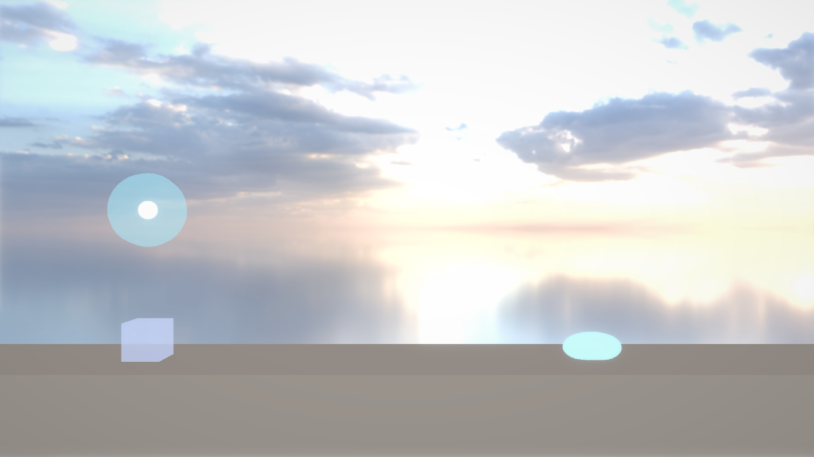

# G7：ジャンプのギミック（水色の円・ばね・緑の円・緑の壁）

## このファイルについて
- [AL4_01Game.md](AL4_01Game.md) の **G7**（P1）。G6（[G6Polygon.md](G6Polygon.md)）の続き。
- やること
  1. **エンジン（小）：`GetWorldRight`・`GetWorldUp`**（Transform の右・上の向き。Unity の `transform.right`・`transform.up`）
  2. **ゲーム：IceCube にジャンプの決まりを足す**（自分のジャンプの持ち方・円を先に使う・壁にくっつく・吹っ飛ぶ・ばねで跳ぶ）
  3. **ゲーム：ギミック4つ**（`JumpOrb` 水色の円・`Spring` ばね・`LaunchOrb` 緑の円・`StickyWall` 緑の壁）。新しいフォルダ `Source/Scripts/Gimmicks/` に置く
  4. **エディタ：ギミックを作って Prefab にし、レベルに置いて試す**
- **パートの順番**：A → B・C → D → E。**B（IceCube）と C（ギミック）はお互いを include する**ので、両方書き終わってからビルドする。
- 確かめた環境：本体の master（e3bbbf7 ＝ G6 まで）＋ このファイル、AL4_01 のコピー（G6 のパートE まで）＋ パートB〜D。Release でテスト用のシーンを動かし、入力を時間で流してログで数字を確かめた。Debug（エディタ付き）もビルドして起動した（7章）。

| パート | ファイル | 何をするか |
|---|---|---|
| A | `MyEngine/Components/TransformComponent.h`（MyEngine_v1） | `GetWorldRight`・`GetWorldUp` を足す |
| B | `Source/Scripts/IceCube.h/.cpp`（AL4_01） | ジャンプの決まり・くっつく・吹っ飛ぶ・ばね |
| C | `Source/Scripts/Gimmicks/JumpOrb.h/.cpp`・`Spring.h/.cpp`・`LaunchOrb.h/.cpp`・`StickyWall.h/.cpp`（新しく作る） | ギミック4つ |
| D | `AL4_01.vcxproj` | 新しい 8 ファイル |
| E | エディタで | ギミックの Prefab を作って、レベルに置いて試す |

---

## 0. 前の写経で気づいた所（しなくてもよい）
G6 をコミットする前に、写経したコードと答えを見比べた。**動きが変わる違いは無かった**（ほとんどが改行の位置・コメント・include の順番）。

| ファイル | 違い | 起きること |
|---|---|---|
| `CollisionSystem.cpp` | `CalcPushOut` の一番下の `MY_ASSERT_MSG(false, "カプセルが球に置き換わっていません");` が無い（G5 まではあった行。switch を書き直すときに消えたと思う） | 無し（来ない所。来たら気づけるように置いていた印） |
| `Collision.cpp` | `PushOutAABBAABB`（箱を箱から）の置き場所が、ファイルの後ろの方に動いている | 無し |
| `PrimitiveRendererComponent.h` | 一番上に、`PrimitiveMaterial` の説明と同じ1行（`/// モデルのファイルを使わない形の見た目…`）が増えている。`PrimitiveMaterial` の上の説明は古いまま（「Polygon Renderer の足場」が無い） | 無し（説明だけ） |
| `ComponentEditor.h`・`ElasticSurfaceSystem.cpp`・`PhysicsSystem.cpp`・`CollisionSystem.h/.cpp`・`ColliderComponent.h` | コメントがいくつか無い・短い | 無し |

- 戻すなら、`CollisionSystem.cpp` の `CalcPushOut` の最後を、こうする（`return false;` の上に1行）。

```cpp
	case ColliderShape::Capsule:
		break; // 置き換えたので来ない
	}
	MY_ASSERT_MSG(false, "カプセルが球に置き換わっていません");
	return false;
}
```

---

## 1. 何をするか（なぜこう作ったか）

### 1.1 エンジンに置く物・ゲームに置く物
- ギミックの決まり（円は1回使ったら出るまで使えない、壁にくっつく…）は、**このゲームだけの決まり**なので、ゲームの Script にした。エンジンは「触れた（Trigger）・ぶつかった向き（`normal`）・Rigidbody で動かす」をもう持っているので、それを使うだけで作れる。
- エンジンに足したのは、**向きを読む関数2つ**だけ。緑の円の矢印・ばねの向きを、Transform の Rotation の Z で決めたいので、「この Entity の右・上はワールドでどちらか」が要る。前からある `GetWorldForward`（前＝+Z）と同じ作り（行列の1行目・2行目）。
- ギミックは `Source/Scripts/Gimmicks/` に置く。G8 でトゲ・熱湯・◆ も足すので、`Source/Scripts/` に全部入れると 15 を超える。

```
Source/Scripts/
 ├ IceCube.h/.cpp      … プレイヤー（ジャンプの決まりは全部ここ）
 ├ LevelInfo.h/.cpp
 ├ GoalDoor.h/.cpp
 └ Gimmicks/
    ├ JumpOrb.h/.cpp   … 水色の円（「使ったか」を覚えるだけ）
    ├ Spring.h/.cpp    … ばね（触れたら IceCube::Bounce を呼ぶ）
    ├ LaunchOrb.h/.cpp … 緑の円（入ったら IceCube::Launch を呼ぶ）
    └ StickyWall.h/.cpp… 緑の壁（印だけ。中身なし）
```

- **動きは全部 IceCube に**書いて、ギミックは「いつ・どれだけ」を渡すだけにした。動きがあちこちに分かれると、「なぜ今跳べないのか」を調べるのに、何個もファイルを見ることになるので。

### 1.2 自分のジャンプの持ち方
AL4_01Game.md 5章の「自分のジャンプ（1回）」を、2つの値で持つ。

| 値 | いつ満タン | いつ消える | 使えるのは |
|---|---|---|---|
| `groundJumpTimer_`（G5 からある） | 地面にいる間（Coyote Time） | 足場から落ちて Coyote Time が過ぎた・跳んだ | 地面にいる・落ちて 0.1 秒の間 |
| `hasAirJump_`（新しく足す） | **緑の壁にくっついた・緑の円に入った** | 使った・**着地した**（着地したら、自分のジャンプは上の地面のジャンプの方で持つ） | 空中でいつでも |

- 2つに分けたのは、「足場から落ちたときは 0.1 秒で消える」と「壁・円で戻った分は使うまで残る」が、消え方が違うから。
- ばねで跳んだ後は、両方 0（空中で自分のジャンプは使えない。AL4_01Game.md 6章「今はできない」）。

### 1.3 ジャンプを使う順番（短絡評価）
```cpp
	if (ReadJumpRequest(deltaTime) && (CanGroundJump() || UseJumpOrb() || UseAirJump())) {
		Jump(rigidbody);
	}
```
- `||` は**左から順に調べて、true が出たらそこで止まる**（短絡評価）。なので
  1. 地面のジャンプが使えれば、それで跳ぶ（`UseJumpOrb` は呼ばれない → 地上で円の中にいても、円は使わない）
  2. 使えなければ、触れている水色の円を1つ使う（`UseJumpOrb` が円を「使った」にする）
  3. 円も無ければ、戻った自分のジャンプを使う（`UseAirJump` が `hasAirJump_` を false にする）
- 「空中では円を先に使う」（自分のジャンプが残る）が、この並び順だけで書ける。
- `ReadJumpRequest` は**先行入力**（G5 の Jump Buffer）を1か所にまとめた物。くっついている間・吹っ飛びの間も同じ先行入力を使うので、関数にした。押した瞬間を Jump Buffer 秒覚えて、「頼まれているか」を返す。

### 1.4 水色の円：円ごとに「使った」を覚える
```
         前のフレームの終わり                    このフレーム
  CollisionSystem::Update ──────→  ① 当たりを Script に配る（OnTrigger〜・OnCollision〜）
  （重なりを調べて一覧にする）          IceCube：触れている円を touchingOrbs_ に集める
                                        JumpOrb：キューブが出た（Exit）→「使える」に戻す
                                     ② 全部の Script の Update
                                        IceCube：跳ぶとき、touchingOrbs_ の円に「使える？」と聞いて、使う
                                        IceCube：Update の最後に touchingOrbs_ を空にする（次のフレームに集め直す）
```
- **「使ったか」は円（JumpOrb）が覚える**。円ごとに覚えるので、2つ重なっていれば、使える方が使われる（2回跳べる）。
- **「触れているか」は IceCube が毎フレーム集め直す**。前のフレームの当たりから作るので、出た円は自然に一覧から消える。
- 円が「使える」に戻るのは、キューブが**円から出たとき**（`OnTriggerExit`）。円の中で上がって下りても、出なければ使えない（AL4_01Game.md 5章）。
- 当たりの一覧は、全部の Script の `Update` より前に配られる（`ScriptSystem::Update` の 3 → 4）。なので IceCube の `Update` の中では、もう「今触れている円」と「円が使えるか」がそろっている。

### 1.5 ばね：向きの成分だけ、決まった速さにする
```cpp
	const float speed = std::sqrt(2.0f * gravity_ * height);
	rigidbody->velocity += direction * (speed - Dot(rigidbody->velocity, direction));
```
- `Dot(velocity, direction)` は「今の速さの、ばねの向きの分」。それを引いて `speed` を足すので、**ばねの向きの速さだけがちょうど `speed` になる**（横に走っていた分は残る）。
  - 真上を向いたばね（direction ＝ (0, 1)）なら `velocity.y = speed` と同じ。落ちてきても、走ってきても、同じ高さまで上がる。
- `isJumpRising_ = false` にするので、ジャンプを離しても上向きの速さを減らさない → **押しても押さなくても同じ高さ**。
- Trigger なので、横から触れても跳ぶ。ばねの上に落ちてくると、また触れるので、また跳ぶ（跳ね続ける）。

### 1.6 緑の円：寄る → 飛ぶ → やめる
```
入った         0.1 秒（Launch Gather Time）       0.3 秒（Launch Jump Lock）          1.5 秒（Duration）
  │── 真ん中へ寄る ──│────────── 矢印の向きへ、まっすぐ（重力なし・左右の入力は効かない）──────────│
  │                  │         ジャンプ：何もしない │ ジャンプ：吹っ飛びをやめて跳ぶ          │→ 時間切れ：普通の空中へ
  │                                                                                         （速さはそのまま、重力が戻る）
  └ 何かに正面からぶつかる（飛ぶ向きと反対を向いた当たり）→ 普通の空中へ ／ 緑の壁に横から当たる → くっつく
```
- **寄る**間は、位置を直接動かす（`TranslateWorld`。G5 のクリアの吸い込みと同じ）。どこから入っても、真ん中から飛び出すので、飛ぶ線がいつも同じになる（レベルを作るとき、線の先に何を置くか決めやすい）。
- **矢印の向き**は LaunchOrb の右（ローカルの +X ＝ `GetWorldRight`）。Rotation の Z を 90 にすると上、180 で左、45 で右上。
- **吹っ飛びをやめるジャンプ**は「戻った自分のジャンプ」（入ったときに `hasAirJump_ = true`）を使う。跳ばずに吹っ飛びが終わったら、自分のジャンプは空中に残る。横の速さは Launch Jump Keep（0.5）倍、上は普通のジャンプの速さ。
- **ぶつかった**かは、当たりの向き（`normal`）と飛ぶ向きの内積が −0.5 より小さいか（正面から約 60 度の内）で見る。床をこすりながら横へ飛ぶだけなら、床の `normal` は上向き（内積 0）なので止まらない。
- 吹っ飛びの最中に別の緑の円に入ったら、そっちの向きで吹っ飛び直す（`Launch` がもう一度呼ばれるだけ）。

### 1.7 緑の壁：くっつく・離れる・壁ジャンプ
- **くっつく条件**：空中（地面にいない）で、当たった相手に `StickyWall` が付いていて、当たりの向きが横向き（`normal.x` の大きさが 0.5 より大きい。斜めの壁も入る）。上に乗ったら、`normal` が上向きなので普通の床。
- **くっついている間**：重力を切って、壁へ少しだけ押し付け続ける（`-normal × 2m/s`）。G6 の「坂の上で止まる」と同じやり方で、物理が押し戻して消すので動かない。押し付けないと、ぴったり触れているだけになって、壁の当たりが来なくなる。
- **離れる**：ジャンプ（壁ジャンプ：上は普通のジャンプ、横は壁の外向きへ Wall Jump Speed）か、壁から離れる向きへの入力（落ちる。自分のジャンプは残る）。
- **離れた直後は、同じ壁にくっつかない**（Wall Regrab Time 0.2 秒）。離れたフレームも、当たりは前のフレームの物（まだ壁に触れている）が来るので、これが無いと、離れた瞬間にまたくっつく。
  - 「くっつき → 別の状態」を全部 `ChangeState` の1か所で通すようにして、そこで壁を覚える（壁ジャンプ・離す・ばね・緑の円・やられ、どれで離れても同じ）。

### 1.8 状態（State）と switch
| State | 重力 | 左右の入力 | ジャンプ | 次へ |
|---|---|---|---|---|
| Move | あり | 効く | 地面 → 円 → 戻った自分のジャンプ | 緑の壁 → Stick ／ 緑の円 → Launch |
| **Stick**（新） | なし | 壁から離れる向きで Move | 壁ジャンプ → Move | 緑の円 → Launch ／ ばね → Move |
| **Launch**（新） | なし | 効かない | Lock の後、吹っ飛びをやめて跳ぶ → Move | ぶつかる・時間切れ → Move ／ 緑の壁 → Stick ／ 別の緑の円 → Launch |
| Dead・Clear | — | — | — | — |

- `IsPlayable`（やられ・クリアでないか）は、State が5つになったので、決まりどおり switch にした（default は書かない。State を足したら、ここも直すことになる）。
- 「下の線より下に落ちたら一発アウト」は、Move の中から `Update` の頭に動かした（くっつき・吹っ飛びの最中に落ちても、アウトになるように）。
- `stateTimer_` は今まで「やられ・クリアになってからの秒数」だったが、吹っ飛びでも使うので、`ChangeState` で毎回 0 にする。

### 1.9 使った STL（あまり使っていない物）
| 物 | 中身 | 使った所 |
|---|---|---|
| `std::copysign(a, b)`（`<cmath>`） | **a の大きさに、b の符号（＋−）を付けた数**。`copysign(6, -0.8)` は −6 | 壁ジャンプの横の速さ（壁の向き `normal.x` の符号だけ使う。斜めの壁でも横の速さは同じ）・吹っ飛び中に回る向き |
| `std::remainder(x, 360)`（`<cmath>`） | **x を 360 で割って、一番近い整数との差（余り）**。`remainder(370, 360)` は 10、`remainder(350, 360)` は −10。`fmod` と違い、答えが −180〜180 になる | 吹っ飛びで何回も回った後の角度を −180〜180 に戻す（戻すときに、逆へ何回も回らないように） |

---

## 2. パートA：向きを読む関数（エンジン）

### `MyEngine/Components/TransformComponent.h`（1か所。`GetWorldForward` の下に足す）

```cpp
// 右（ローカルの+X）がワールドでどちらを向いているか。長さ1（大きさが0なら(0,0,0)）。Unity の transform.right と同じ
// 行列の1行目＝ローカルの(1,0,0)を変換した向き。横から見るゲームで、Z の回転で向きを決める物（吹っ飛ばす円の矢印など）に使う
inline Vector3 GetWorldRight(const TransformComponent& transform) {
	const Matrix4x4& m = transform.worldMatrix;
	return Normalize(Vector3{m.m[0][0], m.m[0][1], m.m[0][2]});
}

// 上（ローカルの+Y）がワールドでどちらを向いているか。長さ1（大きさが0なら(0,0,0)）。Unity の transform.up と同じ
// 行列の2行目＝ローカルの(0,1,0)を変換した向き。傾けて置いた物の「上」（ばねが跳ばす向きなど）に使う
inline Vector3 GetWorldUp(const TransformComponent& transform) {
	const Matrix4x4& m = transform.worldMatrix;
	return Normalize(Vector3{m.m[1][0], m.m[1][1], m.m[1][2]});
}
```

- 行列の1行目はローカルの (1, 0, 0)、2行目は (0, 1, 0) を変換した向き（`GetWorldForward` の3行目と同じ考え）。大きさ（Scale）が掛かっているので、`Normalize` で長さ1にする。

---

## 3. パートB：IceCube（AL4_01）

### `Source/Scripts/IceCube.h`（全部置き換える）
変わる所が多いので、全部のせる。**変わった所**：

| 場所 | 変わったこと |
|---|---|
| include | `<vector>` |
| 上の説明 | ギミック（G7）の1行 |
| public | `OnTriggerEnter`・`OnTriggerStay`・`Bounce`・`Launch`。`IsPlayable` は .cpp へ（switch にした） |
| `State` | `Stick`・`Launch` |
| 関数 | `UpdateStick`・`UpdateLaunch`・`TakeOff`・`ReadJumpRequest`・`UseJumpOrb`・`UseAirJump`・`TryStick`・`ChangeState`・`CollectContact`。`UpdateJump` の説明 |
| Inspector の値 | `--- ギミック ---` の6つ |
| 実行中の値 | `hasAirJump_`。`stateTimer_` の説明。一番下に `--- 緑の壁 ---`・`--- 緑の円（吹っ飛び）---`・`--- このフレームの当たりで集める ---` |
| 定数 | `kWallNormalX`・`kWallStickSpeed`・`kLetGoInput`・`kLaunchBlockCos` |

```cpp
#pragma once
#include <vector>

#include <MyEngine/ECS/Script.h>
#include <MyEngine/Math/Vector3.h>

/// <summary>
/// 氷のキューブ（プレイヤー）。Rigidbody ＋ Collider（Sphere）を付けた Entity に付ける
/// <para>Rigidbody は Freeze Position Z を付け、Collide With Rigidbodies を外す。Use Gravity・Gravity Scale は、ここが毎フレーム書く</para>
/// <para>見た目のキューブは子の Entity「Body」（Primitive Renderer の箱）。当たりは球で、キューブは見た目だけ（傾く・伸び縮みする）</para>
/// <para>左右移動とジャンプ（1回）。コヨーテタイム・先行入力・長押しで高さが変わる。ぶつかる・押し戻すのはエンジン（PhysicsSystem）の仕事で、
/// ここは「入力を読んで、Rigidbody の速さと重力の強さを書く」だけ</para>
/// <para>ギミック（G7）：水色の円（JumpOrb）で空中でもう一度跳ぶ・ばね（Spring）で決まった高さへ・緑の円（LaunchOrb）で吹っ飛ぶ・緑の壁（StickyWall）にくっつく</para>
/// <para>HP・やられ（下に落ちる・Kill・HP 0）・クリア（GoalDoor から）。やられたら少し待って、レベルの最初から（SceneManager::ReloadScene）</para>
/// </summary>
class IceCube : public Script {
public:
	void Start() override;
	void Update() override;
	void Fields(ComponentUI& ui) override;

	// ===== 当たり（足元の向き・緑の壁・水色の円を集める。キューブを地面の向きに傾ける）=====
	void OnCollisionEnter(const CollisionInfo& collision) override;
	void OnCollisionStay(const CollisionInfo& collision) override;
	void OnTriggerEnter(GameObject other) override;
	void OnTriggerStay(GameObject other) override;

	// ===== ほかの Script から使う =====
	// HP を amount だけ減らす（トゲ：G8）。0 になったらやられ
	void Damage(int amount);
	// 一発アウト（熱湯：G8。下に落ちたときも、ここを通る）
	void Kill();
	// ゴールに入った（GoalDoor から）。doorPosition へ吸い込まれる（次のレベルへ進むのは GoalDoor）
	void Clear(const Vector3& doorPosition);
	// ばねで跳ぶ（Spring から）。up の向きへ、height（m）の高さまで上がる速さにする。ジャンプを押していても同じ高さ
	void Bounce(const Vector3& up, float height);
	// 吹っ飛ぶ（LaunchOrb から）。center へ寄ってから、direction の向きへ speed（m/s）でまっすぐ飛ぶ。duration 秒で普通の空中に戻る
	void Launch(const Vector3& center, const Vector3& direction, float speed, float duration);
	int GetHp() const { return hp_; }
	int GetMaxHp() const { return maxHp_; }
	// 操作できるか（やられ・クリアの最中でない）
	bool IsPlayable() const;

private:
	/// <summary>
	/// 今していること
	/// </summary>
	enum class State {
		Move,   // 動ける（地上・空中）
		Stick,  // 緑の壁にくっついている（止まる。ジャンプで壁と反対へ跳ぶ・離れる向きの入力で落ちる）
		Launch, // 緑の円で吹っ飛んでいる（真ん中に寄ってから、まっすぐ飛ぶ。重力なし・左右の入力は効かない）
		Dead,   // やられ（縮んで消えて、少し待ってから、レベルの最初から）
		Clear,  // クリア（扉へ吸い込まれる）
	};

	// ===== 毎フレーム =====
	void UpdateMove(RigidbodyComponent& rigidbody, float deltaTime);         // State::Move
	void UpdateStick(RigidbodyComponent& rigidbody, float deltaTime);        // State::Stick
	void UpdateLaunch(RigidbodyComponent& rigidbody, float deltaTime);       // State::Launch
	void UpdateDead(float deltaTime);                                        // State::Dead
	void UpdateClear(float deltaTime);                                       // State::Clear
	void UpdateGround(const RigidbodyComponent& rigidbody, float deltaTime); // 地面にいるか・着地
	void UpdateRun(RigidbodyComponent& rigidbody, float deltaTime);          // 左右移動
	void UpdateJump(RigidbodyComponent& rigidbody, float deltaTime);         // ジャンプ（先行入力・コヨーテタイム・長押し・水色の円）
	void UpdateGravity(RigidbodyComponent& rigidbody) const;                 // 重力の強さ（上がる・落ちる）と、落ちる速さの上限
	void UpdateBody(const RigidbodyComponent& rigidbody, float deltaTime);   // 見た目（子の Body の傾き・伸び縮み・大きさ）
	void Jump(RigidbodyComponent& rigidbody);                                // 跳ぶ
	void TakeOff();                                                          // 地面を離れる（跳ぶ・ばね。地面のジャンプと先行入力を消す）
	bool ReadJumpRequest(float deltaTime);                                   // ジャンプを頼まれているか（今押した・先行入力で覚えている）
	bool UseJumpOrb();                                                       // 触れている水色の円を1つ使う（使えたら true）
	bool UseAirJump();                                                       // 緑の壁・緑の円で戻った自分のジャンプを使う（使えたら true）
	bool TryStick(RigidbodyComponent& rigidbody);                            // 横から緑の壁に触れていたら、くっつく（くっついたら true）
	void ChangeState(State next);                                            // 今していることを変える（壁から離れるときは、少しの間その壁にくっつかない）
	void BeginEnding(State next);                                            // やられ・クリアを始める（物理で動かすのを止める）
	void CollectContact(const CollisionInfo& collision);                     // 当たりから、足元・緑の壁・吹っ飛びの行き止まりを集める
	void CollectGround(const CollisionInfo& collision);                      // 足元の向きを集める
	// 地面のジャンプが使えるか（地面にいる・足場から落ちてコヨーテタイムの間）
	bool CanGroundJump() const { return isOnGround_ || groundJumpTimer_ > 0.0f; }
	// 足元の向きが分かる地面に立っているか（坂に沿って走る・重力を切る。このフレームに跳んだら false）
	bool IsStanding() const { return isOnGround_ && groundNormal_.y >= kStandCos; }

	// ===== 入力 =====
	static float ReadMoveInput();  // 左右（-1〜1。左が−）
	static bool IsJumpTriggered(); // ジャンプを押した瞬間
	static bool IsJumpPressed();   // ジャンプを押している

	// ===== Inspector に出す・保存する値 =====
	// --- 移動 ---
	float runSpeed_ = 7.0f;     // 左右の一番速い速さ（m/s）
	float groundAccel_ = 60.0f; // 地上で、入力の向きへ速さを変える強さ（1秒に何 m/s 変えるか）
	float groundDecel_ = 70.0f; // 地上で入力が無いとき、止まる強さ
	float airAccel_ = 35.0f;    // 空中で、入力の向きへ速さを変える強さ
	float airDecel_ = 10.0f;    // 空中で入力が無いとき、横の速さを落とす強さ（小さいと、跳んだ勢いが残る）
	// --- ジャンプ ---
	float jumpHeight_ = 3.0f;            // 長押ししたときのジャンプの高さ（m）
	float gravity_ = 30.0f;              // 重力の強さ（m/s²。上がっている間）
	float fallGravityMultiplier_ = 1.5f; // 落ちる間の重力の倍率
	float maxFallSpeed_ = 20.0f;         // 落ちる速さの上限（m/s）
	float jumpCutRatio_ = 0.5f;          // 上がっている途中でジャンプを離したとき、上向きの速さに掛ける
	float coyoteTime_ = 0.1f;            // 足場から落ちても、この秒数はまだジャンプできる
	float jumpBufferTime_ = 0.1f;        // 着地のこの秒数前に押したジャンプは、着地した瞬間に跳ぶ
	// --- ギミック ---
	float wallJumpSpeed_ = 6.0f;     // 緑の壁から跳んだときの、壁と反対への横の速さ（m/s）
	float wallRegrabTime_ = 0.2f;    // 緑の壁から離れた後、この秒数は同じ壁にくっつかない
	float launchGatherTime_ = 0.1f;  // 緑の円に入ってから、真ん中に寄る秒数
	float launchJumpLock_ = 0.3f;    // 緑の円に入ってから、この秒数はジャンプできない
	float launchJumpKeep_ = 0.5f;    // 吹っ飛びをやめて跳んだとき、横の速さに掛ける
	float launchSpinSpeed_ = 720.0f; // 吹っ飛び中に、見た目のキューブが回る速さ（度/秒）
	// --- HP・やられ・クリア ---
	int maxHp_ = 3;             // HP
	float restartDelay_ = 1.0f; // やられてから、レベルの最初に戻るまでの秒数
	float clearTime_ = 0.6f;    // ゴールの扉へ吸い込まれる秒数
	// --- 見た目（子の Body）---
	float cubeSize_ = 1.0f;     // 見た目のキューブの大きさ（m）
	float tiltAngle_ = 12.0f;   // 空中で、進む向きに傾く角度（度。走る速さのとき）
	float tiltSpeed_ = 12.0f;   // 傾きが変わる速さ（大きいほどすぐ）
	float jumpStretch_ = 0.2f;  // 跳んだとき、縦に伸びる割合
	float landSquash_ = 0.25f;  // 着地したとき、縦につぶれる割合（落ちる速さの上限で着地したとき）
	float stretchTime_ = 0.08f; // 伸び縮みが戻る時間の目安（秒）

	// ===== 実行中だけの値（保存しない）=====
	State state_ = State::Move;                 // 今していること
	int hp_ = 0;                                // 今の HP（Start で Max HP にする）
	float killHeight_ = -10.0f;                 // これより下に落ちたら一発アウト（Start で LevelInfo から読む）
	bool isOnGround_ = false;                   // 地面にいる
	bool isJustLanded_ = false;                 // このフレームに着地した
	float groundJumpTimer_ = 0.0f;              // 足場から落ちた後、地面のジャンプがあと何秒使えるか（コヨーテタイムの残り）
	bool hasAirJump_ = false;                   // 緑の壁・緑の円で戻った自分のジャンプがある（使うか着地するまで残る）
	float jumpBufferTimer_ = 0.0f;              // 押したジャンプを、あと何秒覚えているか（先行入力の残り）
	float sinceJump_ = 1.0f;                    // 最後に跳んでからの秒数
	bool isJumpRising_ = false;                 // ジャンプで上がっている途中（長押しを見る）
	float previousVelocityX_ = 0.0f;            // 前のフレームの左右の速さ（坂に着地したときに使う）
	float previousVelocityY_ = 0.0f;            // 前のフレームの上下の速さ（着地の強さに使う）
	Vector3 groundNormal_ = {0.0f, 0.0f, 0.0f}; // このフレームの足元の向き（当たりで集める。乗っていなければ 0）
	float stateTimer_ = 0.0f;                   // 今していることになってからの秒数（吹っ飛び・やられ・クリアで使う）
	bool isRestartRequested_ = false;           // やり直しを頼んだ（何回も頼まないように）
	Vector3 clearStart_ = {0.0f, 0.0f, 0.0f};   // 吸い込まれ始めた位置
	Vector3 clearTarget_ = {0.0f, 0.0f, 0.0f};  // 扉の位置
	GameObject body_;                           // 子の「Body」（見た目のキューブ。Start で探す）
	float bodyAngle_ = 0.0f;                    // 今の傾き（度。Z 軸のまわりで、左回りが＋）
	float stretch_ = 0.0f;                      // 今の伸び縮み（＋で縦に伸びる、−でつぶれる）
	float bodyScale_ = 1.0f;                    // 全体の大きさの倍率（やられ・クリアで小さくなる）
	// --- 緑の壁 ---
	GameObject stickWall_;                        // くっついている壁
	Vector3 stickNormal_ = {0.0f, 0.0f, 0.0f};    // くっついている壁の向き（壁から外へ。当たりの normal）
	GameObject lastWall_;                         // 最後に離れた壁
	float wallRegrabTimer_ = 0.0f;                // 最後に離れた壁に、またくっつけるまでの残り秒数
	// --- 緑の円（吹っ飛び）---
	Vector3 launchStart_ = {0.0f, 0.0f, 0.0f};    // 円に入った位置
	Vector3 launchCenter_ = {0.0f, 0.0f, 0.0f};   // 寄っていく円の真ん中
	Vector3 launchVelocity_ = {0.0f, 0.0f, 0.0f}; // 飛ぶ速さ（向き × 速さ）
	float launchDuration_ = 0.0f;                 // 吹っ飛びの長さ（秒）
	// --- このフレームの当たりで集める（groundNormal_ と同じく、Update の最後に空にする）---
	GameObject wallContact_;                      // 横から触れた緑の壁（無ければ空）
	Vector3 wallNormal_ = {0.0f, 0.0f, 0.0f};     // その壁の当たりの向き
	std::vector<GameObject> touchingOrbs_;        // 触れている水色の円
	bool isLaunchBlocked_ = false;                // 吹っ飛ぶ向きの先にぶつかった

	static constexpr float kGroundIgnoreAfterJump = 0.1f; // 跳んだ直後のこの秒数は、足場に触れていても地面にいることにしない
	static constexpr float kStandCos = 0.7f;              // 当たりの向き（normal）の上の成分がこれ以上なら足元（約45度。エンジンの地面の判定と同じ）
	static constexpr float kGroundStickSpeed = 2.0f;      // 立っている間、足元へ押し付ける速さ（m/s。物理が押し戻して消すので、動きには出ない）
	static constexpr float kWallNormalX = 0.5f;           // 当たりの向きの横の成分の大きさがこれより大きければ、横から当たった（斜めの壁も入る）
	static constexpr float kWallStickSpeed = 2.0f;        // くっついている間、壁へ押し付ける速さ（m/s。足元と同じく、物理が消す）
	static constexpr float kLetGoInput = 0.5f;            // 壁から離れる向きの入力がこれより大きければ、壁を離す
	static constexpr float kLaunchBlockCos = 0.5f;        // 当たりの向きと飛ぶ向きの内積が −0.5 より小さければ、行き止まり（正面から約60度の内）
	static constexpr float kVanishTime = 0.25f;           // やられたとき、縮んで消えるまでの秒数（G8 で、砕ける・溶けるに替える）
};
```

### `Source/Scripts/IceCube.cpp`（10か所）
**1. include に2つ足す**（`LevelInfo.h` の下）

```cpp
#include "LevelInfo.h"
#include "Source/Scripts/Gimmicks/JumpOrb.h"
#include "Source/Scripts/Gimmicks/StickyWall.h"
```

- ゲームの include のフォルダは `$(ProjectDir)`（`project/`）なので、ほかのフォルダのファイルは `Source/Scripts/…` から書く。

**2. `Fields`：ギミックの値**（`// ===== ジャンプ =====` の区切りの最後 `Jump Buffer` の下に足す）

```cpp
	// ===== ギミック =====
	ui.Separator("Gimmick");
	ui.Field("Wall Jump Speed", wallJumpSpeed_, AtLeast(0.0f).Tip("緑の壁から跳んだときの、壁と反対への横の速さ（m/s）。上へは Jump Height と同じ高さ"));
	ui.Field("Wall Regrab Time", wallRegrabTime_, AtLeast(0.0f).Tip("緑の壁から離れた（跳んだ・離れる向きに入力した）後、この秒数は同じ壁にくっつかない（押しっぱなしで、すぐ戻ってくっつかないように）"));
	ui.Field("Launch Gather Time", launchGatherTime_, AtLeast(0.0f).Tip("緑の円に入ってから、円の真ん中に寄る秒数（その後、矢印の向きへ飛ぶ。0 なら寄らずにすぐ飛ぶ）"));
	ui.Field("Launch Jump Lock", launchJumpLock_, AtLeast(0.0f).Tip("緑の円に入ってから、この秒数はジャンプできない（その後のジャンプで、吹っ飛びをやめて跳ぶ）"));
	ui.Field("Launch Jump Keep", launchJumpKeep_, Range(0.0f, 1.0f).Tip("吹っ飛びをやめて跳んだとき、横の速さに掛ける（0.5 なら半分残る）"));
	ui.Field("Launch Spin Speed", launchSpinSpeed_, AtLeast(0.0f).Tip("吹っ飛び中に、見た目のキューブが回る速さ（度/秒。飛ぶ向きへ転がるように回る）"));
```

**3. `Update`：一発アウトを頭に・State の switch・当たりで集めた物を空にする**（`if (deltaTime <= 0.0f) { … }` の下から、関数の最後までを置き換える）

```cpp
	// --- 下の線より下に落ちたら、一発アウト（動ける間はいつでも。くっつき・吹っ飛びの最中も）---
	if (IsPlayable() && GetWorldPosition(transform).y < killHeight_) {
		Kill();
	}
	wallRegrabTimer_ -= deltaTime;

	// --- 今していることで、することが変わる ---
	switch (state_) {
	case State::Move:
		UpdateMove(*rigidbody, deltaTime);
		break;
	case State::Stick:
		UpdateStick(*rigidbody, deltaTime);
		break;
	case State::Launch:
		UpdateLaunch(*rigidbody, deltaTime);
		break;
	case State::Dead:
		UpdateDead(deltaTime);
		break;
	case State::Clear:
		UpdateClear(deltaTime);
		break;
	}
	UpdateBody(*rigidbody, deltaTime);

	// --- 次のフレームのために覚える・空にする ---
	previousVelocityX_ = rigidbody->velocity.x;
	previousVelocityY_ = rigidbody->velocity.y;
	// 当たりで集める物は、次のフレームの当たりで集め直す
	groundNormal_ = {0.0f, 0.0f, 0.0f};
	wallContact_ = {};
	touchingOrbs_.clear();
	isLaunchBlocked_ = false;
}
```

- `wallRegrabTimer_` は、State に関係なく毎フレーム減らす（吹っ飛び中も数える）。

**4. `UpdateMove` を置き換えて、`IsPlayable`・`ChangeState` を足す**（一発アウトは `Update` へ動いた）

```cpp
void IceCube::UpdateMove(RigidbodyComponent& rigidbody, float deltaTime) {
	UpdateGround(rigidbody, deltaTime);
	// --- 空中で、横から緑の壁に触れたら、くっつく ---
	if (TryStick(rigidbody)) {
		return;
	}
	UpdateRun(rigidbody, deltaTime);
	UpdateJump(rigidbody, deltaTime);
	UpdateGravity(rigidbody);
}

bool IceCube::IsPlayable() const {
	switch (state_) {
	case State::Move:
	case State::Stick:
	case State::Launch:
		return true;
	case State::Dead:
	case State::Clear:
		return false;
	}
	return false;
}

void IceCube::ChangeState(State next) {
	// 緑の壁から離れるとき：その壁を覚えて、Wall Regrab Time 秒はくっつかない
	// （離れたフレームも、前のフレームの当たりで「壁に触れている」が来るので、すぐ戻ってくっつかないように）
	if (state_ == State::Stick && next != State::Stick) {
		lastWall_ = stickWall_;
		wallRegrabTimer_ = wallRegrabTime_;
	}
	state_ = next;
	stateTimer_ = 0.0f;
}
```

**5. `UpdateGround`：着地したら、戻った自分のジャンプを消す**（`groundJumpTimer_ = coyoteTime_;` の下に1行）

```cpp
		groundJumpTimer_ = coyoteTime_; // 地面にいる間は、いつでも満タン
		hasAirJump_ = false;            // 着地したら、自分のジャンプは地面のジャンプ（コヨーテタイム）の方で持つ
```

**6. 当たり：`OnCollisionEnter`・`OnCollisionStay` から `CollectGround` の下まで**（`CollectContact`・`OnTriggerEnter`・`OnTriggerStay` を足す）

```cpp
void IceCube::OnCollisionEnter(const CollisionInfo& collision) { CollectContact(collision); }

void IceCube::OnCollisionStay(const CollisionInfo& collision) { CollectContact(collision); }

void IceCube::CollectContact(const CollisionInfo& collision) {
	CollectGround(collision);
	// --- 緑の壁に、横から触れた（当たりの向きが横向き。斜めの壁も入る。上に乗ったら普通の床）---
	if (std::abs(collision.normal.x) > kWallNormalX && collision.gameObject.GetComponent<StickyWall>() != nullptr) {
		wallContact_ = collision.gameObject;
		wallNormal_ = collision.normal;
	}
	// --- 吹っ飛ぶ向きの先にぶつかった（飛ぶ向きと反対を向いた当たり。床をこすりながら飛ぶだけなら数えない）---
	if (state_ == State::Launch && Dot(collision.normal, Normalize(launchVelocity_)) < -kLaunchBlockCos) {
		isLaunchBlocked_ = true;
	}
}

void IceCube::CollectGround(const CollisionInfo& collision) {
	// 足元の当たり（normal が上向き）のうち、一番上を向いている物を、このフレームの足元の向きにする
	if (collision.normal.y >= kStandCos && collision.normal.y > groundNormal_.y) {
		groundNormal_ = collision.normal;
	}
}

void IceCube::OnTriggerEnter(GameObject other) {
	if (other.GetComponent<JumpOrb>() != nullptr) {
		touchingOrbs_.push_back(other); // 触れている水色の円（使えるかは、跳ぶときに円に聞く）
	}
}

void IceCube::OnTriggerStay(GameObject other) { OnTriggerEnter(other); } // 触れている間も、毎フレーム集め直す
```

- `OnCollisionEnter`・`OnCollisionStay` は、`CollectGround` ではなく `CollectContact` を呼ぶ。
- 緑の壁かどうかは、横向きの当たりのときだけ調べる（`&&` は左が false なら右を調べない。床に乗っている間、毎フレーム `GetComponent` しないように）。

**7. ジャンプ：`UpdateJump` から `Jump` まで置き換えて、`TakeOff` を足す**

```cpp
void IceCube::UpdateJump(RigidbodyComponent& rigidbody, float deltaTime) {
	// --- 跳ぶ：押した（覚えている）ジャンプがあって、使えるジャンプがあるとき ---
	// 使う順番：地上（コヨーテタイムの間も）は地面のジャンプ → 空中は、触れている水色の円 → 緑の壁・緑の円で戻った自分のジャンプ
	// || は左から順に調べて、true が出たらそこで止まる（短絡評価）。なので、円を使えたら、自分のジャンプは使わずに残る
	if (ReadJumpRequest(deltaTime) && (CanGroundJump() || UseJumpOrb() || UseAirJump())) {
		Jump(rigidbody);
	}

	// --- 長押し：上がっている途中でジャンプを離したら、上向きの速さを減らす（すぐ離すと低いジャンプ）---
	if (isJumpRising_) {
		if (rigidbody.velocity.y <= 0.0f) {
			isJumpRising_ = false; // もう落ち始めた（最後まで押していた）
		} else if (!IsJumpPressed()) {
			rigidbody.velocity.y *= jumpCutRatio_;
			isJumpRising_ = false; // 1回のジャンプで1回だけ
		}
	}
}

bool IceCube::ReadJumpRequest(float deltaTime) {
	// 先行入力：押した瞬間を Jump Buffer 秒だけ覚えておく（着地・円に入る・壁にくっつく少し前に押しても、その瞬間に跳ぶ）
	// 押したフレームは isTriggered で見る（Jump Buffer が 0 でも跳べるように）
	const bool isTriggered = IsJumpTriggered();
	if (isTriggered) {
		jumpBufferTimer_ = jumpBufferTime_;
	}
	const bool isRequested = isTriggered || jumpBufferTimer_ > 0.0f;
	jumpBufferTimer_ -= deltaTime;
	return isRequested;
}

bool IceCube::UseJumpOrb() {
	// 触れている円のうち、使える物を1つ使う（2つ重なっていても、円ごとに覚えているので、使える方が使われる）
	for (const GameObject& orbObject : touchingOrbs_) {
		JumpOrb* orb = orbObject.GetComponent<JumpOrb>();
		if (orb != nullptr && orb->IsReady()) {
			orb->Use();
			return true;
		}
	}
	return false;
}

bool IceCube::UseAirJump() {
	if (!hasAirJump_) {
		return false;
	}
	hasAirJump_ = false;
	return true;
}

void IceCube::Jump(RigidbodyComponent& rigidbody) {
	// 長押ししたときに、ちょうど Jump Height まで上がる速さ
	// 速さ v で真上に投げると、重力 g で v² ÷ 2g だけ上がる（v² = 2gh）→ v ＝ √(2gh)。上がっている間の重力（Gravity）で計算する
	// 下向きの速さは捨てる（落ちている途中で円を使っても、同じ高さだけ上がる）
	rigidbody.velocity.y = std::sqrt(2.0f * gravity_ * jumpHeight_);
	TakeOff();
	isJumpRising_ = true;
}

void IceCube::TakeOff() {
	isOnGround_ = false;
	groundJumpTimer_ = 0.0f; // 地面のジャンプを使った（コヨーテタイムの残りも消す）
	jumpBufferTimer_ = 0.0f; // 覚えていたジャンプも使った
	sinceJump_ = 0.0f;
	stretch_ = jumpStretch_; // 見た目：縦に伸びる
}
```

- `Jump` の中の「地面を離れる」所（地面のジャンプ・先行入力を消す・伸びる）を `TakeOff` に分けた。ばね（`Bounce`）も同じことをするので。

**8. 緑の壁・ばね・緑の円**（`UpdateGravity` の下、`// HP・やられ・クリア` の区切りの上に足す）

```cpp
//=============================================================================
// 緑の壁（くっつく）
//=============================================================================
bool IceCube::TryStick(RigidbodyComponent& rigidbody) {
	// --- 早期リターン：緑の壁に横から触れていない・地面にいる・さっき離れた壁 ---
	if (!wallContact_ || isOnGround_) {
		return false;
	}
	if (wallContact_ == lastWall_ && wallRegrabTimer_ > 0.0f) {
		return false;
	}
	// --- くっつく：止まって、自分のジャンプが戻る ---
	ChangeState(State::Stick);
	stickWall_ = wallContact_;
	stickNormal_ = wallNormal_;
	hasAirJump_ = true;
	groundJumpTimer_ = 0.0f;
	isJumpRising_ = false;
	rigidbody.velocity = {0.0f, 0.0f, 0.0f};
	rigidbody.useGravity = false;
	return true;
}

void IceCube::UpdateStick(RigidbodyComponent& rigidbody, float deltaTime) {
	// --- 壁ジャンプ：上＋壁と反対へ（先行入力も使う。くっつく少し前に押していたら、くっついた瞬間に跳ぶ）---
	if (ReadJumpRequest(deltaTime)) {
		ChangeState(State::Move);
		hasAirJump_ = false; // 壁で戻った自分のジャンプを使った
		rigidbody.useGravity = true;
		Jump(rigidbody);
		// 横は、壁の外向き（normal の X の符号）へ Wall Jump Speed。斜めの壁でも、横の速さは同じにする
		// std::copysign(a, b)：a の大きさに、b の符号（＋−）を付けた数（<cmath>）
		rigidbody.velocity.x = std::copysign(wallJumpSpeed_, stickNormal_.x);
		return;
	}
	// --- 壁から離れる向きに入力したら、離れて落ちる（自分のジャンプは残る）---
	if (ReadMoveInput() * stickNormal_.x > kLetGoInput) {
		ChangeState(State::Move);
		rigidbody.velocity = {0.0f, 0.0f, 0.0f};
		rigidbody.useGravity = true;
		return;
	}
	// --- くっついている間：止まって、壁へ少しだけ押し付ける（物理が押し戻して消すので動かない。壁の当たりが続く）---
	rigidbody.useGravity = false;
	rigidbody.velocity = -stickNormal_ * kWallStickSpeed;
}

//=============================================================================
// ばね・緑の円（吹っ飛び）
//=============================================================================
void IceCube::Bounce(const Vector3& up, float height) {
	RigidbodyComponent* rigidbody = GetComponent<RigidbodyComponent>();
	const Vector3 direction = Normalize(Vector3{up.x, up.y, 0.0f}); // 奥行きには跳ばない
	if (!IsPlayable() || rigidbody == nullptr || Length(direction) == 0.0f) {
		return;
	}
	ChangeState(State::Move); // くっつき・吹っ飛びの最中でも、ばねが勝つ
	// 跳ぶ向き（direction）の速さだけを「height まで上がる速さ」にする（横に動いていた分は残る）
	// 今の速さの direction の成分を引いて、決まった速さを足す。下向きに落ちてきても、同じ高さまで上がる
	const float speed = std::sqrt(2.0f * gravity_ * height);
	rigidbody->velocity += direction * (speed - Dot(rigidbody->velocity, direction));
	rigidbody->useGravity = true;
	TakeOff();
	isJumpRising_ = false; // 長押しを見ない（ジャンプを押していても、離しても同じ高さ）
	hasAirJump_ = false;   // ばねの後は、空中で自分のジャンプは使えない（水色の円は使える）
}

void IceCube::Launch(const Vector3& center, const Vector3& direction, float speed, float duration) {
	RigidbodyComponent* rigidbody = GetComponent<RigidbodyComponent>();
	const Vector3 flat = Normalize(Vector3{direction.x, direction.y, 0.0f}); // 奥行きには飛ばない
	if (!IsPlayable() || rigidbody == nullptr || Length(flat) == 0.0f) {
		return;
	}
	ChangeState(State::Launch); // 吹っ飛びの最中に別の円に入ったら、そっちの向きで吹っ飛び直す
	launchStart_ = GetWorldPosition(transform);
	launchCenter_ = {center.x, center.y, launchStart_.z};
	launchVelocity_ = flat * speed;
	launchDuration_ = duration;
	hasAirJump_ = true; // 自分のジャンプが戻る（吹っ飛びをやめるジャンプに使う）
	isOnGround_ = false;
	groundJumpTimer_ = 0.0f;
	jumpBufferTimer_ = 0.0f; // 入る前に押したジャンプで、すぐやめないように
	isJumpRising_ = false;
	rigidbody->velocity = {0.0f, 0.0f, 0.0f};
	rigidbody->useGravity = false;
}

void IceCube::UpdateLaunch(RigidbodyComponent& rigidbody, float deltaTime) {
	stateTimer_ += deltaTime;
	// --- 吹っ飛び中でも、横から緑の壁に当たったら、くっつく ---
	if (TryStick(rigidbody)) {
		return;
	}
	// --- 行き止まり（飛ぶ向きの先にぶつかった）・時間切れ：普通の空中へ（今の速さのまま、重力が戻る）---
	if (isLaunchBlocked_ || stateTimer_ >= launchDuration_) {
		ChangeState(State::Move);
		rigidbody.useGravity = true;
		return;
	}
	// --- Launch Jump Lock 秒の後は、ジャンプで吹っ飛びをやめて跳ぶ（横の速さを Launch Jump Keep だけ残す）---
	// ReadJumpRequest は先に呼んで、先行入力を数える（Lock の終わる少し前に押しても、終わった瞬間に跳ぶ）
	if (ReadJumpRequest(deltaTime) && stateTimer_ >= launchJumpLock_ && UseAirJump()) {
		ChangeState(State::Move);
		rigidbody.useGravity = true;
		rigidbody.velocity.x = launchVelocity_.x * launchJumpKeep_;
		Jump(rigidbody);
		return;
	}
	// --- 真ん中に寄る（Launch Gather Time 秒）→ 決まった向きへ、まっすぐ飛ぶ（重力なし）---
	rigidbody.useGravity = false;
	if (stateTimer_ < launchGatherTime_) {
		// 最初は速く、だんだんゆっくり寄る。位置を直接動かす（速さは 0。物理は壁から押し出すだけ）
		const float t = stateTimer_ / launchGatherTime_;
		const Vector3 next = MathUtility::Lerp(launchStart_, launchCenter_, Ease::OutQuad(t, 0.0f, 1.0f));
		EntityManager::TranslateWorld(gameObject.handle, next - GetWorldPosition(transform));
		rigidbody.velocity = {0.0f, 0.0f, 0.0f};
	} else {
		rigidbody.velocity = launchVelocity_;
	}
}
```

- `TryStick` は Move と Launch の両方から呼ぶ（吹っ飛び中もくっつく）。
- `UpdateLaunch` の `ReadJumpRequest(deltaTime) && stateTimer_ >= launchJumpLock_ && UseAirJump()` は、`ReadJumpRequest` を一番左に置いている。Lock の間も毎フレーム呼んで、先行入力を数えるため（Lock の終わる少し前に押しても、終わった瞬間に跳ぶ）。

**9. `Damage`・`Kill`・`Clear`・`BeginEnding`**（`state_ != State::Move` を `!IsPlayable()` に。`BeginEnding` は `ChangeState` を使う）

```cpp
void IceCube::Damage(int amount) {
	if (!IsPlayable() || amount <= 0) {
		return; // もうやられ・クリアの最中
	}
	hp_ = (std::max)(hp_ - amount, 0);
	if (hp_ == 0) {
		Kill();
	}
}

void IceCube::Kill() {
	if (!IsPlayable()) {
		return; // もうやられ・クリアの最中
	}
	hp_ = 0;
	BeginEnding(State::Dead);
}

void IceCube::Clear(const Vector3& doorPosition) {
	if (!IsPlayable()) {
		return;
	}
	clearStart_ = GetWorldPosition(transform);
	clearTarget_ = {doorPosition.x, doorPosition.y, clearStart_.z}; // 奥行きは変えない
	BeginEnding(State::Clear);
}

void IceCube::BeginEnding(State next) {
	ChangeState(next);
	isJumpRising_ = false;
	// --- その場で止める（重力で落ちない。やられ・クリアの動きは、このスクリプトが位置と大きさで作る）---
	if (RigidbodyComponent* rigidbody = GetComponent<RigidbodyComponent>()) {
		rigidbody->velocity = {0.0f, 0.0f, 0.0f};
		rigidbody->useGravity = false;
	}
}
```

**10. `UpdateBody`：吹っ飛び中は回り続ける**（`// 目標へ指数で近づける…` と `bodyAngle_ += …` の2行を置き換える）

```cpp
	if (state_ == State::Launch) {
		// 吹っ飛び中は、飛ぶ向きへ転がるように回り続ける（右へ飛ぶと右回り＝マイナス、左へ飛ぶと左回り）
		bodyAngle_ -= std::copysign(launchSpinSpeed_, launchVelocity_.x) * deltaTime;
	} else {
		// 360 度回った分は捨てて −180〜180 にする（吹っ飛びで何回も回った後に、逆へ何回も回って戻らないように）
		// std::remainder(x, 360)：x を 360 で割った「一番近い整数」との余り（<cmath>。fmod と違い、−180〜180 になる）
		bodyAngle_ = std::remainder(bodyAngle_, 360.0f);
		// 目標へ指数で近づける（Tilt Speed が大きいほどすぐ。フレームの速さが変わっても同じ動き）
		bodyAngle_ += (targetAngle - bodyAngle_) * (1.0f - std::exp(-tiltSpeed_ * deltaTime));
	}
```

---

## 4. パートC：ギミック4つ（AL4_01。新しく作る）
`Source/Scripts/` の下に `Gimmicks` フォルダを作って、8 ファイルを置く。どれも `SCRIPT(…, "Gimmick")` なので、Add Component → **Gameplay → Gimmick** に出る。

### `Source/Scripts/Gimmicks/JumpOrb.h`

```cpp
#pragma once
#include <MyEngine/ECS/Script.h>
#include <MyEngine/Math/Vector3.h>
#include <MyEngine/Math/Vector4.h>

/// <summary>
/// 水色の円（ジャンプの円）。Collider（Sphere・Is Trigger）を付けた Entity に付ける
/// <para>氷のキューブが触れている間、空中でもう一度跳べる。跳ぶのは IceCube で、ここは「使えるか」を覚えるだけ</para>
/// <para>使ったら、キューブが円から一度出るまで使えない（入り直すと、また使える）。円ごとに覚えるので、2つ重なっていれば、使える方が使われる</para>
/// <para>見た目：子の「Ring」（輪。ゆっくり回る。使うと広がって消える）と「Core」（真ん中の光る玉。使うと暗くなる）。どちらも無くてよい</para>
/// </summary>
class JumpOrb : public Script {
public:
	void Start() override;
	void Update() override;
	void Fields(ComponentUI& ui) override;
	void OnTriggerExit(GameObject other) override; // キューブが出た → また使える

	// ===== IceCube から使う =====
	// 使えるか（まだ使っていない）
	bool IsReady() const { return !isUsed_; }
	// 使う（キューブが円から出るまで、使えない）
	void Use();

private:
	// ===== Inspector に出す・保存する値 =====
	float spinSpeed_ = 30.0f;      // 輪が回る速さ（度/秒）
	float popScale_ = 1.6f;        // 使ったとき、輪がこの倍まで広がって消える
	float popTime_ = 0.25f;        // 輪が広がって消えるまでの秒数
	float usedBrightness_ = 0.25f; // 使った後の、真ん中の玉の明るさ（元の色に掛ける）

	// ===== 実行中だけの値（保存しない）=====
	bool isUsed_ = false;                          // 使った（キューブが出るまで使えない）
	float popTimer_ = 0.0f;                        // 使ってからの秒数
	GameObject ring_;                              // 子の「Ring」（Start で探す）
	GameObject core_;                              // 子の「Core」（Start で探す）
	Vector3 ringScale_ = {1.0f, 1.0f, 1.0f};       // 輪の元の大きさ
	Vector4 ringColor_ = {1.0f, 1.0f, 1.0f, 1.0f}; // 輪の元の色
	Vector4 coreColor_ = {1.0f, 1.0f, 1.0f, 1.0f}; // 玉の元の色
};
```

### `Source/Scripts/Gimmicks/JumpOrb.cpp`

```cpp
#include "JumpOrb.h"

#include <algorithm>

#include <MyEngine/Math/MathUtility.h>

#include "Source/Scripts/IceCube.h"

SCRIPT(JumpOrb, "Gimmick");

//=============================================================================
// Inspector に出す・保存する値
//=============================================================================
void JumpOrb::Fields(ComponentUI& ui) {
	ui.Label("キューブが触れている間、空中でもう一度跳べる。使ったら、円から一度出るまで使えない");
	ui.Field("Spin Speed", spinSpeed_, Tip("子の Ring が回る速さ（度/秒。マイナスで逆回り）"));
	ui.Field("Pop Scale", popScale_, AtLeast(1.0f).Tip("使ったとき、子の Ring がこの倍まで広がって消える"));
	ui.Field("Pop Time", popTime_, AtLeast(0.01f).Tip("子の Ring が広がって消えるまでの秒数"));
	ui.Field("Used Brightness", usedBrightness_, Range(0.0f, 1.0f).Tip("使った後の、子の Core の明るさ（元の色に掛ける。キューブが円から出ると元に戻る）"));
}

//=============================================================================
// 毎フレーム
//=============================================================================
void JumpOrb::Start() {
	// 子の見た目を探して、元の大きさと色を覚える（無ければ、その見た目は動かさない）
	ring_ = gameObject.FindChild("Ring");
	core_ = gameObject.FindChild("Core");
	if (ring_) {
		ringScale_ = ring_.GetTransform().scale;
		if (const PrimitiveRendererComponent* renderer = ring_.GetComponent<PrimitiveRendererComponent>()) {
			ringColor_ = renderer->material.color;
		}
	}
	if (core_) {
		if (const PrimitiveRendererComponent* renderer = core_.GetComponent<PrimitiveRendererComponent>()) {
			coreColor_ = renderer->material.color;
		}
	}
}

void JumpOrb::Update() {
	const float deltaTime = Time::GetDeltaTime();
	popTimer_ += deltaTime;
	// --- 輪：ゆっくり回る。使ったら Pop Time 秒で、広がりながら薄くなって消える ---
	if (ring_) {
		const float t = isUsed_ ? std::clamp(popTimer_ / popTime_, 0.0f, 1.0f) : 0.0f; // 0：元のまま 〜 1：消えた
		TransformComponent& ring = ring_.GetTransform();
		Rotate(ring, {0.0f, 0.0f, 1.0f}, spinSpeed_ * deltaTime);
		ring.scale = ringScale_ * MathUtility::Lerp(1.0f, popScale_, t);
		if (PrimitiveRendererComponent* renderer = ring_.GetComponent<PrimitiveRendererComponent>()) {
			renderer->material.color = ringColor_ * (1.0f - t); // 色ごと薄くする（Transparent は A が、Additive は RGB が効く）
		}
	}
	// --- 真ん中の玉：使ったら暗くなる（A はそのまま）---
	if (core_) {
		if (PrimitiveRendererComponent* renderer = core_.GetComponent<PrimitiveRendererComponent>()) {
			const float brightness = isUsed_ ? usedBrightness_ : 1.0f;
			renderer->material.color = {coreColor_.x * brightness, coreColor_.y * brightness, coreColor_.z * brightness, coreColor_.w};
		}
	}
}

//=============================================================================
// 使う・戻る
//=============================================================================
void JumpOrb::Use() {
	isUsed_ = true;
	popTimer_ = 0.0f;
}

void JumpOrb::OnTriggerExit(GameObject other) {
	// キューブが円から出たら、また使える（入り直すと跳べる）
	if (other.GetComponent<IceCube>() != nullptr) {
		isUsed_ = false;
	}
}
```

- 見た目（子の Ring・Core）は、`Start` で元の大きさと色を覚えて、毎フレーム「元の値 × 今の割合」で書く。足していく書き方（`scale *= …`）にすると、Pop の途中で入り直したときなどに、元に戻らなくなるので。
- 今は Ring も Primitive の球（回っても見た目は変わらない）。G10 で輪の絵（Sprite）に替えると、Spin Speed で回って見える。

### `Source/Scripts/Gimmicks/LaunchOrb.h`

```cpp
#pragma once
#include <MyEngine/ECS/Script.h>
#include <MyEngine/Math/Vector3.h>

/// <summary>
/// 緑の円（吹っ飛ばす円）。Collider（Sphere・Is Trigger）を付けた Entity に付ける
/// <para>氷のキューブが入ると、円の真ん中に寄ってから、矢印の向き（この Entity の右＝ローカルの +X）へまっすぐ吹っ飛ぶ。向きは Transform の Rotation の Z で決める</para>
/// <para>吹っ飛ぶ動き（重力なし・始まって少しはジャンプできない・ぶつかるか時間切れで終わる）は IceCube。ここは速さと長さを渡すだけ</para>
/// <para>見た目：子の「Ring」（入ると一瞬ふくらむ）。矢印は子に置いた箱など（コードでは動かさない。親と一緒に回る）</para>
/// </summary>
class LaunchOrb : public Script {
public:
	void Start() override;
	void Update() override;
	void Fields(ComponentUI& ui) override;
	void OnTriggerEnter(GameObject other) override; // キューブが入った → 吹っ飛ばす

private:
	// ===== Inspector に出す・保存する値 =====
	float speed_ = 16.0f;     // 飛ぶ速さ（m/s）
	float duration_ = 1.5f;   // 吹っ飛びの長さ（秒。何にもぶつからなければ、この秒数で普通の空中に戻る）
	float pulseScale_ = 1.4f; // 入ったとき、輪がこの倍にふくらむ
	float pulseTime_ = 0.2f;  // ふくらんだ輪が戻るまでの秒数

	// ===== 実行中だけの値（保存しない）=====
	GameObject ring_;                        // 子の「Ring」（Start で探す）
	Vector3 ringScale_ = {1.0f, 1.0f, 1.0f}; // 輪の元の大きさ
	float pulseTimer_ = 0.0f;                // キューブが入ってからの秒数（Start で Pulse Time にして、ふくらんでいない所から始める）
};
```

### `Source/Scripts/Gimmicks/LaunchOrb.cpp`

```cpp
#include "LaunchOrb.h"

#include <algorithm>

#include <MyEngine/Math/MathUtility.h>

#include "Source/Scripts/IceCube.h"

SCRIPT(LaunchOrb, "Gimmick");

//=============================================================================
// Inspector に出す・保存する値
//=============================================================================
void LaunchOrb::Fields(ComponentUI& ui) {
	ui.Label("キューブが入ると、真ん中に寄ってから、矢印の向き（この Entity の右＝ローカルの +X）へ吹っ飛ぶ。向きは Rotation の Z（90 で上、180 で左）");
	ui.Field("Speed", speed_, AtLeast(0.0f).Tip("飛ぶ速さ（m/s）"));
	ui.Field("Duration", duration_, AtLeast(0.0f).Tip("吹っ飛びの長さ（秒）。何にもぶつからなければ、この秒数で普通の空中に戻る（重力が戻る）"));
	ui.Field("Pulse Scale", pulseScale_, AtLeast(1.0f).Tip("キューブが入ったとき、子の Ring がこの倍にふくらむ"));
	ui.Field("Pulse Time", pulseTime_, AtLeast(0.01f).Tip("ふくらんだ Ring が戻るまでの秒数"));
}

//=============================================================================
// 毎フレーム
//=============================================================================
void LaunchOrb::Start() {
	ring_ = gameObject.FindChild("Ring"); // 無ければ、見た目は動かさない
	if (ring_) {
		ringScale_ = ring_.GetTransform().scale;
	}
	pulseTimer_ = pulseTime_; // ふくらんでいない所から
}

void LaunchOrb::Update() {
	pulseTimer_ += Time::GetDeltaTime();
	if (!ring_) {
		return;
	}
	// --- 輪：キューブが入った瞬間に Pulse Scale 倍にふくらんで、Pulse Time 秒で元に戻る ---
	const float t = std::clamp(pulseTimer_ / pulseTime_, 0.0f, 1.0f);
	ring_.GetTransform().scale = ringScale_ * MathUtility::Lerp(pulseScale_, 1.0f, t);
}

//=============================================================================
// 当たり
//=============================================================================
void LaunchOrb::OnTriggerEnter(GameObject other) {
	// --- 早期リターン：キューブでない・もうやられた・もうクリアした ---
	IceCube* cube = other.GetComponent<IceCube>();
	if (cube == nullptr || !cube->IsPlayable()) {
		return;
	}
	// --- 吹っ飛ばす：真ん中は自分の位置、向きは自分の右（ローカルの +X。Rotation の Z で回る）---
	cube->Launch(GetWorldPosition(transform), GetWorldRight(transform), speed_, duration_);
	pulseTimer_ = 0.0f;
}
```

### `Source/Scripts/Gimmicks/Spring.h`

```cpp
#pragma once
#include <MyEngine/ECS/Script.h>
#include <MyEngine/Math/Vector3.h>

/// <summary>
/// ばね（水色のふっくらした山）。Collider（Is Trigger）を付けた Entity に付ける
/// <para>氷のキューブが触れると、決まった高さ（Height）まで跳ばす。ジャンプを押しても押さなくても同じ高さ。自分のジャンプは戻らない</para>
/// <para>跳ばす向きは、この Entity の上（ローカルの +Y）。Rotation の Z で傾けると、斜めに跳ばす。Trigger なので、横から触れても跳ばす</para>
/// <para>見た目：子の「Body」が、跳ばした瞬間につぶれて戻る</para>
/// </summary>
class Spring : public Script {
public:
	void Start() override;
	void Update() override;
	void Fields(ComponentUI& ui) override;
	void OnTriggerEnter(GameObject other) override; // キューブが触れた → 跳ばす

private:
	// ===== Inspector に出す・保存する値 =====
	float height_ = 7.0f;      // 跳ばす高さ（m。キューブの真ん中が、触れた所からこれだけ上がる）
	float squash_ = 0.4f;      // 跳ばした瞬間に、子の Body が縦につぶれる割合
	float recoverTime_ = 0.1f; // つぶれた Body が戻る時間の目安（秒）

	// ===== 実行中だけの値（保存しない）=====
	GameObject body_;                           // 子の「Body」（Start で探す）
	Vector3 bodyScale_ = {1.0f, 1.0f, 1.0f};    // Body の元の大きさ
	Vector3 bodyPosition_ = {0.0f, 0.0f, 0.0f}; // Body の元の位置（親から見た位置）
	float squashNow_ = 0.0f;                    // 今のつぶれ具合（0 で元のまま）
};
```

### `Source/Scripts/Gimmicks/Spring.cpp`

```cpp
#include "Spring.h"

#include <cmath>

#include "Source/Scripts/IceCube.h"

SCRIPT(Spring, "Gimmick");

//=============================================================================
// Inspector に出す・保存する値
//=============================================================================
void Spring::Fields(ComponentUI& ui) {
	ui.Label("キューブが触れると、決まった高さまで跳ばす（ジャンプを押しても同じ高さ）。向きはこの Entity の上（Rotation の Z で傾ける）");
	ui.Field("Height", height_, AtLeast(0.0f).Tip("跳ばす高さ（m）。キューブの真ん中が、触れた所からこれだけ上がる（上がる間の重力は IceCube の Gravity）"));
	ui.Field("Squash", squash_, Range(0.0f, 0.9f).Tip("跳ばした瞬間に、子の Body が縦につぶれる割合"));
	ui.Field("Recover Time", recoverTime_, AtLeast(0.01f).Tip("つぶれた Body が戻る時間の目安（秒）"));
}

//=============================================================================
// 毎フレーム
//=============================================================================
void Spring::Start() {
	body_ = gameObject.FindChild("Body"); // 無ければ、見た目は動かさない
	if (body_) {
		bodyScale_ = body_.GetTransform().scale;
		bodyPosition_ = body_.GetTransform().translation;
	}
}

void Spring::Update() {
	if (!body_) {
		return;
	}
	// --- つぶれ具合は、だんだん元に戻る（Recover Time で、残りが約 37% になる）---
	squashNow_ *= std::exp(-Time::GetDeltaTime() / recoverTime_);
	// --- 縦につぶれて、横に広がる（横は縦の半分だけ）。底が浮かないように、縮んだ高さの半分だけ下げる ---
	TransformComponent& body = body_.GetTransform();
	body.scale = {bodyScale_.x * (1.0f + squashNow_ * 0.5f), bodyScale_.y * (1.0f - squashNow_), bodyScale_.z * (1.0f + squashNow_ * 0.5f)};
	body.translation = {bodyPosition_.x, bodyPosition_.y - bodyScale_.y * squashNow_ * 0.5f, bodyPosition_.z};
}

//=============================================================================
// 当たり
//=============================================================================
void Spring::OnTriggerEnter(GameObject other) {
	// --- 早期リターン：キューブでない・もうやられた・もうクリアした ---
	IceCube* cube = other.GetComponent<IceCube>();
	if (cube == nullptr || !cube->IsPlayable()) {
		return;
	}
	// --- 跳ばす：向きは自分の上（ローカルの +Y）---
	cube->Bounce(GetWorldUp(transform), height_);
	squashNow_ = squash_;
}
```

### `Source/Scripts/Gimmicks/StickyWall.h`

```cpp
#pragma once
#include <MyEngine/ECS/Script.h>

/// <summary>
/// 緑の壁（くっつく壁）の印。Collider の付いた足場（Polygon Shape など。Is Trigger は外す）に付ける
/// <para>空中のキューブが横から当たるとくっつく（止まって、自分のジャンプが戻る）。上に乗ったら普通の床</para>
/// <para>中身は無い。くっつく動きは全部 IceCube で、IceCube が「当たった相手に StickyWall が付いているか」を見る</para>
/// </summary>
class StickyWall : public Script {
public:
	void Fields(ComponentUI& ui) override;
};
```

### `Source/Scripts/Gimmicks/StickyWall.cpp`

```cpp
#include "StickyWall.h"

SCRIPT(StickyWall, "Gimmick");

//=============================================================================
// Inspector に出す・保存する値
//=============================================================================
void StickyWall::Fields(ComponentUI& ui) { ui.Label("印だけ（値は無い）。空中のキューブが横から当たると、くっつく。上に乗ったら普通の床"); }
```

- 中身の無い Script でも、`SCRIPT(...)` で登録すれば Add Component に出て、シーンファイルに保存される（`GetComponent<StickyWall>()` で見つかる）。Unity で、空の MonoBehaviour を「印」に使うのと同じ。

---

## 5. パートD：`AL4_01.vcxproj`（8ファイル）
ソリューションエクスプローラーで AL4_01 を右クリック → 追加 → 既存の項目 → `Source/Scripts/Gimmicks/` の 8 ファイル。vcxproj にはこう入る。

```xml
    <ClCompile Include="Source\Scripts\Gimmicks\JumpOrb.cpp" />
    <ClCompile Include="Source\Scripts\Gimmicks\LaunchOrb.cpp" />
    <ClCompile Include="Source\Scripts\Gimmicks\Spring.cpp" />
    <ClCompile Include="Source\Scripts\Gimmicks\StickyWall.cpp" />
```

```xml
    <ClInclude Include="Source\Scripts\Gimmicks\JumpOrb.h" />
    <ClInclude Include="Source\Scripts\Gimmicks\LaunchOrb.h" />
    <ClInclude Include="Source\Scripts\Gimmicks\Spring.h" />
    <ClInclude Include="Source\Scripts\Gimmicks\StickyWall.h" />
```

---

## 6. パートE：ギミックを作って、レベルに置く（エディタで）
ギミックは1つ作ったら **Prefab にする**（右クリック → Save As Prefab）。G9 でレベルを作るときは、Prefab を並べるだけになる。色は今は仮（G10 で絵にする）。

**E-1. 水色の円（`JumpOrb`）**：Hierarchy の ＋ → Create Entity。名前 `JumpOrb`。

| Entity | Component | 値 |
|---|---|---|
| `JumpOrb` | Collider | Is Trigger 付ける・Shape Sphere・Radius 1 |
| | JumpOrb（Gameplay → Gimmick） | そのまま |
| └ `Ring`（Create Child） | Primitive Renderer | Shape Sphere・Color (0.4, 0.85, 1, 0.3)・Surface Transparent・Shading Unlit。Transform の Scale (2, 2, 2) |
| └ `Core`（Create Child） | Primitive Renderer | Shape Sphere・Color (0.5, 0.9, 1, 1)・Surface Additive・Shading Unlit。Scale (0.5, 0.5, 0.5) |

- 子の名前は `Ring`・`Core`（Script が名前で探す）。Collider の Radius 1 と Ring の Scale 2（直径 2）をそろえると、「輪に触れたら使える」に見える。

**E-2. 緑の円（`LaunchOrb`）**

| Entity | Component | 値 |
|---|---|---|
| `LaunchOrb` | Collider | Is Trigger 付ける・Shape Sphere・Radius 0.8 |
| | LaunchOrb（Gameplay → Gimmick） | Speed 16・Duration 1.5（そのまま） |
| └ `Ring` | Primitive Renderer | Shape Sphere・Color (0.3, 0.9, 0.4, 0.3)・Transparent・Unlit。Scale (1.6, 1.6, 1.6) |
| └ `Arrow` | Primitive Renderer | Shape Box・Color (0.4, 1, 0.5, 1)・Additive・Unlit。Position (1.1, 0, 0)・Scale (0.8, 0.15, 0.15) |

- 飛ぶ向きは、**親（`LaunchOrb`）の Rotation の Z**（0：右、90：上、180：左）。Arrow は子なので、一緒に回って向きを見せる。

**E-3. ばね（`Spring`）**

| Entity | Component | 値 |
|---|---|---|
| `Spring` | Collider | Is Trigger 付ける・Shape Box・Size (1.6, 0.6, 1) |
| | Spring（Gameplay → Gimmick） | Height 7（そのまま） |
| └ `Body` | Primitive Renderer | Shape Sphere・Color (0.5, 0.85, 1, 1)・Opaque。Scale (1.6, 0.8, 1) |

- 床の上に置くときは、Position の Y を「床の高さ ＋ 0.3」にする（箱の半分の高さ）。

**E-4. 緑の壁（`StickyWall`）**：＋ → 3D Object → Polygon。名前 `StickyWall`。Add Component → Gameplay → Gimmick → StickyWall。Polygon Renderer の Color (0.3, 0.9, 0.3, 1)。Edit Shape で縦長にする（例：(−0.5, 0)・(0.5, 0)・(0.5, 8)・(−0.5, 8)）。

**E-5. 置いて試す**：`Level02`（または試し用に新しいシーン）に、上の Prefab を置いて Play。

| すること | こうなればよい |
|---|---|
| 地上から跳んで、頂上で水色の円に入ってもう一度押す | もう一度跳ぶ（地上と同じ高さ）。輪が広がって消え、玉が暗くなる |
| 円の中で、もう一度押す | 跳ばない |
| 円から出て、また入って押す | 跳ぶ（輪と玉が元に戻っている） |
| 走ってばねに触れる（押しても・押さなくても） | 同じ高さ（約 7m）まで跳ぶ。空中で押しても跳ばない |
| 緑の円に入る | 真ん中に寄ってから、矢印の向きへまっすぐ飛ぶ。キューブが回る。すぐ押しても何もしない |
| 飛んでいる途中で押す（0.3 秒より後） | 吹っ飛びをやめて跳ぶ |
| 空中で緑の壁に横から当たる | 止まる。押すと壁と反対へ跳ぶ。壁から離れる向きに入力すると落ちて、空中で1回跳べる |
| 緑の壁の上に乗る | 普通の床 |

---

## 7. 確かめたこと
Release（エディタ無し）で、テスト用のシーン（下の表）を動かした。入力はテスト用の Script から時間で流し（IceCube の入力の3つの関数を一時的に差し替えた）、位置・速さ・State をログに出した。確かめた後、差し替えとテスト用の Script・シーンは外した。Debug（エディタ付き）のビルドも通り、起動して警告が出ないことも見た（どちらも、前からある `DIRECTINPUT_VERSION` の警告2つだけ）。

```
床：x = −10〜130、上の面 y = 0
水色の円 (0, 4)・2つ重ねた円 (10, 4)（半径 1）       ばね (22, 0.3)
緑の円（右）(42, 1) → 普通の壁 x = 60                 緑の円（上。Rotation Z 90）(66, 1)
緑の壁 x = 84〜85（高さ 12）                         緑の円（右）(102, 1) → 緑の壁 x = 110〜111
```

| 場面 | 計算・決まり | 結果 |
|---|---|---|
| 地上から跳んで、頂上（y 3.415）で円の中で押す | 地上と同じ 3m 上がる | 上向き 12.92 → 頂上 **6.368**（＋2.95。地上のジャンプも 2.95） |
| 円の中で、使った後に押す | 跳ばない | 跳ばない（速さはそのまま減っていく） |
| 円から出て（y 5.595）、落ちて入り直し（y 5.418）、押す | 跳ぶ | y 4.491 から跳んだ（頂上 7.446） |
| 2つ重ねた円の中で3回押す | 2回だけ跳ぶ | 1回目・2回目は 12.92 で跳び、3回目は跳ばない |
| 走ってばねに横から触れる | 上向き √(2 × 30 × 7) ＝ 20.494 | **20.494**。頂上は触れた所から 6.93m（地上の 3m が 2.95m になるのと同じく、フレームの刻みの分だけ低い） |
| ジャンプを押しっぱなしでばねに触れる | 同じ高さ | **20.494**・6.93m（同じ） |
| ばねの後、上がっている途中で押す | 跳ばない | 跳ばない |
| 緑の円（右）に入る | 0.1 秒で真ん中、その後 16m/s | 入った x 40.87 → 0.1 秒で (41.97, 0.986) → vx **16.000**・vy **0** |
| そのまま壁（x = 60）まで | ぶつかって普通の空中へ | x **59.5**（壁 − 半径）で Move に。入ってから 1.20 秒（寄る 0.1 ＋ 17.5m ÷ 16）。自分のジャンプが残っている |
| 入って 0.08 秒で押す・0.48 秒で押す | 1回目は何もしない、2回目でやめて跳ぶ | 1回目は何もしない。2回目で vx **8.000**（半分）・vy 12.67（跳んだフレームの重力の分だけ 12.92 より小さい）。自分のジャンプを使った |
| 緑の円（上）に入る | 1.5 秒で時間切れ | 入ってから **1.50** 秒で Move（vy 15.2 のまま重力が戻る。y 23.7 → 頂上 27.5） |
| 跳んで緑の壁に横から当たる | くっつく | 次のフレームに Stick（y 2.680）。1.27 秒そのまま（ずれ **0.000**） |
| くっついて押す | 横 −6・上は普通のジャンプ | vx **−6.000**・vy 12.905 |
| 壁から離れる向き（左）に入力 → 空中で押す → もう一度押す | 1回だけ跳べる | Move（自分のジャンプが残る）→ 跳んだ（12.88）→ 2回目は跳ばない |
| 緑の円（右）で緑の壁へ | 吹っ飛び中もくっつく | x 109.5 で Stick（y 1.000 のまま） |
| 着地の 0.07 秒前に押す（先行入力） | 着地した瞬間に跳ぶ（G5 と同じ） | 着地したフレームに跳んだ（`ReadJumpRequest` にまとめても同じ） |
| 見た目 | 円・ばね・キューブ | 下の画像 |



**分かったこと（決めること）**：壁ジャンプの後、**壁の方へ押しっぱなしにすると、0.35 秒後に同じ壁へ戻って、2.7m 上でまたくっつく**（1枚の緑の壁を登っていける）。Wall Regrab Time（0.2 秒）が過ぎた後に戻ってくるので。
- 登らせたくなければ、Wall Regrab Time を大きくする（戻ってきても、落ち始めてからくっつくので、上がる分が減る）か、「着地するまで同じ壁にはくっつかない」にする（`TryStick` の `wallRegrabTimer_ > 0.0f` を、着地で消す印に変える）。
- 元のゲームで同じ壁を登れるかを確かめて決める（AL4_01Game.md の「まだ決めていないこと」に足した）。

---

## 8. AL4_01Game.md・Reference.md の直し
- [AL4_01Game.md](AL4_01Game.md)
  - 3章「これから足す物」：G7 のエンジンは `GetWorldRight`・`GetWorldUp`。ギミックは `Source/Scripts/Gimmicks/`。
  - 5章「ジャンプの決まり」：自分のジャンプの持ち方（1.2）。
  - 6章「決まりの細かい所」：緑の円の「寄る」・ぶつかった判定・矢印の向き、ばねで跳ね続ける。
  - 13章「Step」の G7：済んだ物。
  - 「まだ決めていないこと」：同じ緑の壁を登れてよいか。
- [Reference.md](../Reference.md)：7章 Transform の表に `GetWorldRight`・`GetWorldUp`。ついでに、古かった `rotation` の説明（ラジアン → クォータニオン・`SetEulerAngles`）と、だめな例を直した。
