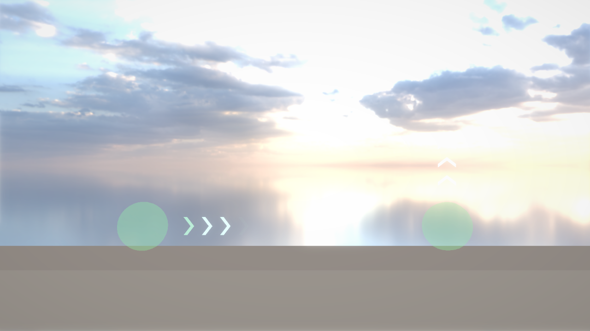
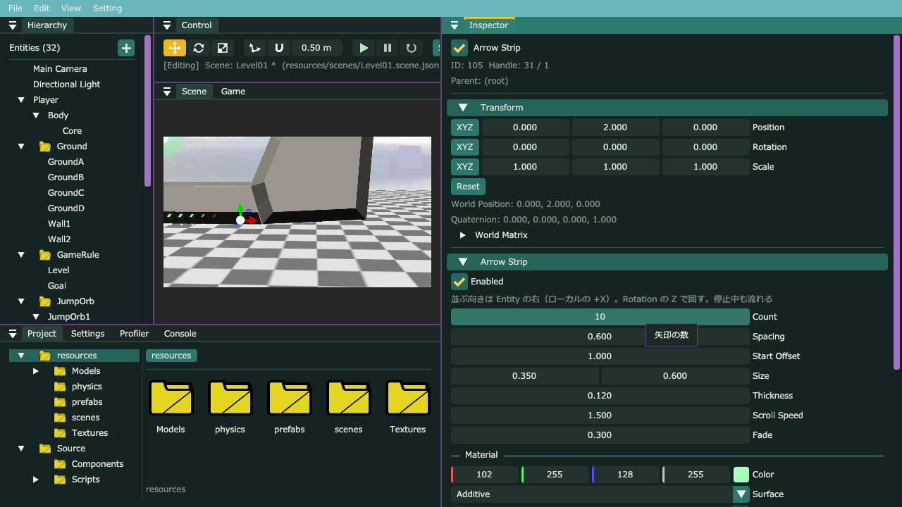

# G7b：緑の円をジャンプで発動・流れる矢印（Arrow Strip）・ばねを消す

## このファイルについて
- [G7Gimmick.md](G7Gimmick.md) の直し。頼まれた3つ：
  1. **緑の円は、輪の中でジャンプしたら発動**する（触れただけでは飛ばない）。行き先に **「> > > >」と流れる矢印**を出す。**吹っ飛んだ後も1回だけジャンプできる**。
  2. **矢印を簡単に調整できるエディタ** → エンジンの汎用機能 **Arrow Strip** にした（1.1）。
  3. **ばねは要らない** → 消す所（パートA）。
- **パートの順番**：A（ばねを消す）→ B（エンジン）→ C・D（ゲーム。C と D はお互いを include するので、両方書いてからビルド）→ E（エディタ）。
- 確かめた環境：本体の master（e3bbbf7）＋ G7・EditorFolder の答え ＋ このファイル、AL4_01 のコピー（G7 の答え）＋ パートA〜D。Release でテスト用のシーンに入力を時間で流してログで確かめ、Debug のエディタで Arrow Strip を作って値を変えた（7章）。

| パート | ファイル | 何をするか |
|---|---|---|
| A | `Source/Scripts/Gimmicks/Spring.h/.cpp`（消す）・`IceCube.h/.cpp`・`AL4_01.vcxproj` | ばねを消す |
| B | `Components/ArrowStripComponent.h`・`Systems/ArrowStripSystem.h/.cpp`（新しく作る）・`Engine.cpp`・`Window/WindowManager.cpp`・`Editor/Windows/HierarchyWindow.cpp`・`MyEngine_v1.vcxproj`（MyEngine_v1） | 流れる矢印の列 |
| C | `Source/Scripts/Gimmicks/JumpRing.h/.cpp`（新しく作る）・`JumpOrb.h/.cpp`・`LaunchOrb.h/.cpp`（置き換える） | 輪の共通部分・緑の円 |
| D | `Source/Scripts/IceCube.h/.cpp` | 緑の円をジャンプで使う |
| E | エディタで | 緑の円に矢印を付けて、Prefab を作り直す |

---

## 0. 前の写経で気づいた所
G7・EditorFolder の写経と答えを見比べた（AL4_01 の IceCube.cpp は、関数の並び順と見出しを自分で整理してあったので、並びは比べずに中身だけ比べた）。

| ファイル | 違い | 起きること | |
|---|---|---|---|
| `IceCube.cpp` の `UpdateGround` | `hasAirJump_ = false;`（着地したら、戻った自分のジャンプを消す）の1行が無い | **動きが変わる**。緑の壁・緑の円で戻ったジャンプを使わずに着地すると、ずっと残る。その後、足場から歩いて落ちると（コヨーテタイムが過ぎても）空中で1回跳べてしまう | **直す** |
| `HierarchyWindow.cpp` の `DrawEntityMenu` | フォルダの右クリックの **Create Folder**（フォルダの中にフォルダ）が無い | フォルダの中にフォルダを作れない（作ってからドラッグすれば入る） | しなくてもよい |
| `TransformEditor.h` | `#include <array>` が無い | 無し（ほかの include から入っている）。使う物は自分で include する決まりなので、足しておくとよい | しなくてもよい |
| `Matrix4x4.cpp` の `Inverse`・`EntityManager.cpp`・`SceneGizmo.cpp` | `{ }` の付け方・行の右のコメント | 無し | — |

- G7 の0章の `MY_ASSERT_MSG`（カプセル）は戻してあった。

**`UpdateGround` の直し**（`groundJumpTimer_ = coyoteTime_;` の下に1行）

```cpp
		groundJumpTimer_ = coyoteTime_; // 地面にいる間は、いつでも満タン
		hasAirJump_ = false;            // 着地したら、自分のジャンプは地面のジャンプ（コヨーテタイム）の方で持つ
```

**Create Folder**（`DrawEntityMenu` の `Create Child` の下。EditorFolder.md の 5章 6）

```cpp
	// フォルダの中にだけ、フォルダを作れる（普通の Entity の子にはフォルダを置かない。AcceptEntityDrop と同じ決まり）
	if (IsFolder(handle) && ImGui::MenuItem("Create Folder")) {
		EditorHistory::RequestCreate("Folder", handle, {ComponentSnapshot::Make(FolderComponent{})});
	}
```

---

## 1. 何をするか（なぜこう作ったか）

### 1.1 エンジンの汎用機能にした方がいいか → 矢印は「する」、吹っ飛ぶ決まりは「しない」
| | どこに | 理由 |
|---|---|---|
| **「> > > >」と流れる矢印** | **エンジン**（Arrow Strip。Rendering3D の Component） | ① **Script は停止中に動かない**（`Update` は再生中だけ）。Script で矢印を並べると、エディタで止まっている間は見えず、値を変えるたびに Play しないと分からない。エンジンの System は停止中も描くので、**Inspector で値を変えると Scene ビューですぐ見える**（これが「調整が簡単なエディタ」）。② 「こっちへ進む」を見せる物は、コンベア・風の向き・案内など、このゲーム以外でも使う。③ 形を作って描くのはエンジンの仕事（3章の方針）。 |
| 緑の円で吹っ飛ぶ決まり | ゲーム（IceCube・LaunchOrb） | このゲームだけの決まり（輪の中でジャンプ・0.3 秒・1回だけ跳べる）。G7 と同じ考え |

- 矢印の向きは、親の緑の円と同じ（子の Entity に付けるので、親の Rotation の Z で一緒に回る）。飛ぶ向き（LaunchOrb の右）と見た目の向きが、いつもそろう。
- まだ作っていない物：Scene ビューで矢印の先をドラッグして長さ・向きを変える取っ手（Polygon の Edit Shape のような物）。今は Inspector の数字と、Rotation のギズモ（E キー）で変える。要れば次に足せる。

### 1.2 Arrow Strip の作り
```
  Entity ●── Start Offset ──▶  >   >   >   >        Count 個を Spacing ずつ。列の長さ L ＝ Count × Spacing
                              ←─────── L ───────→
  位置 ＝ ((i ＋ 0.5) × Spacing ＋ 時間 × Scroll Speed) を L で折り返す（端から出たら、反対の端から出てくる）
  明るさ ＝ 近い方の端までの割合 ÷ Fade（1 を超えたら 1）  … 両端で薄くなって、出入りが目立たない
```
- 矢印1つは「>」の形。太さのある棒2本（平行四辺形2枚＝三角形4枚）で作る（ArrowStripSystem.cpp の図）。
- 矢印ごとに明るさが違うので、1つずつ `Renderer::DrawMesh` で描く（色は描くたびに渡す。数は多くて 32）。
- 流れる時間は、何も掛けていない時間（`Time::GetUnscaleDeltaTime`）を足していく。停止中・一時停止中も流れる。
- 色・透け方は Primitive Renderer と同じ Material（初めは加算・Unlit の緑で、光って見える）。Texture を選ぶと、矢印1つの四角に1枚貼る（G10 で絵にしたくなったとき）。
- `(i + 0.5)` にしているのは、Scroll Speed を 0 にして止めたとき、端の矢印が Fade で消えないように（両端から半分ずつ空けて並ぶ）。

### 1.3 緑の円：ジャンプで使う → 水色の円と同じ「輪」にまとめた
G7 の水色の円（JumpOrb）は「触れている間、ジャンプで使える。使ったら出るまで使えない」だった。緑の円も同じになるので、その部分を **共通の親クラス `JumpRing`** に移した。

```
            JumpRing（Script。SCRIPT で登録しない＝付けられない）
            ・IsReady / Use … 使えるか・使う（輪ごとに覚える）
            ・OnTriggerExit … キューブが出たら、また使える
            ・OnUse（virtual）… 使った瞬間の見た目は、子クラスで
           ┌──────┴──────┐
   JumpOrb（水色の円）       LaunchOrb（緑の円）
   輪が広がって消える          輪がふくらむ・向き・速さ・長さを持つ
```
- 同じ処理を2つのクラスに書かない（コピペを減らす）。IceCube は触れている輪を `GetComponent<JumpRing>()` で1回で集め、跳ぶときに `GetComponent<JumpOrb>()` か `GetComponent<LaunchOrb>()` で種類を見る（Script の `GetComponent` は `dynamic_cast` で探すので、親クラスの型でも子クラスが見つかる）。
- `Use` は `virtual` にしない。「使った」を覚えるのは必ず `JumpRing` で、子クラスは `OnUse` で見た目だけ変える（子が覚え方を書き換えられないように）。

**ジャンプを押したときの順番**

| 今 | 1番目 | 2番目 |
|---|---|---|
| Move（地上・空中） | **緑の円の中なら吹っ飛ぶ** | 地面のジャンプ → 水色の円 → 戻った自分のジャンプ（G7 のまま） |
| Stick（緑の壁） | **緑の円の中なら吹っ飛ぶ** | 壁ジャンプ |
| Launch（吹っ飛び中） | **別の緑の円の中なら吹っ飛び直す**（0.3 秒の間でも） | 0.3 秒の後なら、吹っ飛びをやめて跳ぶ（戻った自分のジャンプを使う） |

- 吹っ飛び始めた円は「使った」になる。真ん中に寄る間も、その円の中にいるが、もう一度押しても選ばれない（出たら戻る）。
- Move で吹っ飛び始めたフレームは、その後の `UpdateGravity` を呼ばない（呼ぶと、`Launch` が切った重力を戻してしまう）。

### 1.4 吹っ飛んだ後、1回だけジャンプできる
- `Launch` で `hasAirJump_ = true`（G7 から同じ）。**吹っ飛ばしたジャンプは、自分のジャンプを使わない**（`UseLaunchOrb` が true を返したら、`Jump` を呼ばずに終わる）ので、吹っ飛びの途中（0.3 秒の後）でも、ぶつかって止まった後の空中でも、1回跳べる。2回目は跳べない。

### 1.5 ばねを消す
- ばねだけが使っていた物：`Spring.h/.cpp`、IceCube の `Bounce`。`TakeOff`（地面を離れる）は `Jump` も使うので残す（説明の「ばね」だけ消す）。
- G7 で足した `GetWorldUp`（エンジン）は、ばねの向きに使っていたが、Transform の便利な関数として残す（Unity の `transform.up`）。
- AL4_01Game.md の8章のレベル3「熱湯の池を、ばねで越える」は「水色の円をつないで越える」にした。

---

## 2. パートA：ばねを消す（AL4_01）
今の AL4_01 には `Spring.h/.cpp` があり、Level01 にはばねは置いていなかった（シーンファイルに `"Spring"` が無いのを確かめた）。

| 場所 | すること |
|---|---|
| `Source/Scripts/Gimmicks/Spring.h`・`Spring.cpp` | ソリューションエクスプローラーで2つを選んで右クリック → 削除 → **削除**（「除外」だとファイルが残る）。vcxproj の `Spring.cpp`・`Spring.h` の2行も消える |
| `IceCube.h` の上の説明 | `ばね（Spring）で決まった高さへ・` を消す（パートD の1） |
| `IceCube.h` の public | `// ばねで跳ぶ（Spring から）…` と `void Bounce(const Vector3& up, float height);` の2行を消す（パートD の2） |
| `IceCube.h` の `TakeOff` の説明 | `（跳ぶ・ばね。…）` → `（…）`（パートD の3） |
| `IceCube.cpp` | `void IceCube::Bounce(…) { … }` を関数ごと消す。自分で付けた見出し（`// ===== 地面を離れる（跳ぶ・ばね。…` など）の「ばね」も消す |
| シーン・Prefab | ばねを置いた物があれば消す（残すと、読むときに「知らないComponent "Spring" を飛ばしました」と出る）。Prefab の `Spring.prefab` を作っていたら、Project ウィンドウで消す |

---

## 3. パートB：Arrow Strip（エンジン）

### `MyEngine/Components/ArrowStripComponent.h`（新しく作る）

```cpp
#pragma once
#include <type_traits>

#include "MyEngine/Components/PrimitiveRendererComponent.h"
#include "MyEngine/Math/Vector2.h"

// 「> > > >」のように、向きを示す矢印（山形）を一列に並べて流す見た目。Entity に付ける Component（カテゴリ：Rendering3D）
// 並ぶ向きは Entity の右（ローカルの +X）。Rotation の Z で回すと、矢印の向きも変わる（横から見るゲーム向けに、X・Y の面に描く）
// 吹っ飛ばす円の行き先・ベルトコンベア・風の向きなど、「こっちへ進む」を見せたい所に使う
// 描くのは ArrowStripSystem。停止中も描いて流すので、Inspector で値を変えると Scene ビューですぐ見られる
// 矢印の絵（テクスチャ）は無くてよい（形は ArrowStripSystem が作る）。Texture を選ぶと、矢印1つの四角に1枚貼る
//
//   Entity ●───── Start Offset ─────▶ > > > >    （Count 個。Spacing ずつ。全部で Count × Spacing の長さを、くり返し流れる）
//                                      ↑     ↑
//                              Fade で薄く   Fade で薄く（両端）

/// <summary>
/// 向きを示す矢印の列
/// </summary>
struct ArrowStripComponent {
	bool enabled = true;           // false の間は描かない
	int count = 4;                 // 矢印の数
	float spacing = 0.6f;          // 矢印の間（m。1つの矢印の先から、次の矢印の先まで）
	float startOffset = 1.0f;      // 列の始まり（Entity の位置から +X へ何 m 先か。円の外から並べたいときなど）
	Vector2 size = {0.35f, 0.6f};  // 矢印1つの大きさ（X：先まで の長さ、Y：高さ。m）
	float thickness = 0.12f;       // 矢印の線の太さ（X の向きで測る。m）
	float scrollSpeed = 1.5f;      // 流れる速さ（m/秒。0 で止まる。マイナスで逆へ流れる）
	float fade = 0.3f;             // 両端で薄くする長さ（列の長さに対する割合。0〜0.5。0 なら薄くしない）
	PrimitiveMaterial material = {
	    .color = {0.4f, 1.0f, 0.5f, 1.0f},
	    .surface = SurfaceType::Additive,
	    .shadingType = ShadingType::Unlit,
	}; // 見た目（色・透け方・テクスチャ。Primitive Renderer と同じ。初めは加算で光る緑）
};

static_assert(std::is_trivially_copyable_v<ArrowStripComponent>);
```

- `material` の初期値は、PolygonRendererComponent と同じく、名前を書いて入れる（`.color = …` 指定子付き初期化。C++20）。書かなかった項目は、`PrimitiveMaterial` の初期値のまま。名前は宣言した順に書く決まり。

### `MyEngine/Systems/ArrowStripSystem.h`（新しく作る）

```cpp
#pragma once
#include "MyEngine/Components/ArrowStripComponent.h"

// 前方宣言
class Camera;
class IBLEnvironment;


/// <summary>
/// Arrow Strip（向きを示す矢印の列）を登録し、描く
/// <para>矢印は「>」の形を、太さのある2本の棒（平行四辺形2枚）で作る。並べて、時間で +X へ流す</para>
/// <para>流れる時間は、何も掛けていない時間（一時停止・スローでも、停止中のエディタでも流れる）</para>
/// </summary>
class ArrowStripSystem {
public:
	// ArrowStripComponent を登録する（置き場所・保存・Inspector）。EntityManager::Initialize の後に呼ぶ
	static void Initialize();
	static void Release();

	/// <summary>
	/// 描画リクエストを積む（WindowManager::DrawAll から。停止中も描く）
	/// </summary>
	/// <param name="environment">環境光（PBR に要る。nullptr なら PBR の形は Half Lambert で描かれる）</param>
	static void Draw(Camera* camera, IBLEnvironment* environment);
};
```

### `MyEngine/Systems/ArrowStripSystem.cpp`（新しく作る）

```cpp
#include "ArrowStripSystem.h"

#include <algorithm>
#include <cmath>
#include <memory>
#include <vector>

#include "MyEngine/Components/TransformComponent.h"
#include "MyEngine/Diagnostics/MyAssert.h"
#include "MyEngine/ECS/ComponentSerializer.h"
#include "MyEngine/ECS/ComponentUI.h"
#include "MyEngine/ECS/EntityManager.h"
#include "MyEngine/ECS/GameComponent.h"
#include "MyEngine/Editor/Inspector/ComponentEditor.h"
#include "MyEngine/Graphics/Renderer/Renderer.h"
#include "MyEngine/Math/Color.h"
#include "MyEngine/Systems/PrimitiveRenderSystem.h"
#include "MyEngine/Time/EngineTime.h"

namespace {
constexpr float kMaxCount = 32.0f; // 矢印の数の上限（1つずつ描くので、多すぎないように）

/// <summary>
/// ArrowStripSystem が持つ物（Initialize で作り、Release で消す）
/// </summary>
struct ArrowStripState {
	float time = 0.0f;                  // 流れる時間（秒。何も掛けていない時間を足していく）
	std::vector<Vertex3dData> vertices; // 矢印1つ分の頂点（使い回す）
	std::vector<uint32_t> indices;      // 矢印1つ分の番号（いつも同じ）
};
std::unique_ptr<ArrowStripState> state;

// x を 0〜length の間に折り返す（length を超えたら 0 から、マイナスなら length の方から）
// std::fmod はマイナスの数だとマイナスの余りを返すので、floor（小さい方の整数）で割った回数を引く
float Repeat(float x, float length) { return x - std::floor(x / length) * length; }

// 列の中の位置 t（0〜1）での明るさ。両端の fade の長さで 0 まで薄くする（真ん中は 1）
float CalcFade(float t, float fade) {
	if (fade <= 0.0f) {
		return 1.0f;
	}
	const float edge = (std::min)(t, 1.0f - t); // 近い方の端までの割合
	return std::clamp(edge / fade, 0.0f, 1.0f);
}

//=============================================================================
// 矢印1つ分の形
//=============================================================================
//
//   F────E                  「>」を、太さ thickness の棒2本（平行四辺形2枚）で作る
//    ╲    ╲                   下の棒：A B C D　上の棒：D C E F
//     ╲    ╲                  先（C）はローカルの +X の向き
//      D────C   ← 先
//     ╱    ╱                 頂点はワールド座標にして渡す（Renderer::DrawMesh）
//    ╱    ╱                  UV は矢印1つの四角に、絵を1枚
//   A────B
//   ↑ left（矢印の左端の X）
//
void BuildArrow(const ArrowStripComponent& strip, float left, const Matrix4x4& world, const Vector3& normal) {
	const float width = (std::max)(strip.size.x, 0.0f);
	const float halfHeight = (std::max)(strip.size.y, 0.0f) * 0.5f;
	const float thickness = std::clamp(strip.thickness, 0.0f, width); // 長さより太いと、形が裏返る
	// --- ローカルの6点（Entity から見た X・Y。Z は 0 の面）---
	const Vector2 local[6] = {
	    {left,                     -halfHeight}, // A
	    {left + thickness,         -halfHeight}, // B
	    {left + width,             0.0f       }, // C 先
	    {left + width - thickness, 0.0f       }, // D 内側のくぼみ
	    {left + thickness,         halfHeight }, // E
	    {left,                     halfHeight }, // F
	};
	state->vertices.clear();
	for (const Vector2& point : local) {
		const Vector3 position = TransformPoint({point.x, point.y, 0.0f}, world);
		// UV：矢印1つの四角（左端〜先、下〜上）を 0〜1 に。V は下向きなので上を 0 にする
		const Vector2 uv = {(width > 0.0f) ? (point.x - left) / width : 0.0f, (halfHeight > 0.0f) ? (halfHeight - point.y) / (halfHeight * 2.0f) : 0.0f};
		state->vertices.push_back({
		    {position.x, position.y, position.z, 1.0f},
            uv, normal
        });
	}
}

//=============================================================================
// Inspector と 保存
//=============================================================================
void DescribeArrowStrip(ComponentUI& ui, ArrowStripComponent& value) {
	ui.Field("Enabled###enabled", value.enabled, Tip("外すと描かない"));
	ui.Label("並ぶ向きは Entity の右（ローカルの +X）。Rotation の Z で回す。停止中も流れる");
	ui.Field("Count###count", value.count, Range(1.0f, kMaxCount).Tip("矢印の数"));
	value.count = std::clamp(value.count, 1, static_cast<int>(kMaxCount));
	ui.Field("Spacing###spacing", value.spacing, AtLeast(0.01f).Tip("矢印の間（m。1つの先から次の先まで）。列の長さは Count × Spacing"));
	ui.Field("Start Offset###startOffset", value.startOffset, Tip("列の始まり（Entity の位置から +X へ何 m 先か）。円の外から並べたいときなど"));
	ui.Field("Size###size", value.size, AtLeast(0.0f).Tip("矢印1つの大きさ（X：先までの長さ、Y：高さ。m）"));
	ui.Field("Thickness###thickness", value.thickness, AtLeast(0.0f).Tip("矢印の線の太さ（X の向きで測る。m）。Size の X より太くはならない"));
	ui.Field("Scroll Speed###scrollSpeed", value.scrollSpeed, Tip("流れる速さ（m/秒）。0 で止まる、マイナスで逆へ流れる。端から出た矢印は、反対の端から出てくる"));
	ui.Field("Fade###fade", value.fade, Range(0.0f, 0.5f).Tip("両端で薄くする長さ（列の長さに対する割合）。0 なら薄くしない"));
	ui.Separator("Material");
	PrimitiveRenderSystem::DescribeMaterial(ui, value.material, "");
}
} // namespace

//=============================================================================
// 初期化 / 解放
//=============================================================================
void ArrowStripSystem::Initialize() {
	MY_ASSERT_MSG(state == nullptr, "Initialize()が2回以上呼ばれています");
	state = std::make_unique<ArrowStripState>();
	// 番号は矢印の形が同じなので、最初に1回だけ作る（下の棒 A B C・A C D、上の棒 D C E・D E F）
	state->indices = {0, 1, 2, 0, 2, 3, 3, 2, 4, 3, 4, 5};

	// Arrow Strip の置き場所・保存・Inspector を登録する（見せ方は DescribeArrowStrip 1つで、保存と Inspector の両方に使う）
	EntityManager::RegisterComponent<ArrowStripComponent>();
	ComponentSerializer::Register<ArrowStripComponent>("Arrow Strip", &DescribeArrowStrip);
	ComponentEditorRegistry::Register(std::make_unique<DescribedComponentEditor<ArrowStripComponent>>("Arrow Strip", "Rendering3D", &DescribeArrowStrip));
}

void ArrowStripSystem::Release() { state.reset(); }

//=============================================================================
// 描画
//=============================================================================
void ArrowStripSystem::Draw(Camera* camera, IBLEnvironment* environment) {
	MY_ASSERT_MSG(state != nullptr, "ArrowStripSystem::Initialize()を先に呼んでください");
	// 流れる時間：何も掛けていない時間（停止中のエディタでも流して、Inspector で変えた値をすぐ見られるように）
	state->time += Time::GetUnscaleDeltaTime();

	EntityManager::ForEach<ArrowStripComponent>([camera, environment](Handle<Entity> entity, const ArrowStripComponent& strip) {
		if (!strip.enabled || strip.count <= 0 || strip.spacing <= 0.0f || !EntityManager::IsActiveInHierarchy(entity)) {
			return;
		}
		const TransformComponent* transform = EntityManager::Get<TransformComponent>(entity);
		if (transform == nullptr) {
			return;
		}
		const Matrix4x4& world = transform->worldMatrix;
		// 法線はカメラの方（-Z）。Z の大きさが 0 で向きが決まらなければ、そのまま -Z
		Vector3 normal = Normalize(TransformNormal({0.0f, 0.0f, -1.0f}, world));
		if (LengthSq(normal) == 0.0f) {
			normal = {0.0f, 0.0f, -1.0f};
		}
		Renderer::MeshConfig config;
		PrimitiveRenderSystem::ApplyMaterial(config, strip.material, environment);
		config.camera = camera;

		// --- 矢印を1つずつ：列の中の位置を時間で進めて、列の長さで折り返す。両端は薄くする ---
		const float length = strip.spacing * static_cast<float>(strip.count); // 列の長さ
		for (int i = 0; i < strip.count; ++i) {
			// (i + 0.5) × Spacing：止めたとき、両端から半分ずつ空けて並ぶ（端の矢印が Fade で消えないように）
			const float position = Repeat((static_cast<float>(i) + 0.5f) * strip.spacing + state->time * strip.scrollSpeed, length);
			const float brightness = CalcFade(position / length, strip.fade);
			if (brightness <= 0.0f) {
				continue;
			}
			// 色ごと薄くする（Transparent は A が、Additive は RGB が効く）
			config.color = ToColorCode(strip.material.color * brightness);
			// 矢印の真ん中を position に置く
			BuildArrow(strip, strip.startOffset + position - strip.size.x * 0.5f, world, normal);
			Renderer::DrawMesh(config, state->vertices, state->indices);
		}
	});
}
```

- `Repeat`：`std::fmod(x, length)` はマイナスの x でマイナスの余り（−0.3 など）を返すので、`std::floor`（その数以下の一番大きい整数）を使う。Scroll Speed がマイナス（逆へ流れる）でも 0〜length に入る。
- 頂点はワールド座標にしてから渡す（Polygon Renderer と同じ）。Renderer は両面を描く設定（`SolidNone`）なので、Scene ビューで後ろから見ても見える。
- 頂点の配列は `state` に持って使い回す（毎フレーム、矢印の数だけ new しないように）。`DrawMesh` は中身を写して持っていくので、次の矢印で書き換えてよい。

### `MyEngine/Engine.cpp`（3か所）
**1. include**（`PolygonShapeSystem.h` の上）

```cpp
#include "MyEngine/Systems/ArrowStripSystem.h"
```

**2. `Initialize`**（`PolygonShapeSystem::Initialize();` の下）

```cpp
	ArrowStripSystem::Initialize();      // Arrow StripをEntityManagerに登録する（保存・Inspectorも）ので、EntityManagerの後
```

**3. `Finalize`**（`PolygonShapeSystem::Release();` の下）

```cpp
	ArrowStripSystem::Release();      // シーン（ウィンドウ）の破棄より後にする
```

### `MyEngine/Window/WindowManager.cpp`（2か所）
**1. include**（`PolygonShapeSystem.h` の下）

```cpp
#include "MyEngine/Systems/ArrowStripSystem.h"
```

**2. `DrawAll`**（`PolygonShapeSystem::Draw(…)` の下）

```cpp
	ArrowStripSystem::Draw(gameCamera, gameEnvironment);      // 向きを示す矢印の列の描画
```

### `MyEngine/Editor/Windows/HierarchyWindow.cpp`（2か所）
**1. include**（`CameraComponent.h` の上）

```cpp
#include "MyEngine/Components/ArrowStripComponent.h"
```

**2. `DrawCreateMenu` の 3D Object に足す**（`Polygon` の `if` の下）

```cpp
		if (ImGui::MenuItem("Arrow Strip")) {
			// 「> > > >」と流れる矢印の列（向きは Rotation の Z。Inspector で数・間・大きさ・速さを変えると、停止中もすぐ見られる）
			EditorHistory::RequestCreate("Arrow Strip", {}, {ComponentSnapshot::Make(ArrowStripComponent{})});
		}
```

### `MyEngine_v1.vcxproj`（3ファイル）
`ArrowStripComponent.h` を Components、`ArrowStripSystem.h/.cpp` を Systems に「既存の項目を追加」。

```xml
    <ClCompile Include="MyEngine\Systems\ArrowStripSystem.cpp" />
```

```xml
    <ClInclude Include="MyEngine\Systems\ArrowStripSystem.h" />
    <ClInclude Include="MyEngine\Components\ArrowStripComponent.h" />
```

- Components は 20 ファイル、Systems は 30 ファイルになった（目安の 15 を超えている。分けるのは提出の後）。

---

## 4. パートC：輪の共通部分・水色の円・緑の円（AL4_01）

### `Source/Scripts/Gimmicks/JumpRing.h`（新しく作る）

```cpp
#pragma once
#include <MyEngine/ECS/Script.h>

/// <summary>
/// ジャンプで使う輪（水色の円 JumpOrb・緑の円 LaunchOrb の共通部分）。これだけでは付けられない（SCRIPT で登録しない）
/// <para>氷のキューブが輪に触れている間、ジャンプで使える。使ったら、キューブが輪から一度出るまで使えない（入り直すと、また使える）</para>
/// <para>何が起きるか（もう一度跳ぶ・吹っ飛ぶ）は IceCube が決める。ここは「使えるか」を輪ごとに覚えるだけ</para>
/// <para>IceCube は触れている輪を GetComponent&lt;JumpRing&gt;() で集める（JumpOrb・LaunchOrb のどちらも見つかる）</para>
/// </summary>
class JumpRing : public Script {
public:
	void OnTriggerExit(GameObject other) override; // キューブが出た → また使える

	// ===== IceCube から使う =====
	// 使えるか（まだ使っていない）
	bool IsReady() const { return !isUsed_; }
	// 使う（キューブが輪から出るまで、使えない）。見た目は OnUse で
	void Use();

protected:
	// 使った瞬間に呼ぶ（輪が広がる・ふくらむなどの見た目を始める。派生クラスで書く）
	virtual void OnUse() {}
	// 使ったか（見た目を変えるのに使う）
	bool IsUsed() const { return isUsed_; }

private:
	bool isUsed_ = false; // 使った（キューブが出るまで使えない）
};
```

### `Source/Scripts/Gimmicks/JumpRing.cpp`（新しく作る）

```cpp
#include "JumpRing.h"

#include "Source/Scripts/IceCube.h"

//=============================================================================
// 使う・戻る
//=============================================================================
void JumpRing::Use() {
	isUsed_ = true;
	OnUse(); // 見た目（派生クラス）
}

void JumpRing::OnTriggerExit(GameObject other) {
	// キューブが輪から出たら、また使える（入り直すと使える）
	if (other.GetComponent<IceCube>() != nullptr) {
		isUsed_ = false;
	}
}
```

- `protected`：自分と子クラスからは使えて、ほかのクラス（IceCube など）からは使えない。`OnUse`・`IsUsed` は子クラスの見た目のためだけの物なので、ここに置いた。

### `Source/Scripts/Gimmicks/JumpOrb.h`（全部置き換える）
G7 から：親を `JumpRing` に・`OnTriggerExit`・`IsReady`・`Use`・`isUsed_` を消した（JumpRing へ）・`OnUse` を足した。

```cpp
#pragma once
#include <MyEngine/Math/Vector3.h>
#include <MyEngine/Math/Vector4.h>

#include "Source/Scripts/Gimmicks/JumpRing.h"

/// <summary>
/// 水色の円（ジャンプの円）。Collider（Sphere・Is Trigger）を付けた Entity に付ける
/// <para>氷のキューブが触れている間、空中でもう一度跳べる。跳ぶのは IceCube で、「使えるか」は JumpRing が覚える</para>
/// <para>見た目：子の「Ring」（輪。ゆっくり回る。使うと広がって消える）と「Core」（真ん中の光る玉。使うと暗くなる）。どちらも無くてよい</para>
/// </summary>
class JumpOrb : public JumpRing {
public:
	void Start() override;
	void Update() override;
	void Fields(ComponentUI& ui) override;

protected:
	void OnUse() override { popTimer_ = 0.0f; } // 使った瞬間から、輪が広がり始める

private:
	// ===== Inspector に出す・保存する値 =====
	float spinSpeed_ = 30.0f;      // 輪が回る速さ（度/秒）
	float popScale_ = 1.6f;        // 使ったとき、輪がこの倍まで広がって消える
	float popTime_ = 0.25f;        // 輪が広がって消えるまでの秒数
	float usedBrightness_ = 0.25f; // 使った後の、真ん中の玉の明るさ（元の色に掛ける）

	// ===== 実行中だけの値（保存しない）=====
	float popTimer_ = 0.0f;                        // 使ってからの秒数
	GameObject ring_;                              // 子の「Ring」（Start で探す）
	GameObject core_;                              // 子の「Core」（Start で探す）
	Vector3 ringScale_ = {1.0f, 1.0f, 1.0f};       // 輪の元の大きさ
	Vector4 ringColor_ = {1.0f, 1.0f, 1.0f, 1.0f}; // 輪の元の色
	Vector4 coreColor_ = {1.0f, 1.0f, 1.0f, 1.0f}; // 玉の元の色
};
```

### `Source/Scripts/Gimmicks/JumpOrb.cpp`（全部置き換える）
G7 から：`isUsed_` → `IsUsed()`・`IceCube.h` の include と、一番下の「使う・戻る」を消した。

```cpp
#include "JumpOrb.h"

#include <algorithm>

#include <MyEngine/Math/MathUtility.h>

SCRIPT(JumpOrb, "Gimmick");

//=============================================================================
// Inspector に出す・保存する値
//=============================================================================
void JumpOrb::Fields(ComponentUI& ui) {
	ui.Label("キューブが触れている間、空中でもう一度跳べる。使ったら、円から一度出るまで使えない");
	ui.Field("Spin Speed", spinSpeed_, Tip("子の Ring が回る速さ（度/秒。マイナスで逆回り）"));
	ui.Field("Pop Scale", popScale_, AtLeast(1.0f).Tip("使ったとき、子の Ring がこの倍まで広がって消える"));
	ui.Field("Pop Time", popTime_, AtLeast(0.01f).Tip("子の Ring が広がって消えるまでの秒数"));
	ui.Field("Used Brightness", usedBrightness_, Range(0.0f, 1.0f).Tip("使った後の、子の Core の明るさ（元の色に掛ける。キューブが円から出ると元に戻る）"));
}

//=============================================================================
// 毎フレーム
//=============================================================================
void JumpOrb::Start() {
	// 子の見た目を探して、元の大きさと色を覚える（無ければ、その見た目は動かさない）
	ring_ = gameObject.FindChild("Ring");
	core_ = gameObject.FindChild("Core");
	if (ring_) {
		ringScale_ = ring_.GetTransform().scale;
		if (const PrimitiveRendererComponent* renderer = ring_.GetComponent<PrimitiveRendererComponent>()) {
			ringColor_ = renderer->material.color;
		}
	}
	if (core_) {
		if (const PrimitiveRendererComponent* renderer = core_.GetComponent<PrimitiveRendererComponent>()) {
			coreColor_ = renderer->material.color;
		}
	}
}

void JumpOrb::Update() {
	const float deltaTime = Time::GetDeltaTime();
	popTimer_ += deltaTime;
	// --- 輪：ゆっくり回る。使ったら Pop Time 秒で、広がりながら薄くなって消える ---
	if (ring_) {
		const float t = IsUsed() ? std::clamp(popTimer_ / popTime_, 0.0f, 1.0f) : 0.0f; // 0：元のまま 〜 1：消えた
		TransformComponent& ring = ring_.GetTransform();
		Rotate(ring, {0.0f, 0.0f, 1.0f}, spinSpeed_ * deltaTime);
		ring.scale = ringScale_ * MathUtility::Lerp(1.0f, popScale_, t);
		if (PrimitiveRendererComponent* renderer = ring_.GetComponent<PrimitiveRendererComponent>()) {
			renderer->material.color = ringColor_ * (1.0f - t); // 色ごと薄くする（Transparent は A が、Additive は RGB が効く）
		}
	}
	// --- 真ん中の玉：使ったら暗くなる（A はそのまま）---
	if (core_) {
		if (PrimitiveRendererComponent* renderer = core_.GetComponent<PrimitiveRendererComponent>()) {
			const float brightness = IsUsed() ? usedBrightness_ : 1.0f;
			renderer->material.color = {coreColor_.x * brightness, coreColor_.y * brightness, coreColor_.z * brightness, coreColor_.w};
		}
	}
}
```

### `Source/Scripts/Gimmicks/LaunchOrb.h`（全部置き換える）
G7 から：親を `JumpRing` に・`OnTriggerEnter` を消した（触れただけでは飛ばない）・IceCube が読む4つ（`GetCenter`・`GetDirection`・`GetSpeed`・`GetDuration`）と `OnUse` を足した。

```cpp
#pragma once
#include <MyEngine/Math/Vector3.h>

#include "Source/Scripts/Gimmicks/JumpRing.h"

/// <summary>
/// 緑の円（吹っ飛ばす円）。Collider（Sphere・Is Trigger）を付けた Entity に付ける
/// <para>氷のキューブが輪の中でジャンプすると、輪の真ん中に寄ってから、矢印の向き（この Entity の右＝ローカルの +X）へまっすぐ吹っ飛ぶ。
/// 向きは Transform の Rotation の Z で決める。触れただけでは何も起きない（通り抜ける）</para>
/// <para>吹っ飛ぶ動き（重力なし・始まって少しはジャンプできない・ぶつかるか時間切れで終わる）は IceCube。ここは速さと長さを渡すだけ。
/// 「使えるか」（使ったら輪から出るまで使えない）は JumpRing</para>
/// <para>見た目：子の「Ring」（使うと一瞬ふくらむ）。行き先の矢印は、子に置いたエンジンの Arrow Strip（コードでは動かさない。親と一緒に回る）</para>
/// </summary>
class LaunchOrb : public JumpRing {
public:
	void Start() override;
	void Update() override;
	void Fields(ComponentUI& ui) override;

	// ===== IceCube から使う =====
	// 寄っていく真ん中（ワールド座標）
	Vector3 GetCenter() const { return GetWorldPosition(transform); }
	// 飛ぶ向き（この Entity の右＝ローカルの +X。Rotation の Z で回る）
	Vector3 GetDirection() const { return GetWorldRight(transform); }
	float GetSpeed() const { return speed_; }
	float GetDuration() const { return duration_; }

protected:
	void OnUse() override { pulseTimer_ = 0.0f; } // 使った瞬間に、輪がふくらむ

private:
	// ===== Inspector に出す・保存する値 =====
	float speed_ = 16.0f;     // 飛ぶ速さ（m/s）
	float duration_ = 1.5f;   // 吹っ飛びの長さ（秒。何にもぶつからなければ、この秒数で普通の空中に戻る）
	float pulseScale_ = 1.4f; // 使ったとき、輪がこの倍にふくらむ
	float pulseTime_ = 0.2f;  // ふくらんだ輪が戻るまでの秒数

	// ===== 実行中だけの値（保存しない）=====
	GameObject ring_;                        // 子の「Ring」（Start で探す）
	Vector3 ringScale_ = {1.0f, 1.0f, 1.0f}; // 輪の元の大きさ
	float pulseTimer_ = 0.0f;                // 使ってからの秒数（Start で Pulse Time にして、ふくらんでいない所から始める）
};
```

### `Source/Scripts/Gimmicks/LaunchOrb.cpp`（全部置き換える）
G7 から：`OnTriggerEnter` と `IceCube.h` の include を消し、Label の説明を変えた。

```cpp
#include "LaunchOrb.h"

#include <algorithm>

#include <MyEngine/Math/MathUtility.h>

SCRIPT(LaunchOrb, "Gimmick");

//=============================================================================
// Inspector に出す・保存する値
//=============================================================================
void LaunchOrb::Fields(ComponentUI& ui) {
	ui.Label("キューブが輪の中でジャンプすると、真ん中に寄ってから、矢印の向き（この Entity の右＝ローカルの +X）へ吹っ飛ぶ。向きは Rotation の Z（90 で上、180 で左）");
	ui.Field("Speed", speed_, AtLeast(0.0f).Tip("飛ぶ速さ（m/s）"));
	ui.Field("Duration", duration_, AtLeast(0.0f).Tip("吹っ飛びの長さ（秒）。何にもぶつからなければ、この秒数で普通の空中に戻る（重力が戻る）"));
	ui.Field("Pulse Scale", pulseScale_, AtLeast(1.0f).Tip("使ったとき、子の Ring がこの倍にふくらむ"));
	ui.Field("Pulse Time", pulseTime_, AtLeast(0.01f).Tip("ふくらんだ Ring が戻るまでの秒数"));
}

//=============================================================================
// 毎フレーム
//=============================================================================
void LaunchOrb::Start() {
	ring_ = gameObject.FindChild("Ring"); // 無ければ、見た目は動かさない
	if (ring_) {
		ringScale_ = ring_.GetTransform().scale;
	}
	pulseTimer_ = pulseTime_; // ふくらんでいない所から
}

void LaunchOrb::Update() {
	pulseTimer_ += Time::GetDeltaTime();
	if (!ring_) {
		return;
	}
	// --- 輪：使った瞬間に Pulse Scale 倍にふくらんで、Pulse Time 秒で元に戻る ---
	const float t = std::clamp(pulseTimer_ / pulseTime_, 0.0f, 1.0f);
	ring_.GetTransform().scale = ringScale_ * MathUtility::Lerp(pulseScale_, 1.0f, t);
}
```

### `AL4_01.vcxproj`
`JumpRing.h/.cpp` を Gimmicks に「既存の項目を追加」（Spring の2行はパートAで消えている）。

```xml
    <ClCompile Include="Source\Scripts\Gimmicks\JumpRing.cpp" />
```

```xml
    <ClInclude Include="Source\Scripts\Gimmicks\JumpRing.h" />
```

---

## 5. パートD：IceCube（AL4_01）
自分で並べ替えた IceCube.cpp に合わせて、関数の名前で書く。

### `Source/Scripts/IceCube.h`（5か所）
**1. 上の説明**（ばね を消して、緑の円の書き方を変える）

```cpp
/// <para>ギミック（G7）：水色の円（JumpOrb）で空中でもう一度跳ぶ・緑の円（LaunchOrb）の中でジャンプすると吹っ飛ぶ・緑の壁（StickyWall）にくっつく</para>
```

**2. public**：`Bounce` と `Launch`（とその説明）の4行を消す（`Launch` は IceCube の中からしか呼ばなくなったので、private へ移す）

**3. private の関数**（`TakeOff` の説明を直し、`UseLaunchOrb`・`Launch` を足す）

```cpp
	void TakeOff();                                                          // 地面を離れる（地面のジャンプと先行入力を消す）
	bool ReadJumpRequest(float deltaTime);                                   // ジャンプを頼まれているか（今押した・先行入力で覚えている）
	bool UseLaunchOrb();                                                     // 触れている緑の円を1つ使って、吹っ飛ぶ（使えたら true）
	// 吹っ飛ぶ。center へ寄ってから、direction の向きへ speed（m/s）でまっすぐ飛ぶ。duration 秒で普通の空中に戻る
	void Launch(const Vector3& center, const Vector3& direction, float speed, float duration);
	bool UseJumpOrb();                                                       // 触れている水色の円を1つ使う（使えたら true）
```

**4. Inspector の値の説明**（2行）

```cpp
	float launchGatherTime_ = 0.1f;  // 吹っ飛び始めてから、真ん中に寄る秒数
	float launchJumpLock_ = 0.3f;    // 吹っ飛び始めてから、この秒数はジャンプできない（別の緑の円は使える）
```

**5. `touchingOrbs_` の説明**

```cpp
	std::vector<GameObject> touchingOrbs_;        // 触れている輪（水色の円・緑の円。JumpRing）
```

### `Source/Scripts/IceCube.cpp`（8か所。0章の `UpdateGround` の1行も）
**1. include**（`JumpOrb.h` の下）

```cpp
#include "Source/Scripts/Gimmicks/JumpOrb.h"
#include "Source/Scripts/Gimmicks/LaunchOrb.h"
#include "Source/Scripts/Gimmicks/StickyWall.h"
```

**2. `Fields` の説明**（Launch Gather Time・Launch Jump Lock の2行）

```cpp
	ui.Field("Launch Gather Time", launchGatherTime_, AtLeast(0.0f).Tip("緑の円の中でジャンプしてから、円の真ん中に寄る秒数（その後、矢印の向きへ飛ぶ。0 なら寄らずにすぐ飛ぶ）"));
	ui.Field("Launch Jump Lock", launchJumpLock_, AtLeast(0.0f).Tip("吹っ飛び始めてから、この秒数はジャンプできない（その後のジャンプで、吹っ飛びをやめて跳ぶ。別の緑の円の中なら、いつでも吹っ飛び直せる）"));
```

**3. `UpdateMove`**（`UpdateGravity` の前に3行）

```cpp
void IceCube::UpdateMove(RigidbodyComponent& rigidbody, float deltaTime) {
	UpdateGround(rigidbody, deltaTime);
	// --- 空中で、横から緑の壁に触れたら、くっつく ---
	if (TryStick(rigidbody)) {
		return;
	}
	UpdateRun(rigidbody, deltaTime);
	UpdateJump(rigidbody, deltaTime);
	if (state_ != State::Move) {
		return; // 緑の円で吹っ飛び始めた（重力は Launch が切った。ここで戻さない）
	}
	UpdateGravity(rigidbody);
}
```

**4. `OnTriggerEnter`**（`JumpOrb` → `JumpRing`）

```cpp
void IceCube::OnTriggerEnter(GameObject other) {
	// 触れている輪（水色の円・緑の円。どちらも JumpRing なので、1回で見つかる）。使えるかは、跳ぶときに輪に聞く
	if (other.GetComponent<JumpRing>() != nullptr) {
		touchingOrbs_.push_back(other);
	}
}
```

- `JumpRing.h` は `JumpOrb.h`・`LaunchOrb.h` が include しているので、ここで足さなくても見える（足してもよい）。

**5. `UpdateJump` の前半**（「跳ぶ」の `if` を置き換える。長押しの所はそのまま）

```cpp
void IceCube::UpdateJump(RigidbodyComponent& rigidbody, float deltaTime) {
	// --- 跳ぶ：押した（覚えている）ジャンプがあって、使えるジャンプがあるとき ---
	if (ReadJumpRequest(deltaTime)) {
		// 緑の円の中なら、跳ばずに吹っ飛ぶ（地上でも空中でも、ほかのジャンプより先。自分のジャンプは使わない）
		if (UseLaunchOrb()) {
			return;
		}
		// 使う順番：地上（コヨーテタイムの間も）は地面のジャンプ → 空中は、触れている水色の円 → 緑の壁・緑の円で戻った自分のジャンプ
		// || は左から順に調べて、true が出たらそこで止まる（短絡評価）。なので、円を使えたら、自分のジャンプは使わずに残る
		if (CanGroundJump() || UseJumpOrb() || UseAirJump()) {
			Jump(rigidbody);
		}
	}
```

- 緑の円で吹っ飛んだら `return`（長押しの所は見ない。`Launch` が `isJumpRising_` を消している）。

**6. `UpdateStick` の一番上**（`if (ReadJumpRequest(deltaTime)) {` の中の頭に3行）

```cpp
	// --- 壁ジャンプ：上＋壁と反対へ（先行入力も使う。くっつく少し前に押していたら、くっついた瞬間に跳ぶ）---
	if (ReadJumpRequest(deltaTime)) {
		// 緑の円の中なら、壁ジャンプではなく吹っ飛ぶ（Move のときと同じく、緑の円が先）
		if (UseLaunchOrb()) {
			return;
		}
		ChangeState(State::Move);
```

**7. `UseLaunchOrb` を足して、`Bounce` を消す。`Launch` は説明を3か所直す**（`Bounce` があった所。自分で並べた所でよい）

```cpp
//=============================================================================
// 緑の円（吹っ飛び）
//=============================================================================
bool IceCube::UseLaunchOrb() {
	// 触れている緑の円のうち、使える物を1つ使って、その円の向きへ吹っ飛ぶ（使った円は、出るまで使えない）
	for (const GameObject& orbObject : touchingOrbs_) {
		LaunchOrb* orb = orbObject.GetComponent<LaunchOrb>();
		if (orb != nullptr && orb->IsReady()) {
			orb->Use();
			Launch(orb->GetCenter(), orb->GetDirection(), orb->GetSpeed(), orb->GetDuration());
			return true;
		}
	}
	return false;
}

void IceCube::Launch(const Vector3& center, const Vector3& direction, float speed, float duration) {
	RigidbodyComponent* rigidbody = GetComponent<RigidbodyComponent>();
	const Vector3 flat = Normalize(Vector3{direction.x, direction.y, 0.0f}); // 奥行きには飛ばない
	if (!IsPlayable() || rigidbody == nullptr || Length(flat) == 0.0f) {
		return;
	}
	ChangeState(State::Launch); // 吹っ飛びの最中に別の円の中でジャンプしたら、そっちの向きで吹っ飛び直す
	launchStart_ = GetWorldPosition(transform);
	launchCenter_ = {center.x, center.y, launchStart_.z};
	launchVelocity_ = flat * speed;
	launchDuration_ = duration;
	hasAirJump_ = true; // 自分のジャンプが1回ある（吹っ飛びの途中・後で、1回だけ跳べる）
	isOnGround_ = false;
	groundJumpTimer_ = 0.0f;
	jumpBufferTimer_ = 0.0f; // 吹っ飛ばしたジャンプ（先行入力）で、すぐやめないように
	isJumpRising_ = false;
	rigidbody->velocity = {0.0f, 0.0f, 0.0f};
	rigidbody->useGravity = false;
}
```

**8. `UpdateLaunch` のジャンプ**（`// --- Launch Jump Lock 秒の後は…` の `if` を置き換える）

```cpp
	// --- ジャンプ：別の緑の円の中なら、そっちの向きで吹っ飛び直す（いつでも）---
	// Launch Jump Lock 秒の後なら、吹っ飛びをやめて跳ぶ（横の速さを Launch Jump Keep だけ残す。自分のジャンプを使う）
	// ReadJumpRequest は毎フレーム呼んで、先行入力を数える（Lock の終わる少し前に押しても、終わった瞬間に跳ぶ）
	// 吹っ飛び始めた円は「使った」ので、円から出るまで UseLaunchOrb には選ばれない
	if (ReadJumpRequest(deltaTime)) {
		if (UseLaunchOrb()) {
			return;
		}
		if (stateTimer_ >= launchJumpLock_ && UseAirJump()) {
			ChangeState(State::Move);
			rigidbody.useGravity = true;
			rigidbody.velocity.x = launchVelocity_.x * launchJumpKeep_;
			Jump(rigidbody);
			return;
		}
	}
```

---

## 6. パートE：緑の円に矢印を付ける（エディタで）
**E-1. 今の LaunchOrb を直す**（Level01 の `LaunchOrb`）
1. `LaunchOrb` を右クリック → Create Child。名前を `Arrows` にする。
2. `Arrows` に Add Component → **Rendering3D → Arrow Strip**。Transform は (0, 0, 0)・回転 0 のまま（向きは親の LaunchOrb の Rotation の Z）。
3. Inspector で調整（停止中も流れるので、見ながら変えられる）。初めの値の目安：

| 項目 | 値 | |
|---|---|---|
| Start Offset | 1.0 | Ring（Scale 1.6 ＝ 半径 0.8）の外から並べる |
| Count・Spacing | 4・0.6 | 2.4m の列 |
| Size・Thickness | (0.35, 0.6)・0.12 | |
| Scroll Speed | 1.5 | |
| Fade | 0.3 | |
| Material | Color (0.4, 1, 0.5, 1)・Additive・Unlit（初めから） | |

4. G7 で Arrow（箱）を作っていたら消す（今の Level01 の LaunchOrb の子は Ring・Core。Core は残しても消してもよい）。
5. 向きを変えるときは、**親の `LaunchOrb`** を回す（Rotation の Z。E キーのギズモでも）。矢印も一緒に回る。

**E-2. Prefab を作り直す**：`LaunchOrb` を右クリック → Save As Prefab（同じ名前なら上書き。前の中身は .bak に残る）。

**E-3. Play で確かめる**

| すること | こうなればよい |
|---|---|
| 緑の円を通り抜ける（押さない） | 何も起きない（普通に落ちる・走る） |
| 輪の中でジャンプ（地上でも空中でも） | 真ん中に寄って、矢印の向きへ飛ぶ。輪がふくらむ |
| すぐもう一度押す | 何もしない（0.3 秒） |
| 飛んでいる途中で押す（0.3 秒より後） | 吹っ飛びをやめて跳ぶ。もう一度押しても跳ばない |
| 押さずに壁まで飛んで止まる → 空中で押す | 1回だけ跳べる |
| 飛んでいる途中で、別の緑の円の中で押す | そっちの向きで飛び直す |

---

## 7. 確かめたこと
**Release（エディタ無し）**：G7 のテスト用シーンから、ばねを外し、緑の円の子を Arrow Strip にして、緑の円（上向き）を (52, 1) に足した。入力はテスト用の Script から時間で流した（確かめた後に外した）。

```
床：上の面 y = 0   緑の円（右）(42, 1) → 普通の壁 x = 60
緑の円（上）(52, 1)・(66, 1)   緑の円（右）(102, 1) → 緑の壁 x = 110
```

| 場面 | 決まり | 結果 |
|---|---|---|
| 走って緑の円（右）の中で止まる。押さない | 何も起きない | 4.5 秒ずっと Move（触れていても飛ばない） |
| 輪の中（地上）でジャンプ | 吹っ飛ぶ | Launch。0.1 秒で真ん中 (42, 1) → vx **16**・vy 0。自分のジャンプが1回ある（air 1） |
| 吹っ飛んで 0.15 秒で押す | 何もしない | 何もしない |
| 0.5 秒で押す | やめて跳ぶ | vx **8**・vy 12.66。自分のジャンプを使った（air 0） |
| 押さずに飛んで、途中の緑の円（上）を通る | 通り抜ける | 通り抜けて、壁（x = 60）で Move（x 59.5） |
| 壁で止まった後、空中で押す → もう一度押す | 1回だけ | 1回目 vy **12.91** で跳んだ。2回目は跳ばない |
| 飛んでいる途中、緑の円（上）の中（x 51.6）で押す | 吹っ飛び直す | その場で Launch（上へ）。真ん中 (52, ・) に寄って vy 16、1.5 秒で時間切れ |
| 緑の円（上）の中でジャンプ | 上へ | 1.50 秒で時間切れ → Move（vy 15.2） |
| 緑の円（右）→ 緑の壁 | くっつく | x 109.5 で Stick |
| 見た目 | 矢印が流れる・端で薄くなる・上向きの円は上向き | 下の画像1 |



**エディタ（Debug）**：テストの間だけ、ファイルに書いた操作を ImGui に入れる仕掛けを付けて、実際に操作した（確かめた後に外して、ビルドし直した）。

| すること | 結果 |
|---|---|
| ＋ → 3D Object | Polygon の下に **Arrow Strip** が出る |
| Arrow Strip を押す | 「Arrow Strip」ができて、Inspector に Count・Spacing・Start Offset・Size・Thickness・Scroll Speed・Fade・Material |
| 停止中に Position Y を 2、Count を 4 → 10 にドラッグ | Scene ビューの矢印がすぐ 10 個になった（画像2） |
| 停止中に 7 フレームあけて2回撮る | 矢印の所だけ 805 画素変わった（Inspector の所は 0）＝ **停止中も流れている** |



- Debug・Release とも、前からある `DIRECTINPUT_VERSION` の警告2つだけでビルドが通った。
- 確かめていないこと：利用者さんの AL4_01 そのもの（0章の直しを入れた後の動き）。Material の Texture を選んだときの見た目（絵が無いので）。

---

## 8. AL4_01Game.md・Reference.md の直し
- [AL4_01Game.md](AL4_01Game.md)：3章（Arrow Strip を足す・ばねを消す）、5章（自分のジャンプが戻る：緑の円で吹っ飛んだ。状態の表）、6章（緑の円の決まり・ばねはやめた・確かめることから、ばねと「緑の円で戻るか」を消した）、8章（レベル3）、12章（効果音）、13章（G7b）、決めたこと（3行）。
- [Reference.md](../Reference.md)：8章に「向きを示す矢印の列（Arrow Strip）」、17章の Hierarchy の ＋ に Arrow Strip。
- [G7Gimmick.md](G7Gimmick.md) は G7 のときのまま（ばね・触れたら飛ぶ緑の円は、このファイルで変えた）。
