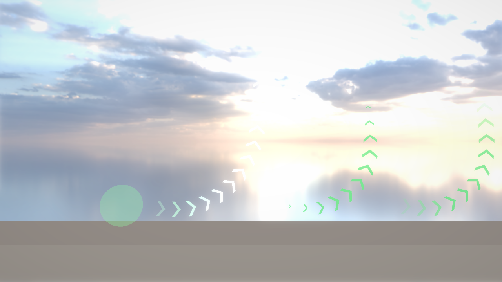
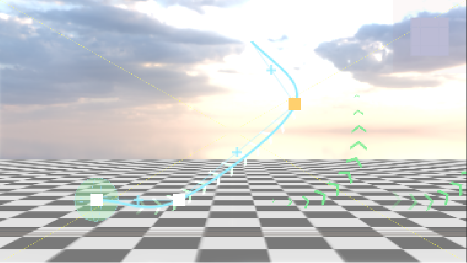

# G7c：矢印を曲げる・緑の円は線に沿って飛ぶ・Opaque の Fade

## このファイルについて
- [G7bLaunchArrow.md](G7bLaunchArrow.md) の続き。頼まれた3つ：
  1. **矢印（Arrow Strip）を曲げられる**ようにする。作り方は Polygon Shape と同じ「点を置いて、Scene ビューで動かす」（B 案）。
  2. **緑の円で吹っ飛んだキューブも、その線に沿って飛ぶ**（見た目と飛び方がいつもそろう）。
  3. **Surface を Opaque にしたときの Fade がおかしい**のを直す。
- **G7b をまだ写していなければ**：G7b のパートB の `ArrowStripComponent.h`・`ArrowStripSystem.h/.cpp` と、パートC の `LaunchOrb.h/.cpp` は、このファイルの物を写せばよい（G7b の分は飛ばしてよい）。それ以外（Engine.cpp・WindowManager.cpp・HierarchyWindow.cpp・JumpRing・JumpOrb・IceCube の G7b の所）は G7b のまま写す。
- **パートの順番**：A（曲線の計算）→ B（Arrow Strip）→ C（エディタ）→ D（ゲーム）→ E（エディタで）。A〜C はエンジンだけでビルドが通る。D は B の `ArrowStripSystem::BuildPath` を使う。
- 確かめた環境：本体の master（e3bbbf7）＋ G7・EditorFolder・G7b の答え ＋ このファイル、AL4_01 のコピー（G7b の答え）＋ パートD。Release でテスト用のシーンに入力を時間で流してログで確かめ、Debug のエディタで Edit Path を操作した（7章）。

| パート | ファイル | 何をするか |
|---|---|---|
| A | `Math/Geometry/PathCurve.h/.cpp`（新しく作る） | 点を通るなめらかな線（Catmull-Rom）。長さで位置と向きを聞ける |
| B | `Components/ArrowStripComponent.h`・`Systems/ArrowStripSystem.h/.cpp`（全部置き換える） | 線に沿って並べる・Fade を透け方ごとに・線を外へ渡す・Edit Path |
| C | `Editor/Gizmos/PointListGizmo.h/.cpp`・`ArrowStripGizmo.h/.cpp`（新しく作る）・`PolygonShapeGizmo.h/.cpp`（置き換える）・`SceneGizmo.cpp`・`MyEngine_v1.vcxproj` | 点を動かすエディタを Polygon Shape と共通にする |
| D | `Source/Scripts/Gimmicks/LaunchOrb.h/.cpp`（置き換える）・`Source/Scripts/IceCube.h/.cpp`（AL4_01） | 線に沿って飛ぶ |
| E | エディタで | 緑の円の Arrows を曲げる・Prefab を作り直す |

---

## 1. 何をするか（なぜこう作ったか）

### 1.1 Opaque で Fade がおかしかった理由
G7b は、矢印ごとに **色をまるごと暗く**して薄く見せていた（`material.color * brightness`）。透け方（Surface）ごとに、色の混ぜ方が違う（`RenderStates.cpp` のブレンド）。

| Surface | 色の混ぜ方 | G7b の見え方 | G7c の消し方 |
|---|---|---|---|
| Opaque | 混ぜない（A を使わない） | RGB だけ暗くなって、両端で**黒い矢印**になる | **小さくして消す**（大きさ・太さに掛ける。色はそのまま） |
| Transparent | 画面の色と、A の割合で混ぜる | RGB と A の両方に掛かって、濃さの**2乗**で消える（端の手前で急に薄い・暗い色を通る） | **A だけ**下げる |
| Additive | 色 × A を足す | これも 2 乗で消える | **RGB だけ**下げる |

- 不透明な物は、どうしても半透明にはできない（奥行きを書くので、後ろが描かれない）。なので Opaque は形の大きさで消す。
- Surface は3つの値の enum なので、分けるのは `switch`（`ApplyFade`）。

### 1.2 曲線は Catmull-Rom（点を必ず通る線）
「点を置いて、その間をなめらかにつなぐ」線はいくつかある。

| 線 | 点の上を通るか | 操作 | |
|---|---|---|---|
| ベジェ曲線 | 端の点だけ通る（間の点は「引っぱる取っ手」） | 点＋取っ手を動かす（Illustrator・Unity の Spline） | 取っ手のエディタが要る |
| **Catmull-Rom** | **全部の点を通る** | 点を動かすだけ | **Polygon Shape と同じ操作で済む** |
| B スプライン | 点を通らない | 点を動かすだけ | 思った所を通らない |

```
   p0 ・          ・ p3        p1 から p2 までの曲線を、前後の点 p0・p3 も使って作る
        ╲  p1 ●━━━━● p2 ╱     ・p1 では「p0 → p2 の向き」、p2 では「p1 → p3 の向き」に進む
                               ・なので、区間のつなぎ目で向きが急に変わらない（なめらか）
```
- 端の区間には前（後ろ）の点が無いので、**端の点で折り返した点**（2P0 − P1）を使う。こうすると、点が 2 つのときはまっすぐな線になる（G7b の矢印と同じ）。
- 点を必ず通るので、**曲がる手前で、少しだけ反対へふくらむ**ことがある（下の 7 章の線は、右へ進んでから上へ曲がる手前で 0.14m 下がる）。気になるときは、曲がる所の近くに点を足すと減る。

### 1.3 線に沿った長さで聞く（折れ線＋二分探索）
矢印を「等間隔」に並べる・キューブを「決まった速さ」で動かすには、**線に沿った長さ**（m）で場所を聞きたい。曲線の式の t（0〜1）は長さに比例しない（点の間が長い所では、t が同じだけ進んでも長く進む）。

1. 点と点の間（1区間）を 16 本の短い直線に分ける（細かい折れ線にする）。
2. 始まりから各点までの長さを足していく（`distances_`。小さい順に並ぶ）。
3. 長さ d の場所は、`distances_` を二分探索して「d が入っている短い直線」を見つけ、その上で割合で決める。向きはその直線の向き。

- 線は毎フレーム作り直す（点は 16 個まで・区間 16 本なので、240 本の直線。配列は使い回すので new しない）。

### 1.4 矢印の並べ方：Count を消して、Spacing だけにした
G7b は「Count 個 × Spacing」で列の長さが決まっていた。曲げられるようにすると、**線の長さは点で決まる**ので、数を別に決めると線と合わなくなる。

```
   ●────── Start Offset ──────▶ >   >   >   >   >   ●
   線の始まり                    ←── 並べる長さ L ──→  線の終わり
                                 数 ＝ L ÷ Spacing を四捨五入（1〜64）
                                 間 ＝ L ÷ 数（Spacing に一番近い、ちょうど割り切れる間）
```
- ちょうど割り切れる間にするのは、端から出た矢印が反対の端から出てくるとき（`Repeat`）、間がずれないように。
- **Start Offset は線に沿って測る**ようにした。緑の円では、線は円の真ん中（点0）から始め、矢印は輪の外（1m 先）から並べる。キューブは点0（真ん中）へ寄ってから飛ぶ。
- 初めの点は (0, 0)・(3.4, 0)。Start Offset 1・Spacing 0.6 で、G7b の初めの並び（1m 先から 4 個）と同じになる。

### 1.5 キューブを線に沿って飛ばす
```
  Launch（ジャンプした瞬間）            UpdateLaunch（毎フレーム）
  ・緑の円から線を写す（ワールド座標）    ・Gather 秒：線の始まりへ寄る（G7b と同じ）
  ・進んだ長さ ＝ 0                      ・進んだ長さ ＋＝ Speed × deltaTime
                                         ・線の上のその点へ、このフレームで着く速さを Rigidbody に入れる
                                         ・線の終わりの先は、終わりの向きへまっすぐ（Duration まで）
```
- **位置を直接動かさず、速さを入れる**：「次の点 − 今の位置」÷ deltaTime。物理はこの速さで動かすので、ぶつかる物からは押し出される（壁を抜けない）。
- 床をこすって遅れたら、次のフレームで取り戻す。ただし **Speed の 2 倍まで**（`kLaunchCatchUp`。大きく引っかかったときに、ワープするように飛び出さないように）。
- 線は吹っ飛び始めに **写して持つ**（`launchPath_`）。飛んでいる間に円や矢印が動いても、飛ぶ線は変わらない。
- `launchVelocity_` は「今の線の向き × 速さ」にして、毎フレーム書き直す。G7b からこれを使っていた3つ（行き止まりの判定・やめて跳ぶときの横の速さ・キューブの回る向き）は、そのまま曲線でも正しく動く。
- **線の終わり**：初めは G7b と同じく「終わりの向きへまっすぐ飛び続けて、Duration で終わる」。LaunchOrb の **End At Path End** を付けると、線の終わりで吹っ飛びをやめて、その勢い（終わりの向き × Speed）のまま普通の空中へ（重力が戻るので、放り投げたように飛ぶ）。
- 線は子の「Arrows」（Arrow Strip）から作る（`ArrowStripSystem::BuildPath`）。Arrows が無い緑の円は、G7b と同じく右（+X）へまっすぐ。

### 1.6 エディタ：点を動かす所を Polygon Shape と共通にした
Polygon Shape の Edit Shape（`PolygonShapeGizmo.cpp`、330 行）は「点を描く・掴む・＋で足す・Delete・グリッド・Undo」を全部持っていた。Arrow Strip も同じ操作にしたいので、**そのまま写すとコピペが 300 行**になる。そこで、点の操作を `PointListGizmo` に移して、2つから使う。

```
   PolygonShapeGizmo（Edit Shape）       ArrowStripGizmo（Edit Path）
   ・閉じた多角形・3点まで                ・開いた線・2点まで
   ・前の面の上・辺が交差したら赤          ・Z = 0 の面・点を通る曲線も描く
           │  PointList を作って渡す              │
           └────────────► PointListGizmo ◄────────┘
                           点の印・掴む・＋で足す・Delete・吸い付く・Undo・Esc
```
- `PointList` に「点の置き場所・数・閉じているか・面の Z・形が正しいか・曲線・Undo の写し方」を入れて渡す。点の置き場所は `std::span<Vector2>`（配列の一部を指す物。`std::array` をそのまま渡せる。C++20）。
- 選んだ点などの状態は1つだけ持つ。**前のフレームに呼ばれなかったら捨てる**（`ImGui::GetFrameCount()` で見る）。Finish Editing で止めた後に、次に編集を始めたとき、前のドラッグが残らないように。
- 線は、点を結ぶ**薄い線**（どの点の間に ＋ があるか）と、実際の**曲線**（太い線）の2つを描く。

---

## 2. パートA：曲線の計算（エンジン）

### `MyEngine/Math/Geometry/PathCurve.h`（新しく作る）

```cpp
#pragma once
#include <span>
#include <vector>

#include "MyEngine/Math/Vector3.h"

/// <summary>
/// 点を順に通る、なめらかな線（Catmull-Rom スプライン）。細かい折れ線にして持ち、線に沿った長さ（m）で位置と向きを聞ける
/// <para>Arrow Strip（矢印を線に沿って等間隔に並べる）と、それに沿って物を決まった速さで動かす（緑の円の吹っ飛び）のに使う</para>
/// <para>点が 2 つならまっすぐな線。点は Entity から見た位置でも、ワールド座標でもよい（入れた座標のまま返す）</para>
/// </summary>
class PathCurve {
public:
	/// <summary>
	/// 線の上の1点
	/// </summary>
	struct Sample {
		Vector3 position = {0.0f, 0.0f, 0.0f}; // 位置
		Vector3 tangent = {1.0f, 0.0f, 0.0f};  // 進む向き（長さ1）
	};

	/// <summary>
	/// 点を順に通る線を作り直す（前の中身は捨てる。配列の置き場所は使い回す）
	/// <para>同じ位置に続けて置いた点は1つにまとめる。まとめた後で点が 2 つより少なければ、空の線になる</para>
	/// </summary>
	void Build(std::span<const Vector3> points);

	// 線があるか（点が 2 つ以上で作れた）
	bool IsEmpty() const { return positions_.size() < 2; }
	// 線の長さ（m）。空なら 0
	float GetLength() const { return distances_.empty() ? 0.0f : distances_.back(); }
	// 細かい折れ線の点（エディタで線を描くのに使う）
	std::span<const Vector3> GetPolyline() const { return positions_; }

	/// <summary>
	/// 始まりから distance（m）進んだ所の位置と向き。0 より前は始まり、長さより先は終わりで止まる
	/// <para>空の線なら、原点と +X</para>
	/// </summary>
	Sample Evaluate(float distance) const;

private:
	std::vector<Vector3> positions_; // 細かい折れ線の点（始まりから終わりへ）
	std::vector<float> distances_;   // 始まりから、その点までの長さ（m。positions_ と同じ数。distances_[0] は 0）
	std::vector<Vector3> controls_;  // Build で、続けて同じ位置の点をまとめた後の点（使い回す）
};
```

### `MyEngine/Math/Geometry/PathCurve.cpp`（新しく作る）

```cpp
#include "PathCurve.h"

#include <algorithm>

namespace {
constexpr int kSegmentsPerSpan = 16; // 点と点の間（1区間）を、何本の短い直線に分けるか（多いほどなめらか・重い）

//=============================================================================
// Catmull-Rom スプライン
//=============================================================================
//
//   p0 ・          ・ p3        p1 から p2 までの曲線を、前後の点 p0・p3 も使って作る
//        ╲  p1 ●━━━━● p2 ╱     ・p1 では「p0 → p2 の向き」、p2 では「p1 → p3 の向き」に進む
//                               ・なので、区間のつなぎ目で向きが急に変わらない（なめらか）
//   t は 0（p1）〜 1（p2）。式は、この2つの決まりを満たす3次式（Catmull-Rom の式そのまま）
//
Vector3 CatmullRom(const Vector3& p0, const Vector3& p1, const Vector3& p2, const Vector3& p3, float t) {
	const float t2 = t * t;
	const float t3 = t2 * t;
	return (p1 * 2.0f + (p2 - p0) * t + (p0 * 2.0f - p1 * 5.0f + p2 * 4.0f - p3) * t2 + (p1 * 3.0f - p0 - p2 * 3.0f + p3) * t3) * 0.5f;
}
} // namespace

//=============================================================================
// 作る
//=============================================================================
void PathCurve::Build(std::span<const Vector3> points) {
	positions_.clear();
	distances_.clear();
	// --- 続けて同じ位置の点をまとめる（長さ 0 の区間があると、向きが決まらない）---
	controls_.clear();
	for (const Vector3& point : points) {
		if (controls_.empty() || LengthSq(point - controls_.back()) > 0.0f) {
			controls_.push_back(point);
		}
	}
	const size_t count = controls_.size();
	if (count < 2) {
		return;
	}

	// --- 区間ごとに、細かい折れ線にする ---
	// 端の区間には「前の点」「後ろの点」が無いので、端の点で折り返した位置を使う（2P0 − P1）。端では、となりの点の方へまっすぐ進む
	const Vector3 before = controls_[0] * 2.0f - controls_[1];
	const Vector3 after = controls_[count - 1] * 2.0f - controls_[count - 2];
	positions_.push_back(controls_[0]);
	for (size_t i = 0; i + 1 < count; ++i) {
		const Vector3& p0 = (i == 0) ? before : controls_[i - 1];
		const Vector3& p3 = (i + 2 < count) ? controls_[i + 2] : after;
		// 区間の始まり（s = 0）は、1つ前の区間の終わりと同じ点なので、s = 1 から足す
		for (int s = 1; s <= kSegmentsPerSpan; ++s) {
			const float t = static_cast<float>(s) / static_cast<float>(kSegmentsPerSpan);
			positions_.push_back(CatmullRom(p0, controls_[i], controls_[i + 1], p3, t));
		}
	}

	// --- 始まりから各点までの長さ（短い直線の長さを足していく）---
	distances_.reserve(positions_.size());
	float total = 0.0f;
	distances_.push_back(total);
	for (size_t i = 1; i < positions_.size(); ++i) {
		total += Length(positions_[i] - positions_[i - 1]);
		distances_.push_back(total);
	}
}

//=============================================================================
// 長さで聞く
//=============================================================================
PathCurve::Sample PathCurve::Evaluate(float distance) const {
	if (IsEmpty()) {
		return {};
	}
	const float clamped = std::clamp(distance, 0.0f, GetLength());
	// --- distance が入っている短い直線を探す（distances_ は小さい順なので、二分探索）---
	// std::upper_bound：小さい順に並んだ範囲で「clamped より大きい最初の要素」を返す（<algorithm>。O(log n)）
	// その1つ前の点から、その点までの直線の上にある
	const auto found = std::upper_bound(distances_.begin(), distances_.end(), clamped);
	const size_t end = std::clamp(static_cast<size_t>(found - distances_.begin()), size_t{1}, positions_.size() - 1);
	const size_t start = end - 1;
	// --- 直線の上で、長さの割合で位置を決める。向きはその直線の向き ---
	const float segmentLength = distances_[end] - distances_[start];
	const float t = (segmentLength > 0.0f) ? (clamped - distances_[start]) / segmentLength : 0.0f;
	Sample sample;
	sample.position = positions_[start] + (positions_[end] - positions_[start]) * t;
	if (segmentLength > 0.0f) {
		sample.tangent = (positions_[end] - positions_[start]) / segmentLength;
	}
	return sample;
}
```

- `CatmullRom` の式は、t = 0 で p1、t = 1 で p2、その2点での向きが (p2 − p0) ÷ 2・(p3 − p1) ÷ 2 になる3次式（覚えなくてよい。「前後の点の向きに進む」が式になった物）。
- `std::upper_bound`：小さい順に並んだ範囲で、値より大きい最初の要素を返す（`<algorithm>`）。順に探すと長さに比例して時間がかかるが、二分探索なので半分ずつ絞れる。
- `controls_` を持っているのは、同じ位置の点をまとめた後の点を、毎フレーム new しないため（`clear()` しても置き場所は残る）。

---

## 3. パートB：Arrow Strip（エンジン）
G7b の3ファイルを**全部置き換える**。

### `MyEngine/Components/ArrowStripComponent.h`（全部置き換える）
G7b から：`count` を消した・`points`・`pointCount`・`GetPoints` を足した（Polygon Shape と同じ形）・`startOffset` を線に沿って測るようにした。

```cpp
#pragma once
#include <span>
#include <array>
#include <cstdint>
#include <algorithm>
#include <type_traits>

#include "MyEngine/Components/PrimitiveRendererComponent.h"
#include "MyEngine/Math/Vector2.h"

// 「> > > >」のように、向きを示す矢印（山形）を線に沿って並べて流す見た目。Entity に付ける Component（カテゴリ：Rendering3D）
// 線は、点を順に通るなめらかな曲線（Catmull-Rom。点が 2 つならまっすぐ）。点は Entity のローカル座標の X・Y（Z は 0 の面に描く）
// 吹っ飛ばす円の行き先（緑の円は、この線に沿ってキューブを飛ばす）・ベルトコンベア・風の向きなど、「こっちへ進む」を見せたい所に使う
// 描くのは ArrowStripSystem。停止中も描いて流すので、Inspector・Scene ビュー（Edit Path）で変えると、すぐ見られる
// 矢印の絵（テクスチャ）は無くてよい（形は ArrowStripSystem が作る）。Texture を選ぶと、矢印1つの四角に1枚貼る
//
//   点0 ●── Start Offset ──▶ >  >  >  >  ╮        矢印は Start Offset から線の終わりまでに、Spacing ずつ並ぶ
//   （線の始まり）                         >       （Spacing に一番近い、ちょうど割り切れる間に直す）
//                                     点2 ● >     矢印の向きは、その場所の線の向き
//              ↑ 点1 はこのあたり（線は点を必ず通る）

// 線の点の数の上限（Component は memcpy で写すので、決まった大きさの配列で持つ）
constexpr uint32_t kMaxArrowPathPoints = 16;

/// <summary>
/// 向きを示す矢印の列
/// </summary>
struct ArrowStripComponent {
	bool enabled = true; // false の間は描かない
	// 線の点（Entity から見た X・Y。m）。使うのは先頭から pointCount 個。初めは右へまっすぐ 3.4m（G7b の Start Offset 1・4個・0.6 と同じ並び）
	std::array<Vector2, kMaxArrowPathPoints> points = {
	    {{0.0f, 0.0f}, {3.4f, 0.0f}}
    };
	int pointCount = 2;            // 使っている点の数（2〜kMaxArrowPathPoints）
	float startOffset = 1.0f;      // 線の始まりから、矢印を並べ始めるまでの長さ（m。線に沿って測る。円の外から並べたいときなど）
	float spacing = 0.6f;          // 矢印の間（m。線に沿って測る。1つの矢印の先から、次の矢印の先まで）
	Vector2 size = {0.35f, 0.6f};  // 矢印1つの大きさ（X：先までの長さ、Y：高さ。m）
	float thickness = 0.12f;       // 矢印の線の太さ（X の向きで測る。m）
	float scrollSpeed = 1.5f;      // 流れる速さ（m/秒。0 で止まる。マイナスで逆へ流れる）
	float fade = 0.3f;             // 両端で消していく長さ（並べた長さに対する割合。0〜0.5。0 なら消さない。Opaque は小さくして、それ以外は薄くして消す）
	PrimitiveMaterial material = {
	    .color = {0.4f, 1.0f, 0.5f, 1.0f},
	    .surface = SurfaceType::Additive,
	    .shadingType = ShadingType::Unlit,
	}; // 見た目（色・透け方・テクスチャ。Primitive Renderer と同じ。初めは加算で光る緑）

	// 使っている点だけ（pointCount が範囲の外でも、配列の外は読まない）
	std::span<const Vector2> GetPoints() const { return {points.data(), static_cast<size_t>(std::clamp(pointCount, 0, static_cast<int>(kMaxArrowPathPoints)))}; }
};

static_assert(std::is_trivially_copyable_v<ArrowStripComponent>);
```

- 前のシーンに `"count"` が保存されていても、読むときに飛ばされる（知らない名前）。点が無いので、初めの (0, 0)・(3.4, 0) になる。

### `MyEngine/Systems/ArrowStripSystem.h`（全部置き換える）
G7b から：`BuildPath`・`IsEditing`・`SetEditing` を足した。

```cpp
#pragma once
#include "MyEngine/Components/ArrowStripComponent.h"
#include "MyEngine/Math/Geometry/PathCurve.h"
#include "MyEngine/Math/Matrix4x4.h"

// 前方宣言
class Camera;
class IBLEnvironment;


/// <summary>
/// Arrow Strip（向きを示す矢印の列）を登録し、描く
/// <para>線は点を順に通る曲線（PathCurve）。矢印は「>」の形を、太さのある2本の棒（平行四辺形2枚）で作り、線に沿って並べて、時間で流す</para>
/// <para>流れる時間は、何も掛けていない時間（一時停止・スローでも、停止中のエディタでも流れる）</para>
/// <para>Scene ビューでの線の編集は ArrowStripGizmo（エディタ）。編集中かどうかは、Inspector のボタンから変えるので、ここに置く（Polygon Shape と同じ）</para>
/// </summary>
class ArrowStripSystem {
public:
	// ArrowStripComponent を登録する（置き場所・保存・Inspector）。EntityManager::Initialize の後に呼ぶ
	static void Initialize();
	static void Release();

	/// <summary>
	/// 描画リクエストを積む（WindowManager::DrawAll から。停止中も描く）
	/// </summary>
	/// <param name="environment">環境光（PBR に要る。nullptr なら PBR の形は Half Lambert で描かれる）</param>
	static void Draw(Camera* camera, IBLEnvironment* environment);

	/// <summary>
	/// 線を作る（点にワールド行列を掛けてから曲線にする。worldMatrix に単位行列を渡すと、Entity から見た位置のまま）
	/// <para>緑の円が、キューブを線に沿って飛ばすのに使う。点が 2 つより少なければ、空の線になる</para>
	/// </summary>
	static void BuildPath(const ArrowStripComponent& strip, const Matrix4x4& worldMatrix, PathCurve& path);

	// ===== 線の編集（エディタ）=====
	// Scene ビューで、選んでいる Entity の線の点を動かしているか（Inspector の Edit Path で切り替える）
	static bool IsEditing();
	static void SetEditing(bool isEditing);
};
```

### `MyEngine/Systems/ArrowStripSystem.cpp`（全部置き換える）
G7b から：`ApplyFade`（1.1）・`BuildArrow` を線の向きで回す・`Draw` を線に沿って並べる（1.4）・Inspector に Edit Path と点・`BuildPath`・編集中の印。

```cpp
#include "ArrowStripSystem.h"

#include <array>
#include <cmath>
#include <format>
#include <memory>
#include <vector>
#include <algorithm>

#include "MyEngine/Components/TransformComponent.h"
#include "MyEngine/Diagnostics/MyAssert.h"
#include "MyEngine/ECS/ComponentSerializer.h"
#include "MyEngine/ECS/ComponentUI.h"
#include "MyEngine/ECS/EntityManager.h"
#include "MyEngine/ECS/GameComponent.h"
#include "MyEngine/Editor/Inspector/ComponentEditor.h"
#include "MyEngine/Graphics/Renderer/Renderer.h"
#include "MyEngine/Math/Color.h"
#include "MyEngine/Systems/PrimitiveRenderSystem.h"
#include "MyEngine/Time/EngineTime.h"

namespace {
constexpr int kMaxArrows = 64;          // 1本の線に並べる矢印の数の上限（1つずつ描くので、多すぎないように）
constexpr float kMinPointCount = 2.0f;  // 線の点の数の下限（まっすぐな線）
constexpr float kMinSpacing = 0.01f;    // 矢印の間の下限（m。0 で割らないように）

/// <summary>
/// 矢印1つの置き方
/// </summary>
struct ArrowPlacement {
	PathCurve::Sample sample; // 矢印の真ん中の位置と、線の向き（Entity から見た座標）
	float scale = 1.0f;       // 大きさの倍率（Opaque の Fade で小さくする）
};

/// <summary>
/// ArrowStripSystem が持つ物（Initialize で作り、Release で消す）
/// </summary>
struct ArrowStripState {
	float time = 0.0f;                  // 流れる時間（秒。何も掛けていない時間を足していく）
	PathCurve path;                     // 描いている線（Entity から見た座標。Entity ごとに作り直して使い回す）
	std::vector<Vertex3dData> vertices; // 矢印1つ分の頂点（使い回す）
	std::vector<uint32_t> indices;      // 矢印1つ分の番号（いつも同じ）
	bool isEditing = false;             // Scene ビューで線を編集しているか
};
std::unique_ptr<ArrowStripState> state;

// x を 0〜length の間に折り返す（length を超えたら 0 から、マイナスなら length の方から）
// std::fmod はマイナスの数だとマイナスの余りを返すので、floor（小さい方の整数）で割った回数を引く
float Repeat(float x, float length) { return x - std::floor(x / length) * length; }

// 並べた中の位置 t（0〜1）での濃さ。両端の fade の長さで 0 まで下げる（真ん中は 1）
float CalcFade(float t, float fade) {
	if (fade <= 0.0f) {
		return 1.0f;
	}
	const float edge = (std::min)(t, 1.0f - t); // 近い方の端までの割合
	return std::clamp(edge / fade, 0.0f, 1.0f);
}

//=============================================================================
// 端で消す（透け方ごとに、消し方を変える）
//=============================================================================
// Opaque（不透明）は透けない（A を使わない）ので、色を暗くすると黒い矢印になる → 小さくして消す
// Transparent は A だけ、Additive は RGB だけを下げる（両方に掛けると、濃さの2乗で消えて、端の手前で急に薄くなる）
void ApplyFade(SurfaceType surface, float fade, Vector4* color, float* scale) {
	switch (surface) {
	case SurfaceType::Opaque:
		*scale = fade;
		break;
	case SurfaceType::Transparent:
		color->w *= fade;
		break;
	case SurfaceType::Additive:
		color->x *= fade;
		color->y *= fade;
		color->z *= fade;
		break;
	}
}

//=============================================================================
// 矢印1つ分の形
//=============================================================================
//
//   F────E                  「>」を、太さ thickness の棒2本（平行四辺形2枚）で作る
//    ╲    ╲                   下の棒：A B C D　上の棒：D C E F
//     ╲    ╲                  先（C）は線の進む向き（tangent）
//      D────C   ← 先          矢印の真ん中（A と C の真ん中の X）を、線の上の位置に置く
//     ╱    ╱
//    ╱    ╱                  矢印の中の向き：along ＝ 線の向き、across ＝ 線の向きを左へ 90 度回した向き
//   A────B                   頂点は「線の位置 ＋ along × u ＋ across × v」を、ワールド座標にして渡す（Renderer::DrawMesh）
//                            UV は矢印1つの四角に、絵を1枚
//
void BuildArrow(const ArrowStripComponent& strip, const ArrowPlacement& placement, const Matrix4x4& world, const Vector3& normal) {
	const float width = (std::max)(strip.size.x, 0.0f) * placement.scale;
	const float halfHeight = (std::max)(strip.size.y, 0.0f) * 0.5f * placement.scale;
	const float thickness = std::clamp(strip.thickness * placement.scale, 0.0f, width); // 長さより太いと、形が裏返る
	const float left = -width * 0.5f;                                                    // 矢印の左端（真ん中から見た u）
	// --- 矢印の中の6点（u：線の向き、v：横）---
	const std::array<Vector2, 6> local = {
	    Vector2{left,                     -halfHeight}, // A
	    Vector2{left + thickness,         -halfHeight}, // B
	    Vector2{left + width,             0.0f       }, // C 先
	    Vector2{left + width - thickness, 0.0f       }, // D 内側のくぼみ
	    Vector2{left + thickness,         halfHeight }, // E
	    Vector2{left,                     halfHeight }, // F
	};
	const Vector3& along = placement.sample.tangent;
	const Vector3 across = {-along.y, along.x, 0.0f}; // X・Y の面で、左へ 90 度回した向き
	state->vertices.clear();
	for (const Vector2& point : local) {
		const Vector3 position = TransformPoint(placement.sample.position + along * point.x + across * point.y, world);
		// UV：矢印1つの四角（左端〜先、下〜上）を 0〜1 に。V は下向きなので上を 0 にする
		const Vector2 uv = {(width > 0.0f) ? (point.x - left) / width : 0.0f, (halfHeight > 0.0f) ? (halfHeight - point.y) / (halfHeight * 2.0f) : 0.0f};
		state->vertices.push_back({
		    {position.x, position.y, position.z, 1.0f},
            uv, normal
        });
	}
}

//=============================================================================
// Inspector と 保存
//=============================================================================
void DescribeArrowStrip(ComponentUI& ui, ArrowStripComponent& value) {
	ui.Field("Enabled###enabled", value.enabled, Tip("外すと描かない"));
	// ===== 線の編集（Inspector だけ。保存・読み込みのときは Button がいつも false）=====
	if (ui.Button(state->isEditing ? "Finish Editing###editPath" : "Edit Path###editPath")) {
		state->isEditing = !state->isEditing;
	}
	ui.Label("Scene ビューで ■ をドラッグ・＋ で足す・Delete で消す。停止中も流れる");
	// ===== 並べ方 =====
	ui.Field("Start Offset###startOffset", value.startOffset, AtLeast(0.0f).Tip("線の始まりから、矢印を並べ始めるまでの長さ（m。線に沿って測る）。円の外から並べたいときなど"));
	ui.Field("Spacing###spacing", value.spacing, AtLeast(kMinSpacing).Tip("矢印の間（m。線に沿って測る）。並べる長さがちょうど割り切れるように、一番近い間に直して並べる"));
	ui.Field("Size###size", value.size, AtLeast(0.0f).Tip("矢印1つの大きさ（X：先までの長さ、Y：高さ。m）"));
	ui.Field("Thickness###thickness", value.thickness, AtLeast(0.0f).Tip("矢印の線の太さ（X の向きで測る。m）。Size の X より太くはならない"));
	ui.Field("Scroll Speed###scrollSpeed", value.scrollSpeed, Tip("流れる速さ（m/秒）。0 で止まる、マイナスで逆へ流れる。端から出た矢印は、反対の端から出てくる"));
	ui.Field("Fade###fade", value.fade, Range(0.0f, 0.5f).Tip("両端で消していく長さ（並べた長さに対する割合）。0 なら消さない。Opaque は小さくして、Transparent・Additive は薄くして消す"));
	// ===== 線の点（先に数を読むので、シーンファイルから読むときも、その数だけ点を読む）=====
	ui.Separator("Path");
	const int before = value.pointCount;
	ui.Field("Point Count###pointCount", value.pointCount, Range(kMinPointCount, static_cast<float>(kMaxArrowPathPoints)).Tip("線の点の数。Scene ビューで足す・消すこともできる。点は Entity から見た X・Y（m）。線は点を順に、なめらかに通る"));
	value.pointCount = std::clamp(value.pointCount, static_cast<int>(kMinPointCount), static_cast<int>(kMaxArrowPathPoints));
	// 増やした点は、最後の点の先（最後の区間と同じ向き・長さ）に置く（前に使っていた所や原点に飛んでいかないように）
	for (int i = (std::max)(before, 2); i < value.pointCount; ++i) {
		value.points[i] = value.points[i - 1] * 2.0f - value.points[i - 2];
	}
	for (int i = 0; i < value.pointCount; ++i) {
		ui.Field(std::format("Point {}###point{}", i, i).c_str(), value.points[i]); // 保存の名前は point0, point1, …
	}
	ui.Separator("Material");
	PrimitiveRenderSystem::DescribeMaterial(ui, value.material, "");
}
} // namespace

//=============================================================================
// 初期化 / 解放
//=============================================================================
void ArrowStripSystem::Initialize() {
	MY_ASSERT_MSG(state == nullptr, "Initialize()が2回以上呼ばれています");
	state = std::make_unique<ArrowStripState>();
	// 番号は矢印の形が同じなので、最初に1回だけ作る（下の棒 A B C・A C D、上の棒 D C E・D E F）
	state->indices = {0, 1, 2, 0, 2, 3, 3, 2, 4, 3, 4, 5};

	// Arrow Strip の置き場所・保存・Inspector を登録する（見せ方は DescribeArrowStrip 1つで、保存と Inspector の両方に使う）
	EntityManager::RegisterComponent<ArrowStripComponent>();
	ComponentSerializer::Register<ArrowStripComponent>("Arrow Strip", &DescribeArrowStrip);
	ComponentEditorRegistry::Register(std::make_unique<DescribedComponentEditor<ArrowStripComponent>>("Arrow Strip", "Rendering3D", &DescribeArrowStrip));
}

void ArrowStripSystem::Release() { state.reset(); }

//=============================================================================
// 線
//=============================================================================
void ArrowStripSystem::BuildPath(const ArrowStripComponent& strip, const Matrix4x4& worldMatrix, PathCurve& path) {
	// 点（X・Y）を Z が 0 の面に置いて、行列を掛ける（決まった大きさの配列なので、new しない）
	std::array<Vector3, kMaxArrowPathPoints> points{};
	const std::span<const Vector2> source = strip.GetPoints();
	for (size_t i = 0; i < source.size(); ++i) {
		points[i] = TransformPoint({source[i].x, source[i].y, 0.0f}, worldMatrix);
	}
	path.Build({points.data(), source.size()});
}

//=============================================================================
// 描画
//=============================================================================
void ArrowStripSystem::Draw(Camera* camera, IBLEnvironment* environment) {
	MY_ASSERT_MSG(state != nullptr, "ArrowStripSystem::Initialize()を先に呼んでください");
	// 流れる時間：何も掛けていない時間（停止中のエディタでも流して、Inspector で変えた値をすぐ見られるように）
	state->time += Time::GetUnscaleDeltaTime();

	EntityManager::ForEach<ArrowStripComponent>([camera, environment](Handle<Entity> entity, const ArrowStripComponent& strip) {
		if (!strip.enabled || !EntityManager::IsActiveInHierarchy(entity)) {
			return;
		}
		const TransformComponent* transform = EntityManager::Get<TransformComponent>(entity);
		if (transform == nullptr) {
			return;
		}
		// --- 線は Entity から見た座標で作る（矢印の形も Entity から見た座標で作って、最後にワールド行列を掛ける）---
		BuildPath(strip, MakeIdentity4x4(), state->path);
		const float startOffset = (std::max)(strip.startOffset, 0.0f);
		const float length = state->path.GetLength() - startOffset; // 矢印を並べる長さ
		if (state->path.IsEmpty() || length <= 0.0f) {
			return;
		}
		// --- 数と間：Spacing に一番近い、ちょうど割り切れる間にする（端から出た矢印が反対の端から出てくるとき、間がずれないように）---
		const int count = std::clamp(static_cast<int>(std::round(length / (std::max)(strip.spacing, kMinSpacing))), 1, kMaxArrows);
		const float step = length / static_cast<float>(count);

		const Matrix4x4& world = transform->worldMatrix;
		// 法線はカメラの方（-Z）。Z の大きさが 0 で向きが決まらなければ、そのまま -Z
		Vector3 normal = Normalize(TransformNormal({0.0f, 0.0f, -1.0f}, world));
		if (LengthSq(normal) == 0.0f) {
			normal = {0.0f, 0.0f, -1.0f};
		}
		Renderer::MeshConfig config;
		PrimitiveRenderSystem::ApplyMaterial(config, strip.material, environment);
		config.camera = camera;

		// --- 矢印を1つずつ：並べた中の位置を時間で進めて、並べる長さで折り返す。両端は消していく ---
		for (int i = 0; i < count; ++i) {
			// (i + 0.5) × step：止めたとき、両端から半分ずつ空けて並ぶ（端の矢印が Fade で消えないように）
			const float position = Repeat((static_cast<float>(i) + 0.5f) * step + state->time * strip.scrollSpeed, length);
			const float fade = CalcFade(position / length, strip.fade);
			if (fade <= 0.0f) {
				continue;
			}
			Vector4 color = strip.material.color;
			ArrowPlacement placement;
			ApplyFade(strip.material.surface, fade, &color, &placement.scale);
			config.color = ToColorCode(color);
			// 矢印の真ん中を、線の上の position の所に、線の向きで置く
			placement.sample = state->path.Evaluate(startOffset + position);
			BuildArrow(strip, placement, world, normal);
			Renderer::DrawMesh(config, state->vertices, state->indices);
		}
	});
}

//=============================================================================
// 線の編集
//=============================================================================
bool ArrowStripSystem::IsEditing() { return state != nullptr && state->isEditing; }

void ArrowStripSystem::SetEditing(bool isEditing) {
	MY_ASSERT_MSG(state != nullptr, "ArrowStripSystem::Initialize()を先に呼んでください");
	state->isEditing = isEditing;
}
```

- `BuildArrow` の `across`：X・Y の面で、向き (x, y) を左へ 90 度回すと (−y, x)。矢印の「上」はここ。
- 描くときは `MakeIdentity4x4()`（単位行列）で線を作る（Entity から見た座標のまま）。矢印の形を作ってから、頂点ごとに Entity のワールド行列を掛ける。緑の円に渡すときは、Arrows のワールド行列を掛けた線（パートD）。
- Point Count を Inspector で増やすと、増えた点は「最後の区間をもう1回伸ばした所」に置く（Polygon Shape は最初の点との真ん中。線は閉じていないので、先へ伸ばす）。

---

## 4. パートC：点を動かすエディタ（エンジン）

### `MyEngine/Editor/Gizmos/PointListGizmo.h`（新しく作る）

```cpp
#pragma once
#include <span>

#include <externals/imgui/imgui.h>

#include "MyEngine/ECS/Entity.h"
#include "MyEngine/Math/Matrix4x4.h"
#include "MyEngine/Math/Vector2.h"
#include "MyEngine/Math/Vector3.h"

// 前方宣言
class Camera;
class ComponentEditor;


/// <summary>
/// Scene ビューで編集する点の並び（Polygon Shape の外周・Arrow Strip の線）。点は Entity から見た X・Y
/// <para>持ち主（PolygonShapeGizmo・ArrowStripGizmo）が、毎フレーム Component から作って渡す</para>
/// </summary>
struct PointList {
	std::span<Vector2> storage;                // 点の置き場所（全部。足すと、後ろの点を1つずつずらす）
	int* count = nullptr;                      // 使っている点の数（足す・消すと変わる）
	int minCount = 2;                          // これより少なくは消せない
	bool isClosed = false;                     // 最後の点から最初の点へも辺がある（多角形）
	float planeZ = 0.0f;                       // 点を動かす面（Entity から見た Z）
	bool isValid = true;                       // false なら、辺を赤く描く（形がおかしい）
	std::span<const Vector3> curve;            // 点の間を通る線（Entity から見た座標。あれば、辺の代わりにこれを太く描く）
	const ComponentEditor* editor = nullptr;   // Undo の写しを取る（Inspector と同じ ComponentEditor::Save）
	const void* component = nullptr;           // 写しを取る Component（点を持っている物）
};

/// <summary>
/// Scene ビューで、点を動かす・足す・消す（形・線の編集の共通部分）
/// <para>操作：■ をドラッグ（0.25m に吸い付く。Ctrl で吸い付かない）／辺の真ん中の ＋ を押すと点を足す（そのままドラッグできる）／
/// 点を選んで Delete で消す（minCount より少なくはできない）／Esc で編集を終わる</para>
/// <para>1回のドラッグ・足す・消すで、1件の履歴になる（Ctrl+Z で戻せる）</para>
/// <para>選んだ点などの状態は1つだけ持つ。別の物を渡した・前のフレームに呼ばれなかったら、状態を捨てる</para>
/// </summary>
class PointListGizmo {
public:
	/// <summary>
	/// Scene ビューの絵の上に描いて、マウス・キーで編集する。持ち主の Draw から毎フレーム1回
	/// </summary>
	/// <param name="entity">点を持っている Entity（Undo の記録に使う）</param>
	/// <param name="list">編集する点</param>
	/// <param name="world">Entity のワールド行列</param>
	/// <param name="camera">Scene ビューのカメラ</param>
	/// <param name="imageMin">絵の左上（画面の座標）</param>
	/// <param name="imageSize">絵の大きさ</param>
	/// <param name="isHovered">マウスが絵の上にあるか</param>
	/// <returns>編集を続けるか（Esc を押したら false。持ち主は編集中の印を消す）</returns>
	static bool Draw(Handle<Entity> entity, const PointList& list, const Matrix4x4& world, const Camera& camera, const ImVec2& imageMin, const ImVec2& imageSize, bool isHovered);
};
```

### `MyEngine/Editor/Gizmos/PointListGizmo.cpp`（新しく作る）
`PolygonShapeGizmo.cpp` の中身を移して、`PolygonShapeComponent` の所を `PointList` にした。G6 から変えた所：
- `shape.points` → `list.storage`、`shape.pointCount` → `*list.count`、`kMinPoints` → `list.minCount`、`ToWorld` の Z → `list.planeZ`。
- 辺の数を `EdgeCount`（閉じていなければ1つ少ない）に。`FindHoveredPlus`・描く所の `for` がこれを使う。
- `ScreenPoints` の配列を `std::vector` に（点の数の上限が、持ち主で違うので）。
- 曲線を描く `DrawCurve`・その線があるとき辺を薄くする所・`WorldToPixel` を足した。
- 状態を捨てる所（`Draw` の頭。1.6）・Esc を `Draw` の中へ（`false` を返して、持ち主が編集中の印を消す）。

```cpp
#ifdef USE_IMGUI
#include "PointListGizmo.h"

#include <cmath>
#include <vector>
#include <cstddef>
#include <algorithm>

#include <externals/imgui/ImGuizmo.h>

#include "MyEngine/Camera/Camera.h"
#include "MyEngine/Collision/Collision.h"
#include "MyEngine/Editor/History/EditorHistory.h"
#include "MyEngine/Editor/Inspector/ComponentEditor.h"

namespace {
constexpr float kGridSize = 0.25f;                          // 点が吸い付く間隔（m。Entity から見た位置で）
constexpr float kHandleHalfSize = 5.0f;                     // 点の印（■）の大きさの半分（ピクセル）
constexpr float kPlusHalfSize = 4.0f;                       // 辺の真ん中の印（＋）の大きさの半分（ピクセル）
constexpr float kPickRadius = 9.0f;                         // マウスがこれより近ければ、点・＋を掴める（ピクセル）
constexpr float kLineThickness = 2.0f;                      // 辺・線の太さ（ピクセル）
constexpr float kGuideThickness = 1.0f;                     // 線があるときの、辺（点と点を結ぶ補助線）の太さ（ピクセル）
constexpr ImU32 kEdgeColor = IM_COL32(80, 220, 255, 255);   // 辺・線（水色）
constexpr ImU32 kGuideColor = IM_COL32(80, 220, 255, 110);  // 線があるときの辺（薄い水色）
constexpr ImU32 kInvalidColor = IM_COL32(255, 70, 70, 255); // 形がおかしい（辺が交差している）ときの辺（赤）
constexpr ImU32 kPointColor = IM_COL32(255, 255, 255, 255); // 点（白）
constexpr ImU32 kActiveColor = IM_COL32(255, 160, 40, 255); // 選んだ点・マウスが乗っている点と ＋（選んだ物の枠と同じオレンジ）
constexpr ImU32 kPlusColor = IM_COL32(80, 220, 255, 200);   // 辺の真ん中の ＋（水色）

/// <summary>
/// 編集の状態（エディタに1つだけ）
/// </summary>
struct EditState {
	Handle<Entity> entity;           // 編集している Entity
	const void* component = nullptr; // 編集している Component（同じ Entity の別の Component を渡されたら、状態を捨てる）
	int lastFrame = -1;              // 最後に Draw が呼ばれた ImGui のフレーム（とんでいたら、編集をやめていたので状態を捨てる）
	int selectedPoint = -1;          // 選んでいる点（Delete で消す。-1 なら無し）
	int dragPoint = -1;              // ドラッグしている点（-1 ならしていない）
	std::vector<std::byte> before;   // ドラッグ・足す・消すの前の Component（ComponentEditor::Save の写し。Undo の「前」）
};

/// <summary>
/// 点の、Scene ビューの絵の上の位置
/// </summary>
struct ScreenPoints {
	std::vector<ImVec2> pixels; // 絵の上のピクセル
	std::vector<bool> isVisible; // 写っているか（カメラの後ろの点は false）
	int count = 0;              // 点の数
};

EditState edit;

// ===== 画面の位置（真ん中0、右と上が＋、端が±1）↔ Scene ビューの絵の上のピクセル（Y は下向き）=====
ImVec2 ToPixel(const Vector2& ndc, const ImVec2& imageMin, const ImVec2& imageSize) {
	return ImVec2(imageMin.x + (ndc.x * 0.5f + 0.5f) * imageSize.x, imageMin.y + (0.5f - ndc.y * 0.5f) * imageSize.y);
}
Vector2 ToNdc(const ImVec2& pixel, const ImVec2& imageMin, const ImVec2& imageSize) { return {(pixel.x - imageMin.x) / imageSize.x * 2.0f - 1.0f, 1.0f - (pixel.y - imageMin.y) / imageSize.y * 2.0f}; }

// 2点の距離の2乗（ピクセル）
float DistanceSq(const ImVec2& a, const ImVec2& b) {
	const float dx = a.x - b.x;
	const float dy = a.y - b.y;
	return dx * dx + dy * dy;
}

// 2点の真ん中（ピクセル）
ImVec2 Midpoint(const ImVec2& a, const ImVec2& b) { return ImVec2((a.x + b.x) * 0.5f, (a.y + b.y) * 0.5f); }

// 辺の数（多角形は点の数と同じ。線は1つ少ない）。辺 i は 点 i → 点 (i + 1) % count
int EdgeCount(const PointList& list, int count) { return list.isClosed ? count : (std::max)(count - 1, 0); }

// 足せる余りがあるか
bool CanInsert(const PointList& list) { return *list.count < static_cast<int>(list.storage.size()); }

//=============================================================================
// 履歴（Undo）
//=============================================================================
// ===== 変える前の中身を覚える =====
void Remember(const PointList& list) {
	if (list.editor != nullptr) {
		edit.before = list.editor->Save(list.component);
	}
}

// ===== 覚えた中身と今の中身を、1件の履歴にする（Inspector で値を変えたときと同じ入口。変わっていなければ積まれない）=====
void Commit(const PointList& list) {
	if (list.editor != nullptr && !edit.before.empty()) {
		EditorHistory::RecordComponentChange(edit.entity, *list.editor, edit.before, list.editor->Save(list.component));
		EditorHistory::CommitComponentChanges();
	}
	edit.before.clear();
}

//=============================================================================
// 位置の変換
//=============================================================================
// ===== Entity から見た点を、点を動かす面の上でワールドへ =====
Vector3 ToWorld(const Vector2& point, const PointList& list, const Matrix4x4& world) { return TransformPoint({point.x, point.y, list.planeZ}, world); }

// ===== ワールドの位置の、絵の上のピクセル（写っていなければ false）=====
bool WorldToPixel(const Vector3& position, const Camera& camera, const ImVec2& imageMin, const ImVec2& imageSize, ImVec2* pixel) {
	Vector2 ndc;
	if (!camera.WorldToScreenPoint(position, &ndc)) {
		return false;
	}
	*pixel = ToPixel(ndc, imageMin, imageSize);
	return true;
}

// ===== 点の、絵の上の位置 =====
ScreenPoints CalcScreenPoints(const PointList& list, const Matrix4x4& world, const Camera& camera, const ImVec2& imageMin, const ImVec2& imageSize) {
	ScreenPoints result;
	result.count = *list.count;
	result.pixels.resize(result.count);
	result.isVisible.resize(result.count);
	for (int i = 0; i < result.count; ++i) {
		result.isVisible[i] = WorldToPixel(ToWorld(list.storage[i], list, world), camera, imageMin, imageSize, &result.pixels[i]);
	}
	return result;
}

// ===== マウスの位置 → Entity から見た X・Y（点を動かす面の上）。面と交わらなければ false =====
bool MouseToLocal(const PointList& list, const Matrix4x4& world, const Camera& camera, const ImVec2& imageMin, const ImVec2& imageSize, Vector2* local) {
	// マウスの所から奥へ向かうレイ（Scene ビューのクリックで選ぶときと同じ）
	const Ray ray = camera.ScreenPointToRay(ToNdc(ImGui::GetMousePos(), imageMin, imageSize));
	// 点を動かす面（向きは Entity の Z 軸。Plane は「法線 · 点 ＝ distance」で表す）
	const Vector3 normal = Normalize(TransformNormal({0.0f, 0.0f, 1.0f}, world));
	if (LengthSq(normal) == 0.0f) {
		return false; // Z の大きさが 0（面の向きが決まらない）
	}
	const Vector3 onPlane = ToWorld({0.0f, 0.0f}, list, world);
	float t = 0.0f;
	if (!Collision::RayPlane(ray, {normal, Dot(normal, onPlane)}, &t)) {
		return false; // 面と平行・面がカメラの後ろ
	}
	// 交わった所を、Entity から見た位置に戻す
	const Vector3 hit = TransformPoint(Collision::RayPoint(ray, t), Inverse(world));
	if (!std::isfinite(hit.x) || !std::isfinite(hit.y)) {
		return false; // 大きさが 0 の物（逆行列が作れない）
	}
	*local = {hit.x, hit.y};
	return true;
}

// ===== グリッドに吸い付ける（Ctrl を押している間はしない）=====
Vector2 Snap(const Vector2& point) {
	if (ImGui::GetIO().KeyCtrl) {
		return point;
	}
	return {std::round(point.x / kGridSize) * kGridSize, std::round(point.y / kGridSize) * kGridSize};
}

//=============================================================================
// 操作
//=============================================================================
// ===== マウスの近くの点（無ければ -1）=====
int FindHoveredPoint(const ScreenPoints& screen, const ImVec2& mouse) {
	int found = -1;
	float best = kPickRadius * kPickRadius;
	for (int i = 0; i < screen.count; ++i) {
		const float distanceSq = DistanceSq(mouse, screen.pixels[i]);
		if (screen.isVisible[i] && distanceSq < best) {
			found = i;
			best = distanceSq;
		}
	}
	return found;
}

// ===== マウスの近くの ＋（辺 i の真ん中。無ければ -1）=====
int FindHoveredPlus(const PointList& list, const ScreenPoints& screen, const ImVec2& mouse) {
	int found = -1;
	float best = kPickRadius * kPickRadius;
	for (int i = 0; i < EdgeCount(list, screen.count); ++i) {
		const int next = (i + 1) % screen.count;
		if (!screen.isVisible[i] || !screen.isVisible[next]) {
			continue;
		}
		const float distanceSq = DistanceSq(mouse, Midpoint(screen.pixels[i], screen.pixels[next]));
		if (distanceSq < best) {
			found = i;
			best = distanceSq;
		}
	}
	return found;
}

// ===== 辺 edge の真ん中に点を足す。足した点の番号を返す =====
int InsertPoint(const PointList& list, int edge) {
	const int count = *list.count;
	const int insert = edge + 1;
	const Vector2 middle = (list.storage[edge] + list.storage[(edge + 1) % count]) * 0.5f;
	// insert 番から後ろを1つずつ後ろへずらして、空いた所に入れる（copy_backward：後ろから写すので、重なっていても壊れない）
	std::copy_backward(list.storage.begin() + insert, list.storage.begin() + count, list.storage.begin() + count + 1);
	list.storage[insert] = middle;
	*list.count = count + 1;
	return insert;
}

// ===== 点 index を消す（後ろの点を1つずつ前へ詰める）=====
void ErasePoint(const PointList& list, int index) {
	std::copy(list.storage.begin() + index + 1, list.storage.begin() + *list.count, list.storage.begin() + index);
	--*list.count;
}

// ===== マウス：押す（点を掴む・＋で足す・何も無い所で選ぶのをやめる）・ドラッグ・離す =====
void HandleMouse(const PointList& list, const Matrix4x4& world, const Camera& camera, const ScreenPoints& screen, const ImVec2& imageMin, const ImVec2& imageSize, bool isHovered) {
	// --- 押した（右上の軸の上は、そちらの操作）---
	const bool canGrab = isHovered && edit.dragPoint < 0 && !ImGuizmo::IsViewManipulateHovered();
	if (canGrab && ImGui::IsMouseClicked(ImGuiMouseButton_Left)) {
		const ImVec2 mouse = ImGui::GetMousePos();
		const int hoveredPoint = FindHoveredPoint(screen, mouse);
		const int hoveredPlus = CanInsert(list) ? FindHoveredPlus(list, screen, mouse) : -1;
		if (hoveredPoint >= 0) {
			Remember(list);
			edit.selectedPoint = edit.dragPoint = hoveredPoint;
		} else if (hoveredPlus >= 0) {
			Remember(list); // 足す前を覚える（足してドラッグして離すまでが1件）
			edit.selectedPoint = edit.dragPoint = InsertPoint(list, hoveredPlus);
		} else {
			edit.selectedPoint = -1;
		}
	}
	if (edit.dragPoint < 0) {
		return;
	}
	// --- ドラッグ中：マウスの所へ（グリッドに吸い付く）。離したら1件の履歴にする ---
	// 少し動かすまで（IsMouseDragging：押した所から数ピクセル）は点を動かさない。押しただけで、グリッドに吸い付いて位置が変わらないように
	if (ImGui::IsMouseDown(ImGuiMouseButton_Left)) {
		Vector2 local;
		if (ImGui::IsMouseDragging(ImGuiMouseButton_Left) && MouseToLocal(list, world, camera, imageMin, imageSize, &local)) {
			list.storage[edit.dragPoint] = Snap(local);
		}
	} else {
		Commit(list);
		edit.dragPoint = -1;
	}
}

// ===== キー：Delete で選んだ点を消す（minCount より少なくはしない）=====
void HandleDelete(const PointList& list) {
	if (edit.dragPoint >= 0 || edit.selectedPoint < 0 || edit.selectedPoint >= *list.count || !ImGui::IsKeyPressed(ImGuiKey_Delete, false)) {
		return;
	}
	if (*list.count <= list.minCount) {
		return;
	}
	Remember(list);
	ErasePoint(list, edit.selectedPoint);
	Commit(list);
	edit.selectedPoint = -1;
}

//=============================================================================
// 描く
//=============================================================================
// ===== 点の間を通る線（Entity から見た座標の折れ線を、絵の上へ）=====
void DrawCurve(ImDrawList* drawList, const PointList& list, const Matrix4x4& world, const Camera& camera, const ImVec2& imageMin, const ImVec2& imageSize) {
	ImVec2 previous;
	bool hasPrevious = false;
	for (const Vector3& point : list.curve) {
		ImVec2 pixel;
		const bool isVisible = WorldToPixel(TransformPoint({point.x, point.y, list.planeZ}, world), camera, imageMin, imageSize, &pixel);
		if (isVisible && hasPrevious) {
			drawList->AddLine(previous, pixel, kEdgeColor, kLineThickness);
		}
		previous = pixel;
		hasPrevious = isVisible;
	}
}

void DrawPoints(const PointList& list, const Matrix4x4& world, const Camera& camera, const ScreenPoints& screen, const ImVec2& imageMin, const ImVec2& imageSize, bool isHovered) {
	ImDrawList* drawList = ImGui::GetWindowDrawList();
	drawList->PushClipRect(imageMin, ImVec2(imageMin.x + imageSize.x, imageMin.y + imageSize.y), true); // 絵の外（黒い余白）には描かない
	const ImVec2 mouse = ImGui::GetMousePos();
	const int count = screen.count;
	const int edgeCount = EdgeCount(list, count);
	// --- 辺（形がおかしいと赤）。線があるときは、辺は薄い補助線にして、線を太く描く ---
	const bool hasCurve = !list.curve.empty();
	const ImU32 edgeColor = !list.isValid ? kInvalidColor : (hasCurve ? kGuideColor : kEdgeColor);
	const float edgeThickness = hasCurve ? kGuideThickness : kLineThickness;
	for (int i = 0; i < edgeCount; ++i) {
		const int next = (i + 1) % count;
		if (screen.isVisible[i] && screen.isVisible[next]) {
			drawList->AddLine(screen.pixels[i], screen.pixels[next], edgeColor, edgeThickness);
		}
	}
	if (hasCurve) {
		DrawCurve(drawList, list, world, camera, imageMin, imageSize);
	}
	// --- 辺の真ん中の ＋（点を足せる間だけ。ドラッグ中は出さない）---
	if (CanInsert(list) && edit.dragPoint < 0) {
		const int hoveredPlus = isHovered ? FindHoveredPlus(list, screen, mouse) : -1;
		for (int i = 0; i < edgeCount; ++i) {
			const int next = (i + 1) % count;
			if (!screen.isVisible[i] || !screen.isVisible[next]) {
				continue;
			}
			const ImVec2 center = Midpoint(screen.pixels[i], screen.pixels[next]);
			const ImU32 color = (i == hoveredPlus) ? kActiveColor : kPlusColor;
			drawList->AddLine(ImVec2(center.x - kPlusHalfSize, center.y), ImVec2(center.x + kPlusHalfSize, center.y), color, kLineThickness);
			drawList->AddLine(ImVec2(center.x, center.y - kPlusHalfSize), ImVec2(center.x, center.y + kPlusHalfSize), color, kLineThickness);
		}
	}
	// --- 点（■。選んだ点・マウスが乗っている点はオレンジ）---
	const int hoveredPoint = (isHovered && edit.dragPoint < 0) ? FindHoveredPoint(screen, mouse) : -1;
	for (int i = 0; i < count; ++i) {
		if (!screen.isVisible[i]) {
			continue;
		}
		const ImVec2& p = screen.pixels[i];
		const bool isActive = (i == edit.selectedPoint || i == hoveredPoint);
		drawList->AddRectFilled(ImVec2(p.x - kHandleHalfSize, p.y - kHandleHalfSize), ImVec2(p.x + kHandleHalfSize, p.y + kHandleHalfSize), isActive ? kActiveColor : kPointColor);
	}
	drawList->PopClipRect();
}
} // namespace

//=============================================================================
// 毎フレーム
//=============================================================================
bool PointListGizmo::Draw(Handle<Entity> entity, const PointList& list, const Matrix4x4& world, const Camera& camera, const ImVec2& imageMin, const ImVec2& imageSize, bool isHovered) {
	// --- 別の物を渡された・前のフレームに呼ばれなかった（編集をやめていた）：選んだ点などは捨てる ---
	const int frame = ImGui::GetFrameCount();
	if (edit.entity != entity || edit.component != list.component || edit.lastFrame != frame - 1) {
		edit = {};
		edit.entity = entity;
		edit.component = list.component;
	}
	edit.lastFrame = frame;
	// --- キー（Scene ビューを触っている時だけ。文字の入力中は何もしない）---
	const bool isKeyTarget = (isHovered || ImGui::IsWindowFocused()) && !ImGui::GetIO().WantTextInput;
	if (isKeyTarget && ImGui::IsKeyPressed(ImGuiKey_Escape, false)) {
		if (edit.dragPoint >= 0) {
			Commit(list); // ドラッグ中なら、そこまでを1件にする
		}
		edit = {};
		return false;
	}
	if (isKeyTarget) {
		HandleDelete(list);
	}
	// --- マウス（変えた後の点で描くように、描くための位置は後でもう一度出す）---
	HandleMouse(list, world, camera, CalcScreenPoints(list, world, camera, imageMin, imageSize), imageMin, imageSize, isHovered);
	DrawPoints(list, world, camera, CalcScreenPoints(list, world, camera, imageMin, imageSize), imageMin, imageSize, isHovered);
	return true;
}
#endif
```

### `MyEngine/Editor/Gizmos/PolygonShapeGizmo.cpp`（全部置き換える）
点の操作は PointListGizmo へ移ったので、Polygon Shape から `PointList` を作って渡すだけになる。

```cpp
#ifdef USE_IMGUI
#include "PolygonShapeGizmo.h"

#include <cmath>

#include "MyEngine/Components/PolygonShapeComponent.h"
#include "MyEngine/Components/TransformComponent.h"
#include "MyEngine/ECS/EntityManager.h"
#include "MyEngine/Editor/Gizmos/PointListGizmo.h"
#include "MyEngine/Editor/Inspector/ComponentEditor.h"
#include "MyEngine/Editor/Windows/HierarchyWindow.h"
#include "MyEngine/Math/Geometry/Polygon.h"
#include "MyEngine/Systems/PolygonShapeSystem.h"

namespace {
constexpr int kMinPoints = 3; // 点の数の下限（これより少なくは消せない）
} // namespace

//=============================================================================
// 毎フレーム
//=============================================================================
bool PolygonShapeGizmo::Draw(const Camera& camera, const ImVec2& imageMin, const ImVec2& imageSize, bool isHovered) {
	if (!PolygonShapeSystem::IsEditing()) {
		return false;
	}
	// --- 選んでいる物に Polygon Shape が無ければ、編集を終わる（選ぶのをやめた・ほかの物を選んだ）---
	const Handle<Entity> selected = HierarchyWindow::GetSelected();
	PolygonShapeComponent* shape = EntityManager::Get<PolygonShapeComponent>(selected);
	const TransformComponent* transform = EntityManager::Get<TransformComponent>(selected);
	if (shape == nullptr || transform == nullptr) {
		PolygonShapeSystem::SetEditing(false);
		return false;
	}
	// --- 点を動かすのは、前の面の上（見えている面の上に印を出す）。閉じた多角形で、辺が交差していたら赤 ---
	PointList list;
	list.storage = shape->points;
	list.count = &shape->pointCount;
	list.minCount = kMinPoints;
	list.isClosed = true;
	list.planeZ = -std::abs(shape->depth) * 0.5f;
	list.isValid = Polygon2D::IsSimple(shape->GetPoints());
	list.editor = ComponentEditorRegistry::Find<PolygonShapeComponent>();
	list.component = shape;
	if (!PointListGizmo::Draw(selected, list, transform->worldMatrix, camera, imageMin, imageSize, isHovered)) {
		PolygonShapeSystem::SetEditing(false); // Esc で終わった
		return false;
	}
	return true;
}
#endif
```

### `MyEngine/Editor/Gizmos/PolygonShapeGizmo.h`（説明の2行だけ）
`/// <para>操作：■ をドラッグ…` から `…（描かれない形）</para>` までの3行を、この2行にする（関数はそのまま）。

```cpp
/// <para>操作・履歴は PointListGizmo（Arrow Strip の線と共通）。ここは Polygon Shape から「動かす点」を作って渡すだけ</para>
/// <para>3 点より少なくはできない。辺が交差していると、線が赤くなる（描かれない形）</para>
```

### `MyEngine/Editor/Gizmos/ArrowStripGizmo.h`（新しく作る）

```cpp
#pragma once
#include <externals/imgui/imgui.h>

// 前方宣言
class Camera;


/// <summary>
/// Scene ビューで、Arrow Strip の線の点を動かす・足す・消す（Inspector の Edit Path を押している間だけ）
/// <para>操作・履歴は PointListGizmo（Polygon Shape と共通）。ここは Arrow Strip から「動かす点」と「点を通る線」を作って渡すだけ</para>
/// <para>2 点より少なくはできない。点を結ぶ薄い線と、実際の線（なめらかな曲線）を描く</para>
/// </summary>
class ArrowStripGizmo {
public:
	/// <summary>
	/// Scene ビューの絵の上に描いて、マウスで編集する。SceneGizmo::Draw から毎フレーム1回（選んだ物の枠の後）
	/// </summary>
	/// <param name="camera">Scene ビューのカメラ</param>
	/// <param name="imageMin">絵の左上（画面の座標）</param>
	/// <param name="imageSize">絵の大きさ</param>
	/// <param name="isHovered">マウスが絵の上にあるか</param>
	/// <returns>線を編集しているか（true なら、SceneGizmo は移動のギズモ・クリックで選び直すのをしない）</returns>
	static bool Draw(const Camera& camera, const ImVec2& imageMin, const ImVec2& imageSize, bool isHovered);
};
```

### `MyEngine/Editor/Gizmos/ArrowStripGizmo.cpp`（新しく作る）

```cpp
#ifdef USE_IMGUI
#include "ArrowStripGizmo.h"

#include "MyEngine/Components/ArrowStripComponent.h"
#include "MyEngine/Components/TransformComponent.h"
#include "MyEngine/ECS/EntityManager.h"
#include "MyEngine/Editor/Gizmos/PointListGizmo.h"
#include "MyEngine/Editor/Inspector/ComponentEditor.h"
#include "MyEngine/Editor/Windows/HierarchyWindow.h"
#include "MyEngine/Math/Geometry/PathCurve.h"
#include "MyEngine/Systems/ArrowStripSystem.h"

namespace {
constexpr int kMinPoints = 2; // 点の数の下限（まっすぐな線）
PathCurve preview;            // 描く線（Entity から見た座標。毎フレーム作り直して、配列は使い回す）
} // namespace

//=============================================================================
// 毎フレーム
//=============================================================================
bool ArrowStripGizmo::Draw(const Camera& camera, const ImVec2& imageMin, const ImVec2& imageSize, bool isHovered) {
	if (!ArrowStripSystem::IsEditing()) {
		return false;
	}
	// --- 選んでいる物に Arrow Strip が無ければ、編集を終わる（選ぶのをやめた・ほかの物を選んだ）---
	const Handle<Entity> selected = HierarchyWindow::GetSelected();
	ArrowStripComponent* strip = EntityManager::Get<ArrowStripComponent>(selected);
	const TransformComponent* transform = EntityManager::Get<TransformComponent>(selected);
	if (strip == nullptr || transform == nullptr) {
		ArrowStripSystem::SetEditing(false);
		return false;
	}
	// --- 点は矢印を描く面（Z が 0）の上で動かす。開いた線で、点を通る曲線も描く ---
	ArrowStripSystem::BuildPath(*strip, MakeIdentity4x4(), preview);
	PointList list;
	list.storage = strip->points;
	list.count = &strip->pointCount;
	list.minCount = kMinPoints;
	list.isClosed = false;
	list.planeZ = 0.0f;
	list.curve = preview.GetPolyline();
	list.editor = ComponentEditorRegistry::Find<ArrowStripComponent>();
	list.component = strip;
	if (!PointListGizmo::Draw(selected, list, transform->worldMatrix, camera, imageMin, imageSize, isHovered)) {
		ArrowStripSystem::SetEditing(false); // Esc で終わった
		return false;
	}
	return true;
}
#endif
```

- 2つの Gizmo は「編集中か・選んだ物に Component があるか・PointList を作る・Esc で印を消す」の 20 行ほどが似ている。印（`IsEditing`）と Component の型が違うので、ここは分けたままにした（テンプレートにまとめると、読むのが難しくなる割に短くならない）。

### `MyEngine/Editor/Gizmos/SceneGizmo.cpp`（2か所）
**1. include**（`PolygonShapeGizmo.h` の上）

```cpp
#include "MyEngine/Editor/Gizmos/ArrowStripGizmo.h"
```

**2. `SceneGizmo::Draw`**（`PolygonShapeGizmo::Draw` の `if` を置き換える）

```cpp
	// 形・線の編集中（Polygon Shape の Edit Shape・Arrow Strip の Edit Path）は、点を動かすのがマウスの仕事。移動のギズモ・クリックで選び直すのはしない
	// || は左から調べて true で止まるので、2つの編集が同じフレームに動くことはない
	if (PolygonShapeGizmo::Draw(camera, imageMin, imageSize, isHovered) || ArrowStripGizmo::Draw(camera, imageMin, imageSize, isHovered)) {
		return;
	}
```

### `MyEngine_v1.vcxproj`（6ファイル）
`PathCurve.h/.cpp` を Math/Geometry、`PointListGizmo.h/.cpp`・`ArrowStripGizmo.h/.cpp` を Editor/Gizmos に「既存の項目を追加」。

```xml
    <ClCompile Include="MyEngine\Editor\Gizmos\PointListGizmo.cpp" />
    <ClCompile Include="MyEngine\Editor\Gizmos\ArrowStripGizmo.cpp" />
    <ClCompile Include="MyEngine\Math\Geometry\PathCurve.cpp" />
```

```xml
    <ClInclude Include="MyEngine\Editor\Gizmos\PointListGizmo.h" />
    <ClInclude Include="MyEngine\Editor\Gizmos\ArrowStripGizmo.h" />
    <ClInclude Include="MyEngine\Math\Geometry\PathCurve.h" />
```

- Editor/Gizmos は 12 ファイル、Math/Geometry は 13 ファイルになった（目安の 15 より少ない）。

---

## 5. パートD：線に沿って飛ぶ（AL4_01）

### `Source/Scripts/Gimmicks/LaunchOrb.h`（全部置き換える）
G7b から：`GetCenter`・`GetDirection` を消して `BuildPath`・`IsEndAtPathEnd` を足した・`endAtPathEnd_`・`arrows_`。

```cpp
#pragma once
#include <MyEngine/Math/Geometry/PathCurve.h>
#include <MyEngine/Math/Vector3.h>

#include "Source/Scripts/Gimmicks/JumpRing.h"

/// <summary>
/// 緑の円（吹っ飛ばす円）。Collider（Sphere・Is Trigger）を付けた Entity に付ける
/// <para>氷のキューブが輪の中でジャンプすると、線の始まり（ふつうは輪の真ん中）に寄ってから、子の「Arrows」（Arrow Strip）の線に沿って吹っ飛ぶ。
/// 線の終わりの後は、終わりの向きへまっすぐ（End At Path End を付けると、線の終わりで吹っ飛びをやめる）。触れただけでは何も起きない（通り抜ける）</para>
/// <para>Arrows が無ければ、この Entity の右（ローカルの +X。Rotation の Z で回る）へまっすぐ</para>
/// <para>吹っ飛ぶ動き（重力なし・始まって少しはジャンプできない・ぶつかるか時間切れで終わる）は IceCube。ここは線・速さ・長さを渡すだけ。
/// 「使えるか」（使ったら輪から出るまで使えない）は JumpRing</para>
/// <para>見た目：子の「Ring」（使うと一瞬ふくらむ）。矢印は子の Arrows（エンジンの Arrow Strip。コードでは動かさない。親と一緒に回る）</para>
/// </summary>
class LaunchOrb : public JumpRing {
public:
	void Start() override;
	void Update() override;
	void Fields(ComponentUI& ui) override;

	// ===== IceCube から使う =====
	// 飛ぶ線を作る（ワールド座標）。子の Arrows の線。無ければ、この Entity の真ん中から右へまっすぐ
	void BuildPath(PathCurve& path) const;
	float GetSpeed() const { return speed_; }
	float GetDuration() const { return duration_; }
	// 線の終わりで吹っ飛びをやめるか（やめると、その時の勢いのまま普通の空中へ）
	bool IsEndAtPathEnd() const { return endAtPathEnd_; }

protected:
	void OnUse() override { pulseTimer_ = 0.0f; } // 使った瞬間に、輪がふくらむ

private:
	// ===== Inspector に出す・保存する値 =====
	float speed_ = 16.0f;       // 飛ぶ速さ（m/s。線に沿って）
	float duration_ = 1.5f;     // 吹っ飛びの長さ（秒。何にもぶつからなければ、この秒数で普通の空中に戻る）
	bool endAtPathEnd_ = false; // 線の終わりで吹っ飛びをやめる（false なら、終わりの向きへまっすぐ飛び続ける）
	float pulseScale_ = 1.4f;   // 使ったとき、輪がこの倍にふくらむ
	float pulseTime_ = 0.2f;    // ふくらんだ輪が戻るまでの秒数

	// ===== 実行中だけの値（保存しない）=====
	GameObject ring_;                        // 子の「Ring」（Start で探す）
	GameObject arrows_;                      // 子の「Arrows」（Arrow Strip。Start で探す）
	Vector3 ringScale_ = {1.0f, 1.0f, 1.0f}; // 輪の元の大きさ
	float pulseTimer_ = 0.0f;                // 使ってからの秒数（Start で Pulse Time にして、ふくらんでいない所から始める）
};
```

### `Source/Scripts/Gimmicks/LaunchOrb.cpp`（全部置き換える）
G7b から：Label の説明・End At Path End・`Start` で Arrows を探す・一番下の `BuildPath`。

```cpp
#include "LaunchOrb.h"

#include <array>
#include <algorithm>

#include <MyEngine/Math/MathUtility.h>
#include <MyEngine/Systems/ArrowStripSystem.h>

SCRIPT(LaunchOrb, "Gimmick");

//=============================================================================
// Inspector に出す・保存する値
//=============================================================================
void LaunchOrb::Fields(ComponentUI& ui) {
	ui.Label("キューブが輪の中でジャンプすると、線の始まりに寄ってから、子の Arrows（Arrow Strip）の線に沿って吹っ飛ぶ。Arrows が無ければ、この Entity の右（Rotation の Z で回る）へまっすぐ");
	ui.Field("Speed", speed_, AtLeast(0.0f).Tip("飛ぶ速さ（m/s。線に沿って）"));
	ui.Field("Duration", duration_, AtLeast(0.0f).Tip("吹っ飛びの長さ（秒）。何にもぶつからなければ、この秒数で普通の空中に戻る（重力が戻る）"));
	ui.Field("End At Path End", endAtPathEnd_, Tip("付ける：線の終わりで吹っ飛びをやめて、その勢いのまま普通の空中へ（曲がった線の先で放り出す）／外す：線の終わりの後は、終わりの向きへまっすぐ（Duration まで）"));
	ui.Field("Pulse Scale", pulseScale_, AtLeast(1.0f).Tip("使ったとき、子の Ring がこの倍にふくらむ"));
	ui.Field("Pulse Time", pulseTime_, AtLeast(0.01f).Tip("ふくらんだ Ring が戻るまでの秒数"));
}

//=============================================================================
// 毎フレーム
//=============================================================================
void LaunchOrb::Start() {
	// 子の見た目と矢印を探す（無ければ、見た目は動かさない・まっすぐ飛ばす）
	ring_ = gameObject.FindChild("Ring");
	arrows_ = gameObject.FindChild("Arrows");
	if (ring_) {
		ringScale_ = ring_.GetTransform().scale;
	}
	pulseTimer_ = pulseTime_; // ふくらんでいない所から
}

void LaunchOrb::Update() {
	pulseTimer_ += Time::GetDeltaTime();
	if (!ring_) {
		return;
	}
	// --- 輪：使った瞬間に Pulse Scale 倍にふくらんで、Pulse Time 秒で元に戻る ---
	const float t = std::clamp(pulseTimer_ / pulseTime_, 0.0f, 1.0f);
	ring_.GetTransform().scale = ringScale_ * MathUtility::Lerp(pulseScale_, 1.0f, t);
}

//=============================================================================
// 飛ぶ線
//=============================================================================
void LaunchOrb::BuildPath(PathCurve& path) const {
	// --- 子の Arrows の線（矢印と同じ線。Arrows の Transform も掛かる）---
	if (arrows_) {
		if (const ArrowStripComponent* strip = arrows_.GetComponent<ArrowStripComponent>()) {
			ArrowStripSystem::BuildPath(*strip, arrows_.GetTransform().worldMatrix, path);
			if (!path.IsEmpty()) {
				return;
			}
		}
	}
	// --- Arrows が無い：真ん中から右へ 1m のまっすぐな線（線の終わりの後も、同じ向きへまっすぐ飛ぶ）---
	const Vector3 center = GetWorldPosition(transform);
	const std::array<Vector3, 2> points = {center, center + GetWorldRight(transform)};
	path.Build(points);
}
```

- `arrows_.GetComponent<ArrowStripComponent>()`：Script の `GetComponent` は、エンジンの Component（Arrow Strip など）も取れる（JumpOrb が Ring の Primitive Renderer を取っているのと同じ）。

### `Source/Scripts/IceCube.h`（5か所）
**1. include と前方宣言**（`Script.h` の下に PathCurve、include の後に前方宣言）

```cpp
#include <MyEngine/ECS/Script.h>
#include <MyEngine/Math/Geometry/PathCurve.h>
#include <MyEngine/Math/Vector3.h>

// 前方宣言
class LaunchOrb;
```

- `LaunchOrb` は参照（`const LaunchOrb&`）で受け取るだけなので、ヘッダーでは名前だけ知らせる（中身は IceCube.cpp が `LaunchOrb.h` を include していて見える）。LaunchOrb.h → JumpRing.h → … と include がつながらないので、IceCube.h を include する所（JumpRing.cpp など）のビルドが軽い。

**2. 上の説明**（ギミックの行）

```cpp
/// <para>ギミック（G7）：水色の円（JumpOrb）で空中でもう一度跳ぶ・緑の円（LaunchOrb）の中でジャンプすると、矢印の線に沿って吹っ飛ぶ・緑の壁（StickyWall）にくっつく</para>
```

**3. `State::Launch` の説明**

```cpp
		Launch, // 緑の円で吹っ飛んでいる（線の始まりに寄ってから、線に沿って飛ぶ。重力なし・左右の入力は効かない）
```

**4. private の関数**（G7b の `Launch` の説明と宣言の2行を、この2行にする）

```cpp
	void Launch(const LaunchOrb& orb);                                       // 吹っ飛ぶ。orb の線の始まりへ寄ってから、線に沿って飛ぶ
	PathCurve::Sample CalcLaunchPoint(float distance) const;                 // 吹っ飛ぶ線の、distance（m）進んだ所（線の終わりより先は、まっすぐ伸ばす）
```

**5. `// --- 緑の円（吹っ飛び）---` の値**（4行 → 8行に置き換え）と、定数を1つ（`kLaunchBlockCos` の下）

```cpp
	// --- 緑の円（吹っ飛び）---
	PathCurve launchPath_;                        // 飛ぶ線（ワールド座標。吹っ飛び始めに、緑の円から写す）
	Vector3 launchStart_ = {0.0f, 0.0f, 0.0f};    // 円に入った位置
	Vector3 launchCenter_ = {0.0f, 0.0f, 0.0f};   // 寄っていく、線の始まり（Z は自分の Z）
	Vector3 launchVelocity_ = {0.0f, 0.0f, 0.0f}; // 今の飛ぶ速さ（線の向き × 速さ。毎フレーム書き直す。行き止まり・やめて跳ぶ・回る向きに使う）
	float launchSpeed_ = 0.0f;                    // 飛ぶ速さ（m/s。線に沿って）
	float launchDistance_ = 0.0f;                 // 線に沿って進んだ長さ（m）
	float launchDuration_ = 0.0f;                 // 吹っ飛びの長さ（秒）
	bool isLaunchEndAtPathEnd_ = false;           // 線の終わりで吹っ飛びをやめる
```

```cpp
	static constexpr float kLaunchCatchUp = 2.0f;         // 線より遅れたとき（床をこすった・少し引っかかった）、追いつく速さの上限（飛ぶ速さの何倍か）
```

### `Source/Scripts/IceCube.cpp`（3か所）
**1. `UseLaunchOrb`・`Launch`**（`UseLaunchOrb` の頭から `Launch` の `hasAirJump_ = true;` の行まで置き換える。その下はそのまま）

```cpp
bool IceCube::UseLaunchOrb() {
	// 触れている緑の円のうち、使える物を1つ使って、その円の線に沿って吹っ飛ぶ（使った円は、出るまで使えない）
	for (const GameObject& orbObject : touchingOrbs_) {
		LaunchOrb* orb = orbObject.GetComponent<LaunchOrb>();
		if (orb != nullptr && orb->IsReady()) {
			orb->Use();
			Launch(*orb);
			return true;
		}
	}
	return false;
}

void IceCube::Launch(const LaunchOrb& orb) {
	RigidbodyComponent* rigidbody = GetComponent<RigidbodyComponent>();
	if (!IsPlayable() || rigidbody == nullptr) {
		return;
	}
	// --- 飛ぶ線を、緑の円から写す（飛んでいる間に円が動いても、線は変わらない）---
	orb.BuildPath(launchPath_);
	if (launchPath_.IsEmpty()) {
		return;
	}
	ChangeState(State::Launch); // 吹っ飛びの最中に別の円の中でジャンプしたら、そっちの線で吹っ飛び直す
	launchStart_ = GetWorldPosition(transform);
	const Vector3 pathStart = launchPath_.Evaluate(0.0f).position;
	launchCenter_ = {pathStart.x, pathStart.y, launchStart_.z}; // 奥行きは変えない
	launchSpeed_ = orb.GetSpeed();
	launchDistance_ = 0.0f;
	launchVelocity_ = CalcLaunchPoint(0.0f).tangent * launchSpeed_;
	launchDuration_ = orb.GetDuration();
	isLaunchEndAtPathEnd_ = orb.IsEndAtPathEnd();
	hasAirJump_ = true; // 自分のジャンプが1回ある（吹っ飛びの途中・後で、1回だけ跳べる）
```

- G7b の `Length(flat) == 0.0f` の確かめは要らなくなった（向きは線から作る。点が全部同じ所にあると、`BuildPath` が空の線になって、上の `IsEmpty` で止まる）。

**2. `UpdateLaunch` の終わり**（`// --- 真ん中に寄る（Launch Gather Time 秒）…` から関数の終わりまで置き換える）
**3. `CalcLaunchPoint` を足す**（`UpdateLaunch` のすぐ下）

```cpp
	// --- 線の始まりに寄る（Launch Gather Time 秒）→ 線に沿って飛ぶ（重力なし）---
	rigidbody.useGravity = false;
	if (stateTimer_ < launchGatherTime_) {
		// 最初は速く、だんだんゆっくり寄る。位置を直接動かす（速さは 0。物理は壁から押し出すだけ）
		const float t = stateTimer_ / launchGatherTime_;
		const Vector3 next = MathUtility::Lerp(launchStart_, launchCenter_, Ease::OutQuad(t, 0.0f, 1.0f));
		EntityManager::TranslateWorld(gameObject.handle, next - GetWorldPosition(transform));
		rigidbody.velocity = {0.0f, 0.0f, 0.0f};
		return;
	}
	// --- 線に沿って、1フレームに Speed × deltaTime ずつ進む ---
	launchDistance_ += launchSpeed_ * deltaTime;
	// 線の終わりで吹っ飛びをやめる（End At Path End）：線の終わりの向きの勢いのまま、普通の空中へ
	if (isLaunchEndAtPathEnd_ && launchDistance_ >= launchPath_.GetLength()) {
		ChangeState(State::Move);
		rigidbody.useGravity = true;
		rigidbody.velocity = CalcLaunchPoint(launchPath_.GetLength()).tangent * launchSpeed_;
		return;
	}
	const PathCurve::Sample point = CalcLaunchPoint(launchDistance_);
	launchVelocity_ = point.tangent * launchSpeed_;
	// 位置は直接動かさず、「線の上の次の点に、このフレームで着く速さ」を Rigidbody に入れる（物理がぶつかる物から押し出せるように）
	// 床をこすって遅れたら、次のフレームで取り戻す。ただし Speed の kLaunchCatchUp 倍まで（大きく遅れても、飛び出さないように）
	const Vector3 position = GetWorldPosition(transform);
	Vector3 velocity = (Vector3{point.position.x, point.position.y, position.z} - position) / deltaTime;
	const float maxSpeed = launchSpeed_ * kLaunchCatchUp;
	if (Length(velocity) > maxSpeed) {
		velocity = Normalize(velocity) * maxSpeed;
	}
	rigidbody.velocity = velocity;
}

PathCurve::Sample IceCube::CalcLaunchPoint(float distance) const {
	// 線の終わりより先は、終わりの向きへまっすぐ伸ばす（線が短くても、Duration の間は飛び続ける）
	PathCurve::Sample sample = launchPath_.Evaluate(distance);
	const float over = distance - launchPath_.GetLength();
	if (over > 0.0f) {
		sample.position += sample.tangent * over;
	}
	sample.tangent = Normalize(Vector3{sample.tangent.x, sample.tangent.y, 0.0f}); // 奥行きには飛ばない
	return sample;
}
```

- 寄る所は G7b と同じ（`return` を足して、`else` を無くした）。
- `CalcLaunchPoint` で向きの Z を 0 にして長さ 1 に直す（Arrows を X・Y で回しても、奥行きへは飛ばない）。位置の Z は使わない（自分の Z のまま。Rigidbody も Freeze Position Z）。

---

## 6. パートE：エディタで
**E-1. 緑の円の Arrows を曲げる**（Level01 の `LaunchOrb` の子の `Arrows`）
1. `Arrows` を選んで、Inspector の Arrow Strip の **Edit Path** を押す。
2. Scene ビューに、点（■）・点を結ぶ薄い線・曲線・辺の真ん中の ＋ が出る。■ をドラッグ、＋ で点を足す、点を選んで Delete で消す（2 点まで）。Ctrl+Z で戻る。Esc か Finish Editing で終わる。
3. 点0 は (0, 0)（円の真ん中）のままにしておく（キューブはここへ寄ってから飛ぶ）。曲げたい所に点を足して動かす。
4. 曲げた先で放り出したいときは、親の `LaunchOrb` の **End At Path End** を付ける。

| 場面 | 線の例 | End At Path End |
|---|---|---|
| 右へ飛んで、壁の上へ回り込む | (0, 0)・(3, 0)・(5, 2)・(5.5, 6) | 外す（上へまっすぐ Duration まで） |
| 右へ飛んで、山なりに放る | (0, 0)・(3, 1)・(6, 1.5) | 付ける（終わりの向きで放る） |
| まっすぐ（G7b と同じ） | (0, 0)・(3.4, 0)。向きは親の Rotation の Z | 外す |

**E-2. Prefab を作り直す**：`LaunchOrb` を右クリック → Save As Prefab（同じ名前なら上書き）。

**E-3. Play で確かめる**

| すること | こうなればよい |
|---|---|
| 曲げた緑の円の中でジャンプ | 真ん中に寄って、矢印の線の上を飛ぶ |
| 線の終わりまで飛ぶ（End At Path End を外す） | 終わりの向きへまっすぐ、Duration で落ち始める |
| 同じ（End At Path End を付ける） | 線の終わりで重力が戻って、放り出される |
| 飛んでいる途中で押す（0.3 秒より後） | 吹っ飛びをやめて跳ぶ（G7b と同じ。横の速さは、その時の線の向きの半分） |
| Arrows の Surface を Opaque にする | 両端の矢印が、黒くならずに小さくなって消える |

---

## 7. 確かめたこと
**Release（エディタ無し）**：テスト用のシーンに、緑の円を4つ（曲線・曲線＋End At Path End・初めの Arrows・Arrows 無し）と、Opaque・Transparent の Arrow Strip を置いた。入力はテスト用の Script から時間で流し、毎フレーム「キューブの位置と、写した線（折れ線）との距離」をログに出した（確かめた後に外した）。

```
床：上の面 y = 0     緑の円は y = 1。曲線は (0,0)・(3,0)・(5,2)・(5.5,6)（長さ 9.974m）
曲線 (10, 1)   曲線＋End At Path End (40, 1)   初めの Arrows (70, 1)   Arrows 無し (100, 1)
```

| 場面 | 決まり | 結果 |
|---|---|---|
| 曲線の円の中でジャンプ | 寄ってから、線に沿って 16 m/s | 寄る間 0.1 秒の後、線との距離 **0.0000**（全部のフレーム）・速さ 15.99〜16.00。向きは (16, 0) → (12.2, 10.3) → (1.0, 16.0) と曲がった |
| 同じ・線の終わりの後 | 終わりの向きへまっすぐ | (1.79, 15.90) のまま進んで、1.50 秒で Move |
| 曲線＋End At Path End | 線の終わりで普通の空中へ | 進んだ長さ 10.128（線 9.974）で Move・速さ (1.79, 15.40)・重力あり |
| 初めの Arrows（2点） | G7b と同じ | vx **16**・vy 0、1.50 秒で Move |
| Arrows 無し | 右へまっすぐ | vx **16**・vy 0 |
| 曲線の手前 | — | 右へ進んでから上へ曲がる手前で、線が 0.14m 下がる（1.2 の「反対へふくらむ」）。キューブもその通りに動いた |
| 見た目 | 曲がる・Opaque は小さくして消す | 下の画像1（左：加算、真ん中：Opaque、右：Transparent） |



**エディタ（Debug）**：テストの間だけ、ファイルに書いた操作を ImGui に入れる仕掛けを付けて、実際に操作した（確かめた後に外して、ビルドし直した）。

| すること | 結果 |
|---|---|
| Arrows を選んで Edit Path | ボタンが Finish Editing に変わり、■・薄い線・曲線・＋ が出た |
| ■ をドラッグ | 点が動き、曲線・矢印も一緒に変わった（画像2）。シーンに * が付いた |
| Ctrl+Z | 元の形に戻った |
| ＋ を押す → Delete | 点が 5 つになって選ばれた → 4 つに戻った |
| Esc | 編集が終わった |
| Floor（Polygon Shape）で Edit Shape | 前の面の辺が出た（共通にした後も動く） |



- Debug・Release とも、前からある `DIRECTINPUT_VERSION` の警告2つだけでビルドが通った。
- 確かめていないこと：利用者さんの AL4_01 そのもの（Level01 の Arrows を曲げた後）。曲線で壁にぶつかったとき（行き止まりの決まりは G7b のまま。向きを毎フレーム線の向きにしただけ）。Scene ビューで、線の終わりより先に点を足す操作（＋ は点の間にしか出ないので、端の点をドラッグしてから間に足す）。

---

## 8. AL4_01Game.md・Reference.md の直し
- [AL4_01Game.md](AL4_01Game.md)：3章（Arrow Strip の G7c）、6章（緑の円は線に沿って飛ぶ・End At Path End）、13章（G7c）、決めたこと（1行）。
- [Reference.md](../Reference.md)：8章の Arrow Strip（線の点・Edit Path・Spacing・Fade の消し方・PathCurve）、17章の Scene ビュー（Edit Path）。
