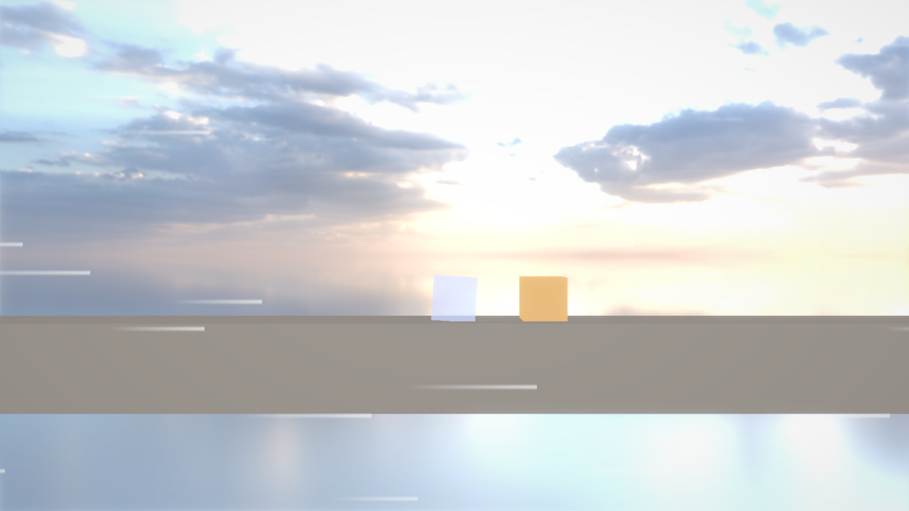
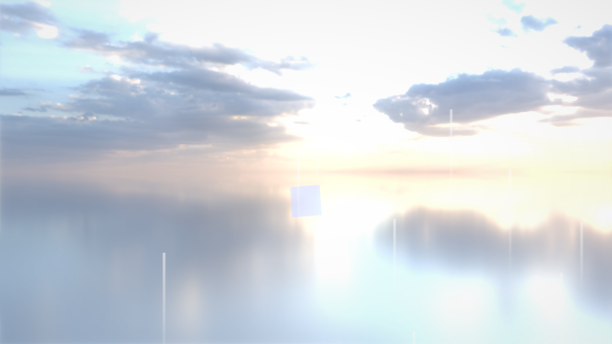
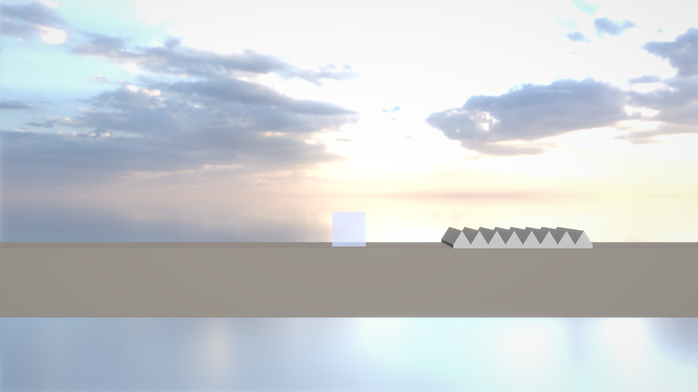

# G8：トゲ・熱湯・風・◆（Wind Zone と画面の風の線）

## このファイルについて
- [AL4_01Game.md](AL4_01Game.md) の 13章の **G8**（P1）。「危ない物がある」状態にする。
  - **トゲ**：触れた瞬間に HP −1・はねる・ひびが入る。HP 0 で**砕ける**。
  - **熱湯**：触れたら一発アウト。**溶ける**。
  - **風**：範囲の中で押される（向かい風・追い風・上向きの風）。範囲にいる間は**画面全体に白い線が流れる**。
  - **◆**：触れたら拾う。数は LevelInfo が数える（右下に出すのは G9）。
- 風はエンジンの機能（**Wind Zone**）にした。ほかのゲームでも使えて、Inspector の Add Component・Hierarchy の ＋ から置ける。トゲ・熱湯・◆ はゲームの Script（`Source/Scripts/Gimmicks/`）。
- **パートの順番**：A（Wind Zone）→ B（画面の風の線）→ C（トゲ・熱湯・◆）→ D（IceCube）→ E（エディタで置く）。A・B はエンジンだけでビルドが通る（B は A の `WindZoneSystem` が LensPass に書くので、A と B は一緒に写す）。C・D はゲーム。C の Spikes・HotWater は D の `IceCube::Damage`・`Kill(DeathType)` を使うので、C と D は一緒に写してからビルドする。
- 確かめた環境：本体の master（f506646。G7〜G7c をコミットした物）＋ このファイルのエンジン、AL4_01 のコピー（今の写経のまま）＋ このファイルのゲーム。Release でテスト用のシーンに入力を時間で流してログで確かめ、画面を撮った（7章）。Debug もビルドした。

| パート | ファイル | 何をするか |
|---|---|---|
| A | `Components/WindZoneComponent.h`・`Systems/WindZoneSystem.h/.cpp`（新しく作る）・`RigidbodyComponent.h`・`PhysicsSystem.cpp`・`Engine.cpp`・`WindowManager.cpp`・`HierarchyWindow.cpp`・`MathUtility.h`・`MyEngine_v1.vcxproj` | 風の吹く範囲・Rigidbody を押す・Wind Scale・ギズモ・＋ → 3D Object → Wind Zone |
| B | `Graphics/PostEffect/LensPass.h/.cpp`・`Shader/Data/Post/Lens.PS.shader` | 画面全体に流れる風の線 |
| C | `Source/Scripts/Gimmicks/Spikes.h/.cpp`・`HotWater.h/.cpp`・`Gem.h/.cpp`（新しく作る）・`LevelInfo.h/.cpp`（全部置き換える）（AL4_01） | トゲ・熱湯・◆・◆ の数 |
| D | `Source/Scripts/IceCube.h`（全部置き換える）・`IceCube.cpp`（関数ごと）（AL4_01） | ダメージ・ひび・砕ける・溶ける・風に流される |
| E | エディタで | トゲ・熱湯・◆ の Prefab、風を置く |

---

## 0. 前の写経の答え合わせ（G7c まで）

本体の feature/G7（f506646 でコミットした物）と、G7c の答え（worktree `arrow-curve-fade-issue-c20ffa`）を比べた。**動きが変わる違いは無かった**。G7 の0章の `CalcPushOut` の最後の `MY_ASSERT_MSG` も直っていた。

違ったのはコメントと並びだけ（直さなくてもよい）：

| ファイル | 違い |
|---|---|
| `EntityManager.cpp` | `RegisterComponent<FolderComponent>();` の右のコメント（Release でもシーンを読むと付くので、ここで登録する）が無い |
| `SceneGizmo.cpp` | 「フォルダは動かさない」のコメントが無い・`EndDrag` の右のコメントに「フォルダを選んだ」が無い・include の並び |
| `HierarchyWindow.cpp` | 「フォルダの中にだけ、フォルダを作れる」のコメントが無い |
| `PathCurve.cpp`・`.h` | `std::upper_bound` の説明のコメント（2行）が無い・`.h` の説明が短い |
| `Matrix4x4.cpp` | `if` に `{}` を付けた（こちらの方が CLAUDE.md の書き方に合っている） |
| `ArrowStripComponent.h`・`ArrowStripSystem.cpp`・`PointListGizmo.cpp` | include の並び・`ui.Field` の改行 |

### Release のシェーダー（提出の前に要る）
- Release の exe は、エンジンのフォルダではなく **作業フォルダの `MyEngine/Shader/Data`**（AL4_01 なら `AL4_01/project/MyEngine/Shader`）を読む（`ShaderPackageLoader::FindDataDir`。Release 以外は MyEngine.props の `MYENGINE_ROOT_DIR` からエンジンの物を直接読む）。
- **AL4_01 の `project/MyEngine/Shader` は 10/12 の写しのまま**。今回はシェーダー（`Lens.PS.shader`）を変えるので、Release で風の線を見るとき・提出の前には、エンジンの `project/MyEngine/Shader` を丸ごと写し直す（Debug・Development はそのままでよい）。

---

## 1. 何をするか（なぜこう作ったか）

### 1.1 風はエンジン（Wind Zone）
風は「範囲の中の物を、ある向きへ押す」だけで、ゲームのルールが入っていない。Unity にも Wind Zone・Area Effector がある。なのでエンジンの Component にした。

```
       ┌──────────── Size.x ────────────┐
       │  →    →    →    →    →    →    │   範囲：Entity の位置を真ん中にした箱（Size × Scale。Entity と一緒に回る）
Size.y │  →    →    →    →    →    →    │   向き：Entity の右（ローカルの +X）。Rotation の Z で回す（90 で上へ）
       │  →    →    →    →    →    →    │   ギズモ：箱の線と、前の面に矢印3本（Collider のギズモと一緒に出す・消す）
       └────────────────────────────────┘
```

**押し方：風の速さ（Speed）まで、Strength で速くする**。

| 押し方 | 範囲にいる間の速さ | |
|---|---|---|
| 力（加速度）をずっと足す | どんどん速くなる（上向きの風で、空の彼方まで飛んでいく） | × |
| 空気抵抗のように、風の速さとの差に比例 | 風の速さに近づく。けれど、風の向きと直角の速さ（重力で落ちる）まで弱めてしまう | △ |
| **風の向きの速さが Speed より遅い間だけ、Strength × 時間 を足す** | **Speed で止まる**。直角の速さはそのまま。速く飛んできた物は止めない | ○ |

- 「風の向きの速さ」は、速さと風の向き（長さ1）の内積（`Dot(velocity, direction)`）。
- 上向きの風で浮かせるには、Strength を重力より大きくする（キューブは重力 30・落ちる間 45 なので、60 にすると浮く）。浮いたキューブは、上がる速さ ＝ Speed の近くで止まり、範囲の上の端で出たり入ったりしてゆれる。
- **強さのゆれ（Gust）**：速さの違う sin を2つ重ねた値（−1〜1）で、Speed を ±Gust の割合でゆらす。2.3 倍の方は 1 つめと周期がそろわないので、同じゆれ方がすぐにはくり返さない。範囲ごとに置いた場所で始まりをずらす。
- 重なった範囲は、速さを足して、強さは一番強い物にする（足すと、重ねるほど急に速くなるので）。

### 1.2 キューブは自分で風を読む（Rigidbody の Wind Scale）
エンジンがキューブの `velocity` を押しても、**次のフレームに IceCube の `UpdateRun` が速さを目標（入力 × 7m/s）へ近づけるので、押した分がすぐ消される**。

```
フレーム n   ：IceCube が vx を 7 にする → Wind Zone が vx を +0.67（40 × 1/60）→ 物理が動かす
フレーム n+1 ：IceCube が vx を 7 へ近づける（最大 60 × 1/60 ＝ 1 ずつ）→ 7.67 が 7 に戻る（風が効かない）
```

なので：
- Rigidbody に **Wind Scale**（風に押される倍率。初期値 1）を足した。IceCube は Start で 0 にして、エンジンには押させない。
- IceCube は毎フレーム `WindZoneSystem::Sample(位置)` で自分の所の風を読む。
  - **横**：風で流される速さ `windDriftX_` を、風の速さへ Strength で近づけて覚える（風の外では減速で 0 へ）。**走る目標の速さに足す**（目標 ＝ 入力 × 7 ＋ windDriftX_）。入力が無ければ風の速さで流され、向かい風に走ると遅くなる。
  - **縦**：縦の速さは毎フレーム目標へ戻されない（ジャンプと重力だけ）ので、エンジンと同じ押し方（`WindZoneSystem::Push`）の縦だけを使う。
  - 上向きの風で浮くとき（`IsWindLifting`：風が上へ・重力より強い）は、「立っている間は重力を切って足元へ押し付ける」（G6 の坂で止まる仕組み）をやめる。やめないと、押し付けた分で浮けない。
- 木箱のような普通の Rigidbody は、Wind Scale 1 のまま、エンジンが押す。

### 1.3 画面の風の線（Lens のパス）
元のゲームは、風の範囲に入ると**画面全体に白い線**が流れる。画面の最後に重ねる効果なので、Lens のパス（歪み・色収差・ビネットの所）に足した。

```
画面を風の向きに沿った細い列に分ける（画面の高さに 18 列）
 ─────────────────────────────────────    列ごとに乱数（Hash(列の番号)）で決める：
   ════>          ════>         ════>      ・線があるか（55% の列にだけある）
 ─────────────────────────────────────    ・流れる速さ・線の間・線の長さ
          ══>               ══>          ・列の中で少し上下にずらす（等間隔に見えないように）
 ─────────────────────────────────────    線は前（風下）の端が一番濃く、後ろへ薄くなる
```
- 値（濃さ・向き・時間）は **WindZoneSystem が毎フレーム LensPass に書く**。どの位置の風かは、**カメラが追っている物（Camera Follow の Target）**。ゲームから何も書かなくてよい。
- 範囲に入ったら 0.3 秒で出て、出たら 0.5 秒で消える（AL4_01Game.md の 6章）。止めたらすぐ 0。
- 前からある `addRadialBlur` などは「書かないと 0 に戻る上乗せ」で、Render の最後に自分で消している。風の線は WindZoneSystem が止めているときも 0 を書くので、自分では消さない（Game と Scene の2回 Render が呼ばれるので、1回目で消すと2回目が 0 になる、という心配も無い）。
- Lens は Scene ビューでは掛けないので、風の線も Game ビューだけ。
- **`line` という名前の変数は使えない**（HLSL の予約語。ジオメトリシェーダーの「線」の型）。最初 `float line = …` と書いて、シェーダーのコンパイルで止まった。

### 1.4 トゲ：ダメージは1フレームに1回分
「同じフレームに2つのトゲに触れても1ダメージ」（6章の決まり）を守るため、**トゲは IceCube に頼むだけ**にした。

```
OnTriggerEnter（トゲA）→ cube->Damage(1, 上 × 8)  … pendingDamage_ = 1、pendingKnockback_ を覚える
OnTriggerEnter（トゲB）→ cube->Damage(1, 上 × 8)  … 一番大きい物だけ残す（1 のまま）
IceCube::Update の頭  → ApplyDamage                 … HP −1、はねる、白く光る・揺れる。覚えた物を消す
```
- 触れたままなら減らない（`OnTriggerEnter` だけ見る）。はねて離れて、また触れたら減る（無敵時間は無い）。
- **はねる**：はねる向き（トゲの上 ＝ `GetWorldUp`。壁・天井のトゲは Rotation の Z で回す）の速さだけを、Bounce Speed に入れ替える（落ちてきた勢いは消す。横に走る速さは残る）。くっつき・吹っ飛びはやめる。`TakeOff` で地面を離れ、`isJumpRising_` を消す（ジャンプを離したときの「上向きを半分」が掛からないように）。
- **ひび**：受けたダメージの回数（Max HP − HP）で、子の Body のテクスチャを替える（Crack Small・Crack Large。入れていなければ元のまま）。テクスチャは G10 で AI に作ってもらう。今は白く光る・揺れるだけで分かる。

### 1.5 やられ方（DeathType）
G5 の「縮んで消える」を、やられ方で分けた。3つの値の enum なので `switch`（default は書かない）。

| DeathType | いつ | 見た目 |
|---|---|---|
| Shatter（砕ける） | HP が 0 になった | 元のキューブを隠して、**同じ見た目の小さな箱（かけら）を 8 個**作って飛ばす。重力で落ちながら回って、やり直すまでに小さくなる |
| Melt（溶ける） | 熱湯 | 縦がつぶれて（×0.1 まで）横に広がり（×1.6 まで）、ゆっくり沈む |
| Fall（落ちた） | 下の線より下 | 何もしない（画面の外） |

- かけらは `GameObject::Create` で作った普通の Entity（親は無し。キューブの子にすると、キューブと一緒に動く）に、Body の Primitive Renderer の**写し**を付ける。物理は使わず、IceCube が位置を動かす。やり直しでシーンを読み直すと、かけらも消える。
- 乱数はエンジンの `RandomEngine`（中身は `std::mt19937`）。`GetInsideUnitSphere`（球の中のばらばらな点）で、かけらの出る場所と飛ぶ向きを決める。

### 1.6 ◆ の数（LevelInfo）
- このレベルで拾った数（`gemCount_`）は LevelInfo が持つ。やられてやり直すとシーンを読み直すので、LevelInfo も作り直されて 0 に戻る（◆ も元の所に戻る）。
- クリアした分の合計は **`static inline int clearedGemCount_`**（クラスに1つ。シーンを替えても残る）。次のレベルへ進めたときだけ足す（Next Scene が無くて同じレベルをもう一度遊ぶときは、また置いてあるので足さない）。
  - `static inline`：クラスの中で初期値まで書ける static 変数（C++17）。前は cpp に `int LevelInfo::clearedGemCount_ = 0;` と書く必要があった。
- Number が 1 のレベルを始めたら、合計を 0 に戻す（タイトルから始め直すときの代わり。G9 でタイトルを作ったら、そちらで戻してもよい）。

---

## 2. パートA：Wind Zone（エンジン）

### `MyEngine/Components/WindZoneComponent.h`（新しく作る）
```cpp
#pragma once
#include <type_traits>

#include "MyEngine/Math/Vector3.h"

// 範囲の中の Rigidbody を、風の向きへ押す。Entityに付けるComponent（カテゴリ：Physics）
// 範囲は Entity の位置を真ん中にした箱（Size × Scale。Entity と一緒に回る）。風は Entity の右（ローカルの +X）へ吹く。Rotation の Z で向きを変える（90 で上へ）
// 押すのは WindZoneSystem（再生中だけ）。風の速さまでは Strength で速くして、それより速い物はそれ以上押さない（いつまでも速くならない）
// 画面の風の線は、カメラが追っている物（Camera Follow の Target）が範囲の中にいる間だけ出る

/// <summary>
/// 風の吹く範囲（Unity の Wind Zone・Area Effector の、横から見るゲーム用の小さい版）
/// </summary>
struct WindZoneComponent {
	bool enabled = true;                // false の間は吹かない
	Vector3 size = {8.0f, 4.0f, 4.0f};  // 範囲の大きさ（m。Entity から見た箱の、X・Y・Z の長さ。Scale も掛かる）
	float speed = 5.0f;                 // 風の速さ（m/s）。物はこの速さまで流される（キューブの走る速さ 7 より遅いと、向かい風でも少し進める）
	float strength = 40.0f;             // 風の速さまで速くする強さ（m/s²）。上向きの風で浮かせるなら、重力より大きくする
	float gust = 0.3f;                  // ゆれ（0〜1。0.3 なら、速さが ±30% の間でゆれる）
	float gustFrequency = 0.5f;         // ゆれる速さ（1秒に何回くらい。大きいほど細かくゆれる）
	float lineAmount = 0.6f;            // 画面の風の線の濃さ（0〜1。0 なら線を出さない）
};

static_assert(std::is_trivially_copyable_v<WindZoneComponent>);
```

### `MyEngine/Systems/WindZoneSystem.h`（新しく作る）
```cpp
#pragma once
#include "MyEngine/Components/WindZoneComponent.h"
#include "MyEngine/Math/Vector3.h"

// 前方宣言
class Camera;

/// <summary>
/// Wind Zone（風の吹く範囲）を登録し、範囲の中の Rigidbody を押す。画面の風の線（LensPass）の濃さと向きも決める
/// <para>押し方：風の向きの速さが、風の速さ（Speed）より遅い間だけ、Strength で速くする（それより速ければ押さない）。Unity の Area Effector に近い</para>
/// <para>Rigidbody の Wind Scale が 0 の物は押さない（自分で風を読んで動く物。氷のキューブなど）。その物は Sample・Push を自分で呼ぶ</para>
/// <para>範囲は毎フレーム集め直して覚えておく（Sample は前のフレームの終わりの範囲を使う。Script の Update は、ここより前に呼ばれるので）</para>
/// </summary>
class WindZoneSystem {
public:
	/// <summary>
	/// ある位置の風（重なった範囲は足し合わせる）
	/// </summary>
	struct WindSample {
		Vector3 velocity = {0.0f, 0.0f, 0.0f}; // 風の速さ（向き × 速さ。ゆれ込み。m/s）
		float strength = 0.0f;                 // 風の速さまで速くする強さ（m/s²。重なったら一番強い物。0 なら風の外）
		float lineAmount = 0.0f;               // 画面の風の線の濃さ（ゆれ込み）

		// 風の中か
		bool IsBlowing() const { return strength > 0.0f; }
	};

	// WindZoneComponent を登録する（置き場所・保存・Inspector）。EntityManager::Initialize の後に呼ぶ
	static void Initialize();
	static void Release();

	/// <summary>
	/// 範囲を集め直して、再生中なら Rigidbody を押す。画面の風の線の値を LensPass へ書く
	/// <para>ワールド行列の計算（UpdateTransforms）の後・PhysicsSystem::Update の前に呼ぶ（押した速さで、この後の物理が動かす）</para>
	/// </summary>
	/// <param name="isGameRunning">再生中か（停止中は範囲を集めるだけ。押さない・線を出さない）</param>
	/// <param name="deltaTime">経過秒（Time::GetDeltaTime。一時停止中は 0）</param>
	static void Update(bool isGameRunning, float deltaTime);

	/// <summary>
	/// position の風。範囲の外なら、全部 0
	/// </summary>
	static WindSample Sample(const Vector3& position);

	/// <summary>
	/// velocity を風で押した後の速さ（風の向きの速さが、風の速さより遅い間だけ、strength × deltaTime まで速くする）
	/// </summary>
	static Vector3 Push(const WindSample& wind, const Vector3& velocity, float deltaTime);

	// 範囲と向きを線で描く（エディタ用。Collider のギズモを出しているときだけ）
	static void DrawGizmos(Camera* camera);
};
```

### `MyEngine/Systems/WindZoneSystem.cpp`（新しく作る）
- 範囲は毎フレーム集め直して `state->zones` に覚える（`CollectZones`）。Script の `Sample` はこれを読む。
- 箱の中かは、中心からのずれを箱の3つの軸に測る（`Contains`）。軸と長さは、ワールド行列の1〜3行目（ローカルの X・Y・Z に Scale を掛けた物）から作る（`MakeBox`）。
- 画面の風の線は `UpdateScreenLines`。カメラは `CameraSystem::GetMainCameraEntity`、追っている物は Camera Follow の `target`。

```cpp
#include "WindZoneSystem.h"

#include <algorithm>
#include <array>
#include <cmath>
#include <memory>
#include <numbers>
#include <vector>

#include "MyEngine/Components/CameraFollowComponent.h"
#include "MyEngine/Components/RigidbodyComponent.h"
#include "MyEngine/Components/TransformComponent.h"
#include "MyEngine/Diagnostics/MyAssert.h"
#include "MyEngine/ECS/ComponentSerializer.h"
#include "MyEngine/ECS/ComponentUI.h"
#include "MyEngine/ECS/EntityManager.h"
#include "MyEngine/ECS/GameComponent.h"
#include "MyEngine/Editor/Inspector/ComponentEditor.h"
#include "MyEngine/Graphics/Renderer/Renderer.h"
#include "MyEngine/Graphics/Renderer/SceneRenderer.h"
#include "MyEngine/Math/Geometry/OBB.h"
#include "MyEngine/Math/MathUtility.h"
#include "MyEngine/Systems/CameraSystem.h"
#include "MyEngine/Systems/CollisionSystem.h"

namespace {
constexpr float kLineFadeInTime = 0.3f;  // 範囲に入ってから、画面の風の線が出きるまでの秒数
constexpr float kLineFadeOutTime = 0.5f; // 範囲から出てから、画面の風の線が消えるまでの秒数
constexpr uint32_t kGizmoColor = 0xFF80FFFF; // ギズモの線の色（うすい赤紫。空・Collider の緑・水色・赤と見分けられるように）
constexpr int kGizmoArrowRows = 3;           // ギズモの矢印を、範囲の中に縦に何本並べるか

/// <summary>
/// 集めた範囲1つ（ワールド座標。毎フレーム作り直す）
/// </summary>
struct WorldWindZone {
	OBB box;                                // 範囲（向きのある箱。size は中心から面までの長さ）
	Vector3 direction = {1.0f, 0.0f, 0.0f}; // 風の向き（長さ1。Entity の右）
	float speed = 0.0f;                     // 風の速さ（m/s。ゆれの前）
	float strength = 0.0f;                  // 風の速さまで速くする強さ（m/s²）
	float gust = 0.0f;                      // ゆれ（0〜1）
	float gustFrequency = 0.0f;             // ゆれる速さ（1秒に何回くらい）
	float gustPhase = 0.0f;                 // ゆれの始まりのずれ（範囲ごとに、ゆれがそろわないように）
	float lineAmount = 0.0f;                // 画面の風の線の濃さ
};

/// <summary>
/// WindZoneSystem が持つ物（Initialize で作り、Release で消す）
/// </summary>
struct WindZoneState {
	std::vector<WorldWindZone> zones;            // 今の範囲（Update で集め直す）
	float time = 0.0f;                           // ゆれと風の線の時間（秒。再生中に足していく。止めると 0 に戻す）
	float lineAmount = 0.0f;                     // 今の、画面の風の線の濃さ（出る・消えるを、なめらかにする）
	Vector2 lineDirection = {1.0f, 0.0f};        // 今の、画面の風の線の向き（消えていく間は、最後の向きのまま）
	Renderer::LineListConfig gizmoLines;         // ギズモの線（使い回す）
};
std::unique_ptr<WindZoneState> state;

//=============================================================================
// ゆれ
//=============================================================================
// -1〜1 の間をゆっくり行き来する値。速さの違う sin を2つ重ねて、決まった周期に見えないようにする
// （2.3 倍の方は 1 つめと周期がそろわないので、同じゆれ方がすぐにはくり返さない）
float CalcGustNoise(float time, float frequency, float phase) {
	const float angle = 2.0f * std::numbers::pi_v<float> * frequency * time + phase;
	return 0.6f * std::sin(angle) + 0.4f * std::sin(angle * 2.3f + phase * 1.7f);
}

// その範囲の、今の「ゆれの倍率」（1 ± gust）
float CalcGustScale(const WorldWindZone& zone) { return 1.0f + zone.gust * CalcGustNoise(state->time, zone.gustFrequency, zone.gustPhase); }

//=============================================================================
// 範囲
//=============================================================================
// 箱の中か（中心からのずれを、箱の3つの軸の向きに測って、どれも半分の長さ以内なら中）
bool Contains(const OBB& box, const Vector3& position) {
	const Vector3 offset = position - box.center;
	return std::abs(Dot(offset, box.axes[0])) <= box.size.x && std::abs(Dot(offset, box.axes[1])) <= box.size.y && std::abs(Dot(offset, box.axes[2])) <= box.size.z;
}

// Entity のワールド行列から、範囲の箱を作る
// 行列の1〜3行目は、ローカルの X・Y・Z の向きに Scale を掛けた物。長さが Scale、向きが軸になる
OBB MakeBox(const WindZoneComponent& zone, const Matrix4x4& world) {
	OBB box;
	box.center = {world.m[3][0], world.m[3][1], world.m[3][2]};
	const std::array<float, 3> halfSize = {zone.size.x * 0.5f, zone.size.y * 0.5f, zone.size.z * 0.5f};
	std::array<float, 3> scaled{};
	for (int i = 0; i < 3; ++i) {
		const Vector3 row = {world.m[i][0], world.m[i][1], world.m[i][2]};
		const float length = Length(row);
		box.axes[i] = (length > 0.0f) ? row / length : Vector3{0.0f, 0.0f, 0.0f}; // Scale が 0 の軸は、向きが決まらない（その軸の長さも 0 になる）
		scaled[i] = std::abs(halfSize[i]) * length;
	}
	box.size = {scaled[0], scaled[1], scaled[2]};
	return box;
}

// 有効な Wind Zone を集め直す（停止中も集める。ギズモと、Script の Sample に使う）
void CollectZones() {
	state->zones.clear(); // 中身だけ消す（確保したメモリは残る）
	EntityManager::ForEach<WindZoneComponent>([](Handle<Entity> entity, const WindZoneComponent& zone) {
		if (!zone.enabled || !EntityManager::IsActiveInHierarchy(entity)) {
			return;
		}
		const TransformComponent* transform = EntityManager::Get<TransformComponent>(entity);
		if (transform == nullptr) {
			return;
		}
		WorldWindZone world;
		world.box = MakeBox(zone, transform->worldMatrix);
		world.direction = world.box.axes[0]; // 右（ローカルの +X）
		world.speed = zone.speed;
		world.strength = (std::max)(zone.strength, 0.0f);
		world.gust = std::clamp(zone.gust, 0.0f, 1.0f);
		world.gustFrequency = (std::max)(zone.gustFrequency, 0.0f);
		world.gustPhase = world.box.center.x * 0.37f + world.box.center.y * 0.71f; // 置いた場所で決まる、ばらばらな値
		world.lineAmount = std::clamp(zone.lineAmount, 0.0f, 1.0f);
		state->zones.push_back(world);
	});
}

//=============================================================================
// 押す
//=============================================================================
// 再生中：Wind Scale が 0 でない Rigidbody を、その位置の風で押す
void PushRigidbodies(float deltaTime) {
	EntityManager::ForEach<RigidbodyComponent>([deltaTime](Handle<Entity> entity, RigidbodyComponent& rigidbody) {
		if (rigidbody.isKinematic || rigidbody.windScale == 0.0f || !EntityManager::IsActiveInHierarchy(entity)) {
			return; // 物理で動かさない・風で押さない（自分で風を読む）
		}
		const TransformComponent* transform = EntityManager::Get<TransformComponent>(entity);
		if (transform == nullptr) {
			return;
		}
		WindZoneSystem::WindSample wind = WindZoneSystem::Sample(GetWorldPosition(*transform));
		if (!wind.IsBlowing()) {
			return;
		}
		wind.strength *= rigidbody.windScale; // 軽い物・重い物で、押され方を変える
		rigidbody.velocity = WindZoneSystem::Push(wind, rigidbody.velocity, deltaTime);
	});
}

//=============================================================================
// 画面の風の線
//=============================================================================
// カメラが追っている物（Camera Follow の Target）の所の風で、線の濃さと向きを決めて、LensPass へ書く
void UpdateScreenLines(bool isGameRunning, float deltaTime) {
	float target = 0.0f; // 出したい濃さ
	if (isGameRunning) {
		const Handle<Entity> cameraEntity = CameraSystem::GetMainCameraEntity();
		const CameraFollowComponent* follow = EntityManager::Get<CameraFollowComponent>(cameraEntity);
		const TransformComponent* followed = (follow != nullptr) ? EntityManager::Get<TransformComponent>(EntityManager::Find(follow->target)) : nullptr;
		if (followed != nullptr) {
			const WindZoneSystem::WindSample wind = WindZoneSystem::Sample(GetWorldPosition(*followed));
			target = std::clamp(wind.lineAmount, 0.0f, 1.0f);
			const Vector2 direction = {wind.velocity.x, wind.velocity.y};
			if (Length(direction) > 0.0f) {
				state->lineDirection = Normalize(direction); // 風が無くなったら、最後の向きのまま消えていく
			}
		}
	}
	// 出るときは Fade In、消えるときは Fade Out の時間で、まっすぐ近づける（濃さ 1 を、その秒数で変えきる速さ）
	const float time = (target > state->lineAmount) ? kLineFadeInTime : kLineFadeOutTime;
	state->lineAmount = MathUtility::MoveTowards(state->lineAmount, target, deltaTime / time);
	if (!isGameRunning) {
		state->lineAmount = 0.0f; // 止めたらすぐ消す（エディタの停止中に残らないように）
	}
	// --- LensPass へ書く（毎フレーム書くので、上乗せの値と違って自分では消えない）---
	if (PostProcess* post = SceneRenderer::GetPost()) {
		LensPass& lens = post->GetLensPass();
		lens.windLines = state->lineAmount;
		lens.windLineDirection = state->lineDirection;
		lens.windLineTime = state->time;
	}
}

//=============================================================================
// Inspector と 保存
//=============================================================================
void DescribeWindZone(ComponentUI& ui, WindZoneComponent& value) {
	ui.Field("Enabled###enabled", value.enabled, Tip("外すと吹かない"));
	ui.Label("風は Entity の右（ローカルの +X）へ吹く。Rotation の Z で向きを変える（90 で上へ）");
	ui.Field("Size###size", value.size, AtLeast(0.0f).Tip("範囲の大きさ（m。Entity から見た箱の X・Y・Z の長さ。Scale も掛かる）。真ん中は Entity の位置"));
	ui.Field("Speed###speed", value.speed, AtLeast(0.0f).Tip("風の速さ（m/s）。物はこの速さまで流される（それより速い物は、それ以上押さない）"));
	ui.Field("Strength###strength", value.strength, AtLeast(0.0f).Tip("風の速さまで速くする強さ（m/s²）。上向きの風で浮かせるなら、重力（Settings の Physics → Gravity × 物の Gravity Scale）より大きくする"));
	ui.Field("Gust###gust", value.gust, Range(0.0f, 1.0f).Tip("ゆれ（0.3 なら、風の速さが ±30% の間でゆれる）。0 ならゆれない"));
	ui.Field("Gust Frequency###gustFrequency", value.gustFrequency, AtLeast(0.0f).Tip("ゆれる速さ（1秒に何回くらい。大きいほど細かくゆれる）"));
	ui.Field("Line Amount###lineAmount", value.lineAmount, Range(0.0f, 1.0f).Tip("画面の風の線の濃さ（0 なら出さない）。カメラが追っている物（Camera Follow の Target）が範囲の中にいる間だけ出る"));
}
} // namespace

//=============================================================================
// 初期化 / 解放
//=============================================================================
void WindZoneSystem::Initialize() {
	MY_ASSERT_MSG(state == nullptr, "Initialize()が2回以上呼ばれています");
	state = std::make_unique<WindZoneState>();

	// Wind Zone の置き場所・保存・Inspector を登録する（見せ方は DescribeWindZone 1つで、保存と Inspector の両方に使う）
	EntityManager::RegisterComponent<WindZoneComponent>();
	ComponentSerializer::Register<WindZoneComponent>("Wind Zone", &DescribeWindZone);
	ComponentEditorRegistry::Register(std::make_unique<DescribedComponentEditor<WindZoneComponent>>("Wind Zone", "Physics", &DescribeWindZone));
}

void WindZoneSystem::Release() { state.reset(); }

//=============================================================================
// 毎フレーム
//=============================================================================
void WindZoneSystem::Update(bool isGameRunning, float deltaTime) {
	MY_ASSERT_MSG(state != nullptr, "WindZoneSystem::Initialize()を先に呼んでください");
	// 時間：再生中だけ進める（止めたら 0 に戻すので、Play を押すたびに同じゆれ方から始まる）
	state->time = isGameRunning ? state->time + deltaTime : 0.0f;
	CollectZones();
	if (isGameRunning && deltaTime > 0.0f) {
		PushRigidbodies(deltaTime);
	}
	UpdateScreenLines(isGameRunning, deltaTime);
}

//=============================================================================
// 風を読む・押す
//=============================================================================
WindZoneSystem::WindSample WindZoneSystem::Sample(const Vector3& position) {
	WindSample sample;
	if (state == nullptr) {
		return sample;
	}
	for (const WorldWindZone& zone : state->zones) {
		if (!Contains(zone.box, position)) {
			continue;
		}
		// 重なった範囲は、速さと線の濃さを足す。強さは一番強い物（足すと、重ねるほど急に速くなるので）
		const float gustScale = CalcGustScale(zone);
		sample.velocity += zone.direction * (zone.speed * gustScale);
		sample.strength = (std::max)(sample.strength, zone.strength);
		sample.lineAmount += zone.lineAmount * gustScale;
	}
	return sample;
}

Vector3 WindZoneSystem::Push(const WindSample& wind, const Vector3& velocity, float deltaTime) {
	const float windSpeed = Length(wind.velocity);
	if (!wind.IsBlowing() || windSpeed <= 0.0f || deltaTime <= 0.0f) {
		return velocity;
	}
	// 風の向きの速さ（along）が、風の速さより遅い間だけ速くする。1フレームに足すのは strength × deltaTime まで（風の速さを超えない）
	// 風の向きと直角の速さ（重力で落ちる・横へ走る）は、そのまま残る
	const Vector3 direction = wind.velocity / windSpeed;
	const float along = Dot(velocity, direction);
	if (along >= windSpeed) {
		return velocity; // もう風より速い（押さない。風で止めることもしない）
	}
	const float add = (std::min)(wind.strength * deltaTime, windSpeed - along);
	return velocity + direction * add;
}

//=============================================================================
// ギズモ
//=============================================================================
void WindZoneSystem::DrawGizmos(Camera* camera) {
	MY_ASSERT_MSG(state != nullptr, "WindZoneSystem::Initialize()を先に呼んでください");
	if (!CollisionSystem::GetShowGizmos() || state->zones.empty()) {
		return; // Collider のギズモと一緒に出す・消す
	}
	Renderer::LineListConfig& gizmo = state->gizmoLines;
	gizmo.lines.clear();
	gizmo.camera = camera;
	for (const WorldWindZone& zone : state->zones) {
		const OBB& box = zone.box;
		// --- 箱：8つの角（番号 i の 1・2・4 のビットで、X・Y・Z の＋側か−側かを決める）を、ビットが1つだけ違う角どうし結ぶ（12本）---
		std::array<Vector3, 8> corners{};
		for (uint32_t i = 0; i < 8; ++i) {
			const float x = (i & 1) ? box.size.x : -box.size.x;
			const float y = (i & 2) ? box.size.y : -box.size.y;
			const float z = (i & 4) ? box.size.z : -box.size.z;
			corners[i] = box.center + box.axes[0] * x + box.axes[1] * y + box.axes[2] * z;
		}
		for (uint32_t i = 0; i < 8; ++i) {
			for (uint32_t bit = 1; bit < 8; bit <<= 1) {
				if ((i & bit) == 0) {
					gizmo.lines.push_back({corners[i], corners[i | bit], kGizmoColor});
				}
			}
		}
		// --- 風の向きの矢印：前の面（Z の−側）に、縦に何本か。左の端から右の端まで、先に「>」---
		const Vector3 front = box.center - box.axes[2] * box.size.z;
		const float head = (std::min)(box.size.x, box.size.y) * 0.3f; // 矢印の先の大きさ
		for (int row = 0; row < kGizmoArrowRows; ++row) {
			const float t = (static_cast<float>(row) + 0.5f) / static_cast<float>(kGizmoArrowRows) * 2.0f - 1.0f; // -1〜1 に等しく並べる
			const Vector3 middle = front + box.axes[1] * (box.size.y * t * 0.8f);
			const Vector3 tail = middle - zone.direction * box.size.x * 0.8f;
			const Vector3 tip = middle + zone.direction * box.size.x * 0.8f;
			gizmo.lines.push_back({tail, tip, kGizmoColor});
			gizmo.lines.push_back({tip, tip - zone.direction * head + box.axes[1] * head * 0.6f, kGizmoColor});
			gizmo.lines.push_back({tip, tip - zone.direction * head - box.axes[1] * head * 0.6f, kGizmoColor});
		}
	}
	Renderer::DrawLines(gizmo);
	gizmo.camera = nullptr; // フレームをまたいで持たない
}
```

### `MyEngine/Components/RigidbodyComponent.h`（1行足す）
`drag` の下に：
```cpp
	float drag = 0.0f;                     // 空気抵抗（大きいほど早く止まる。0 なら止まらない）
	float windScale = 1.0f;                // 風（Wind Zone）に押される強さの倍率（0 なら押されない。自分で風を読んで動く物は 0 にする）
```

### `MyEngine/Systems/PhysicsSystem.cpp`（`DescribeRigidbody` に1行足す）
`Drag` の下に（保存の名前は `windScale`。前に保存したシーンには無いので、1 のまま読まれる）：
```cpp
	ui.Field("Drag###drag", value.drag, AtLeast(0.0f).Tip("空気抵抗（大きいほど早く止まる。0 なら止まらない）"));
	ui.Field("Wind Scale###windScale", value.windScale, AtLeast(0.0f).Tip("風（Wind Zone）に押される強さの倍率（0 なら押されない。Script で風を読んで動かす物は 0 にする）"));
```

### `MyEngine/Engine.cpp`（3か所）
```cpp
#include "MyEngine/Systems/WindZoneSystem.h"
```
```cpp
	ArrowStripSystem::Initialize();      // Arrow StripをEntityManagerに登録する（保存・Inspectorも）ので、EntityManagerの後
	WindZoneSystem::Initialize();        // Wind ZoneをEntityManagerに登録する（保存・Inspectorも）ので、EntityManagerの後
```
```cpp
	ArrowStripSystem::Release();      // シーン（ウィンドウ）の破棄より後にする
	WindZoneSystem::Release();        // シーン（ウィンドウ）の破棄より後にする
```

### `MyEngine/Window/WindowManager.cpp`（3か所）
```cpp
#include "MyEngine/Systems/WindZoneSystem.h"
```
`UpdateAll` の、`EntityManager::UpdateTransforms();` と `PhysicsSystem::Update` の間に（押した速さで、すぐ後の物理が動かす）：
```cpp
	EntityManager::UpdateTransforms();      // ワールド行列（親→子）
	// 風（Wind Zone）の範囲を集め直して、再生中なら Rigidbody を押す（押した速さで、すぐ後の物理が動かす）。画面の風の線の値も書く
	WindZoneSystem::Update(isGameRunning, Time::GetDeltaTime());
```
`DrawAll` の `CollisionSystem::DrawGizmos` の下に：
```cpp
	CollisionSystem::DrawGizmos(gameCamera);
	WindZoneSystem::DrawGizmos(gameCamera); // 風の範囲と向き（Collider のギズモと一緒に出す・消す）
```

### `MyEngine/Editor/Windows/HierarchyWindow.cpp`（2か所）
```cpp
#include "MyEngine/Components/WindZoneComponent.h"
```
＋ → 3D Object の、Arrow Strip の下に：
```cpp
		if (ImGui::MenuItem("Wind Zone")) {
			// 風の吹く範囲（箱。風は右へ吹く。Rotation の Z で向きを変える）。範囲と向きは Collider のギズモと一緒に出る
			EditorHistory::RequestCreate("Wind Zone", {}, {ComponentSnapshot::Make(WindZoneComponent{})});
		}
```

### `MyEngine/Math/MathUtility.h`（1つ足す）
`Vector3` の `Lerp` の下に（パートD の、白く光る色を混ぜるのに使う）：
```cpp
/// Vector4 の線形補間（色を混ぜるときなど）
inline Vector4 Lerp(const Vector4& start, const Vector4& end, float t) { return start + (end - start) * t; }
```

### `MyEngine_v1.vcxproj`
`WindZoneComponent.h`・`WindZoneSystem.h`・`WindZoneSystem.cpp` をプロジェクトに足す（VS のソリューションエクスプローラーで追加すれば、filters も一緒に書かれる）。

---

## 3. パートB：画面の風の線（エンジン）

### `MyEngine/Graphics/PostEffect/LensPass.h`（3か所）
include に：
```cpp
#include "MyEngine/Math/Vector2.h"
```
`addVignette` の下に：
```cpp
	// --- 風の線（画面全体に、風の向きへ流れる白い線）。WindZoneSystem が毎フレーム書く（止めると 0 を書く）ので、上乗せと違って自分では消さない ---
	float windLines = 0.0f;                   // 濃さ（0〜1。0 なら線を描かない）
	Vector2 windLineDirection = {1.0f, 0.0f}; // 流れる向き（画面の右・上が＋。長さ1）
	float windLineTime = 0.0f;                // 流れる時間（秒）
```

`Param` を置き換える（シェーダーの `LensParam` と同じ並び。16 バイトずつ3つ）：
```cpp
	struct Param {
		float distortion; // 画面端の歪み。正で外へ膨らむ
		float aberration; // 色収差。端ほどRGBがずれる
		float radialBlur; // 中心へ向かって流れるブラー
		float vignette;   // 端の暗さ
		uint32_t srcIndex = 0;
		float windLines = 0.0f;               // 風の線の濃さ
		float windLineTime = 0.0f;            // 風の線の流れる時間（秒）
		float aspect = 1.0f;                  // 画面の横 ÷ 縦（線が斜めでも同じ太さに見えるように）
		Vector2 windLineDirection = {1.0f, 0.0f}; // 風の線の流れる向き
		float padding[2] = {};                // 16 バイトの区切りにそろえる
	};
	static_assert(sizeof(Param) == 48, "シェーダーの LensParam（16 バイト × 3）と大きさをそろえる");
```

### `MyEngine/Graphics/PostEffect/LensPass.cpp`（`Render` の中）
`param.vignette = …` の下から：
```cpp
		param.vignette = kVignette + addVignette;
		param.windLines = windLines;
		param.windLineTime = windLineTime;
		param.windLineDirection = windLineDirection;
	}
	param.aspect = (height > 0.0f) ? width / height : 1.0f;
```
- `aspect`（画面の横 ÷ 縦）は、切ってあるときも入れる（使わないが、0 で割らない値にしておく）。

### `MyEngine/Shader/Data/Post/Lens.PS.shader`（全部置き換える）
- `WindLines`：画素ごとに「その画素の線の濃さ」を計算する。画面を風の向きに測った座標（`a`）と、横に測った座標（`c`）に直し、`c` で列を決めて、列ごとの乱数で線を作る。
- `frac(s)`：s の小数の部分（0〜1）。`(a − 時間 × 速さ) ÷ 間` の小数の部分なので、間ごとにくり返す線が、時間で風の向きへ流れる。
- 色は足さずに **白へ寄せる**（`lerp`）。足すと、明るい空の上で白く飛んで見えなくなる。

```cpp
#META
stage: PS
path : Post/Lens.PS.hlsl
profile : ps_6_0
#META_END

#HLSL
#include "Resources/Texture.hlsli"

struct LensParam
{
    float distortion; // 画面端の歪み。正で外へ膨らむ
    float aberration; // 色収差。端ほどRGBがずれる
    float radialBlur; // 中心へ向かって流れるブラー
    float vignette;   // 端の暗さ
    uint32_t srcIndex;
    float windLines;         // 風の線の濃さ（0 なら描かない）
    float windLineTime;      // 風の線の流れる時間（秒）
    float aspect;            // 画面の横 ÷ 縦
    float2 windLineDirection; // 風の線の流れる向き（画面の右・上が＋）
    float2 padding;
};
ConstantBuffer<LensParam> gLens : register(b0);

// ===== 風の線の形 =====
static const float kWindRows = 18.0f;      // 画面の高さに、線の列が何本入るか
static const float kWindRowRatio = 0.55f;  // 線のある列の割合（残りの列には線が無い）
static const float kWindLineWidth = 0.12f; // 線の太さ（列の幅に対する割合。真ん中から片側）
static const float kWindLineColor = 0.7f;  // 線の明るさ（白へ寄せる割合。1 で真っ白）

// 0〜1 の、ばらばらに見える数（同じ n なら同じ数）。sin の大きな値の小数部分を使う、よくある作り方
float Hash(float n)
{
    return frac(sin(n * 12.9898f) * 43758.5453f);
}

// その画素の、風の線の濃さ（0〜1）
// 画面を風の向きに沿った細い列に分けて、列ごとに乱数で「線があるか・速さ・間・長さ」を決める
// 線は前（風下）の端が一番濃く、後ろへ薄くなる。列の中の位置で太さを付ける
float WindLines(float32_t2 uv)
{
    // 縦横の比をそろえた座標（画面の高さが 1）。uv の Y は下向きなので、上を＋にする
    float32_t2 p = float32_t2((uv.x - 0.5f) * gLens.aspect, 0.5f - uv.y);
    float32_t2 along = gLens.windLineDirection;          // 流れる向き
    float32_t2 across = float32_t2(-along.y, along.x);   // 横（左へ 90 度）
    float a = dot(p, along);                             // 流れる向きに測った位置
    float c = dot(p, across) * kWindRows;                // 横に測った位置（列の幅が 1）
    float row = floor(c);                                // 何番目の列か
    // 列ごとの乱数（足す数を変えて、別々の乱数にする）
    float r0 = Hash(row);
    float r1 = Hash(row + 31.7f);
    float r2 = Hash(row + 71.3f);
    float r3 = Hash(row + 113.1f);
    float speed = lerp(1.2f, 2.4f, r1);    // 流れる速さ（画面の高さ / 秒）
    float period = lerp(1.0f, 2.2f, r2);   // 線が来る間（画面の高さ）
    float len = lerp(0.12f, 0.35f, r3);    // 線の長さ（画面の高さ）
    // 時間で流す：a から「進んだ長さ」を引いて、period ごとにくり返す（frac）。local は線の後ろの端から前へ測った長さ
    float s = (a - gLens.windLineTime * speed) / period + r0 * 7.0f;
    float local = frac(s) * period;
    float head = (local < len) ? local / len : 0.0f; // 後ろの端 0 → 前の端 1（前ほど濃い）。線の外は 0
    // 列の中の位置で太さを付ける（真ん中が濃い。列ごとに少し上下にずらして、等間隔に見えないように）
    float inRow = frac(c) - 0.5f + (r1 - 0.5f) * 0.4f;
    float width = 1.0f - smoothstep(0.0f, kWindLineWidth, abs(inRow));
    float exists = (r0 < kWindRowRatio) ? 1.0f : 0.0f; // 線の無い列
    return head * width * exists;
}

struct VSOutput
{
    float32_t4 position : SV_Position;
    float32_t2 texcoord : TEXCOORD0;
};

float32_t4 main(VSOutput input) : SV_TARGET
{
    float32_t2 uv = input.texcoord;
    float32_t2 offset = uv - 0.5f; // 画面中心からのずれ
    float dist2 = dot(offset, offset); // 中心=0、四隅=0.5。二乗なので端だけ強く効く

    // ===== 歪み：中心はそのまま、端ほど押し出す =====
    float32_t2 warped = saturate(uv + offset * dist2 * gLens.distortion);

    // ===== 色収差：RGBを歪みと同じ向きにずらす =====
    float shift = gLens.aberration * dist2;
    float32_t3 color;
    color.r = gTextures[gLens.srcIndex].Sample(gSampler, saturate(warped + offset * shift)).r;
    color.g = gTextures[gLens.srcIndex].Sample(gSampler, warped).g;
    color.b = gTextures[gLens.srcIndex].Sample(gSampler, saturate(warped - offset * shift)).b;

    // ===== 放射ブラー：中心へ向かって数回サンプルして重ねる =====
    // 外へ向かって拾うと画面外を舐めるので、必ず中心側へ引く
    if (gLens.radialBlur > 0.001f)
    {
        float32_t3 sum = color;
        for (int i = 1; i < 6; ++i)
        {
            float t = float(i) / 5.0f;
            sum += gTextures[gLens.srcIndex].Sample(gSampler, saturate(warped - offset * (t * gLens.radialBlur))).rgb;
        }
        color = sum * (1.0f / 6.0f);
    }

    // ===== 風の線：白へ寄せる（足すと明るい所で白く飛ぶので、lerp で寄せる）=====
    if (gLens.windLines > 0.001f)
    {
        // line は HLSL の予約語（ジオメトリシェーダーの「線」の型）なので、変数の名前に使えない
        float streak = WindLines(warped) * gLens.windLines;
        color = lerp(color, float32_t3(1.0f, 1.0f, 1.0f), saturate(streak * kWindLineColor));
    }

    // ===== ビネット：端を落として中心へ視線を集める =====
    color *= 1.0f - saturate(dist2 * gLens.vignette);

    return float32_t4(color, 1.0f);
}
#HLSL_END
```

---

## 4. パートC：トゲ・熱湯・◆（ゲーム）

### `Source/Scripts/Gimmicks/Spikes.h`（新しく作る）
```cpp
#pragma once
#include <MyEngine/ECS/Script.h>

/// <summary>
/// トゲ（1列）。Collider（Is Trigger）を付けた Entity に付ける。見た目は Polygon Shape のギザギザなど（Collider の Shape を Polygon にすると、当たりも同じ形になる）
/// <para>氷のキューブが触れた瞬間に、HP を Damage だけ減らして、トゲの上（ローカルの +Y）へはねさせる</para>
/// <para>触れたままなら減らない。一度離れて、また触れたら、また減る（無敵時間は無い）。1列は1つの Trigger にする（分けると、歩くだけで何回も減る）</para>
/// <para>同じフレームに2つのトゲに触れても、減るのは1回分（IceCube が1フレームにまとめる）</para>
/// </summary>
class Spikes : public Script {
public:
	void Fields(ComponentUI& ui) override;
	void OnTriggerEnter(GameObject other) override; // キューブが触れた瞬間

private:
	// ===== Inspector に出す・保存する値 =====
	int damage_ = 1;           // 減らす HP
	float bounceSpeed_ = 8.0f; // はねる速さ（m/s。トゲの上の向きへ。0 ならはねない）
};
```

### `Source/Scripts/Gimmicks/Spikes.cpp`（新しく作る）
```cpp
#include "Spikes.h"

#include "Source/Scripts/IceCube.h"

SCRIPT(Spikes, "Gimmick");

//=============================================================================
// Inspector に出す・保存する値
//=============================================================================
void Spikes::Fields(ComponentUI& ui) {
	ui.Label("キューブが触れた瞬間に HP が減る。触れたままなら減らない（一度離れて、また触れたら減る）");
	ui.Field("Damage", damage_, Range(0.0f, 10.0f).Tip("減らす HP"));
	ui.Field("Bounce Speed", bounceSpeed_, AtLeast(0.0f).Tip("はねる速さ（m/s）。トゲの上（ローカルの +Y）の向きへ。壁や天井のトゲは、Rotation の Z で回すと、はねる向きも回る。0 ならはねない"));
}

//=============================================================================
// 当たり
//=============================================================================
void Spikes::OnTriggerEnter(GameObject other) {
	IceCube* cube = other.GetComponent<IceCube>();
	if (cube == nullptr) {
		return; // キューブでない
	}
	// 減らすのとはねるのは IceCube（同じフレームに何個のトゲに触れても、1回分にまとめる）
	cube->Damage(damage_, GetWorldUp(transform) * bounceSpeed_);
}
```

### `Source/Scripts/Gimmicks/HotWater.h`（新しく作る）
```cpp
#pragma once
#include <MyEngine/ECS/Script.h>

/// <summary>
/// 熱湯。Collider（Box・Is Trigger）を付けた Entity に付ける。見た目は半透明の箱（Primitive Renderer の Surface を Transparent）など
/// <para>氷のキューブが触れたら一発アウト（溶ける）。HP は関係ない</para>
/// </summary>
class HotWater : public Script {
public:
	void Fields(ComponentUI& ui) override;
	void OnTriggerEnter(GameObject other) override; // キューブが触れた
	void OnTriggerStay(GameObject other) override;  // 触れている（シーンの始まりから中にいた時も、ここで溶ける）
};
```

### `Source/Scripts/Gimmicks/HotWater.cpp`（新しく作る）
```cpp
#include "HotWater.h"

#include "Source/Scripts/IceCube.h"

SCRIPT(HotWater, "Gimmick");

//=============================================================================
// Inspector に出す・保存する値
//=============================================================================
void HotWater::Fields(ComponentUI& ui) { ui.Label("値は無い。キューブが触れたら一発アウト（溶ける）"); }

//=============================================================================
// 当たり
//=============================================================================
void HotWater::OnTriggerEnter(GameObject other) {
	// 何回呼んでも、やられるのは1回だけ（IceCube::Kill が、もうやられていたら何もしない）
	if (IceCube* cube = other.GetComponent<IceCube>()) {
		cube->Kill(IceCube::DeathType::Melt);
	}
}

void HotWater::OnTriggerStay(GameObject other) { OnTriggerEnter(other); }
```

### `Source/Scripts/Gimmicks/Gem.h`（新しく作る）
```cpp
#pragma once
#include <MyEngine/ECS/Script.h>
#include <MyEngine/Math/Vector3.h>

/// <summary>
/// ◆（拾う粒）。Collider（Sphere・Is Trigger）を付けた Entity に付ける
/// <para>氷のキューブが触れたら拾う（LevelInfo の数が増える。クリアには要らない）。拾ったら少しふくらんで消える</para>
/// <para>見た目は子の「Visual」（Primitive Renderer の箱を Rotation の Z で 45 度回した物など）。縦の軸で回りながら、上下にゆれる。無くてよい</para>
/// <para>やられてレベルを最初からやり直すと、シーンを読み直すので、拾った ◆ も元に戻る（数も、そのレベルの分は 0 に戻る）</para>
/// </summary>
class Gem : public Script {
public:
	void Start() override;
	void Update() override;
	void Fields(ComponentUI& ui) override;
	void OnTriggerEnter(GameObject other) override; // キューブが触れた

private:
	// ===== Inspector に出す・保存する値 =====
	float spinSpeed_ = 90.0f; // 子の Visual が縦の軸で回る速さ（度/秒）
	float bobHeight_ = 0.15f; // 上下にゆれる幅（m。真ん中から片側）
	float bobSpeed_ = 0.5f;   // 上下にゆれる速さ（1秒に何回）
	float popScale_ = 1.8f;   // 拾ったとき、この倍までふくらんでから消える
	float popTime_ = 0.2f;    // 拾ってから消えるまでの秒数

	// ===== 実行中だけの値（保存しない）=====
	GameObject visual_;                              // 子の「Visual」（Start で探す）
	Vector3 visualPosition_ = {0.0f, 0.0f, 0.0f};    // Visual の元の位置（親から見た位置）
	Vector3 visualScale_ = {1.0f, 1.0f, 1.0f};       // Visual の元の大きさ
	Vector3 visualEuler_ = {0.0f, 0.0f, 0.0f};       // Visual の元の向き（度。これに縦の軸の回転を足す）
	float time_ = 0.0f;                              // 置かれてからの秒数（回る・ゆれる）
	bool isCollected_ = false;                       // 拾われた
	float popTimer_ = 0.0f;                          // 拾われてからの秒数
};
```

### `Source/Scripts/Gimmicks/Gem.cpp`（新しく作る）
- 回るのは `SetEulerAngles` で、元の向き（Start で覚えた `visualEuler_`）の Y に足す。オイラー角は Z → X → Y の順に回すので、Y は最後（親から見た縦の軸）に回る。Z で 45 度回した ◆ が、そのまま縦の軸で回る。
- 拾ったら `sin` の山の形（0 → 1 → 0）でふくらんでから縮み、消えきったら `Destroy(gameObject)`。

```cpp
#include "Gem.h"

#include <algorithm>
#include <cmath>
#include <numbers>

#include "Source/Scripts/IceCube.h"
#include "Source/Scripts/LevelInfo.h"

SCRIPT(Gem, "Gimmick");

//=============================================================================
// Inspector に出す・保存する値
//=============================================================================
void Gem::Fields(ComponentUI& ui) {
	ui.Label("キューブが触れたら拾う（数は LevelInfo）。見た目は子の Visual");
	ui.Field("Spin Speed", spinSpeed_, Tip("子の Visual が縦の軸で回る速さ（度/秒。マイナスで逆回り）"));
	ui.Field("Bob Height", bobHeight_, AtLeast(0.0f).Tip("上下にゆれる幅（m。真ん中から片側）"));
	ui.Field("Bob Speed", bobSpeed_, AtLeast(0.0f).Tip("上下にゆれる速さ（1秒に何回）"));
	ui.Field("Pop Scale", popScale_, AtLeast(1.0f).Tip("拾ったとき、この倍までふくらんでから消える"));
	ui.Field("Pop Time", popTime_, AtLeast(0.01f).Tip("拾ってから消えるまでの秒数"));
}

//=============================================================================
// 毎フレーム
//=============================================================================
void Gem::Start() {
	// 子の見た目を探して、元の位置・大きさ・向きを覚える（無ければ、見た目は動かさない）
	visual_ = gameObject.FindChild("Visual");
	if (visual_) {
		const TransformComponent& visual = visual_.GetTransform();
		visualPosition_ = visual.translation;
		visualScale_ = visual.scale;
		visualEuler_ = GetEulerAngles(visual);
	}
}

void Gem::Update() {
	const float deltaTime = Time::GetDeltaTime();
	time_ += deltaTime;
	// --- 拾われた：Pop Time 秒でふくらんで消える。消えきったら Entity ごと消す ---
	float scale = 1.0f;
	if (isCollected_) {
		popTimer_ += deltaTime;
		const float t = std::clamp(popTimer_ / popTime_, 0.0f, 1.0f);
		// 前半でふくらみ、後半で 0 まで縮む（sin の山の形：0 → 1 → 0。山の高さを Pop Scale − 1 にして、1 に足す）
		scale = (1.0f + (popScale_ - 1.0f) * std::sin(t * std::numbers::pi_v<float>)) * (1.0f - t);
		if (t >= 1.0f) {
			Destroy(gameObject);
			return;
		}
	}
	if (!visual_) {
		return;
	}
	// --- 回る（縦の軸）・上下にゆれる ---
	// オイラー角は Z → X → Y の順に回すので、Y に足すと、元の向き（45 度回した ◆ など）のまま、縦の軸で回る
	TransformComponent& visual = visual_.GetTransform();
	SetEulerAngles(visual, {visualEuler_.x, visualEuler_.y + spinSpeed_ * time_, visualEuler_.z});
	const float bob = bobHeight_ * std::sin(2.0f * std::numbers::pi_v<float> * bobSpeed_ * time_);
	visual.translation = visualPosition_ + Vector3{0.0f, bob, 0.0f};
	visual.scale = visualScale_ * scale;
}

//=============================================================================
// 当たり
//=============================================================================
void Gem::OnTriggerEnter(GameObject other) {
	// --- 早期リターン：もう拾われた・キューブでない・やられ・クリアの最中 ---
	if (isCollected_) {
		return;
	}
	const IceCube* cube = other.GetComponent<IceCube>();
	if (cube == nullptr || !cube->IsPlayable()) {
		return;
	}
	// --- 拾う：数を増やして、消え始める ---
	isCollected_ = true;
	if (LevelInfo* level = LevelInfo::Find()) {
		level->AddGem();
	}
}
```

### `Source/Scripts/LevelInfo.h`（全部置き換える）
```cpp
#pragma once
#include <string>

#include <MyEngine/ECS/Script.h>


/// <summary>
/// レベル（1つのシーン）の情報と進み方。シーンに1つ、空の Entity（名前は Level）に付ける
/// <para>番号・場所の名前（G9 で左下に出す）・下の線の高さ（これより下に落ちたら一発アウト）・次のシーンの名前を持つ</para>
/// <para>R キー / パッドの Back で、いつでもレベルの最初からやり直せる</para>
/// <para>拾った ◆ の数も数える。このレベルの分はシーンと一緒に消える（やり直すと 0）。クリアしたら、合計に足してから次のレベルへ</para>
/// </summary>
class LevelInfo : public Script {
public:
	void Start() override;
	void Update() override;
	void Fields(ComponentUI& ui) override;

	// ===== ほかの Script から使う =====
	int GetNumber() const { return number_; }
	const std::string& GetAreaName() const { return areaName_; }
	float GetKillHeight() const { return killHeight_; }
	// 次のレベルへ（Next Scene が空・見つからなければ、このレベルを最初から）。このレベルで拾った ◆ は、合計に足す
	void LoadNextLevel() const;
	// 今のシーンの LevelInfo（無ければ nullptr）。ポインタは使い捨て（フレームをまたいで持たない）
	static LevelInfo* Find() { return FindObjectOfType<LevelInfo>(); }

	// --- ◆ ---
	// ◆ を1つ拾った（Gem から）
	void AddGem() { ++gemCount_; }
	// このレベルで拾った ◆ の数
	int GetGemCount() const { return gemCount_; }
	// 今までに拾った ◆ の数（クリアしたレベルの分 ＋ このレベルの分。G9 で右下に出す）
	int GetTotalGemCount() const { return clearedGemCount_ + gemCount_; }

private:
	// ===== Inspector に出す・保存する値 =====
	int number_ = 1;              // レベルの番号
	std::string areaName_ = "森"; // 場所の名前
	float killHeight_ = -10.0f;   // これより下に落ちたら一発アウト（ワールドの Y）
	std::string nextScene_;       // ゴールの後に読むシーンの名前（resources/scenes/<名前>.scene.json。空なら、このレベルをもう一度）

	// ===== 実行中だけの値（保存しない）=====
	int gemCount_ = 0; // このレベルで拾った ◆ の数（シーンを読み直すと、LevelInfo も作り直すので 0 に戻る）
	// クリアしたレベルで拾った ◆ の合計。シーンを替えても残したいので、static（クラスに1つ）にする
	// static inline：クラスの中で初期値まで書ける static 変数（C++17。cpp に「int LevelInfo::clearedGemCount_ = 0;」を書かなくてよい）
	static inline int clearedGemCount_ = 0;
};
```

### `Source/Scripts/LevelInfo.cpp`（全部置き換える）
```cpp
#include "LevelInfo.h"

#include <format>

#include <MyEngine/Input/InputManager.h>

SCRIPT(LevelInfo, "Game");

//=============================================================================
// Inspector に出す・保存する値
//=============================================================================
void LevelInfo::Fields(ComponentUI& ui) {
	ui.Label("R / パッドの Back：レベルの最初からやり直す");
	ui.Field("Number", number_, AtLeast(1.0f).Tip("レベルの番号（G9 で左下に出す）。1 のレベルを始めると、拾った ◆ の合計を 0 に戻す"));
	ui.Field("Area Name", areaName_, Tip("場所の名前（森・海辺。G9 で左下に出す）"));
	ui.Field("Kill Height", killHeight_, Tip("これより下に落ちたら一発アウト（ワールドの Y）。足場の一番下より、少し下にする"));
	ui.Field("Next Scene", nextScene_, Tip("ゴールの後に読むシーンの名前（Level02 など。resources/scenes の .scene.json の名前）。空なら、このレベルをもう一度"));
	// 実行中の数（保存しない。Label は Inspector に出すだけ）
	ui.Label(std::format("拾った ◆：このレベル {} ／ 合計 {}", gemCount_, GetTotalGemCount()).c_str());
}

//=============================================================================
// 最初に1回 / 毎フレーム
//=============================================================================
void LevelInfo::Start() {
	// 最初のレベルから始めたら、◆ の合計を数え直す（static なので、前に遊んだ分が残っている）
	// やり直し（同じレベルを読み直す）では、合計はそのまま（このレベルで拾った分だけ 0 に戻る）
	if (number_ == 1) {
		clearedGemCount_ = 0;
	}
}

void LevelInfo::Update() {
	// --- やり直し：いつでもレベルの最初から ---
	if (InputManager::IsKeyTriggered(DIK_R) || InputManager::IsButtonTriggered(GamepadButton::Back)) {
		SceneManager::ReloadScene();
	}
}

//=============================================================================
// 次のレベル
//=============================================================================
void LevelInfo::LoadNextLevel() const {
	// 次のシーンが空・見つからない（名前の打ち間違い）なら、このレベルをもう一度（見つからないときは LoadScene が警告を出す）
	if (nextScene_.empty() || !SceneManager::LoadScene(nextScene_)) {
		SceneManager::ReloadScene();
		return; // もう一度遊ぶので、拾った ◆ は足さない（読み直すと、また置いてある）
	}
	// 次のレベルへ進めたら、このレベルで拾った ◆ を合計に足す（static は const の関数からも書ける。物ごとの値ではないので）
	clearedGemCount_ += gemCount_;
}
```

### `AL4_01.vcxproj`
`Spikes`・`HotWater`・`Gem` の .h・.cpp をプロジェクトに足す（ソリューションエクスプローラーの Gimmicks の所）。

---

## 5. パートD：IceCube（ゲーム）

### `Source/Scripts/IceCube.h`（全部置き換える）
今の IceCube.h（G7c まで写した物）に、G8 の所を足した物。変わった所：
- `#include <MyEngine/Math/Vector4.h>`・`#include <MyEngine/Systems/WindZoneSystem.h>`
- `enum class DeathType`（public。HotWater から `IceCube::DeathType::Melt` と書く）
- `Damage(int amount, const Vector3& knockback)`・`Kill(DeathType how)`（引数が変わった）
- 関数：`UpdateBodyMaterial`・`ApplyDamage`・`UpdateWindDrift`・`ApplyWindLift`・`SpawnShards`・`UpdateShards`。`IsStanding` に `!IsWindLifting()`、`IsWindLifting` を足した
- 値：「ダメージ・やられの見た目」「風」、実行中の「ダメージ・やられ」「風」。`kVanishTime` を消して、`kHurtShakeSpeed`・`kWindWobbleSpeed`・`kMeltSquash`・`kMeltSpread`

```cpp
#pragma once
#include <vector>

#include <MyEngine/ECS/Script.h>
#include <MyEngine/Math/Vector3.h>
#include <MyEngine/Math/Vector4.h>
#include <MyEngine/Math/Geometry/PathCurve.h>
#include <MyEngine/Systems/WindZoneSystem.h>

// 前方宣言
class LaunchOrb;

/// <summary>
/// 氷のキューブ（プレイヤー）。Rigidbody ＋ Collider（Sphere）を付けた Entity に付ける
/// <para>Rigidbody は Freeze Position Z を付け、Collide With Rigidbodies を外す。Use Gravity・Gravity Scale は、ここが毎フレーム書く</para>
/// <para>見た目のキューブは子の Entity「Body」（Primitive Renderer の箱）。当たりは球で、キューブは見た目だけ（傾く・伸び縮みする）</para>
/// <para>左右移動とジャンプ（1回）。コヨーテタイム・先行入力・長押しで高さが変わる。ぶつかる・押し戻すのはエンジン（PhysicsSystem）の仕事で、
/// ここは「入力を読んで、Rigidbody の速さと重力の強さを書く」だけ</para>
/// <para>ギミック：水色の円（JumpOrb）で空中でもう一度跳ぶ・緑の円（LaunchOrb）の中でジャンプすると、矢印の線に沿って吹っ飛ぶ・緑の壁（StickyWall）にくっつく</para>
/// <para>HP・やられ（下に落ちる・Kill・HP 0）・クリア（GoalDoor から）。やられたら少し待って、レベルの最初から（SceneManager::ReloadScene）</para>
/// <para>トゲ（Spikes）で HP が減る・ひびが入る。HP 0 で砕ける、熱湯（HotWater）で溶ける。風（Wind Zone）には自分で流される（Rigidbody の Wind Scale は Start で 0 にする）</para>
/// </summary>
class IceCube : public Script {
public:
	/// <summary>
	/// やられ方（見た目が変わる）
	/// </summary>
	enum class DeathType {
		Shatter, // 砕ける（かけらが飛び散る。HP が 0 になった）
		Melt,    // 溶ける（つぶれながら沈む。熱湯）
		Fall,    // 落ちた（下の線より下。画面の外なので、見た目は何もしない）
	};

	void Start() override;
	void Update() override;
	void Fields(ComponentUI& ui) override;

	// ===== 当たり（足元の向き・緑の壁・水色の円を集める。キューブを地面の向きに傾ける）=====
	void OnCollisionEnter(const CollisionInfo& collision) override;
	void OnCollisionStay(const CollisionInfo& collision) override;
	void OnTriggerEnter(GameObject other) override;
	void OnTriggerStay(GameObject other) override;

	// ===== ほかの Script から使う =====
	// HP を amount だけ減らして、knockback の速さではねる（0 ならはねない）。0 になったら砕ける
	// 減らすのは次の Update の頭で1回だけ（同じフレームに何回呼ばれても、一番大きい amount と knockback の1回分）
	void Damage(int amount, const Vector3& knockback = {0.0f, 0.0f, 0.0f});
	// 一発アウト（熱湯・下に落ちたとき・HP 0）。how でやられ方の見た目が変わる
	void Kill(DeathType how);
	// ゴールに入った（GoalDoor から）。doorPosition へ吸い込まれる（次のレベルへ進むのは GoalDoor）
	void Clear(const Vector3& doorPosition);
	int GetHp() const { return hp_; }
	int GetMaxHp() const { return maxHp_; }
	// 操作できるか（やられ・クリアの最中でない）
	bool IsPlayable() const;

private:
	/// <summary>
	/// 今していること
	/// </summary>
	enum class State {
		Move,   // 動ける（地上・空中）
		Stick,  // 緑の壁にくっついている（止まる。ジャンプで壁と反対へ跳ぶ・離れる向きの入力で落ちる）
		Launch, // 緑の円で吹っ飛んでいる（線の始まりに寄ってから、線に沿って飛ぶ。重力なし・左右の入力は効かない）
		Dead,   // やられ（砕ける・溶ける。少し待ってから、レベルの最初から）
		Clear,  // クリア（扉へ吸い込まれる）
	};

	// ===== 毎フレーム =====
	void UpdateMove(RigidbodyComponent& rigidbody, float deltaTime);         // State::Move
	void UpdateStick(RigidbodyComponent& rigidbody, float deltaTime);        // State::Stick
	void UpdateLaunch(RigidbodyComponent& rigidbody, float deltaTime);       // State::Launch
	void UpdateDead(float deltaTime);                                        // State::Dead
	void UpdateClear(float deltaTime);                                       // State::Clear
	void UpdateGround(const RigidbodyComponent& rigidbody, float deltaTime); // 地面にいるか・着地
	void UpdateRun(RigidbodyComponent& rigidbody, float deltaTime);          // 左右移動
	void UpdateJump(RigidbodyComponent& rigidbody, float deltaTime);         // ジャンプ（先行入力・コヨーテタイム・長押し・水色の円）
	void UpdateGravity(RigidbodyComponent& rigidbody) const;                 // 重力の強さ（上がる・落ちる）と、落ちる速さの上限
	void UpdateBody(const RigidbodyComponent& rigidbody, float deltaTime);   // 見た目（子の Body の傾き・伸び縮み・大きさ）
	void UpdateBodyMaterial();                                               // 見た目（子の Body のひび・ダメージで白く光る）
	void ApplyDamage(RigidbodyComponent& rigidbody);                         // 頼まれたダメージを1回分だけ受けて、はねる（Update の頭）
	void UpdateWindDrift(float deltaTime);                                   // 風で流される横の速さ（走る目標に足す）
	void ApplyWindLift(RigidbodyComponent& rigidbody, float deltaTime) const; // 風で、縦の速さを押す（上向きの風で浮く）
	void SpawnShards();                                                      // 砕けたかけらを作る
	void UpdateShards(float deltaTime);                                      // かけらを飛ばす
	void Jump(RigidbodyComponent& rigidbody);                                // 跳ぶ
	void TakeOff();                                                          // 地面を離れる（地面のジャンプと先行入力を消す）
	bool ReadJumpRequest(float deltaTime);                                   // ジャンプを頼まれているか（今押した・先行入力で覚えている）
	bool UseLaunchOrb();                                                     // 触れている緑の円を1つ使って、吹っ飛ぶ（使えたら true）
	void Launch(const LaunchOrb& orb);                                       // 吹っ飛ぶ。orb の線の始まりへ寄ってから、線に沿って飛ぶ
	PathCurve::Sample CalcLaunchPoint(float distance) const;                 // 吹っ飛ぶ線の、distance（m）進んだ所（線の終わりより先は、まっすぐ伸ばす）
	bool UseJumpOrb();                                                       // 触れている水色の円を1つ使う（使えたら true）
	bool UseAirJump();                                                       // 緑の壁・緑の円で戻った自分のジャンプを使う（使えたら true）
	bool TryStick(RigidbodyComponent& rigidbody);                            // 横から緑の壁に触れていたら、くっつく（くっついたら true）
	void ChangeState(State next);                                            // 今していることを変える（壁から離れるときは、少しの間その壁にくっつかない）
	void BeginEnding(State next);                                            // やられ・クリアを始める（物理で動かすのを止める）
	void CollectContact(const CollisionInfo& collision);                     // 当たりから、足元・緑の壁・吹っ飛びの行き止まりを集める
	void CollectGround(const CollisionInfo& collision);                      // 足元の向きを集める
	// 地面のジャンプが使えるか（地面にいる・足場から落ちてコヨーテタイムの間）
	bool CanGroundJump() const { return isOnGround_ || groundJumpTimer_ > 0.0f; }
	// 足元の向きが分かる地面に立っているか（坂に沿って走る・重力を切る。このフレームに跳んだら false。上向きの風で浮くときも false）
	bool IsStanding() const { return isOnGround_ && groundNormal_.y >= kStandCos && !IsWindLifting(); }
	// 上向きの風で浮くか（風が上へ吹いていて、重力より強い）。立っている間の「重力を切って押し付ける」をやめて、浮けるようにする
	bool IsWindLifting() const { return wind_.velocity.y > 0.0f && wind_.strength > gravity_; }

	// ===== 入力 =====
	static float ReadMoveInput();  // 左右（-1〜1。左が−）
	static bool IsJumpTriggered(); // ジャンプを押した瞬間
	static bool IsJumpPressed();   // ジャンプを押している

	// ===== Inspector に出す・保存する値 =====
	// --- 移動 ---
	float runSpeed_ = 7.0f;     // 左右の一番速い速さ（m/s）
	float groundAccel_ = 60.0f; // 地上で、入力の向きへ速さを変える強さ（1秒に何 m/s 変えるか）
	float groundDecel_ = 70.0f; // 地上で入力が無いとき、止まる強さ
	float airAccel_ = 35.0f;    // 空中で、入力の向きへ速さを変える強さ
	float airDecel_ = 10.0f;    // 空中で入力が無いとき、横の速さを落とす強さ（小さいと、跳んだ勢いが残る）
	// --- ジャンプ ---
	float jumpHeight_ = 3.0f;            // 長押ししたときのジャンプの高さ（m）
	float gravity_ = 30.0f;              // 重力の強さ（m/s²。上がっている間）
	float fallGravityMultiplier_ = 1.5f; // 落ちる間の重力の倍率
	float maxFallSpeed_ = 20.0f;         // 落ちる速さの上限（m/s）
	float jumpCutRatio_ = 0.5f;          // 上がっている途中でジャンプを離したとき、上向きの速さに掛ける
	float coyoteTime_ = 0.1f;            // 足場から落ちても、この秒数はまだジャンプできる
	float jumpBufferTime_ = 0.1f;        // 着地のこの秒数前に押したジャンプは、着地した瞬間に跳ぶ
	// --- ギミック ---
	float wallJumpSpeed_ = 6.0f;     // 緑の壁から跳んだときの、壁と反対への横の速さ（m/s）
	float wallRegrabTime_ = 0.2f;    // 緑の壁から離れた後、この秒数は同じ壁にくっつかない
	float launchGatherTime_ = 0.1f;  // 吹っ飛び始めてから、真ん中に寄る秒数
	float launchJumpLock_ = 0.3f;    // 吹っ飛び始めてから、この秒数はジャンプできない（別の緑の円は使える）
	float launchJumpKeep_ = 0.5f;    // 吹っ飛びをやめて跳んだとき、横の速さに掛ける
	float launchSpinSpeed_ = 720.0f; // 吹っ飛び中に、見た目のキューブが回る速さ（度/秒）
	// --- HP・やられ・クリア ---
	int maxHp_ = 3;             // HP
	float restartDelay_ = 1.0f; // やられてから、レベルの最初に戻るまでの秒数
	float clearTime_ = 0.6f;    // ゴールの扉へ吸い込まれる秒数
	// --- ダメージ・やられの見た目 ---
	uint32_t crackSmallTexture_ = 0; // 1 回ダメージを受けたときの Body のテクスチャ（小さいひび。0 なら元のまま）
	uint32_t crackLargeTexture_ = 0; // 2 回以上ダメージを受けたときの Body のテクスチャ（大きいひび。0 なら小さいひびのまま）
	float hurtFlashTime_ = 0.15f;    // ダメージを受けたとき、白く光る秒数
	float hurtShakeAngle_ = 10.0f;   // ダメージを受けたとき、揺れる角度（度）
	float hurtShakeTime_ = 0.3f;     // ダメージを受けたとき、揺れる秒数
	int shardCount_ = 8;             // 砕けたときのかけらの数
	float shardSize_ = 0.3f;         // かけらの大きさ（キューブの大きさに掛ける）
	float shardSpeed_ = 7.0f;        // かけらが飛び散る速さ（m/s。一番速いかけら）
	float meltTime_ = 0.6f;          // 溶けて、つぶれきるまでの秒数
	float meltSinkSpeed_ = 0.6f;     // 溶けながら沈む速さ（m/s）
	// --- 風 ---
	float windWobbleAngle_ = 8.0f; // 風の中で、ぐらぐら揺れる角度（度）
	// --- 見た目（子の Body）---
	float cubeSize_ = 1.0f;     // 見た目のキューブの大きさ（m）
	float tiltAngle_ = 12.0f;   // 空中で、進む向きに傾く角度（度。走る速さのとき）
	float tiltSpeed_ = 12.0f;   // 傾きが変わる速さ（大きいほどすぐ）
	float jumpStretch_ = 0.2f;  // 跳んだとき、縦に伸びる割合
	float landSquash_ = 0.25f;  // 着地したとき、縦につぶれる割合（落ちる速さの上限で着地したとき）
	float stretchTime_ = 0.08f; // 伸び縮みが戻る時間の目安（秒）

	// ===== 実行中だけの値（保存しない）=====
	State state_ = State::Move;                 // 今していること
	int hp_ = 0;                                // 今の HP（Start で Max HP にする）
	float killHeight_ = -10.0f;                 // これより下に落ちたら一発アウト（Start で LevelInfo から読む）
	bool isOnGround_ = false;                   // 地面にいる
	bool isJustLanded_ = false;                 // このフレームに着地した
	float groundJumpTimer_ = 0.0f;              // 足場から落ちた後、地面のジャンプがあと何秒使えるか（コヨーテタイムの残り）
	bool hasAirJump_ = false;                   // 緑の壁・緑の円で戻った自分のジャンプがある（使うか着地するまで残る）
	float jumpBufferTimer_ = 0.0f;              // 押したジャンプを、あと何秒覚えているか（先行入力の残り）
	float sinceJump_ = 1.0f;                    // 最後に跳んでからの秒数
	bool isJumpRising_ = false;                 // ジャンプで上がっている途中（長押しを見る）
	float previousVelocityX_ = 0.0f;            // 前のフレームの左右の速さ（坂に着地したときに使う）
	float previousVelocityY_ = 0.0f;            // 前のフレームの上下の速さ（着地の強さに使う）
	Vector3 groundNormal_ = {0.0f, 0.0f, 0.0f}; // このフレームの足元の向き（当たりで集める。乗っていなければ 0）
	float stateTimer_ = 0.0f;                   // 今していることになってからの秒数（吹っ飛び・やられ・クリアで使う）
	bool isRestartRequested_ = false;           // やり直しを頼んだ（何回も頼まないように）
	Vector3 clearStart_ = {0.0f, 0.0f, 0.0f};   // 吸い込まれ始めた位置
	Vector3 clearTarget_ = {0.0f, 0.0f, 0.0f};  // 扉の位置
	GameObject body_;                           // 子の「Body」（見た目のキューブ。Start で探す）
	float bodyAngle_ = 0.0f;                    // 今の傾き（度。Z 軸のまわりで、左回りが＋）
	float stretch_ = 0.0f;                      // 今の伸び縮み（＋で縦に伸びる、−でつぶれる）
	float bodyScale_ = 1.0f;                    // 全体の大きさの倍率（クリアで小さくなる）
	// --- ダメージ・やられ ---
	int pendingDamage_ = 0;                          // このフレームに頼まれたダメージ（次の Update の頭で受ける。一番大きい物）
	Vector3 pendingKnockback_ = {0.0f, 0.0f, 0.0f};  // そのとき、はねる速さ（一番速い物）
	float hurtTimer_ = 1.0f;                         // ダメージを受けてからの秒数（白く光る・揺れる）
	DeathType deathType_ = DeathType::Fall;          // やられ方
	float meltAmount_ = 0.0f;                        // 溶けた割合（0〜1。つぶれて横に広がる）
	Vector4 bodyColor_ = {1.0f, 1.0f, 1.0f, 1.0f};   // Body の元の色（Start で覚える。白く光らせた後に戻す）
	uint32_t bodyTexture_ = 0;                       // Body の元のテクスチャ（ひびが無いとき）
	/// <summary>
	/// 砕けたかけら1つ
	/// </summary>
	struct Shard {
		GameObject object;                        // かけらの Entity（やり直しでシーンを読み直すと消える）
		Vector3 velocity = {0.0f, 0.0f, 0.0f};    // 飛ぶ速さ（m/s）
		Vector3 spin = {0.0f, 0.0f, 0.0f};        // 回る速さ（度/秒。X・Y・Z）
	};
	std::vector<Shard> shards_; // 砕けたかけら
	// --- 風 ---
	WindZoneSystem::WindSample wind_; // このフレームの、自分の所の風（Update の頭で読む）
	float windDriftX_ = 0.0f;         // 風で流される横の速さ（m/s。走る目標の速さに足す）
	float windWobbleTime_ = 0.0f;     // 風の中で揺れる時間（秒）
	// --- 緑の壁 ---
	GameObject stickWall_;                     // くっついている壁
	Vector3 stickNormal_ = {0.0f, 0.0f, 0.0f}; // くっついている壁の向き（壁から外へ。当たりの normal）
	GameObject lastWall_;                      // 最後に離れた壁
	float wallRegrabTimer_ = 0.0f;             // 最後に離れた壁に、またくっつけるまでの残り秒数
	// --- 緑の円（吹っ飛び）---
	PathCurve launchPath_;                        // 飛ぶ線（ワールド座標。吹っ飛び始めに、緑の円から写す）
	Vector3 launchStart_ = {0.0f, 0.0f, 0.0f};    // 円に入った位置
	Vector3 launchCenter_ = {0.0f, 0.0f, 0.0f};   // 寄っていく、線の始まり（Z は自分の Z）
	Vector3 launchVelocity_ = {0.0f, 0.0f, 0.0f}; // 今の飛ぶ速さ（線の向き × 速さ。毎フレーム書き直す。行き止まり・やめて跳ぶ・回る向きに使う）
	float launchSpeed_ = 0.0f;                    // 飛ぶ速さ（m/s。線に沿って）
	float launchDistance_ = 0.0f;                 // 線に沿って進んだ長さ（m）
	float launchDuration_ = 0.0f;                 // 吹っ飛びの長さ（秒）
	bool isLaunchEndAtPathEnd_ = false;           // 線の終わりで吹っ飛びをやめる
	// --- このフレームの当たりで集める（groundNormal_ と同じく、Update の最後に空にする）---
	GameObject wallContact_;                  // 横から触れた緑の壁（無ければ空）
	Vector3 wallNormal_ = {0.0f, 0.0f, 0.0f}; // その壁の当たりの向き
	std::vector<GameObject> touchingOrbs_;    // 触れている輪（水色の円・緑の円。JumpRing）
	bool isLaunchBlocked_ = false;            // 吹っ飛ぶ向きの先にぶつかった

	static constexpr float kGroundIgnoreAfterJump = 0.1f; // 跳んだ直後のこの秒数は、足場に触れていても地面にいることにしない
	static constexpr float kStandCos = 0.7f;              // 当たりの向き（normal）の上の成分がこれ以上なら足元（約45度。エンジンの地面の判定と同じ）
	static constexpr float kGroundStickSpeed = 2.0f;      // 立っている間、足元へ押し付ける速さ（m/s。物理が押し戻して消すので、動きには出ない）
	static constexpr float kWallNormalX = 0.5f;           // 当たりの向きの横の成分の大きさがこれより大きければ、横から当たった（斜めの壁も入る）
	static constexpr float kWallStickSpeed = 2.0f;        // くっついている間、壁へ押し付ける速さ（m/s。足元と同じく、物理が消す）
	static constexpr float kLetGoInput = 0.5f;            // 壁から離れる向きの入力がこれより大きければ、壁を離す
	static constexpr float kLaunchBlockCos = 0.5f;        // 当たりの向きと飛ぶ向きの内積が −0.5 より小さければ、行き止まり（正面から約60度の内）
	static constexpr float kLaunchCatchUp = 2.0f;         // 線より遅れたとき（床をこすった・少し引っかかった）、追いつく速さの上限（飛ぶ速さの何倍か）
	static constexpr float kHurtShakeSpeed = 50.0f;       // ダメージで揺れる速さ（sin に掛ける。ラジアン/秒。1秒に約8回）
	static constexpr float kWindWobbleSpeed = 9.0f;       // 風の中で揺れる速さ（sin に掛ける。ラジアン/秒。1秒に約1.4回）
	static constexpr float kMeltSquash = 0.9f;            // 溶けきったとき、縦がどれだけつぶれるか（1 なら平らになって見えなくなる）
	static constexpr float kMeltSpread = 0.6f;            // 溶けきったとき、横がどれだけ広がるか
};
```

### `Source/Scripts/IceCube.cpp`（関数ごと）
並びと見出しは、今の IceCube.cpp のまま（下の物は、今の並びのまま足した・置き換えた物）。

**include**（RandomEngine を足す）：
```cpp
#include <MyEngine/Input/InputManager.h>
#include <MyEngine/Math/Easing.h>
#include <MyEngine/Math/MathUtility.h>
#include <MyEngine/Math/RandomEngine.h>
```

**Fields**（`Max HP` の Tip を直して、`Clear Time` の下に Damage・Wind を足す）：
```cpp
	ui.Field("Max HP", maxHp_, Range(1.0f, 10.0f).Tip("HP（トゲで減る。0 で砕ける）"));
	ui.Field("Restart Delay", restartDelay_, AtLeast(0.0f).Tip("やられてから、レベルの最初に戻るまでの秒数"));
	ui.Field("Clear Time", clearTime_, AtLeast(0.01f).Tip("ゴールの扉へ吸い込まれる秒数"));
	// ===== ダメージ・やられの見た目 =====
	ui.Separator("Damage");
	ui.AssetField("Crack Small Texture", crackSmallTexture_, AssetType::Texture, Tip("1 回ダメージを受けたときの、子の Body のテクスチャ（小さいひび）。無ければ元のまま"));
	ui.AssetField("Crack Large Texture", crackLargeTexture_, AssetType::Texture, Tip("2 回以上ダメージを受けたときの、子の Body のテクスチャ（大きいひび）。無ければ小さいひびのまま"));
	ui.Field("Hurt Flash Time", hurtFlashTime_, AtLeast(0.0f).Tip("ダメージを受けたとき、白く光る秒数"));
	ui.Field("Hurt Shake Angle", hurtShakeAngle_, AtLeast(0.0f).Tip("ダメージを受けたとき、揺れる角度（度）"));
	ui.Field("Hurt Shake Time", hurtShakeTime_, AtLeast(0.0f).Tip("ダメージを受けたとき、揺れる秒数"));
	ui.Field("Shard Count", shardCount_, Range(0.0f, 32.0f).Tip("砕けたときのかけらの数（かけらは Body と同じ見た目の小さな箱）"));
	ui.Field("Shard Size", shardSize_, AtLeast(0.0f).Tip("かけらの大きさ（Cube Size に掛ける）"));
	ui.Field("Shard Speed", shardSpeed_, AtLeast(0.0f).Tip("かけらが飛び散る速さ（m/s。一番速いかけら。遅いかけらはこの半分）"));
	ui.Field("Melt Time", meltTime_, AtLeast(0.01f).Tip("熱湯で溶けて、つぶれきるまでの秒数"));
	ui.Field("Melt Sink Speed", meltSinkSpeed_, AtLeast(0.0f).Tip("溶けながら沈む速さ（m/s）"));
	// ===== 風 =====
	ui.Separator("Wind");
	ui.Field("Wind Wobble Angle", windWobbleAngle_, AtLeast(0.0f).Tip("風の中で、見た目のキューブがぐらぐら揺れる角度（度）。流される速さは Wind Zone の Speed・Strength で決まる"));
```

**Start**（全部置き換える。Body の元の色・テクスチャを覚える・Wind Scale を 0 に）：
```cpp
void IceCube::Start() {
	hp_ = maxHp_;
	body_ = gameObject.FindChild("Body"); // 見た目のキューブ（無ければ、見た目は動かさない）
	// Body の元の色・テクスチャ（ひび・白く光るのを、ここから変えて戻す）
	if (body_) {
		if (const PrimitiveRendererComponent* renderer = body_.GetComponent<PrimitiveRendererComponent>()) {
			bodyColor_ = renderer->material.color;
			bodyTexture_ = renderer->material.textureHandle;
		}
	}
	// 風は自分で読んで動く（UpdateWindDrift・ApplyWindLift）ので、エンジンには押させない
	// エンジンに押させると、左右の入力（UpdateRun）が毎フレーム速さを目標へ戻して、横の風が消されてしまう
	if (RigidbodyComponent* rigidbody = GetComponent<RigidbodyComponent>()) {
		rigidbody->windScale = 0.0f;
	}
	// 下の線の高さは、シーンの LevelInfo から（LevelInfo が無ければ -10 のまま）
	if (const LevelInfo* level = LevelInfo::Find()) {
		killHeight_ = level->GetKillHeight();
	}
}
```

**Update**（`Kill()` → `Kill(DeathType::Fall)`、その下に2つ足す）：
```cpp
	// --- 下の線より下に落ちたら、一発アウト（動ける間はいつでも。くっつき・吹っ飛びの最中も）---
	if (IsPlayable() && GetWorldPosition(transform).y < killHeight_) {
		Kill(DeathType::Fall);
	}
	// --- トゲなどで頼まれたダメージを、1回分だけ受ける（同じフレームに2つのトゲに触れても1回）---
	ApplyDamage(*rigidbody);
	// --- 自分の所の風（前のフレームの終わりの Wind Zone から）---
	wind_ = WindZoneSystem::Sample(GetWorldPosition(transform));
	wallRegrabTimer_ -= deltaTime;
```

**UpdateMove**（`UpdateWindDrift` と `ApplyWindLift` を足す）：
```cpp
void IceCube::UpdateMove(RigidbodyComponent& rigidbody, float deltaTime) {
	UpdateGround(rigidbody, deltaTime);
	// --- 空中で、横から緑の壁に触れたら、くっつく ---
	if (TryStick(rigidbody)) {
		return;
	}
	UpdateWindDrift(deltaTime);
	UpdateRun(rigidbody, deltaTime);
	UpdateJump(rigidbody, deltaTime);
	if (state_ != State::Move) {
		return; // 緑の円で吹っ飛び始めた（重力は Launch が切った。ここで戻さない）
	}
	UpdateGravity(rigidbody);
	ApplyWindLift(rigidbody, deltaTime); // 重力の後（上向きの風が、重力より強ければ浮く）
}
```

**UpdateDead**（全部置き換える）：
```cpp
// ===== やられ（砕ける・溶ける。少し待ってから、レベルの最初から）=====
void IceCube::UpdateDead(float deltaTime) {
	stateTimer_ += deltaTime;
	// --- 見た目：やられ方で変わる ---
	switch (deathType_) {
	case DeathType::Shatter:
		UpdateShards(deltaTime); // かけらが飛び散る（元のキューブは Kill で隠した）
		break;
	case DeathType::Melt:
		// つぶれながら横に広がって（UpdateBody が meltAmount_ を使う）、ゆっくり沈む
		meltAmount_ = std::clamp(stateTimer_ / meltTime_, 0.0f, 1.0f);
		EntityManager::TranslateWorld(gameObject.handle, {0.0f, -meltSinkSpeed_ * deltaTime, 0.0f});
		break;
	case DeathType::Fall:
		break; // 画面の外なので、何もしない
	}
	// --- 少し待ってから、レベルの最初から（1回だけ頼む）---
	if (stateTimer_ >= restartDelay_ && !isRestartRequested_) {
		isRestartRequested_ = true;
		SceneManager::ReloadScene();
	}
}
```

**ChangeState**（`state_ = next;` の前に足す）：
```cpp
void IceCube::ChangeState(State next) {
	// 緑の壁から離れるとき：その壁を覚えて、Wall Regrab Time 秒はくっつかない
	// （離れたフレームも、前のフレームの当たりで「壁に触れている」が来るので、すぐ戻ってくっつかないように）
	if (state_ == State::Stick && next != State::Stick) {
		lastWall_ = stickWall_;
		wallRegrabTimer_ = wallRegrabTime_;
	}
	// 風に流されるのは Move の間だけ（くっつく・吹っ飛ぶ・やられ・クリアでは、流された速さを捨てる）
	if (next != State::Move) {
		windDriftX_ = 0.0f;
	}
	state_ = next;
	stateTimer_ = 0.0f;
}
```

**UpdateRun**（目標の速さ `targetSpeed` を作って、2か所の `input * runSpeed_` を置き換える）と、その下に **風** の見出しと2つの関数を足す：
```cpp
void IceCube::UpdateRun(RigidbodyComponent& rigidbody, float deltaTime) {
	const float input = ReadMoveInput();
	// 目標の速さ：入力の向きへ Run Speed ＋ 風で流される速さ（追い風で速く、向かい風で遅く。入力が無ければ風の速さで流される）
	const float targetSpeed = input * runSpeed_ + windDriftX_;
	// 入力があれば加速、無ければ減速（地上と空中で強さが違う）
	// 速さを直接書かずに「近づける」ので、急に向きが変わらない
	float rate = 0.0f;
	if (isOnGround_) {
		rate = (input != 0.0f) ? groundAccel_ : groundDecel_;
	} else {
		rate = (input != 0.0f) ? airAccel_ : airDecel_;
	}
	// --- 足元の向きが分かる地面に立っている：坂に沿った速さだけにする（坂を押し下げる分・跳ね上がる分を消す）---
	if (IsStanding()) {
		// 坂に沿った右向き：足元の向き (nx, ny) を右に 90 度回した (ny, −nx)。平らな床なら (1, 0)
		const Vector3 along = {groundNormal_.y, -groundNormal_.x, 0.0f};
		// 着地した瞬間は、空中での横の速さから始める（物理が「落ちてきた勢い」を坂に沿った向きへ曲げているので、そのまま使うと坂をずり落ちる）
		const float current = isJustLanded_ ? previousVelocityX_ : Dot(rigidbody.velocity, along);
		const float speed = MathUtility::MoveTowards(current, targetSpeed, rate * deltaTime);
		rigidbody.velocity = along * speed;
		return;
	}
	rigidbody.velocity.x = MathUtility::MoveTowards(rigidbody.velocity.x, targetSpeed, rate * deltaTime);
}

//=============================================================================
// 風
//=============================================================================
// ===== 風で流される横の速さ（走る目標に足す）=====
void IceCube::UpdateWindDrift(float deltaTime) {
	// 風の中では、風の横の速さへ Strength で近づける。風の外では、地上・空中の減速で 0 へ戻す（風から出ても、少し勢いが残る）
	// Rigidbody の速さを直接押さないのは、UpdateRun が毎フレーム速さを目標へ近づけていて、押した分がすぐ消されるため
	// （目標の方に足しておけば、入力が無ければ風の速さで流され、向かい風に走ると遅くなる）
	const float rate = wind_.IsBlowing() ? wind_.strength : (isOnGround_ ? groundDecel_ : airDecel_);
	windDriftX_ = MathUtility::MoveTowards(windDriftX_, wind_.velocity.x, rate * deltaTime);
}

// ===== 風で、縦の速さを押す（上向きの風で浮く）=====
void IceCube::ApplyWindLift(RigidbodyComponent& rigidbody, float deltaTime) const {
	// 縦はジャンプと重力だけで決まっていて、毎フレーム目標へ戻されないので、エンジンの押し方（Push）をそのまま使う
	// 横は UpdateWindDrift で足したので、ここでは縦だけ使う
	rigidbody.velocity.y = WindZoneSystem::Push(wind_, rigidbody.velocity, deltaTime).y;
}
```

**Damage・Kill**（全部置き換える。間に `ApplyDamage` を足す）：
```cpp
// ===== HP を amount だけ減らして、knockback ではねる（頼むだけ。受けるのは次の Update の頭）=====
void IceCube::Damage(int amount, const Vector3& knockback) {
	if (!IsPlayable()) {
		return; // もうやられ・クリアの最中
	}
	// 同じフレームに何回頼まれても、一番大きいダメージと、一番速いはね返りの1回分にする
	pendingDamage_ = (std::max)(pendingDamage_, amount);
	if (LengthSq(knockback) > LengthSq(pendingKnockback_)) {
		pendingKnockback_ = knockback;
	}
}

// ===== 頼まれたダメージを1回分だけ受けて、はねる =====
void IceCube::ApplyDamage(RigidbodyComponent& rigidbody) {
	const int amount = pendingDamage_;
	const Vector3 knockback = pendingKnockback_;
	pendingDamage_ = 0;
	pendingKnockback_ = {0.0f, 0.0f, 0.0f};
	// --- 早期リターン：頼まれていない・もうやられ・クリアの最中 ---
	if ((amount <= 0 && LengthSq(knockback) == 0.0f) || !IsPlayable()) {
		return;
	}
	// --- HP を減らす。0 になったら砕ける ---
	if (amount > 0) {
		hp_ = (std::max)(hp_ - amount, 0);
		if (hp_ == 0) {
			Kill(DeathType::Shatter);
			return;
		}
		hurtTimer_ = 0.0f; // 白く光る・揺れるのを始める（ひびは UpdateBodyMaterial が HP から決める）
	}
	// --- はねる：くっつき・吹っ飛びはやめて、普通の空中へ ---
	if (LengthSq(knockback) > 0.0f) {
		if (state_ != State::Move) {
			ChangeState(State::Move);
		}
		rigidbody.useGravity = true;
		// はねる向きの速さだけを入れ替える（落ちてきた勢いは消して、決まった速さではねる。横に走る速さは残る）
		const Vector3 direction = Normalize(knockback);
		rigidbody.velocity += direction * (Length(knockback) - Dot(rigidbody.velocity, direction));
		TakeOff();
		isJumpRising_ = false; // ジャンプを離したときの「上向きを半分」が、はねた速さに掛からないように
	}
}

// ===== 一発アウト =====
void IceCube::Kill(DeathType how) {
	if (!IsPlayable()) {
		return; // もうやられ・クリアの最中
	}
	hp_ = 0;
	deathType_ = how;
	BeginEnding(State::Dead);
	// --- やられ方ごとの始まり ---
	switch (how) {
	case DeathType::Shatter:
		SpawnShards(); // かけらを作って、元のキューブを隠す
		break;
	case DeathType::Melt:
		meltAmount_ = 0.0f; // UpdateDead で、だんだん溶ける
		break;
	case DeathType::Fall:
		break;
	}
}
```

**UpdateBody**（全部置き換える）と、その下に `UpdateBodyMaterial`・**砕ける** の見出しと2つの関数を足す：
- 揺れ（ダメージ・風）は `bodyAngle_` には入れず、Transform に書くときに足すだけ（ダメージの揺れ）・目標の傾きに足すだけ（風の揺れ）。`bodyAngle_` に入れると、揺れが終わった後も傾きが残る。

```cpp
void IceCube::UpdateBody(const RigidbodyComponent& rigidbody, float deltaTime) {
	if (!body_) {
		return; // 子の Body が無い（見た目は動かさない）
	}
	// --- 傾き：地上は足元の向きに合わせる。空中は進む向きへ倒れる ---
	float targetAngle = 0.0f; // 度（Z 軸のまわり。画面で左回りが＋）
	if (state_ == State::Move) {
		if (isOnGround_ && groundNormal_.y > 0.0f) {
			// キューブの上 (0, 1) を、足元の向き (nx, ny) へ回す角度
			// Z 軸で θ 回すと (0, 1) は (−sinθ, cosθ) になるので、θ ＝ atan2(−nx, ny)
			targetAngle = std::atan2(-groundNormal_.x, groundNormal_.y) * kRadToDeg;
		} else if (!isOnGround_ && runSpeed_ > 0.0f) {
			// 右へ進むと右へ倒れる（右回り＝マイナス）。走る速さのときに Tilt Angle
			targetAngle = -std::clamp(rigidbody.velocity.x / runSpeed_, -1.0f, 1.0f) * tiltAngle_;
		}
		// 風の中では、ぐらぐら揺れる（目標の傾きに足す。下の指数の近づけ方で、なめらかになる）
		if (wind_.IsBlowing()) {
			windWobbleTime_ += deltaTime;
			targetAngle += std::sin(windWobbleTime_ * kWindWobbleSpeed) * windWobbleAngle_;
		}
	}
	if (state_ == State::Launch) {
		// 吹っ飛び中は、飛ぶ向きへ転がるように回り続ける（右へ飛ぶと右回り＝マイナス、左へ飛ぶと左回り）
		bodyAngle_ -= std::copysign(launchSpinSpeed_, launchVelocity_.x) * deltaTime;
	} else {
		// 360 度回った分は捨てて −180〜180 にする（吹っ飛びで何回も回った後に、逆へ何回も回って戻らないように）
		// std::remainder(x, 360)：x を 360 で割った「一番近い整数」との余り（<cmath>。fmod と違い、−180〜180 になる）
		bodyAngle_ = std::remainder(bodyAngle_, 360.0f);
		// 目標へ指数で近づける（Tilt Speed が大きいほどすぐ。フレームの速さが変わっても同じ動き）
		bodyAngle_ += (targetAngle - bodyAngle_) * (1.0f - std::exp(-tiltSpeed_ * deltaTime));
	}
	// --- 伸び縮みは、だんだん元に戻る（Stretch Time で、残りが約 37% になる）---
	stretch_ *= std::exp(-deltaTime / stretchTime_);

	// --- ダメージを受けた直後は揺れる（傾きに足すだけ。Hurt Shake Time で 0 まで小さくなる）---
	hurtTimer_ += deltaTime;
	float shake = 0.0f;
	if (hurtTimer_ < hurtShakeTime_) {
		shake = std::sin(hurtTimer_ * kHurtShakeSpeed) * hurtShakeAngle_ * (1.0f - hurtTimer_ / hurtShakeTime_);
	}

	// --- 子の Transform へ書く ---
	TransformComponent& body = body_.GetTransform();
	const float size = cubeSize_ * bodyScale_;
	// 溶けるときは、縦がつぶれて、横に広がる（meltAmount_ は溶けていなければ 0）
	const float height = size * (1.0f + stretch_) * (1.0f - kMeltSquash * meltAmount_);       // 縦（伸びると高く、つぶれると低く）
	const float width = size * (1.0f - stretch_ * 0.5f) * (1.0f + kMeltSpread * meltAmount_); // 横・奥行き（縦と反対に、半分だけ）
	body.scale = {width, height, width};
	// つぶれても底が浮かないように、高さが変わった分の半分だけ下げる（伸びたときは上げる）
	body.translation = {0.0f, (height - size) * 0.5f, 0.0f};
	SetEulerAngles(body, {0.0f, 0.0f, bodyAngle_ + shake});
	UpdateBodyMaterial();
}

// ===== ひび・ダメージで白く光る =====
void IceCube::UpdateBodyMaterial() {
	PrimitiveRendererComponent* renderer = body_.GetComponent<PrimitiveRendererComponent>();
	if (renderer == nullptr) {
		return;
	}
	// --- ひび：受けたダメージの回数で、テクスチャを替える（入れていないテクスチャは飛ばして、1つ前の物のまま）---
	const int damageTaken = maxHp_ - hp_;
	uint32_t texture = bodyTexture_;
	if (damageTaken >= 1 && crackSmallTexture_ != 0) {
		texture = crackSmallTexture_;
	}
	if (damageTaken >= 2 && crackLargeTexture_ != 0) {
		texture = crackLargeTexture_;
	}
	renderer->material.textureHandle = texture;
	// --- ダメージを受けた直後は白く光って、Hurt Flash Time で元の色へ戻る ---
	const float flash = (hurtTimer_ < hurtFlashTime_) ? 1.0f - hurtTimer_ / hurtFlashTime_ : 0.0f;
	renderer->material.color = MathUtility::Lerp(bodyColor_, Vector4{1.0f, 1.0f, 1.0f, 1.0f}, flash);
}

//=============================================================================
// 砕ける
//=============================================================================
// ===== かけらを作る（Body と同じ見た目の小さな箱。物理は使わず、ここで飛ばす）=====
void IceCube::SpawnShards() {
	shards_.clear();
	if (!body_) {
		return;
	}
	const PrimitiveRendererComponent* renderer = body_.GetComponent<PrimitiveRendererComponent>();
	if (renderer == nullptr) {
		return;
	}
	const PrimitiveRendererComponent look = *renderer; // かけらの見た目は Body と同じ（色・透け方・テクスチャ）。写しを渡す
	const Vector3 center = GetWorldPosition(body_.GetTransform());
	const float size = cubeSize_ * shardSize_;
	for (int i = 0; i < shardCount_; ++i) {
		Shard shard;
		// 親の無い Entity にする（キューブの子にすると、キューブと一緒に動いてしまう）。Transform はすぐ使える
		shard.object = GameObject::Create("Shard");
		TransformComponent& shardTransform = shard.object.GetTransform();
		// キューブの中の、ばらばらな所から（半径 = キューブの大きさの 0.4 倍の球の中）
		const Vector3 offset = RandomEngine::GetInsideUnitSphere() * (cubeSize_ * 0.4f);
		shardTransform.translation = center + offset;
		shardTransform.scale = {size, size, size};
		SetEulerAngles(shardTransform, RandomEngine::GetVector3({0.0f, 0.0f, 0.0f}, {360.0f, 360.0f, 360.0f}));
		shard.object.AddComponent(look); // 見た目が付くのは次のフレームの頭（AddComponent の予約）
		// 飛ぶ向き：真ん中から外へ ＋ 少し上へ（offset が小さくても、上向きの分で向きが決まる）。速さは Shard Speed の半分〜1倍
		const Vector3 direction = Normalize(offset + Vector3{0.0f, cubeSize_ * 0.6f, 0.0f});
		shard.velocity = direction * (shardSpeed_ * RandomEngine::GetFloat(0.5f, 1.0f));
		shard.velocity.z *= 0.3f; // 横から見るので、奥行きの向きにはあまり飛ばさない
		shard.spin = RandomEngine::GetVector3({-720.0f, -720.0f, -720.0f}, {720.0f, 720.0f, 720.0f});
		shards_.push_back(shard);
	}
	body_.SetActive(false); // 元のキューブを隠す（子の中の箱も一緒に消える）
}

// ===== かけらを飛ばす（重力で落ちながら回って、やり直すまでに小さくなって消える）=====
void IceCube::UpdateShards(float deltaTime) {
	const float life = (restartDelay_ > 0.0f) ? std::clamp(1.0f - stateTimer_ / restartDelay_, 0.0f, 1.0f) : 0.0f; // 1 → 0
	const float size = cubeSize_ * shardSize_ * life;
	for (Shard& shard : shards_) {
		if (!shard.object) {
			continue; // もう消えた（エディタで消したなど）
		}
		shard.velocity.y -= gravity_ * fallGravityMultiplier_ * deltaTime;
		TransformComponent& shardTransform = shard.object.GetTransform();
		shardTransform.translation += shard.velocity * deltaTime;
		Rotate(shardTransform, shard.spin * deltaTime);
		shardTransform.scale = {size, size, size};
	}
}
```

---

## 6. パートE：エディタで置く

### 6.1 トゲ（Prefab「Spikes」）
1. Hierarchy の ＋ → 3D Object → **Polygon**。名前を Spikes にする。
2. Polygon Shape：**Point Count を 19** にして、下の点を入れる（幅 4m・高さ 0.5m のギザギザ8本。下の 0.1m は台）。Depth は 1。

| # | X | Y | # | X | Y | # | X | Y | # | X | Y |
|---|---|---|---|---|---|---|---|---|---|---|---|
| 0 | -2 | 0 | 5 | 1.25 | 0.5 | 10 | 0 | 0.1 | 15 | -1.25 | 0.5 |
| 1 | 2 | 0 | 6 | 1 | 0.1 | 11 | -0.25 | 0.5 | 16 | -1.5 | 0.1 |
| 2 | 2 | 0.1 | 7 | 0.75 | 0.5 | 12 | -0.5 | 0.1 | 17 | -1.75 | 0.5 |
| 3 | 1.75 | 0.5 | 8 | 0.5 | 0.1 | 13 | -0.75 | 0.5 | 18 | -2 | 0.1 |
| 4 | 1.5 | 0.1 | 9 | 0.25 | 0.5 | 14 | -1 | 0.1 | | | |

   - 谷を 0（下の辺と同じ高さ）にすると、辺が触れて「形がおかしい」（赤い線）になるので、台を 0.1m 付けた。
3. Polygon Renderer：色を白（1, 1, 1）、Side Shade 0.7 くらい。
4. Collider：Shape は Polygon のまま、**Is Trigger を付ける**（当たりもギザギザの形になる。Polygon の当たりは球とだけなので、キューブにだけ当たる）。
5. Add Component → Gimmick → **Spikes**（Damage 1・Bounce Speed 8）。
6. Hierarchy で右クリック → Save As Prefab（Spikes）。
- 長くしたいときは Scale X を伸ばす（トゲも横に伸びる）か、Edit Shape で点を足す。**1列は1つの Spikes にする**（並べた Prefab の間を歩くと、それぞれで減る）。
- 壁・天井のトゲは Rotation の Z で回す（はねる向きも回る）。

### 6.2 熱湯（Prefab「HotWater」）
1. 空の Entity「HotWater」：Collider（**Box・Is Trigger**・Size 4, 1, 2）＋ Add Component → Gimmick → **HotWater**。
2. 子に「Water」：Primitive Renderer（Box）、Scale 4, 1, 2、色 (0.3, 0.8, 0.8, 0.5)、**Surface を Transparent**。
3. 穴の底に置く。熱湯の上の面に触れたら溶ける。湯気は G10（パーティクル）。

### 6.3 ◆（Prefab「Gem」）
1. 空の Entity「Gem」：Collider（**Sphere・Is Trigger**・Radius 0.4）＋ Add Component → Gimmick → **Gem**。
2. 子に「**Visual**」（名前はこのとおり）：Primitive Renderer（Box）、Scale 0.4、**Rotation の Z を 45**、色 (1, 0.9, 0.2, 1)、**Surface を Additive**（Bloom で光る）。
3. 拾った数は、再生中に Level の Entity の LevelInfo の Inspector に出る（「拾った ◆：このレベル 1 ／ 合計 1」）。

### 6.4 風（Wind Zone）
1. Hierarchy の ＋ → 3D Object → **Wind Zone**。範囲と矢印（うすい赤紫）は、Collider のギズモを出していれば Scene ビューに出る（Main Camera から 30m より遠いと薄くなる）。
2. 向かい風・追い風：Rotation そのまま（右へ）か Z を 180（左へ）。**Speed はキューブの走る速さ（7）より遅く**する（初期値 5。8 にすると向かい風では押し戻される）。
3. 上向きの風：Rotation の Z を 90、**Size の X が高さ**（ローカルの X が上を向く）。**Strength 60・Speed 8** くらい（重力 30・落ちる間 45 より強くしないと浮かない）。穴の上に置くと、落ちたキューブが吹き上げられる。
4. 画面の風の線は、**Main Camera の Camera Follow の Target がキューブ**なら出る（Level01 はそうなっている）。Line Amount で濃さを変える。Game ビューだけ。
5. 向きを見せたいときは、子に Arrow Strip を置く（Rotation は親と同じなので、線は風の向きに並ぶ）。

---

## 7. 確かめたこと

Release でテスト用のシーン（床・トゲ2列を重ねた物・Damage 3 のトゲ・熱湯・◆・横の風（Speed 8・Strength 40）・木箱・上の風（Speed 8・Strength 60））に、入力を時間で流して、毎フレームの値をログに出した。

| 確かめたこと | 結果 |
|---|---|
| トゲ（2列重ね）に走って触れる | HP 3 → **2（1回だけ）**、上へ 8m/s ではねる |
| はねて、またトゲの上に落ちる | HP 2 → 1 → 0（触れ直すたびに 1）。0 で砕けて、1 秒後にやり直し（HP 3 に戻る） |
| Damage 3 のトゲ | 一度で HP 0。かけら 8 個・元のキューブは隠れる・かけらは落ちていく |
| 熱湯 | 触れた瞬間に Dead（Melt）。Body の縦が 1.0 → 0.1 へ（0.6 秒）、1 秒後にやり直し |
| ◆ | 触れた瞬間に数が 0 → 1。0.2 秒で消える |
| 横の風・入力なし | キューブの速さ 0 → **8.0**（0.18 秒）、木箱（Wind Scale 1）も 8.0 |
| 横の風・向かい（左へ入力） | **1.0**（−7 ＋ 8。押し戻される → 初期値は 5 にした） |
| 横の風・追い（右へ入力） | **15.0**（7 ＋ 8） |
| 上の風・立っているところ | 浮く。上がる速さ 7.5 で止まる（Speed 8 − 1 フレームの重力）。範囲の上の端で出たり入ったりしてゆれる |
| 画面の風の線 | 範囲に入ってから濃さ 0 → 0.8（Line Amount）まで約 0.3 秒。横・上とも、風の向きへ流れる（下の画像） |
| トゲの見た目 | Polygon Shape のギザギザ（下の画像） |
| Debug | ビルド OK |





- Release で風の線が出なかった → 0章の「Release のシェーダー」（ゲームの project/MyEngine/Shader が古い）。写し直したら出た。
- Debug のエディタで、Wind Zone のギズモ（箱と矢印）が Scene ビューに出るのを撮って確かめた。**ゲームのカメラ（Main Camera）から遠い線は薄くなって消える**（Collider のギズモと同じ。線の Fade Start・End Distance が 30m・50m）。＋ → 3D Object → Wind Zone と Inspector は、ビルドだけで、操作は確かめていない。

---

## 8. まだ決めていないこと・後でやること
- **葉が飛ぶ**（風のパーティクル）・**熱湯の湯気**：今のパーティクルは Component になっていない（コードで ParticleEmitter を作る）。G10（素材）か G13（GPU パーティクル）で、パーティクルを Component にしてからにする。`WindZoneSystem::Sample` を読めば、葉も同じ風で流せる。
- **ひびのテクスチャ**：G10 で AI に作ってもらう（同じ氷の絵にひびだけ足した 2 枚）。IceCube の Crack Small Texture・Crack Large Texture に入れる。
- トゲに当たったとき、はねるか（6章「元のゲームで確かめること」）：今は 8m/s。Bounce Speed を 0 にすれば、はねない。
- 風の強さのゆれ（Gust）は、今は速さだけをゆらす。キューブが「ぐらぐら」するのは見た目（Wind Wobble Angle）だけ。
